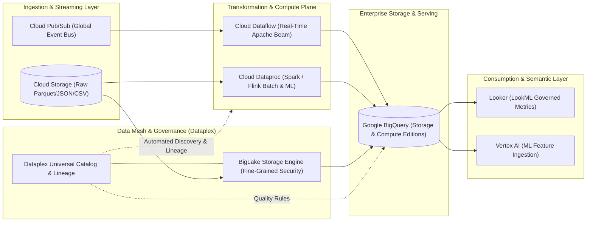

# GCP Analytics & Big Data Hub 📊

Google Cloud provides an industry-leading, petabyte-to-exabyte scale data analytics platform. Engineered around distributed systems innovations born at Google (Dremel, MillWheel, Flume, Colossus, Borg), Google Cloud Analytics decouples storage from compute, automates streaming ingestion, enforces enterprise data mesh governance, and exposes governed semantic metrics for business intelligence.

---

## Service Catalog & Architecture Map

| Service                    | Category                               | Core Architecture & Primary Engine                                                                                       | Reference Guide                                       |
| :------------------------- | :------------------------------------- | :----------------------------------------------------------------------------------------------------------------------- | :---------------------------------------------------- |
| **BigQuery**               | Serverless Enterprise Data Warehouse   | Dremel execution engine, Capacitor columnar storage on Colossus, BI Engine, and BigLake multi-cloud storage abstraction. | [[GCP/databases/bigquery\|BigQuery Deep Dive]]        |
| **Cloud Dataflow**         | Unified Streaming & Batch Processing   | Fully managed Apache Beam runner, dynamic work rebalancing, Streaming Engine, and watermarked windowing.                 | [[GCP/analytics/dataflow/README\|Dataflow Deep Dive]] |
| **Cloud Pub/Sub**          | Global Event Streaming Backbone        | Globally distributed Anycast message queue, sharded write-ahead logs, ordering keys, and exactly-once delivery.          | [[GCP/analytics/pubsub/README\|Pub/Sub Deep Dive]]    |
| **Cloud Dataproc**         | Managed Open-Source Big Data           | Ephemeral and long-running clusters for Apache Spark, Hadoop, Flink, and Presto, alongside Dataproc Serverless.          | [[GCP/analytics/dataproc\|Dataproc Deep Dive]]        |
| **Cloud Dataplex**         | Intelligent Data Mesh & Governance     | Universal metadata catalog, automated schema discovery, data quality (AutoDQ), and end-to-end data lineage.              | [[GCP/analytics/dataplex\|Dataplex Deep Dive]]        |
| **Looker & Looker Studio** | Business Intelligence & Semantic Layer | LookML code-based modeling layer, governed metric repositories, real-time SQL generation, and embedded dashboards.       | [[GCP/analytics/looker\|Looker Deep Dive]]            |
| **Cloud Composer**         | Workflow & DAG Orchestration           | Managed Apache Airflow for scheduled ETL/ELT pipelines and dependency coordination across GCP analytics engines.         | [[GCP/analytics/composer\|Cloud Composer Deep Dive]]  |

---

## The Modern Google Cloud Data Architecture

### 1. Dataflow vs Dataproc

- **Cloud Dataflow (Serverless Beam):** Preferred for **unified streaming and batch pipelines** using Apache Beam. Features zero infrastructure tuning, dynamic autoscaling, liquid work rebalancing, and millisecond-level windowing semantics.
- **Cloud Dataproc (Spark/Hadoop):** Preferred for **migrating legacy open-source big data ecosystems** (existing Spark, Hive, Presto, or Flink codebases). Supports ephemeral on-demand clusters and Dataproc Serverless.

### 2. BigLake: Unifying Data Lakes and Data Warehouses

BigLake abstracts storage formats (Parquet, ORC, Avro, Iceberg) residing in Cloud Storage, AWS S3, or Azure Blob Storage, allowing BigQuery and Spark to query external objects with table-level, row-level, and column-level access controls without copying data.

---

## Related Knowledge Hubs

- [[GCP]] — Master Google Cloud Platform architectural catalog
- [[GCP/databases/cloud-sql|Cloud SQL]] — Relational OLTP database source for ETL extraction
- [[GCP/databases/bigtable/README|Cloud Bigtable]] — Petabyte-scale operational NoSQL wide-column database
- [[AWS/analytics/README|AWS Analytics Comparison]] — Architectural comparison with AWS Redshift, EMR, and Glue
