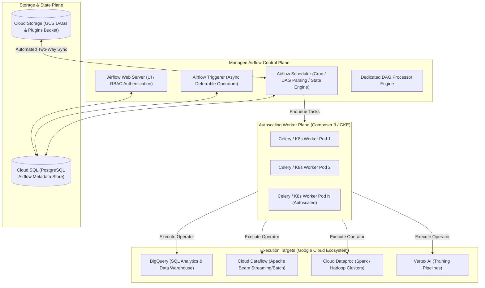

# Cloud Composer Architecture & Apache Airflow Orchestration 🎼

Google Cloud Composer is a fully managed workflow orchestration service built on open-source **Apache Airflow**. It coordinates complex multi-system data pipelines, ETL/ELT batch processing, and machine learning workflows across Google Cloud (BigQuery, Dataflow, Dataproc, Cloud Storage) and external on-premises or hybrid platforms without requiring infrastructure management.

---

## Architecture & Mental Model



### 1. The Composer 3 Architecture Evolution

- **Composer 1 & 2 (GKE-Bound):** Operated on customer-visible GKE clusters. Customers had to configure worker machine shapes, node pools, and manage underlying Kubernetes resource constraints.
- **Composer 3 (Modern Consumption Architecture):** Decouples Airflow completely from customer cluster management. Infrastructure is provisioned in Google-managed serverless worker pools and metered using **Data Processing Units (DCUs)**, representing combined vCPU, memory, and ephemeral storage. Workers scale automatically from zero based on task queue depth.

### 2. DAG Synchronization via Cloud Storage

Every Composer environment is paired with a dedicated [[GCP/storage/gcs\|Cloud Storage bucket]]. When data engineers commit DAG files (`.py`), plugins, or SQL scripts to `gs://<BUCKET_NAME>/dags/`, Google Cloud's background synchronization daemon automatically synchronizes the files to all schedulers, workers, and web servers within 30 to 60 seconds.

---

## Deep Core Concepts & Pipeline Mechanics

### 1. Native GCP Operators vs Bash/Python Scripts

Cloud Composer bundles pre-installed Google Cloud Provider packages (`apache-airflow-providers-google`). Instead of invoking custom Python scripts with `gcloud` or REST requests, pipelines utilize declarative native operators:

- `BigQueryInsertJobOperator`: Submits parameterized SQL queries, extracts, or partition loads into [[GCP/databases/bigquery\|BigQuery]].
- `DataprocCreateBatchOperator`: Provisions ephemeral serverless Spark jobs on [[GCP/analytics/dataproc\|Dataproc Serverless]].
- `CloudDataflowCreatePythonJobOperator`: Deploys streaming or batch pipelines to [[GCP/analytics/dataflow/README\|Cloud Dataflow]].

### 2. Asynchronous Deferrable Operators (Triggerer)

Standard Airflow sensors (e.g. `GCSObjectExistenceSensor`) occupy an entire worker slot while actively polling for a file to appear, idling expensive compute resources. Composer leverages the **Airflow Triggerer** and deferrable operators:

- When a task waits for an external event (e.g., waiting for a BigQuery table partition or file in GCS), the task yields its worker slot and enters a lightweight async event loop in the Triggerer.
- The worker is immediately freed to process other computational tasks, drastically reducing cluster sizing.

### 3. Centralized Secret Management

Instead of storing sensitive database credentials or API keys in Airflow's metadata database, Composer integrates natively with [[GCP/security/scc\|Secret Manager]]. Configuring the Airflow Secret Backend automatically redirects `Airflow Connections` and `Variables` lookups to Secret Manager secrets formatted as `airflow-connections-<conn_id>`.

---

## Production `gcloud` CLI Operations

### 1. Creating a Production Composer 3 Environment

```bash
# Create a high-availability Composer 3 environment with autoscaling workers
gcloud composer environments create prod-composer-pipeline \
  --location=us-central1 \
  --image-version=composer-3-airflow-2.9.3 \
  --service-account="composer-worker-sa@my-prod-project.iam.gserviceaccount.com" \
  --scheduler-count=2 \
  --scheduler-cpu=1.5 \
  --scheduler-memory=4GB \
  --scheduler-storage=2GB \
  --min-workers=2 \
  --max-workers=10 \
  --worker-cpu=2 \
  --worker-memory=8GB \
  --worker-storage=5GB \
  --project=my-prod-project
```

### 2. Deploying DAGs to the Cloud Storage Bucket

```bash
# Upload and synchronize a local DAG directory to the Composer environment
gcloud composer environments storage dags import \
  --environment=prod-composer-pipeline \
  --location=us-central1 \
  --source="dags/finance_etl_daily.py" \
  --project=my-prod-project
```

### 3. Triggering and Monitoring a DAG Run

```bash
# Trigger an immediate manual run of a specific DAG
gcloud composer environments run prod-composer-pipeline \
  --location=us-central1 \
  dags trigger -- finance_etl_daily \
  --conf='{"backfill_date": "2026-10-01"}'

# Check task state and failure logs via the Airflow CLI
gcloud composer environments run prod-composer-pipeline \
  --location=us-central1 \
  tasks states-for-dag-run -- finance_etl_daily 2026-10-01
```

---

## Quotas, Performance, and Configuration Limits

| Resource / Parameter                     | Default Quota / Architectural Limit                  | Mitigation & Scaling Strategy                                                                                      |
| :--------------------------------------- | :--------------------------------------------------- | :----------------------------------------------------------------------------------------------------------------- |
| **Max Concurrent Tasks per Environment** | Defaults to worker scaling range (e.g. 50–200 tasks) | Tune `celery.worker_concurrency` and increase `--max-workers`.                                                     |
| **DAG Parse Time Hard Limit**            | **30 seconds** default timeout per DAG file          | Keep top-level Python code pure; never execute database queries or API calls outside operator `execute()` methods. |
| **Metadata Database Storage**            | Starts at 10 GB; auto-expands up to 3 TB             | Regularly run Airflow metadata cleanup DAGs to purge old `log`, `task_instance`, and `dag_run` rows.               |
| **GCS DAG Sync Latency**                 | **30 to 60 seconds** propagation delay               | Avoid rapid consecutive imports; verify DAG synchronization before triggering test runs.                           |

---

## Official References & Documentation

- [Google Cloud Composer Documentation](https://cloud.google.com/composer/docs)
- [Composer 3 Architecture Overview](https://cloud.google.com/composer/docs/composer-3/architecture-overview)
- [Airflow Deferrable Operators on Composer](https://cloud.google.com/composer/docs/how-to/using/deferrable-operators)
- [Cloud Composer Pricing Structure (DCU Model)](https://cloud.google.com/composer/pricing)

---

## Realistic Pricing Scenarios

### Scenario 1: Mid-Sized Enterprise Data Orchestration (Composer 3)

- **Workload:** Daily ETL batch pipeline orchestrating 100 BigQuery jobs and 20 Dataproc transformations.
  - Schedulers & Web Server: 2 schedulers (1.5 vCPU, 4 GB RAM each) + 1 web server running 24/7.
  - Workers: Scaled down to 0 during off-hours (18 hours/day); autoscaled to 4 workers (2 vCPU, 8 GB RAM each) during the 6-hour morning ETL window.
- **Cost Calculation:**
  - Control plane baseline (Schedulers + Web + Cloud SQL metadata): ~$180.00 / month.
  - Compute DCU consumption during 6-hour batch window: $4 \text{ workers} \times 6\text{ hrs} \times 30\text{ days} \times \$0.045 / \text{DCU-hr} = \mathbf{\$32.40}$
  - Storage & Cloud Logging: $\mathbf{\$15.00}$
  - **Total Estimated Monthly Spend:** **~$227.40 / month**

### Scenario 2: Continuous 24/7 Machine Learning & Streaming Orchestrator

- **Workload:** Continuous 24/7 operations running hourly feature store pipelines and continuous stream monitors.
  - Schedulers: 3 high-availability schedulers.
  - Constant worker baseline: 4 workers running continuously (730 hours/month).
- **Cost Calculation:**
  - Continuous DCU allocation (Control plane + Workers): ~$650.00 / month.
  - Cloud SQL Metadata DB (100 GB storage): $\mathbf{\$25.00}$
  - GCS Bucket & Cross-Zone Data Egress: $\mathbf{\$40.00}$
  - **Total Estimated Monthly Spend:** **~$715.00 / month**

---

## Battle-Tested Nuggets & Production Gotchas

1. **Top-Level Code Execution Overhead:**
   In Apache Airflow, the scheduler repeatedly parses every `.py` file in the DAG directory every few seconds. If a DAG file contains top-level code (e.g. connecting to BigQuery, calling `Variable.get()`, or initializing heavy external libraries outside an operator's `execute()` method), **the scheduler will execute that code on every parsing loop**. This causes scheduler CPU saturation, database connection exhaustion, and delayed task scheduling. Always place API and database calls inside operator execution blocks.
2. **The Metadata Database Bloat Disaster:**
   Airflow stores the state of every task instance, XCom payload, and log pointer in its internal Cloud SQL PostgreSQL database. In high-frequency pipelines (e.g., tasks running every minute), the `task_instance` and `xcom` tables swell to millions of rows, slowing down scheduler queries and crashing the web server. Deploy an automated maintenance DAG (such as `airflow-db-cleanup`) to permanently purge records older than 30 days.
3. **Never Pass Large Datasets via XCom:**
   Airflow XCom (Cross-Communication) is engineered for lightweight task orchestration metadata (e.g., passing a job ID, a timestamp, or an S3/GCS URI). Attempting to pass a 20 MB Pandas DataFrame or JSON list through XCom will bloat the PostgreSQL metadata database and trigger memory exhaustion in worker pods. Write intermediate data to [[GCP/storage/gcs\|GCS]] or [[GCP/databases/bigquery\|BigQuery]] and pass only the storage reference via XCom.
4. **Composer 2 vs Composer 3 GKE Node Maintenance:**
   In Composer 2, underlying GKE nodes were managed in the user's project. When Google initiated automated GKE node pool upgrades, worker pods were evicted, causing running tasks to terminate abruptly with `Task exited with return code -9`. Composer 3 completely eliminates this operational headache by decoupling worker execution into an abstracted, managed serverless pool with resilient task migration.
5. **Private IP Composer & Cloud SQL Proxy Routing:**
   When provisioning a Private IP Composer environment, workers reside in an internal VPC. To connect to private Cloud SQL or on-premises databases, the Composer tenant network must be peered with your VPC with custom routes exported. If route exportation is disabled, tasks attempting to connect to private database endpoints fail with `Connection timed out: 10.x.x.x:5432`.

---

## Across the wiki

- [[GCP/analytics/README|GCP Analytics Hub]] — Big data and analytics architecture
- [[GCP/application-integration/workflows|Workflows Architecture]] — Serverless, sub-second API orchestration alternative
- [[GCP/analytics/dataproc|Dataproc Architecture]] — Managed Spark/Hadoop clusters orchestrated by Composer
- [[GCP/analytics/dataflow/README|Cloud Dataflow Deep Dive]] — Managed Apache Beam runner
- [[GCP/databases/bigquery|Google BigQuery]] — Primary destination and query engine for Composer pipelines
- [[AWS/analytics/glue/README|AWS Glue & Managed Airflow Comparison]] — Comparison with Amazon MWAA
