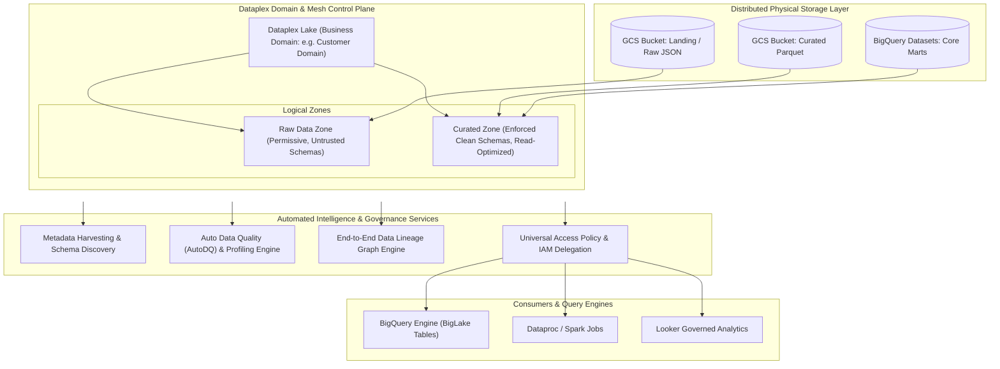

# Dataplex Architecture & Enterprise Data Mesh Governance 🌐

Google Cloud Dataplex is an intelligent data fabric and governance platform designed to implement the **Data Mesh** architectural pattern at enterprise scale. It unifies decentralized data distributed across Cloud Storage buckets, BigQuery datasets, and third-party data lakes into logically organized domains (Lakes and Zones) while automating schema discovery, metadata cataloging, data quality validation, and end-to-end data lineage.

---

## Architecture & Mental Model



Dataplex separates **logical domain organization** from **physical storage locations**:

- **Data Lake:** Represents a high-level business domain (e.g., `sales-domain`, `supply-chain-lake`).
- **Data Zone:** Logical groupings within a Lake representing data maturity:
  - **Raw Zone:** Holds raw, semi-structured, or landing files (JSON, CSV, Avro). Permissive schema changes are tolerated.
  - **Curated Zone:** Holds cleansed, transformed, read-optimized data (Parquet, ORC, BigQuery native tables). Strict schemas and partition requirements are enforced.
- **Asset:** Maps physical storage resources ([[GCP/storage/gcs\|GCS buckets]] or [[GCP/databases/bigquery\|BigQuery datasets]]) into a Zone without physically moving data.

---

## Deep Core Concepts & Governance Engines

### 1. Automated Schema Discovery & Discovery Jobs

Dataplex continuously crawls attached Cloud Storage assets using lightweight serverless discovery runners:

- When new Parquet or CSV files arrive in GCS, Dataplex automatically detects partitions (e.g. `/year=2026/month=10/`), infers schema structures, and registers **external BigQuery tables** or BigLake tables automatically.
- Data analysts can immediately query raw GCS files in BigQuery using standard SQL without writing manual `CREATE EXTERNAL TABLE` statements.

### 2. Auto Data Quality (AutoDQ)

Dataplex provides declarative, serverless data quality evaluation:

- Engineers define YAML rules validating row-level assertions (e.g. `completeness`, `uniqueness`, `null_check`, `range_check`, `regex_match`).
- Dataplex compiles rules into SQL queries executed directly inside [[GCP/databases/bigquery\|BigQuery]], writing validation metrics to Cloud Monitoring and alerting data engineers to corrupt data pipelines.

### 3. Automated End-to-End Data Lineage

Dataplex captures operational transformation lineage out of the box:

- Automatically tracks table dependencies generated by BigQuery SQL transformations, [[GCP/analytics/dataflow/README\|Cloud Dataflow (Beam)]] pipelines, and [[GCP/analytics/dataproc\|Dataproc (Spark)]] jobs.
- Visualizes the complete graph from source bucket $\to$ staging table $\to$ aggregation view $\to$ downstream [[GCP/analytics/looker\|Looker]] dashboards.

---

## Production `gcloud` CLI Operations

### 1. Creating a Dataplex Lake and Raw Zone

```bash
# 1. Create a Dataplex Lake for the Financial Analytics domain
gcloud dataplex lakes create finance-lake \
  --location=us-central1 \
  --display-name="Finance Domain Data Lake" \
  --project=my-prod-project

# 2. Create a Raw Zone within the Lake with automatic discovery enabled
gcloud dataplex zones create raw-transactions-zone \
  --lake=finance-lake \
  --location=us-central1 \
  --type=RAW \
  --resource-location-type=SINGLE_REGION \
  --discovery-enabled \
  --discovery-schedule="0 */6 * * *" \
  --project=my-prod-project
```

### 2. Attaching a Cloud Storage Bucket as an Asset

```bash
# Attach a GCS bucket into the raw data zone
gcloud dataplex assets create raw-invoices-asset \
  --lake=finance-lake \
  --zone=raw-transactions-zone \
  --location=us-central1 \
  --resource-type=STORAGE_BUCKET \
  --resource-name="projects/my-prod-project/buckets/prod-finance-raw-invoices" \
  --project=my-prod-project
```

### 3. Deploying an Auto Data Quality Task

Create a data quality specification file `dq-rules.yaml`:

```yaml
rules:
  - column: transaction_id
    dimension: COMPLETENESS
    nonNullExpectation: {}
  - column: amount
    dimension: VALIDITY
    rangeExpectation:
      minValue: 0.01
```

Submit the quality task via `gcloud`:

```bash
gcloud dataplex data-quality-scans create finance-tx-scan \
  --location=us-central1 \
  --data-scan-spec-file=dq-rules.yaml \
  --data-scan-data="projects/my-prod-project/datasets/finance/tables/transactions" \
  --project=my-prod-project
```

---

## Quotas, Performance, and Configuration Limits

| Resource / Parameter         | Default Quota / Architectural Limit | Operational Guidance                                                                    |
| :--------------------------- | :---------------------------------- | :-------------------------------------------------------------------------------------- |
| **Max Lakes per Project**    | **50 Lakes** per region             | Aggregate by major corporate business domains (e.g. Sales, Marketing, Core Banking).    |
| **Max Zones per Lake**       | **1,000 Zones** per Lake            | Typically structured by data lifecycle (Raw, Cleansed, Curated, Feature Store).         |
| **Max Assets per Zone**      | **300 Assets** per Zone             | Consolidate storage buckets before attaching to prevent asset fragmentation.            |
| **Discovery Scan Frequency** | Configurable from hourly to daily   | Set discovery intervals based on ingestion cadence to avoid redundant crawling compute. |

---

## Official References & Documentation

- [Google Cloud Dataplex Official Documentation](https://cloud.google.com/dataplex/docs)
- [Dataplex Data Mesh Architecture Guide](https://cloud.google.com/dataplex/docs/data-mesh-overview)
- [Auto Data Quality (AutoDQ) Documentation](https://cloud.google.com/dataplex/docs/data-quality-overview)
- [Dataplex Pricing Structure](https://cloud.google.com/dataplex/pricing)

---

## Realistic Pricing Scenarios

### Scenario 1: Enterprise Data Mesh Discovery & Cataloging

- **Workload:** Enterprise managing 50 GCS buckets and 100 BigQuery datasets across 5 Dataplex Lakes.
  - Automated schema discovery scanning new data daily.
  - Technical metadata harvesting: 500,000 registered schema entities.
- **Cost Calculation:**
  - Standard discovery processing: Covered under standard Data Compute Units (DCUs) baseline (~$25.00/month).
  - Enriched custom metadata storage (Business glossary, tags, custom aspects): First 1,000,000 attributes free $\to \mathbf{\$0.00}$.
  - Cloud Monitoring metrics & lineage logging: $\mathbf{\$15.00}$.
  - **Total Estimated Monthly Spend:** **~$40.00 / month**

### Scenario 2: Automated Production Data Quality Scans

- **Workload:** Critical financial data warehouse executing hourly AutoDQ scans across 20 high-value BigQuery tables (verifying row validity, foreign key relationships, and null percentages).
  - Scans consume 4 DCU-hours per day ($0.089 / DCU-hour).
  - BigQuery query engine evaluation compute: $5.00/TB (scans optimized via BigQuery partition filtering).
- **Cost Calculation:**
  - Dataplex Premium Processing: $4 \text{ DCU-hrs/day} \times 30\text{ days} \times \$0.089 = \mathbf{\$10.68}$
  - BigQuery analysis scan slots: $\mathbf{\$35.00}$
  - Automated alerting and dashboard sinks: $\mathbf{\$5.00}$
  - **Total Estimated Monthly Spend:** **~$50.68 / month**

---

## Battle-Tested Nuggets & Production Gotchas

1. **The Recursive GCS Directory Schema Collision:**
   When Dataplex crawls a Cloud Storage bucket, it infers table structures based on directory hierarchies. If a bucket contains mixed data formats (e.g., both CSV and Parquet files in the same subfolder) or inconsistent partition naming schemes (e.g. `/2026-10-15/` vs `/date=2026-10-15/`), discovery will either fail or register multiple duplicate, conflicting BigQuery external tables. Enforce strict directory naming conventions in your ingestion pipelines.
2. **AutoDQ BigQuery Compute Charges:**
   Dataplex Auto Data Quality rules execute SQL queries directly against your underlying BigQuery tables. Running complex validation rules (like full table scans evaluating regex or distinct counts) every hour against multi-terabyte unpartitioned tables will incur significant BigQuery on-demand analysis fees ($5.00/TB). **Always scope AutoDQ rules to recent partitions** using `row_filter: "date = CURRENT_DATE()"`.
3. **Asset Deletion Does Not Delete Data:**
   Deleting a Dataplex Asset, Zone, or Lake is purely a logical metadata operation. It removes the governance wrapper, discovery tasks, and catalog bindings, but **does not delete the underlying Cloud Storage bucket or BigQuery tables**. This safety guardrail prevents accidental data loss during governance refactoring.
4. **Data Lineage IAM Permissions Dependency:**
   To view end-to-end lineage graphs in the Dataplex UI, developers must possess both `roles/dataplex.viewer` and `roles/datalineage.viewer`. If the Data Lineage API (`datalineage.googleapis.com`) is not explicitly enabled in your Google Cloud project before running BigQuery jobs, lineage edges will not be generated retroactively.
5. **BigLake Storage Policy Delegation:**
   When managing data access through Dataplex, platform teams often configure BigLake table access. Users querying BigLake tables need `roles/bigquery.admin` or `roles/bigquery.dataViewer` on BigQuery, but do **not** need read permissions on the raw GCS bucket. Granting direct GCS `storage.objectViewer` bypasses Dataplex security controls and column-level masking rules.

---

## Across the wiki

- [[GCP/analytics/README|GCP Analytics Hub]] — Big data and analytics architectures on Google Cloud
- [[GCP/databases/bigquery|Google BigQuery]] — Enterprise data warehouse governed by Dataplex
- [[GCP/analytics/dataproc|Dataproc Deep Dive]] — Spark analytics processing within Dataplex zones
- [[GCP/analytics/looker|Looker Deep Dive]] — Governed business intelligence consuming Dataplex catalogs
- [[AWS/analytics/lake-formation/README|AWS Lake Formation Comparison]] — Architectural comparison with AWS governance
