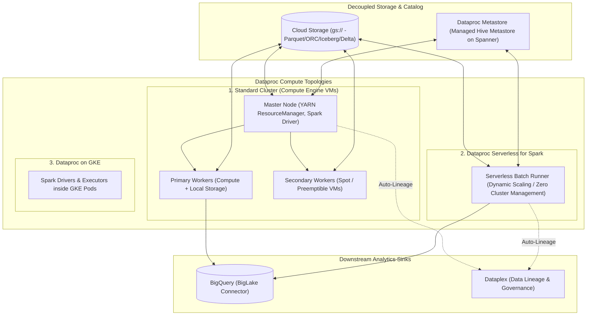

# Dataproc Architecture & Apache Spark Supercomputing ⚡

Google Cloud Dataproc is a fully managed service for executing open-source data processing engines, including **Apache Spark**, **Apache Hadoop**, **Presto / Trino**, and **Apache Flink**. Dataproc decouples storage from compute by executing over Cloud Storage (`gs://`) instead of HDFS, enabling fast ephemeral cluster provisioning (under 90 seconds), automated autoscaling, and fully serverless batch execution.

---

## Architecture & Mental Model



Dataproc revolutionizes legacy Hadoop architectures by replacing the rigid, co-located Hadoop Distributed File System (HDFS) with **Cloud Storage Connector (`gcs-connector`)**. Because data resides permanently in GCS, clusters become stateless and **ephemeral**: an entire 100-node cluster can be spun up in 90 seconds, execute an intensive Spark job, and be deleted immediately, eliminating idle compute expenses.

---

## Deep Core Concepts & Operational Topologies

### 1. Compute Topologies: GCE vs Serverless vs GKE

- **Dataproc on Compute Engine (Standard):** Full control over OS, kernel parameters, Hadoop ecosystem components (Hive, Pig, Presto, Ranger, Zeppelin), and local SSD RAID configurations.
- **Dataproc Serverless for Spark:** Eliminates cluster sizing and maintenance entirely. Developers submit Spark code (`.py`, `.jar`, `.sql`); Google Cloud automatically provisions, scales, and terminates the underlying infrastructure per batch execution, billing strictly by execution seconds.
- **Dataproc on GKE:** Deploys Spark workloads inside existing [[GCP/compute/gke\|GKE]] clusters, consolidating data engineering workloads onto shared corporate Kubernetes infrastructure.

### 2. Primary Workers vs Secondary (Spot) Workers

- **Primary Workers:** Run YARN NodeManagers and participate in HDFS storage. They must remain stable to prevent data corruption.
- **Secondary Workers:** Pure compute nodes that execute Spark executor tasks but do _not_ host HDFS data. They can be provisioned using **Spot VMs** (at 60–91% discounts). If a Spot secondary worker is preempted, YARN simply reschedules the affected task on another worker without cluster failure.

### 3. Graceful Decommissioning & Autoscaling Policies

When an autoscaling policy decides to downscale a cluster during declining load, Dataproc executes **Graceful Decommissioning**:

- The master node stops assigning new tasks to target workers.
- The system waits for active Spark tasks and shuffle stage data to complete (up to a configured timeout, e.g. 1 hour) before deleting the VM, preventing job crashes caused by missing shuffle data (`FetchFailedException`).

---

## Production `gcloud` CLI Operations

### 1. Provisioning a Production Ephemeral Cluster with Spot Workers

```bash
# Create an autoscaling Dataproc cluster using 2 Primary and 8 Spot Secondary workers
gcloud dataproc clusters create analytics-spark-cluster \
  --region=us-central1 \
  --zone=us-central1-a \
  --master-machine-type=n2-standard-4 \
  --master-boot-disk-size=100GB \
  --worker-machine-type=n2-standard-8 \
  --worker-boot-disk-size=200GB \
  --num-workers=2 \
  --num-secondary-workers=8 \
  --secondary-worker-type=spot \
  --image-version=2.2-debian12 \
  --enable-component-gateway \
  --optional-components=JUPYTER,PRESTO \
  --properties="spark:spark.dynamicAllocation.enabled=true" \
  --project=my-prod-project
```

### 2. Submitting a PySpark Job to a Running Cluster

```bash
# Submit a Spark SQL transformation reading from GCS and writing to BigQuery
gcloud dataproc jobs submit pyspark gs://my-spark-jobs/transforms/etl_customers.py \
  --cluster=analytics-spark-cluster \
  --region=us-central1 \
  --jars=gs://spark-lib/bigquery/spark-bigquery-latest_2.12.jar \
  -- --input=gs://raw-data-lake/customers/*.parquet --output_table=my-prod-project:curated_analytics.customers
```

### 3. Executing a Dataproc Serverless Spark Batch (Zero Cluster)

```bash
# Submit a serverless PySpark batch job without provisioning any cluster
gcloud dataproc batches submit pyspark gs://my-spark-jobs/ml/train_xgboost.py \
  --region=us-central1 \
  --batch=batch-xgboost-run-001 \
  --deps-bucket=gs://my-spark-staging-bucket \
  --service-account="dataproc-runner@my-prod-project.iam.gserviceaccount.com" \
  --project=my-prod-project
```

---

## Quotas, Performance, and Configuration Limits

| Resource / Parameter          | Default Quota / Architectural Limit                    | Operational Guidance                                                                                        |
| :---------------------------- | :----------------------------------------------------- | :---------------------------------------------------------------------------------------------------------- |
| **Dataproc Management Fee**   | **$0.010 per vCPU-hour** (in addition to GCE VM costs) | Ephemeral cluster design keeps management fees low by deleting clusters immediately after run completion.   |
| **Compute Engine vCPU Quota** | Bound by project regional Compute Engine vCPU quotas   | Request regional `CPUs (all regions)` and `N2 CPUs` increases before deploying large clusters (100+ nodes). |
| **GCS Connector Throughput**  | Multi-gigabyte/sec aggregate throughput                | Ensure workers use high-bandwidth VM shapes (e.g. `n2-standard-8` or higher) to saturate NIC buffers.       |
| **Shuffle Data Capacity**     | Bound by local worker Persistent Disk / Local SSD      | Attach Local NVMe SSDs (`--num-worker-local-ssds=1`) for shuffle-heavy Spark jobs (large joins/group-bys).  |

---

## Official References & Documentation

- [Google Cloud Dataproc Official Documentation](https://cloud.google.com/dataproc/docs)
- [Dataproc Serverless for Spark Overview](https://cloud.google.com/dataproc-serverless/docs)
- [Dataproc Autoscaling Policies](https://cloud.google.com/dataproc/docs/concepts/configuring-clusters/autoscaling)
- [Dataproc Metastore Architecture](https://cloud.google.com/dataproc-metastore/docs)

---

## Realistic Pricing Scenarios

### Scenario 1: Ephemeral Batch ETL Spark Cluster

- **Workload:** Daily 2-hour financial reconciliation running across 1 Master (`n2-standard-4`), 2 Primary Workers (`n2-standard-8`), and 8 Spot Secondary Workers (`n2-standard-8`).
  - Total vCPUs: $4 + (2 \times 8) + (8 \times 8) = 84\text{ vCPUs}$.
  - Daily runtime: 2 hours (60 hours/month).
- **Cost Calculation:**
  - Master & Primary VMs ($20\text{ vCPUs}$ on-demand): $20 \times \$0.0488 \times 60 = \mathbf{\$58.56}$
  - Spot Secondary VMs ($64\text{ vCPUs}$ @ 75% discount): $64 \times \$0.0122 \times 60 = \mathbf{\$46.85}$
  - Dataproc Management Surcharge ($84\text{ vCPUs} \times \$0.010/hr \times 60$): $\mathbf{\$50.40}$
  - Persistent Disks (1.8 TB standard): $\mathbf{\$12.00}$
  - **Total Estimated Monthly Spend:** **~$167.81 / month**

### Scenario 2: Dataproc Serverless Continuous Processing

- **Workload:** Event stream transformation jobs executing serverlessly on Dataproc Serverless for 8 hours/day.
  - Consumes an average of 16 Data Compute Units (DCUs, $0.05/DCU-hr).
  - Monthly runtime: $8\text{ hrs/day} \times 30\text{ days} = 240\text{ hours}$.
- **Cost Calculation:**
  - Serverless DCU cost: $16 \text{ DCUs} \times 240\text{ hrs} \times \$0.05 / \text{DCU-hr} = \mathbf{\$192.00}$
  - Cloud Storage temporary shuffle data & Cloud Logging: $\mathbf{\$28.00}$
  - **Total Estimated Monthly Spend:** **~$220.00 / month**

---

## Battle-Tested Nuggets & Production Gotchas

1. **The HDFS Persistent Cluster Trap:**
   Engineers migrating from on-premises Cloudera or Hortonworks clusters frequently leave Dataproc clusters running 24/7 with data stored in HDFS. This incurs massive Compute Engine and management fee charges for idle VMs. **Always migrate data to [[GCP/storage/gcs\|Cloud Storage]] (`gs://`)** and deploy ephemeral clusters triggered via [[GCP/analytics/composer\|Cloud Composer]] or switch to Dataproc Serverless.
2. **Shuffle Spill to Disk & IOPS Bottlenecks:**
   In Spark transformations involving massive joins or `groupByKey` operations, executors shuffle intermediate partition data. Standard persistent disks (`pd-standard`) lack sufficient IOPS, causing shuffle stages to stall with `ShuffleFetchFailedException`. For shuffle-intensive workloads, always attach at least one **Local NVMe SSD** to worker nodes (`--num-worker-local-ssds=1`) or configure `pd-ssd`.
3. **Spot Worker Preemption Storms:**
   While secondary Spot workers save up to 90% on compute, running 100% of your worker fleet on Spot VMs is hazardous. If Google Cloud reclaims Spot capacity during high-demand hours, losing all workers simultaneously destroys intermediate shuffle state, causing the entire Spark job to fail. Maintain at least 20–30% of workers as regular Primary VMs to safeguard master coordination and core tasks.
4. **Component Gateway for Zero-Trust Web UIs:**
   Accessing the Spark History Server, YARN ResourceManager, or JupyterLab historically required opening firewall ports or setting up SSH SOCKS5 proxies. Enabling `--enable-component-gateway` creates a secure, Google-managed reverse proxy endpoint authenticated via IAM and OAuth2, allowing browser access directly from the Cloud Console without exposing public IPs.
5. **Dataproc Metastore Cold Start & High Availability:**
   When running ephemeral clusters, re-initializing Hive Metastore tables on cluster boot takes several minutes. Instead of running an on-cluster MySQL Hive metastore, provision a managed **Dataproc Metastore (DPMS)** service. All ephemeral clusters bind to the same central DPMS instance, enabling instant table schema discovery upon boot.

---

## Across the wiki

- [[GCP/analytics/README|GCP Analytics Hub]] — Overview of big data and streaming platforms
- [[GCP/analytics/composer|Cloud Composer Deep Dive]] — Orchestrating Dataproc jobs using Apache Airflow
- [[GCP/databases/bigquery|Google BigQuery]] — Querying Dataproc outputs via BigLake tables
- [[GCP/analytics/dataplex|Dataplex Deep Dive]] — Automated metadata cataloging and data lineage for Spark jobs
- [[AWS/analytics/emr/README|AWS EMR Comparison]] — Architectural comparison with AWS Elastic MapReduce
