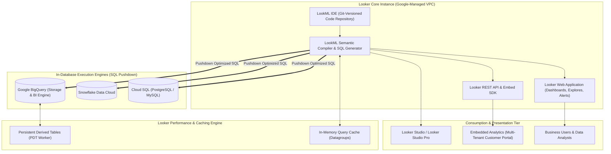
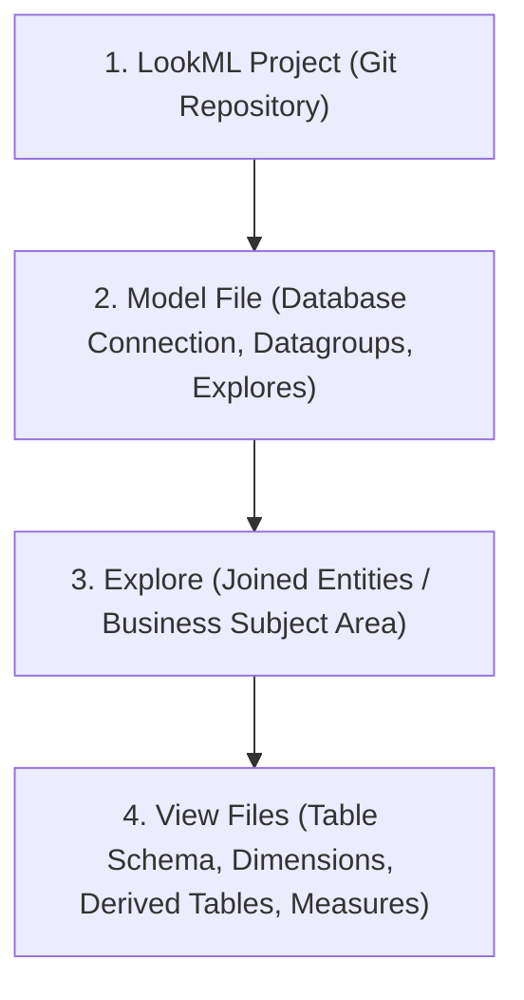

# Looker & Looker Studio Architecture & Semantic Modeling 📈

Looker is Google Cloud's enterprise business intelligence, data application, and embedded analytics platform. Unlike traditional BI tools that extract and cache stale subsets of data into proprietary in-memory cubes, Looker operates on a **100% in-database SQL pushdown architecture** governed by **LookML**—a Git-versioned, declarative modeling language that establishes a single source of truth for organizational business metrics.

---

## Architecture & Mental Model



### 1. In-Database SQL Pushdown vs Data Extraction

Looker eliminates data silos by leaving data inside the underlying analytical warehouse ([[GCP/databases/bigquery\|BigQuery]], Snowflake, Redshift, PostgreSQL). When an analyst drags a dimension or measure onto a canvas, Looker dynamically compiles the LookML model into dialect-specific, mathematically optimized SQL, pushes the query down to the database engine, and streams results directly to the browser.

### 2. Looker (Core) vs Looker Studio (formerly Data Studio)

- **Looker (Core):** Provisioned as a Google-managed infrastructure instance. Features full LookML modeling, Git integration, Persistent Derived Tables, granular row-level access filters, and multi-tenant iframe embedding.
- **Looker Studio:** Free, self-service dashboarding and ad-hoc visualization tool. Can connect directly to BigQuery or consume governed semantic metrics from a Looker instance using the **Looker connector**.
- **Looker Studio Pro:** Enterprise add-on providing workspace governance, team collaboration folders, enterprise SLA, and automated scheduled report distribution.

---

## The LookML Semantic Modeling Hierarchy

LookML enforces a strict four-tier architectural hierarchy:



1. **View:** Maps to an underlying database table or derived query. Defines **Dimensions** (attributes like `country`, `order_date`) and **Measures** (aggregate calculations like `total_revenue`, `average_order_value`, `count_distinct_users`).
2. **Explore:** Defines relational join relationships between Views (e.g. `orders` left-joined to `customers` and `order_items`). Business users interact with Explores without writing raw SQL `JOIN` statements.
3. **Model:** Binds Explores to a specific database connection and configures caching rules (**Datagroups**).
4. **Project:** A Git-tracked repository containing all views, models, dashboards, and documentation files.

---

## Deep Core Concepts & Optimization Engines

### 1. Persistent Derived Tables (PDTs)

When analytical queries require heavy pre-aggregation or complex window transformations, Looker writes intermediate tables back into the database:

- **PDTs:** Looker's background regenerator creates physical scratch tables in BigQuery, materializing transformed results on a schedule or when triggered by underlying table updates (`datagroup_trigger`).
- Subsequent user queries read from the pre-computed PDT in milliseconds rather than recalculating expensive aggregations.

### 2. Aggregate Awareness

Looker's query compiler detects whether an aggregate table exists that can satisfy a user's query:

- If a user requests `total_revenue by month`, and an aggregate table exists at the monthly grain, Looker automatically rewrites the query to hit the summary table rather than scanning billions of raw transaction rows in BigQuery, saving massive compute costs.

---

## Production `gcloud` CLI Operations

### 1. Provisioning a Google-Managed Looker Core Instance

```bash
# Provision a Looker Core instance in us-central1 peered to your private VPC
gcloud looker instances create prod-looker-analytics \
  --location=us-central1 \
  --edition=enterprise \
  --oauth-client-id="123456789-abc.apps.googleusercontent.com" \
  --oauth-client-secret="GOCSPX-secret123" \
  --consumer-network="projects/my-prod-project/global/networks/vpc-prod" \
  --private-ip-enabled \
  --project=my-prod-project
```

### 2. Inspecting Instance Health and URLs

```bash
# Retrieve instance connection URLs and private egress IP
gcloud looker instances describe prod-looker-analytics \
  --location=us-central1 \
  --format="yaml(state,lookerUri,egressPublicIp)" \
  --project=my-prod-project
```

---

## Sample LookML Model Specification

```lookml
# views/order_items.view.lkml
view: order_items {
  sql_table_name: `my-prod-project.curated_analytics.order_items` ;;

  dimension: id {
    primary_key: yes
    type: number
    sql: ${TABLE}.id ;;
  }

  dimension_group: created {
    type: time
    timeframes: [raw, time, date, week, month, quarter, year]
    sql: ${TABLE}.created_at ;;
  }

  dimension: sale_price {
    type: number
    sql: ${TABLE}.sale_price ;;
    value_format_name: usd
  }

  measure: total_revenue {
    type: sum
    sql: ${sale_price} ;;
    value_format_name: usd
    drill_fields: [id, created_date, sale_price]
  }

  measure: average_sale_price {
    type: average
    sql: ${sale_price} ;;
    value_format_name: usd
  }
}
```

---

## Quotas, Performance, and Configuration Limits

| Resource / Parameter                      | Default Quota / Architectural Limit              | Operational Guidance                                                                |
| :---------------------------------------- | :----------------------------------------------- | :---------------------------------------------------------------------------------- |
| **Looker Query Timeout**                  | **30 minutes** (Configurable per connection)     | Optimize slow queries by implementing PDTs or partition pruning in BigQuery.        |
| **Max Concurrent Queries per Connection** | Configurable (Default: 30–75 concurrent threads) | Tune database connection pools to prevent exhausting database worker threads.       |
| **PDT Scratch Schema Storage**            | Bound by BigQuery project storage limits         | Configure expiration intervals on scratch datasets to purge stale materializations. |
| **Looker API Request Rate**               | **1,000 requests per minute**                    | Implement caching in external client applications utilizing the Looker Embed SDK.   |

---

## Official References & Documentation

- [Google Cloud Looker Documentation](https://cloud.google.com/looker/docs)
- [LookML Reference Guide](https://cloud.google.com/looker/docs/lookml-quick-reference)
- [Persistent Derived Tables (PDTs) Architecture](https://cloud.google.com/looker/docs/derived-tables)
- [Looker Core Pricing & Editions](https://cloud.google.com/looker/pricing)

---

## Realistic Pricing Scenarios

### Scenario 1: Enterprise Self-Service Analytics on Looker Core

- **Workload:** 150 business analysts querying 500 GB of daily transactional data in BigQuery via Looker Core Enterprise Edition.
- **Cost Calculation:**
  - Looker Core Enterprise Platform License: ~$3,000 / month (includes managed Google Cloud infrastructure instance).
  - User Licenses: 20 Developers ($125/mo) + 130 Standard Users ($60/mo) = $2,500 + $7,800 = $\mathbf{\$10,300.00}$.
  - BigQuery analysis queries optimized via Looker Aggregate Awareness: $\mathbf{\$350.00}$.
  - **Total Estimated Monthly Spend:** **~$13,650.00 / month**

### Scenario 2: Startup Dashboarding via Looker Studio & BigQuery BI Engine

- **Workload:** 10 marketing dashboards queried by 50 internal team members using free Looker Studio connected to BigQuery with BI Engine in-memory acceleration (10 GB cache).
- **Cost Calculation:**
  - Looker Studio Dashboarding: **$0.00** (Free Tier).
  - BigQuery BI Engine Reservation (10 GB RAM @ ~$0.04/GB-hr): $10 \times 730\text{ hrs} \times \$0.0416 = \mathbf{\$30.37}$.
  - BigQuery raw storage (1 TB active): $\mathbf{\$20.00}$.
  - **Total Estimated Monthly Spend:** **~$50.37 / month**

---

## Battle-Tested Nuggets & Production Gotchas

1. **The In-Database Fanout Problem (Symmetric Aggregates):**
   When joining a one-to-many relationship (e.g. `orders` to `order_items`), traditional SQL sums duplicate the parent order amount for every child item, resulting in inflated financial numbers. Looker solves this using **Symmetric Aggregates**, which tracks the primary key of each entity and uses hashing functions to ensure amounts are summed exactly once. If a view lacks an explicit `primary_key: yes` on a dimension, Symmetric Aggregates will fail, producing incorrect metrics.
2. **PDT Scratch Schema Permissions:**
   Looker builds Persistent Derived Tables by creating and dropping tables in a dedicated scratch schema (e.g. `looker_scratch`). If the database user configured in the Looker connection lacks `CREATE TABLE`, `DROP TABLE`, or BigQuery `roles/bigquery.dataEditor` permissions on that specific scratch dataset, all PDT generation will abort with `Access Denied`, causing queries relying on materialized tables to stall.
3. **Datagroup Cache Invalidation Alignment:**
   A common mistake is setting Looker cache timeouts to a fixed time (e.g. `max_cache_age: "2 hours"`) when underlying data is updated by ETL pipelines. If the ETL completes at 2:05 AM, users may see stale data until 4:00 AM. Always configure **Datagroups** with `sql_trigger`:
   ```lookML
   datagroup: etl_datagroup {
     sql_trigger: SELECT MAX(completed_at) FROM `my-project.analytics.etl_log` ;;
     max_cache_age: "24 hours"
   }
   ```
   This flushes the Looker cache instantly when new data loads.
4. **Git Branch Merging & Production Release Discipline:**
   Looker features a dedicated Development Mode. When multiple developers write LookML simultaneously, merging branches without strict Git peer review can introduce syntax errors that immediately break Explores for all business users. Always enforce Git pull requests with automated LookML linting (`look-at-me-sideways` / LAMS) before merging to master.
5. **Private IP Looker & Reverse Proxy Requirements:**
   When provisioning a Private IP Looker Core instance, Looker resides in an internal Google tenant VPC. It cannot resolve on-premises hostnames or connect across complex hybrid VPNs without Cloud DNS Peering and explicit Route advertisements. Ensure your VPC network is configured with exported custom routes before attempting database connection tests.

---

## Across the wiki

- [[GCP/analytics/README|GCP Analytics Hub]] — Overview of Google Cloud data systems
- [[GCP/databases/bigquery|Google BigQuery]] — High-performance storage and compute engine for Looker
- [[GCP/analytics/dataplex|Dataplex Architecture]] — Enterprise data mesh governance and catalog
- [[GCP/analytics/composer|Cloud Composer Deep Dive]] — Orchestrating data pipelines that trigger Looker datagroups
- [[AWS/analytics/lakehouse-and-bi|AWS Lakehouse & BI Comparison]] — Comparison with AWS analytics and QuickSight patterns
