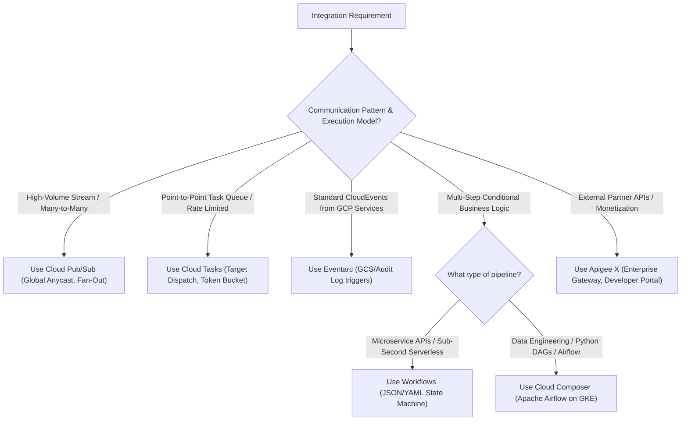

# GCP Application Integration & Eventing Hub 🔌

Modern cloud-native architectures require decoupled asynchronous communication, event-driven triggers, durable workflow state machines, and enterprise API gateways. This hub details Google Cloud's application integration portfolio, enabling resilient microservice topologies and event routing across cloud boundaries.

---

## Service Catalog & Architecture Map

| Service            | Architecture & Protocol Pattern            | Primary Use Case & Guarantees                                                                                                   | Reference Guide                                                    |
| :----------------- | :----------------------------------------- | :------------------------------------------------------------------------------------------------------------------------------ | :----------------------------------------------------------------- |
| **Cloud Tasks**    | Asynchronous HTTP Dispatch / Push Queue    | Point-to-point task queueing, token-bucket rate limiting, automatic backoff retries, and task deduplication.                    | [[GCP/application-integration/cloud-tasks\|Cloud Tasks Deep Dive]] |
| **Workflows**      | Serverless State Machine / JSON & YAML DAG | Low-latency microservice orchestration, long-running stateful workflows (up to 1 year), and built-in connector retries.         | [[GCP/application-integration/workflows\|Workflows Deep Dive]]     |
| **Eventarc**       | CloudEvents Specification Event Router     | Standardized event delivery routing audit logs, GCS mutations, and Pub/Sub events directly to Cloud Run, GKE, or Workflows.     | [[GCP/application-integration/eventarc\|Eventarc Deep Dive]]       |
| **Apigee X**       | Enterprise API Management & Gateway        | Full lifecycle API governance, traffic shaping (spike arrest/quotas), developer portal, monetization, and Cloud Armor security. | [[GCP/application-integration/apigee\|Apigee X Deep Dive]]         |
| **Cloud Pub/Sub**  | High-Throughput Distributed Log            | Global Anycast pub/sub messaging engine supporting millions of messages/sec with ordering keys and dead-letter topics.          | [[GCP/analytics/pubsub/README\|Cloud Pub/Sub Deep Dive]]           |
| **Cloud Composer** | Managed Apache Airflow Orchestration       | Data workflow pipeline orchestration, complex DAG scheduling, and native BigQuery/Dataflow/Spark connectors.                    | [[GCP/analytics/composer\|Cloud Composer Deep Dive]]               |

---

## Architectural Decision Framework

### 1. Cloud Tasks vs Cloud Pub/Sub

- **Cloud Pub/Sub (Publisher-Driven):** Engineered for **many-to-many broadcast streaming**. The publisher has no knowledge of downstream consumers. Does not support explicit dispatch rate throttling per consumer or point-in-time future scheduling.
- **Cloud Tasks (Consumer-Driven):** Engineered for **one-to-one task dispatch**. The queue explicitly dictates the execution target (e.g. `POST https://orders-api.internal/process`), enforces strict concurrency limits (e.g. maximum 10 concurrent requests), and supports scheduling tasks up to 30 days in the future.

### 2. Workflows vs Cloud Composer

- **Workflows:** Lightweight, serverless, fast cold-start (sub-millisecond execution overhead), billed per step executed ($0.00 for idle). Ideal for user-facing API orchestration, payment processing sagas, and serverless event handlers.
- **Cloud Composer:** Heavyweight, persistent Apache Airflow environment with dedicated schedulers, Celery workers, and web server. Ideal for complex batch ETL pipelines, data lake ingestion, machine learning workflows, and dependency graphs with complex Python dependencies.

---

## Related Knowledge Hubs

- [[GCP]] — Master Google Cloud Platform architectural catalog
- [[GCP/compute/cloud-run|Cloud Run]] — Primary execution runtime for serverless event handlers and API endpoints
- [[GCP/analytics/pubsub/README|Cloud Pub/Sub]] — Global messaging backbone
- [[Architecture/solution-architecture-concepts/event-driven-architecture/README|Event-Driven Architecture]] — Core patterns: Saga, Outbox, Choreography vs Orchestration
