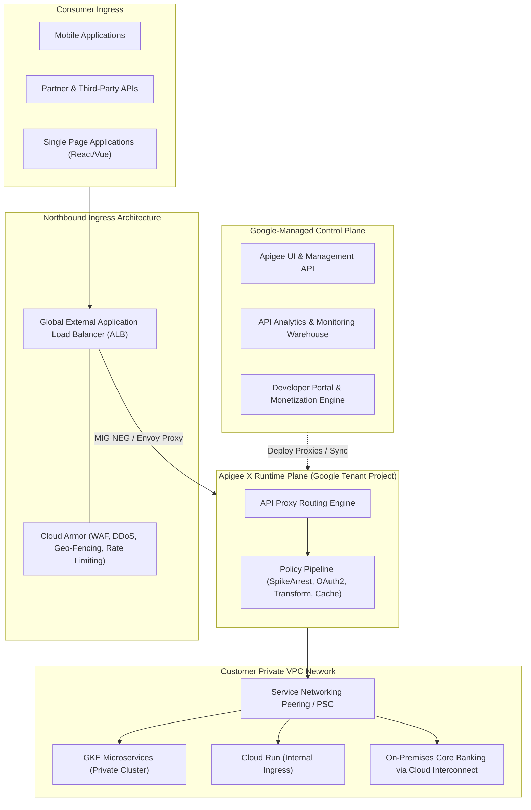

# Apigee X Architecture & Enterprise API Management Deep Dive 🛡️

Apigee X is Google Cloud's enterprise API management platform. It decouples client-facing API interfaces from backend microservices, providing centralized security enforcement (OAuth2, JWT, mTLS, OWASP threat protection), fine-grained traffic management (SpikeArrest, dynamic quotas, rate limiting), developer self-service portals, API monetization, and machine-learning-driven API analytics.

---

## Architecture & Mental Model



Apigee X operates with a strict separation between the **Control Plane** (hosted in Google-managed global infrastructure) and the **Runtime Data Plane** (provisioned in customer-dedicated Google Cloud tenant instances peered directly into the customer's VPC). All API payload processing, token validation, and rate limiting execute exclusively in the runtime plane.

---

## Deep Core Concepts & Engineering Mechanics

### 1. Northbound Ingress & Southbound Egress Topologies

- **Northbound Ingress (Clients $\to$ Apigee):** Traffic arrives via a [[GCP/networking/load-balancing\|Global External Application Load Balancer]] equipped with [[GCP/security/cloud-armor\|Cloud Armor]]. The ALB forwards requests into the Apigee instance using a Managed Instance Group (MIG) proxy or Network Endpoint Group (NEG).
- **Southbound Egress (Apigee $\to$ Backends):** The Apigee runtime plane connects to your private backend services via **VPC Network Peering** or **Private Service Connect (PSC)**. Backend microservices in GKE or Cloud Run never require public IP addresses.

### 2. Traffic Management Policy Engine: SpikeArrest vs Quota

Apigee enforces traffic shaping through specialized declarative XML/JSON policies:

- **SpikeArrest:** Prevents microservice flooding and server crashes caused by traffic spikes. Calculates rolling rates (e.g., `100ps` for 100 requests/sec). If 50 requests arrive in the first 100 milliseconds, SpikeArrest throttles excess requests with `503 Service Unavailable`.
- **Quota Policy:** Enforces business-level usage limits over longer periods (e.g., 10,000 requests per calendar month per API key). Supports rolling windows, calendar-aligned resets, and distributed rate counter synchronization across regional instances.

### 3. Developer Portal & API Products

Apigee abstracts raw API endpoints into **API Products**:

- Platform teams bundle specific paths, HTTP methods, and quota tiers into a product (e.g., "Payments API - Bronze Tier").
- External developers register via the **Developer Portal**, request access, and receive cryptographic API keys or OAuth2 credentials with automatic rate limits enforced.

---

## Production `gcloud` CLI Operations

### 1. Provisioning an Apigee X Organization & Instance

```bash
# 1. Create an Apigee organization bound to a Google Cloud project with VPC peering
gcloud apigee organizations create \
  --project=my-prod-project \
  --authorized-network="projects/my-prod-project/global/networks/vpc-prod" \
  --runtime-type=CLOUD

# 2. Provision an Apigee runtime instance in us-central1 with a /22 IP range
gcloud apigee instances create prod-instance-us-central1 \
  --location=us-central1 \
  --ip-range="10.154.0.0/22" \
  --org=my-prod-project
```

### 2. Creating and Deploying an API Environment

```bash
# 1. Create an Apigee environment (e.g. production)
gcloud apigee environments create prod-env \
  --org=my-prod-project

# 2. Attach the environment to the regional runtime instance
gcloud apigee instances attachments create \
  --environment=prod-env \
  --instance=prod-instance-us-central1 \
  --org=my-prod-project
```

### 3. Deploying an API Proxy Bundle

```bash
# Import and deploy an API proxy bundle to the production environment
gcloud apigee apis create --name="payments-v1" --org=my-prod-project
gcloud apigee deployments create \
  --api="payments-v1" \
  --environment=prod-env \
  --revision=1 \
  --org=my-prod-project
```

---

## Quotas, Performance, and Configuration Limits

| Resource / Parameter                    | Default Quota / Architectural Limit                        | Mitigation & Scaling Strategy                                                                                                       |
| :-------------------------------------- | :--------------------------------------------------------- | :---------------------------------------------------------------------------------------------------------------------------------- |
| **Max Request / Response Payload Size** | **10 MB** (Hard platform proxy limit)                      | For massive file transfers, use Apigee to issue signed URLs directly to [[GCP/storage/gcs\|GCS]].                                   |
| **Request Timeout**                     | **55 seconds** (Default proxy timeout)                     | Keep API proxy transactions synchronous and fast; offload heavy tasks via [[GCP/application-integration/cloud-tasks\|Cloud Tasks]]. |
| **Proxy Target Connections**            | Max 5,000 persistent connections per instance node         | Configure target connection pooling (`HTTPTargetConnection`) in the proxy XML.                                                      |
| **Max Environments per Org**            | Depending on billing tier (PAYG: Up to 5; Enterprise: 20+) | Separate environments logically (dev, test, staging, prod) or use multiple organizations.                                           |

---

## Official References & Documentation

- [Google Cloud Apigee X Official Documentation](https://cloud.google.com/apigee/docs)
- [Apigee X Network Architecture & Provisioning](https://cloud.google.com/apigee/docs/api-platform/get-started/install-overview)
- [Policy Reference: SpikeArrest and Quotas](https://cloud.google.com/apigee/docs/api-platform/reference/policies/spike-arrest-policy)
- [Apigee Pricing Models (Pay-as-you-go vs Subscription)](https://cloud.google.com/apigee/pricing)

---

## Realistic Pricing Scenarios

### Scenario 1: Growth Startup on Apigee Pay-as-you-go (PAYG)

- **Workload:** 1 active production environment in `us-central1` processing 15,000,000 API calls/month.
  - 10,000,000 Standard API calls ($0.20 per million).
  - 5,000,000 Extensible API calls ($0.40 per million).
- **Cost Calculation:**
  - Active Environment Base Fee: $1 \text{ env} \times 730\text{ hours} \times \$0.18 / \text{hr} = \mathbf{\$131.40}$
  - Standard API Calls: $10 \times \$0.20 = \mathbf{\$2.00}$
  - Extensible API Calls: $5 \times \$0.40 = \mathbf{\$2.00}$
  - External ALB + Cloud Armor rules: $\mathbf{\$38.00}$
  - **Total Estimated Monthly Spend:** **~$173.40 / month**

### Scenario 2: Global Enterprise Financial API Ecosystem

- **Workload:** Enterprise banking platform running Apigee Subscription Tier across 3 regions (`us-central1`, `europe-west1`, `asia-east1`) processing 500,000,000 API calls/month.
- **Cost Calculation:**
  - Apigee Enterprise Subscription Base License: Fixed contract baseline (~$2,500/month).
  - Regional Runtime Units (3 regions $\times$ multi-node high availability): $\mathbf{\$1,250.00}$
  - Cloud Interconnect Southbound Egress (10 TB): $\mathbf{\$200.00}$
  - Advanced API Security add-on: $\mathbf{\$500.00}$
  - **Total Estimated Monthly Spend:** **~$4,450.00 / month**

---

## Battle-Tested Nuggets & Production Gotchas

1. **The 10 MB Payload Hard Limit:**
   Apigee X enforces a strict **10 MB limit** on both incoming request bodies and outgoing responses. Any client attempting to upload a 12 MB PDF or receiving a massive JSON list will be terminated abruptly with `413 Request Entity Too Large` (`protocol.http.TooBigBody`). Never use Apigee as a binary file transfer pipeline; generate signed GCS URLs in Apigee and have clients upload directly to storage.
2. **The `/22` Subnet Allocation Requirement:**
   When provisioning an Apigee X runtime instance via Service Networking, it requires a dedicated, non-overlapping `/22` CIDR block (1,024 IP addresses). In enterprise VPCs with tight IP budgets, finding a contiguous `/22` block can be difficult. Plan VPC IP schemas early, or utilize Private Service Connect (PSC) interfaces which eliminate VPC peering IP exhaustion.
3. **SpikeArrest Precision & Clock Slicing:**
   Defining a SpikeArrest of `60pm` (60 per minute) does _not_ mean Apigee allows a burst of 60 requests in the first second and blocks the rest. Apigee slices the minute into 1-second intervals ($1\text{ request / second}$). If two requests arrive within 500 milliseconds of each other, the second request is immediately rejected with HTTP 503. Use `pm` (per minute) with extreme caution; configure rates using `ps` (per second) with appropriate burst smoothing.
4. **Target Server Host Header Routing Errors:**
   When Apigee proxies traffic to modern cloud backends (like Cloud Run or external domains), the backend web server uses the HTTP `Host` header for TLS SNI routing. If your proxy forwards the client's original host header (e.g. `api.mycompany.com`) instead of the backend's target host (e.g. `orders-svc-xyz.a.run.app`), the backend will return `404 Not Found` or SSL handshake failures. Always configure `<Override>true</Override>` or set `target.copy.pathsuffix` in the proxy target endpoint.
5. **Analytics Data Pipeline Lag:**
   Apigee runtime nodes buffer and flush analytical telemetry to BigQuery asynchronously. While real-time request processing is instantaneous, metrics in the Apigee Analytics dashboard typically lag by **10 to 15 minutes**. Never use the Apigee Analytics UI for real-time production incident triage; rely on native Cloud Logging and Cloud Monitoring metrics instead.

---

## Across the wiki

- [[GCP/application-integration/README|GCP Application Integration Hub]] — Overview of Google Cloud integration services
- [[GCP/security/cloud-armor|Cloud Armor Deep Dive]] — Enterprise WAF and DDoS protection for Apigee
- [[GCP/networking/load-balancing|Cloud Load Balancing]] — Ingress architecture routing to Apigee runtimes
- [[GCP/networking/vpc/shared-vpc|Shared VPC Architecture]] — Enterprise multi-project network foundation
- [[AWS/application-integration/appsync/README|AWS API Gateway Comparison]] — Architectural comparison with AWS API management
