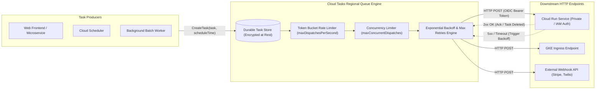

# Cloud Tasks Architecture & Rate-Limited Queuing Deep Dive ⏱️

Google Cloud Tasks is a fully managed, serverless distributed task execution service. It provides point-to-point asynchronous task dispatching with fine-grained rate limiting, traffic smoothing (leaky/token bucket algorithms), configurable retry backoffs, future-scheduled execution, and automated OIDC token-based authentication for downstream HTTP targets.

---

## Architecture & Mental Model



Cloud Tasks operates as an **asynchronous buffer and rate limiter**. When a producer submits a task, Cloud Tasks durably writes it to disk, holds it until its designated `scheduleTime`, and then dispatches it via HTTP POST to the target. Unlike pull-based queue systems, consumers do not poll; Cloud Tasks delivers the work directly into the receiver's endpoint.

---

## Deep Core Concepts & Queue Mechanics

### 1. Token Bucket Rate Limiting & Concurrency Control

Cloud Tasks decouples dispatch velocity from consumer capacity using two distinct knobs:

- `maxDispatchesPerSecond`: Controls the sustained throughput of outgoing requests (implemented via a token bucket). Prevents traffic spikes from overwhelming fragile legacy downstream databases.
- `maxConcurrentDispatches`: Controls the maximum number of requests that can be in-flight simultaneously. If a downstream consumer slows down and response latency increases, Cloud Tasks stops dispatching new tasks until existing requests finish, protecting services from cascading death spirals.

### 2. Task Deduplication via Unique Task Names

To enforce exactly-once enqueue semantics, producers can supply an explicit custom task name:

```
projects/PROJECT_ID/locations/LOCATION_ID/queues/QUEUE_ID/tasks/TASK_ID
```

If a client encounters a network timeout and retries the `CreateTask` API call with the same `TASK_ID`, Cloud Tasks returns `ALREADY_EXISTS` and guarantees that the task is queued only once. Note that task names are tombstoned for a period (~1 hour) after completion before they can be reused.

### 3. Native Zero-Trust Security via OIDC Tokens

When targeting private Google Cloud services (such as [[GCP/compute/cloud-run\|Cloud Run]] or [[GCP/compute/cloud-functions/README\|Cloud Functions]]) with ingress restricted to internal-only, Cloud Tasks automatically generates and injects a signed Google OpenID Connect (OIDC) Bearer token in the `Authorization` header. Downstream services validate the token against IAM without needing hardcoded API keys.

---

## Production `gcloud` CLI Operations

### 1. Creating a Rate-Limited Production Queue

```bash
# Create a queue that throttles dispatch to 50 tasks/sec with max 10 concurrent in-flight requests
gcloud tasks queues create order-processing-queue \
  --location=us-central1 \
  --max-dispatches-per-second=50.0 \
  --max-concurrent-dispatches=10 \
  --max-attempts=5 \
  --min-backoff=5s \
  --max-backoff=300s \
  --max-doublings=3 \
  --project=my-prod-project
```

### 2. Enqueueing an HTTP Task with OIDC Token Authentication

```bash
# Create an HTTP task scheduled for execution 10 minutes in the future targeting Cloud Run
gcloud tasks create-http-task \
  --queue=order-processing-queue \
  --location=us-central1 \
  --url="https://orders-service-xyz.a.run.app/api/v1/finalize" \
  --method=POST \
  --header="Content-Type: application/json" \
  --body-content='{"order_id": "ord-98765", "action": "charge_customer"}' \
  --schedule-time="$(date -u -d '+10 minutes' +%Y-%m-%dT%H:%M:%SZ)" \
  --oidc-service-account-email="cloud-tasks-invoker@my-prod-project.iam.gserviceaccount.com" \
  --oidc-audience="https://orders-service-xyz.a.run.app" \
  --project=my-prod-project
```

### 3. Emergency Queue Management (Pause, Resume, and Purge)

```bash
# Pause queue during downstream database incident (tasks accumulate safely without dispatch)
gcloud tasks queues pause order-processing-queue --location=us-central1

# Resume queue after database health is restored
gcloud tasks queues resume order-processing-queue --location=us-central1

# Purge all queued tasks if a poisoned batch was enqueued
gcloud tasks queues purge order-processing-queue --location=us-central1
```

---

## Quotas, Performance, and Configuration Limits

| Resource / Parameter               | Default Quota / Architectural Limit                                | Mitigation & Scaling Strategy                                                                                                |
| :--------------------------------- | :----------------------------------------------------------------- | :--------------------------------------------------------------------------------------------------------------------------- |
| **Max Task Size**                  | **1 MiB** (Strict payload cap)                                     | For large payloads, store raw payload in [[GCP/storage/gcs\|GCS]] and pass object path in the JSON task body.                |
| **Max Queues per Region**          | **1,000 queues** per project                                       | Segment queues logically by business domain rather than per user/order.                                                      |
| **Default Queue Dispatch Ceiling** | **500 tasks/second** per queue                                     | To scale beyond 500 tasks/sec, request quota increase or shard tasks across $N$ parallel queues.                             |
| **Maximum Schedule Delay**         | **30 days** in the future                                          | For recurring or longer-term scheduling, combine with [[GCP/databases/cloud-sql\|Cloud SQL]] or Firestore scheduler records. |
| **Dispatch Request Timeout**       | **10 minutes** for HTTP targets (up to 24h for App Engine targets) | Keep task handlers lightweight; break multi-step processes into sequential chained tasks.                                    |

---

## Official References & Documentation

- [Google Cloud Tasks Documentation](https://cloud.google.com/tasks/docs)
- [Configuring Cloud Tasks Queues](https://cloud.google.com/tasks/docs/configuring-queues)
- [Creating HTTP Target Tasks](https://cloud.google.com/tasks/docs/creating-http-target-tasks)
- [Cloud Tasks Pricing Model](https://cloud.google.com/tasks/pricing)

---

## Realistic Pricing Scenarios

### Scenario 1: E-Commerce Asynchronous Order Processing

- **Workload:** High-volume retail platform dispatching order validation, notification emails, and ERP sync.
  - 10,000,000 tasks per month. Average task payload: 12 KB (under the 32 KB billable unit threshold).
  - First 1,000,000 operations per month are free.
- **Cost Calculation:**
  - Net billable operations: $10,000,000 - 1,000,000 = 9,000,000\text{ operations}$.
  - Cloud Tasks pricing: $9 \times \$0.40 / \text{million} = \mathbf{\$3.60}$
  - Downstream Cloud Run invocations: ~$45.00
  - **Total Estimated Monthly Spend:** **~$48.60 / month**

### Scenario 2: High-Frequency Webhook Ingestion Buffer

- **Workload:** IoT telemetry ingestion gateway handling 100,000,000 incoming tasks/month buffered to protect an on-prem relational database.
  - Task size: 45 KB (each task consumes $\lceil 45 / 32 \rceil = 2$ billable operations).
  - Total billable operations: $200,000,000$ operations.
- **Cost Calculation:**
  - First 1M operations: Free
  - Remaining 199M operations: $199 \times \$0.40 / \text{million} = \mathbf{\$79.60}$
  - Network Egress to on-prem via Interconnect: $\mathbf{\$15.00}$
  - **Total Estimated Monthly Spend:** **~$94.60 / month**

---

## Battle-Tested Nuggets & Production Gotchas

1. **The 32 KB Operation Chunking Surprise:**
   Cloud Tasks pricing is measured in **32 KB increments**. A task payload of 33 KB consumes 2 billable operations; a task payload of 98 KB consumes 4 operations. When processing hundreds of millions of tasks, sending bloated JSON structures containing redundant metadata can double or quadruple your Cloud Tasks bill. Strip unnecessary fields before enqueuing.
2. **The Tombstone Name Conflict Trap:**
   When using custom task IDs for deduplication (`--task-name`), if a task succeeds or fails and is purged, Google Cloud places that task name in a **tombstone state for approximately 1 hour**. Attempting to reuse the exact same task ID within that window will fail with `ALREADY_EXISTS`, even though the task no longer appears in `gcloud tasks list`. Always append a unique nonce or timestamp if reusing entity keys.
3. **Queue Deletion 7-Day Lockout:**
   If you delete a queue (`gcloud tasks queues delete my-queue`), **you cannot create a new queue with the exact same name in that region for up to 7 days**. If you need to reconfigure queue parameters, always use `gcloud tasks queues update` rather than deleting and recreating the queue.
4. **Cloud Run Cold Starts and 504 Timeouts:**
   When a queue suddenly unleashes a burst of 500 tasks/second against a Cloud Run service scaled to zero, Cloud Run worker containers may take 1 to 3 seconds to initialize. If the target timeout is tight, early tasks will fail with HTTP 504 and trigger retry storms. Configure Cloud Run `min-instances` or tune `max-concurrent-dispatches` to gradually ramp up traffic.
5. **Task Execution is "At Least Once":**
   Although Cloud Tasks enforces strict deduplication at enqueue time, network hiccups between Cloud Tasks and the target endpoint can result in duplicate deliveries (e.g. if the target processes the request but crashes before returning HTTP 200). Handlers must be written **idempotently** using transactional database state checks.

---

## Across the wiki

- [[GCP/application-integration/README|GCP Application Integration Hub]] — Overview of messaging and integration architectures
- [[GCP/application-integration/workflows|Workflows Architecture]] — Orchestrating multi-step serverless tasks
- [[GCP/analytics/pubsub/README|Cloud Pub/Sub Deep Dive]] — High-throughput streaming log alternative
- [[GCP/compute/cloud-run|Cloud Run]] — Recommended execution runtime for task consumer endpoints
- [[AWS/application-integration/sqs/README|AWS SQS Comparison]] — Architectural comparison with AWS Simple Queue Service
