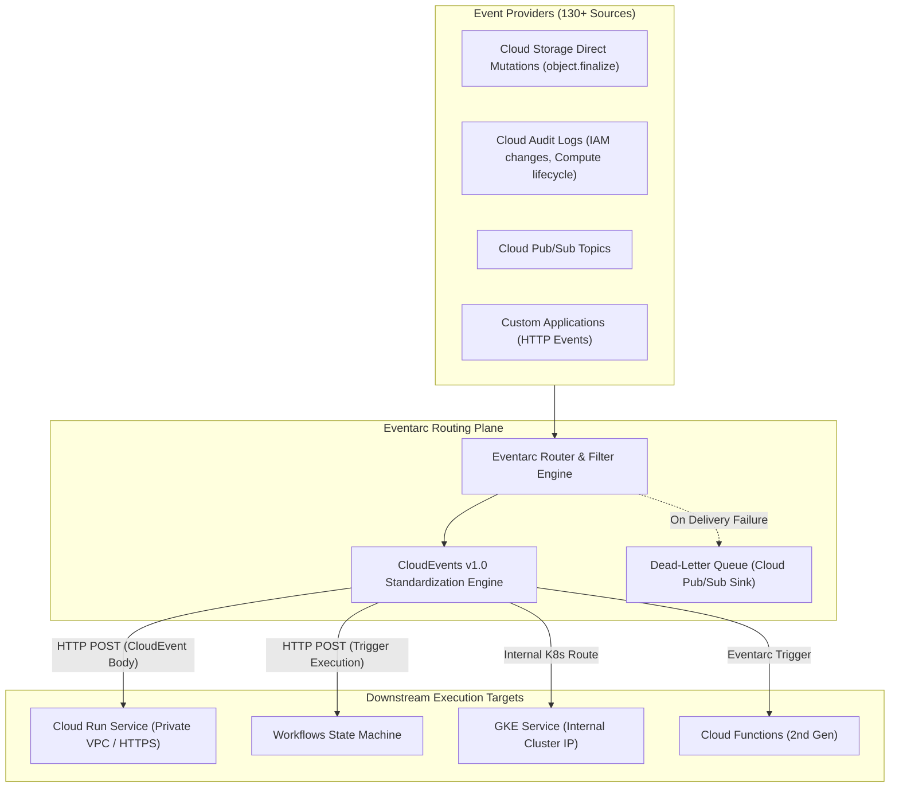

# Eventarc Architecture & CloudEvents Routing Deep Dive ⚡

Google Cloud Eventarc is a fully managed, serverless event routing platform. It standardizes asynchronous event delivery across Google Cloud by converting state changes from 130+ Google Cloud services, Cloud Storage mutations, custom applications, and third-party SaaS sources into standard **CloudEvents v1.0** payloads delivered directly to Cloud Run, GKE, or Workflows with zero infrastructure management.

---

## Architecture & Mental Model



### 1. The CloudEvents v1.0 Specification

Eventarc enforces the CNCF **CloudEvents v1.0** open standard. Every event routed through Eventarc contains uniform metadata headers regardless of source:

- `ce-id`: Unique identifier for the event instance.
- `ce-source`: Context in which the event occurred (e.g. `//storage.googleapis.com/projects/_/buckets/my-bucket`).
- `ce-specversion`: Standard version (`1.0`).
- `ce-type`: Specific event type (e.g. `google.cloud.storage.object.v1.finalized`, `google.cloud.audit.log.v1.written`).
- `ce-time`: RFC 3339 timestamp of event occurrence.

### 2. Direct Storage Events vs Cloud Audit Log Events

- **Direct Cloud Storage Events:** Native, ultra-low-latency event generation from [[GCP/storage/gcs\|Cloud Storage]]. Emits events immediately when objects are created (`finalized`), deleted, archived, or metadata is updated.
- **Cloud Audit Log Events:** Captures administrative and data access actions across almost any GCP service. If a service does not have a native direct trigger (e.g., a GCE instance created, a Secret Manager secret rotated, or an IAM binding modified), Eventarc extracts the event from the project's Cloud Audit Log stream.

---

## Deep Core Concepts & Delivery Guarantees

### 1. Delivery Semantics & Dead-Lettering

Eventarc guarantees **at-least-once delivery**. If a downstream target endpoint returns an HTTP error code ($5\text{xx}$ or $429$) or times out, Eventarc executes exponential backoff retries. Platform engineers can configure an explicit dead-letter Cloud Pub/Sub topic to capture poisoned payloads after maximum retry attempts are exhausted.

### 2. Private Service Connect & Internal VPC Routing

When routing events to private [[GCP/compute/cloud-run\|Cloud Run]] services or internal [[GCP/compute/gke\|GKE]] endpoints that are not exposed to the public internet, Eventarc uses Google's internal software-defined routing mesh. Traffic travels securely over Google's private network without crossing the public internet.

---

## Production `gcloud` CLI Operations

### 1. Creating a Trigger for Direct Cloud Storage Object Creation

```bash
# Create an Eventarc trigger executing a Cloud Run service when an image is uploaded to GCS
gcloud eventarc triggers create gcs-image-processor-trigger \
  --location=us-central1 \
  --destination-run-service=image-resizer-svc \
  --destination-run-region=us-central1 \
  --event-filters="type=google.cloud.storage.object.v1.finalized" \
  --event-filters="bucket=prod-raw-image-uploads" \
  --service-account="eventarc-invoker@my-prod-project.iam.gserviceaccount.com" \
  --project=my-prod-project
```

### 2. Creating a Trigger from Cloud Audit Logs (Secret Rotation)

```bash
# Trigger a workflow whenever a secret version is destroyed or modified in Secret Manager
gcloud eventarc triggers create secret-rotation-trigger \
  --location=us-central1 \
  --destination-workflow=secret-remediation-workflow \
  --destination-workflow-location=us-central1 \
  --event-filters="type=google.cloud.audit.log.v1.written" \
  --event-filters="serviceName=secretmanager.googleapis.com" \
  --event-filters="methodName=google.cloud.secretmanager.v1.SecretManagerService.DestroySecretVersion" \
  --service-account="eventarc-invoker@my-prod-project.iam.gserviceaccount.com" \
  --project=my-prod-project
```

### 3. Listing Available Event Providers

```bash
# Discover all event providers and supported event types in a region
gcloud eventarc providers list --location=us-central1
gcloud eventarc providers describe storage.googleapis.com --location=us-central1
```

---

## Quotas, Performance, and Configuration Limits

| Dimension                    | Default Quota / Architectural Limit                          | Operational Guidance                                                                                      |
| :--------------------------- | :----------------------------------------------------------- | :-------------------------------------------------------------------------------------------------------- |
| **Free Tier Allowance**      | **50,000 events per month** free                             | Free allocation shared across Google and Pub/Sub event sources.                                           |
| **Max Event Payload Size**   | **64 KiB** per billable event unit                           | Events larger than 64 KiB are metered in multiple 64 KiB increments.                                      |
| **Delivery Latency**         | Direct triggers: **< 100ms**; Audit Logs: **1 to 3 seconds** | Use direct storage triggers rather than audit log triggers for latency-sensitive file processing.         |
| **Max Triggers per Project** | **1,000 triggers** per region                                | Consolidate event routing by routing multiple bucket actions to a single handler that inspects `ce-type`. |

---

## Official References & Documentation

- [Google Cloud Eventarc Documentation](https://cloud.google.com/eventarc/docs)
- [CloudEvents Specification Standard](https://cloudevents.io/)
- [Eventarc Supported Event Types & Providers](https://cloud.google.com/eventarc/docs/event-types)
- [Eventarc Pricing Model](https://cloud.google.com/eventarc/pricing)

---

## Realistic Pricing Scenarios

### Scenario 1: Media Processing Pipeline Trigger

- **Workload:** High-throughput document ingestion platform processing 2,000,000 file uploads to GCS per month.
  - Each upload emits 1 `google.cloud.storage.object.v1.finalized` event (payload size: 8 KB).
- **Cost Calculation:**
  - Total events: $2,000,000 - 50,000\text{ (free tier)} = 1,950,000\text{ billable events}$.
  - Eventarc pricing: $1.95 \times \$0.60 / \text{million} = \mathbf{\$1.17}$
  - Downstream Cloud Run invocations: ~$18.50
  - **Total Estimated Monthly Spend:** **~$19.67 / month**

### Scenario 2: Enterprise Cloud Audit Log Compliance Monitor

- **Workload:** Enterprise security compliance scanner auditing 25,000,000 IAM and Compute Engine administrative API calls/month.
- **Cost Calculation:**
  - Billable events ($25\text{M} - 0.05\text{M}$): $24.95 \times \$0.60 / \text{million} = \mathbf{\$14.97}$
  - Cloud Logging audit log ingestion: $\mathbf{\$35.00}$
  - **Total Estimated Monthly Spend:** **~$49.97 / month**

---

## Battle-Tested Nuggets & Production Gotchas

1. **The Audit Log Data Access Logging Prerequisite:**
   By default, Google Cloud projects only record _Admin Activity_ audit logs. If you configure an Eventarc trigger listening for _Data Access_ events (e.g. `google.cloud.bigquery.v2.JobService.InsertJob` or GCS object reads), **the trigger will never fire** until you explicitly enable Data Access logging in the Cloud Console under **IAM & Admin > Audit Logs**.
2. **The Cloud Storage Infinite Trigger Loop:**
   A catastrophic anti-pattern: An Eventarc trigger listens to `object.v1.finalized` on `my-bucket` and invokes a Cloud Run container that processes the file and writes the processed output back into the _same_ `my-bucket`. This triggers another Eventarc event, spawning an exponential, runaway execution storm that can consume tens of thousands of dollars in minutes. Always write processed outputs to a distinct destination bucket or apply strict prefix filters.
3. **IAM Service Account Token Creator Role Requirement:**
   When Eventarc delivers events to authenticated Cloud Run services, the Eventarc service agent (`service-<PROJECT_NUMBER>@gcp-sa-eventarc.iam.gserviceaccount.com`) must have the `roles/iam.serviceAccountTokenCreator` permission on the invoking service account to generate OIDC tokens. Missing this binding causes events to fail with `401 UNAUTHORIZED`.
4. **Latency Discrepancy: Direct vs Audit Log:**
   Direct GCS triggers fire within 50 to 150 milliseconds of object upload. Cloud Audit Log triggers, however, rely on the Cloud Logging pipeline ingestion buffer, introducing a **1 to 3 second delay**. Never use Audit Log triggers for interactive, user-facing synchronous loops.
5. **Payload Truncation on Large Audit Logs:**
   Cloud Audit Logs containing large request parameters (e.g., massive IAM policy updates or batch VM creation manifests) can exceed the CloudEvents header and payload thresholds. Eventarc truncates oversized fields. Handlers must inspect the resource ID from the event and make a direct API call to fetch full resource details if required.

---

## Across the wiki

- [[GCP/application-integration/README|GCP Application Integration Hub]] — Messaging and eventing architecture
- [[GCP/application-integration/workflows|Workflows Architecture]] — Serverless state machine target for Eventarc triggers
- [[GCP/compute/cloud-run|Cloud Run]] — Container runtime target for event processing
- [[GCP/storage/gcs|Google Cloud Storage (GCS)]] — Primary producer of direct object mutation events
- [[AWS/application-integration/eventbridge/README|AWS EventBridge Comparison]] — Architectural comparison with AWS EventBridge event bus
