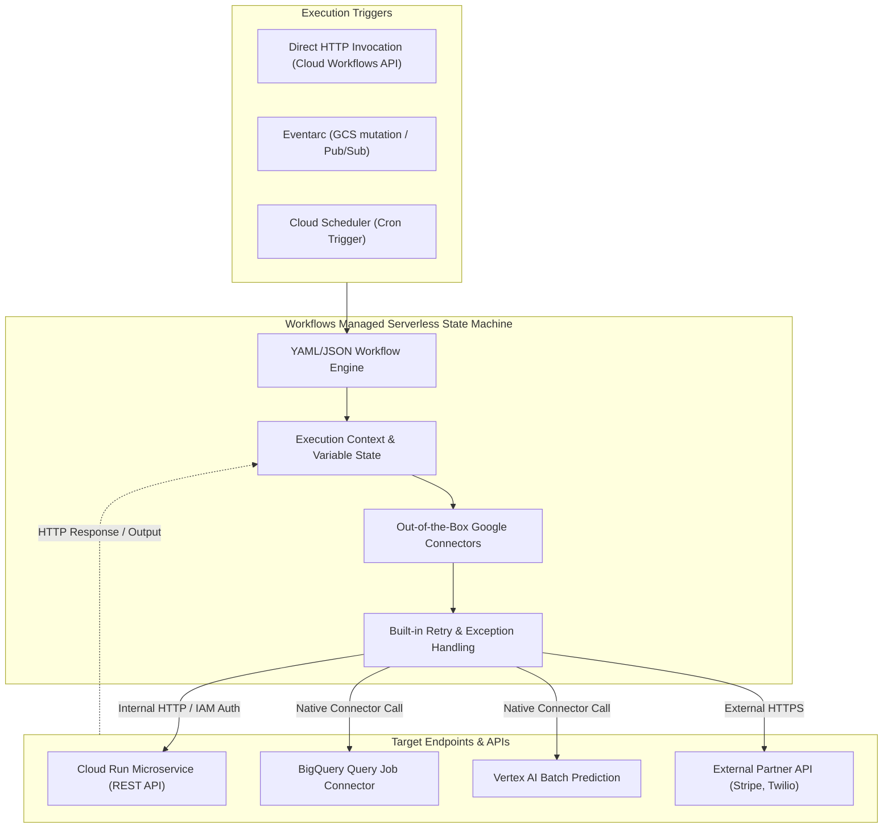

# Workflows Architecture & Serverless Orchestration Deep Dive 🔀

Google Cloud Workflows is a fully managed, serverless orchestration service that coordinates multi-step microservices, Google Cloud APIs, and external HTTP endpoints. It executes declarative state machines defined in YAML or JSON with sub-second execution overhead, built-in retries with exponential backoff, parallel execution branches, and durable state preservation for up to one year.

---

## Architecture & Mental Model



Workflows is designed for **low-latency, event-driven microservice orchestration**. Unlike batch orchestrators like [[GCP/analytics/composer\|Cloud Composer (Airflow)]] which incur heavy worker VM startup times and scheduler polling intervals, Workflows initiates execution within milliseconds and consumes zero compute resources when idle.

---

## Deep Core Concepts & Engineering Mechanics

### 1. Internal Steps vs External Steps

Google Cloud bifurcates workflow steps into two billing and architectural classes:

- **Internal Steps:** Operations executed entirely within the Workflows runtime without crossing network boundaries (e.g., assigning variables, JSON parsing, dictionary manipulation, mathematical calculations, evaluating conditional logic).
- **External Steps:** Operations that issue HTTP/gRPC requests across network boundaries (e.g., calling a Cloud Run service, invoking a Google Cloud connector like BigQuery or Vertex AI, or calling an external third-party API).

### 2. Built-in Connectors & Direct API Integration

Workflows provides a library of **Google Cloud Connectors** (`googleapis.*`). Using connectors eliminates boilerplate HTTP authentication and polling logic:

- Connectors automatically handle OAuth2 token exchange and payload serialization.
- For asynchronous long-running operations (such as running a BigQuery SQL query or training a Vertex AI model), the connector automatically polls the Google Cloud operation until completion without consuming billable external steps during the sleep interval.

### 3. Implementing the Saga Pattern for Distributed Transactions

In distributed microservices, a single business transaction (e.g., booking a vacation) spans multiple databases (flight service, hotel service, payment gateway). Workflows implements the **Saga Pattern** using declarative `try/catch` and compensation steps:

```yaml
main:
  steps:
    - try_booking:
        try:
          steps:
            - reserve_flight:
                call: http.post
                args:
                  url: https://flight-service.internal/reserve
            - reserve_hotel:
                call: http.post
                args:
                  url: https://hotel-service.internal/reserve
        except:
          as: e
          steps:
            # Compensating transaction executed if hotel reservation fails
            - cancel_flight:
                call: http.post
                args:
                  url: https://flight-service.internal/cancel
            - raise_error:
                raise: ${e}
```

---

## Production `gcloud` CLI Operations

### 1. Deploying a Workflow from a Declarative YAML File

```bash
# Deploy a production workflow with dedicated runtime service account
gcloud workflows deploy order-fulfillment-workflow \
  --source=fulfillment.yaml \
  --location=us-central1 \
  --description="E-commerce order fulfillment saga orchestrator" \
  --service-account="workflows-runner@my-prod-project.iam.gserviceaccount.com" \
  --project=my-prod-project
```

### 2. Executing a Workflow with Structured JSON Input

```bash
# Execute the workflow passing dynamic input parameters
gcloud workflows run order-fulfillment-workflow \
  --location=us-central1 \
  --data='{"order_id": "ord-10293", "customer_id": "cust-8472", "amount": 250.00}' \
  --project=my-prod-project
```

### 3. Inspecting Execution Status and Output

```bash
# Describe specific execution and retrieve JSON output
gcloud workflows executions describe EXECUTION_ID \
  --workflow=order-fulfillment-workflow \
  --location=us-central1 \
  --format="json(state,result,error)"
```

---

## Quotas, Performance, and Configuration Limits

| Resource / Metric                   | Default Quota / Architectural Limit                          | Operational Guidance                                                                         |
| :---------------------------------- | :----------------------------------------------------------- | :------------------------------------------------------------------------------------------- |
| **Max Workflows per Project**       | **10,000 workflows**                                         | Ample for large enterprise microservice architectures.                                       |
| **Free Tier Allowance**             | **5,000 internal steps & 2,000 external steps** free monthly | Covers development, staging, and low-volume cron tasks.                                      |
| **Max Execution Duration**          | **1 year** per individual execution                          | Can pause execution awaiting external human callbacks via `events.create_callback_endpoint`. |
| **Max Input / Output Payload Size** | **2 MB** per execution request/response                      | For large payloads, pass object paths in [[GCP/storage/gcs\|Cloud Storage]].                 |
| **Maximum Variable Memory State**   | **256 KB** of in-memory execution state                      | Keep intermediate JSON variables small; avoid buffering large API responses in memory.       |

---

## Official References & Documentation

- [Google Cloud Workflows Official Documentation](https://cloud.google.com/workflows/docs)
- [Workflows Syntax Reference](https://cloud.google.com/workflows/docs/reference/syntax)
- [Google Cloud Connectors Overview](https://cloud.google.com/workflows/docs/connectors)
- [Workflows Pricing Model](https://cloud.google.com/workflows/pricing)

---

## Realistic Pricing Scenarios

### Scenario 1: Serverless Order Processing Saga

- **Workload:** High-growth SaaS platform executing 2,000,000 workflow runs/month.
  - Each workflow execution consists of 4 internal steps (variable setting, condition checks) and 3 external steps (Cloud Run payment API, Cloud SQL inventory update, Twilio SMS).
  - Monthly steps: $8,000,000$ internal steps and $6,000,000$ external steps.
- **Cost Calculation:**
  - Internal steps ($8\text{M} - \text{free 5K}$): $8,000 \times \$0.00001 / \text{step} = \mathbf{\$80.00}$
  - External steps ($6\text{M} - \text{free 2K}$): $6,000 \times \$0.001 / \text{step} = \mathbf{\$6.00}$
  - Cloud Logging telemetry: $\mathbf{\$12.00}$
  - **Total Estimated Monthly Spend:** **~$98.00 / month**

### Scenario 2: High-Volume Event Routing & Filtering

- **Workload:** Security event processing pipeline handling 50,000,000 audit log events/month from Eventarc.
  - 80% of events are filtered out after 2 internal steps and terminated immediately ($80,000,000$ internal steps).
  - 20% of events execute 1 external step alerting an incident response webhook ($10,000,000$ external steps).
- **Cost Calculation:**
  - Internal steps: $80\text{M} \times \$0.01 / 1,000 = \mathbf{\$800.00}$
  - External steps: $10\text{M} \times \$1.00 / 1,000 = \mathbf{\$10.00}$
  - **Total Estimated Monthly Spend:** **~$810.00 / month**

---

## Battle-Tested Nuggets & Production Gotchas

1. **The 256 KB In-Memory Execution State Limit:**
   Workflows maintains its entire execution context (all local variables, step outputs, and loop iterations) in an in-memory state serialized between step transitions. **This memory state cannot exceed 256 KB.** If a step invokes an external API that returns a 1 MB JSON payload, the workflow will crash immediately with `ResourceLimitExceeded`. Always use projection filters in your HTTP call (e.g. `result: resp.body.items[0].id`) to extract only necessary fields.
2. **Infinite Retry Loop Bill Shock:**
   When defining automatic retries on HTTP steps:
   ```yaml
   retry:
     predicate: ${http.default_retry_predicate}
     max_retries: 20
     backoff:
       initial_delay: 1.0
   ```
   If a downstream service suffers an extended outage returning HTTP 500, every retry attempt counts as an external step billed against your account. Across millions of executions, aggressive retry policies during outages can generate thousands of dollars in surprise step charges. Always set sensible `max_retries` (typically 3–5) and configure circuit breakers.
3. **Variable Assignment Syntax (`assign` vs `=`):**
   Unlike Python or JavaScript, Workflows requires explicit declarative variable assignment blocks. Variables cannot be reassigned using simple assignment operators inside step calls. Failing to initialize variables in an explicit `assign` step before accessing them in conditional expressions (`switch`) causes immediate compile-time deployment rejections.
4. **Connector Authentication Service Account Binding:**
   When using out-of-the-box Google connectors (e.g. `googleapis.bigquery.v2.jobs.query`), Workflows does not automatically inherit permissions from the caller. The runtime service account attached to the workflow via `--service-account` must have explicit IAM permissions (e.g. `roles/bigquery.jobUser` and `roles/bigquery.dataViewer`).
5. **Cold Start Comparison with Cloud Functions:**
   Because Workflows is purely an interpreted state machine running in Google's managed control plane, it experiences virtually **zero cold-start latency** (sub-50ms execution start). Migrating multi-step microservice glue code from chained Cloud Functions or Lambda functions to Workflows eliminates runtime container spin-up latencies completely.

---

## Across the wiki

- [[GCP/application-integration/README|GCP Application Integration Hub]] — Messaging and integration architecture
- [[GCP/application-integration/cloud-tasks|Cloud Tasks Architecture]] — Point-to-point task queueing alternative
- [[GCP/application-integration/eventarc|Eventarc Architecture]] — Triggering Workflows from asynchronous CloudEvents
- [[GCP/analytics/composer|Cloud Composer Architecture]] — Heavyweight batch data pipeline orchestration (Apache Airflow)
- [[AWS/application-integration/step-functions/README|AWS Step Functions Comparison]] — Comparison with AWS Step Functions state machines
