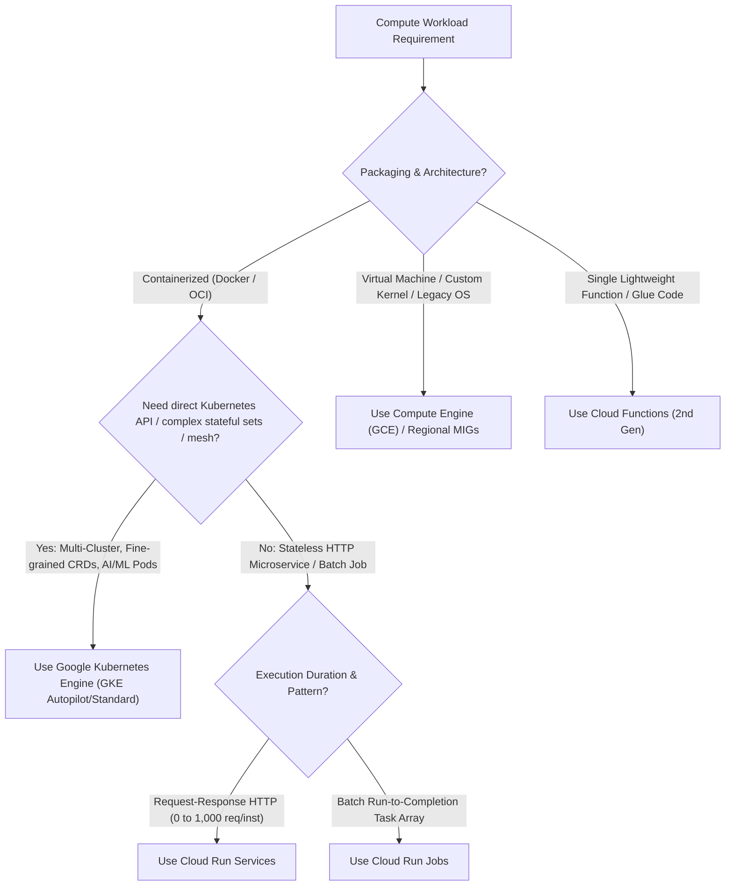

# GCP Compute & Container Platforms Hub 🖥️

Google Cloud provides an expansive compute ecosystem spanning customizable virtual machines, the industry-benchmark managed Kubernetes platform (Google Kubernetes Engine), fully managed serverless container runtimes (Cloud Run), and event-driven functions.

---

## Service Catalog & Architecture Map

| Service                             | Abstraction Level           | Primary Architecture & Engine                                                                    | Reference Guide                                                   |
| :---------------------------------- | :-------------------------- | :----------------------------------------------------------------------------------------------- | :---------------------------------------------------------------- |
| **Compute Engine (GCE)**            | Infrastructure-as-a-Service | Customizable CPU/RAM shapes, Live Migration, Spot VMs, and Regional MIGs.                        | [[GCP/compute/gce\|Compute Engine (GCE)]]                         |
| **Managed Instance Groups (MIGs)**  | Scalable VM Clusters        | Regional/Zonal auto-healing groups, rolling zero-downtime updates, and stateful MIGs.            | [[GCP/compute/gce/migs\|Managed Instance Groups]]                 |
| **Spot VMs**                        | Preemptible Compute         | 60–91% discounted spare capacity with 30-second ACPI shutdown notifications.                     | [[GCP/compute/gce/spot-vms\|Spot VMs]]                            |
| **Google Kubernetes Engine (GKE)**  | Managed Kubernetes Hub      | Autopilot vs Standard, VPC-native alias IPs, Datapath V2 (Cilium eBPF), and Gateway API.         | [[GCP/compute/gke\|GKE Master Hub]]                               |
| **GKE 23-Module Deep Dive Catalog** | Advanced K8s Engineering    | Autopilot, Autoscaling, Gateway API, GPU/TPUs, Kueue, Binary Auth, and SRE runbooks.             | [[GCP/compute/gke/autopilot-deep-dive\|GKE Autopilot Deep Dive]]  |
| **Cloud Run Services**              | Serverless Containers       | Stateless HTTP containers with request concurrency (up to 1,000 req/inst) and Direct VPC Egress. | [[GCP/compute/cloud-run\|Cloud Run Services]]                     |
| **Cloud Run Jobs**                  | Run-to-Completion Batch     | Parallel task arrays, Cloud Scheduler integration, and 24-hour execution caps.                   | [[GCP/compute/cloud-run/jobs\|Cloud Run Jobs]]                    |
| **Cloud Functions (2nd Gen)**       | Event-Driven FaaS           | Built on Cloud Run and Eventarc, 60-minute timeouts, and CloudEvents triggers.                   | [[GCP/compute/cloud-functions/README\|Cloud Functions (2nd Gen)]] |

---

## Compute Abstraction Decision Framework

---

## Related Knowledge Hubs

- [[GCP]] — Master Google Cloud Platform architectural catalog
- [[GCP/networking/vpc|Virtual Private Cloud (VPC)]] — Software-defined network foundation for compute
- [[GCP/developer-tools/README|GCP Developer Tools Hub]] — Continuous integration and delivery pipelines
- [[Kubernetes]] — Cloud-native container orchestration root hub
- [[AWS/compute/README|AWS Compute Comparison]] — Comparison with AWS EC2, ECS, and Lambda
