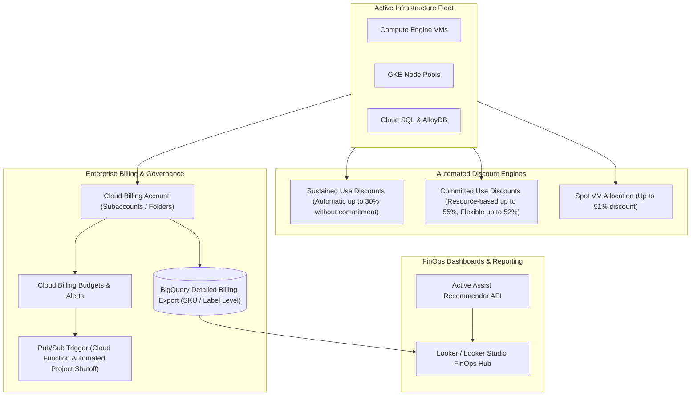

# GCP Cost Management & FinOps Architecture Hub 💰

Cloud financial management (FinOps) on Google Cloud combines automated hardware discounts, programmatic billing exports, machine-learning-driven recommender engines, and native integration with BigQuery to establish financial visibility, accountability, and optimization across cloud infrastructure.

---

## Service Catalog & Architecture Map

| Service                              | Mechanism              | Primary Cost Vector                                                                                            | Reference Guide                                                              |
| :----------------------------------- | :--------------------- | :------------------------------------------------------------------------------------------------------------- | :--------------------------------------------------------------------------- |
| **Pricing Models & Discounts**       | Hardware & Contractual | Sustained Use Discounts (SUDs), Resource-based and Flexible Committed Use Discounts (CUDs).                    | [[GCP/cost-management/pricing-models/README\|Pricing Models & CUDs]]         |
| **GKE FinOps & Rightsizing**         | Container Allocation   | GKE Cost Allocation in BigQuery, Pod rightsizing, overprovisioning pause pods, and Spot node pools.            | [[GCP/compute/gke/cost-optimization-finops\|GKE Cost Optimization & FinOps]] |
| **Spot VMs**                         | Excess Capacity        | 60–91% discounted batch compute with 30-second ACPI shutdown handling.                                         | [[GCP/compute/gce/spot-vms\|Spot VMs Architecture]]                          |
| **BigQuery Detailed Billing Export** | Telemetry Ingestion    | Automated streaming of SKU-level and resource-level cost data directly into BigQuery for Looker analysis.      | [[GCP/databases/bigquery\|BigQuery Deep Dive]]                               |
| **Active Assist / Recommenders**     | ML Cost Optimization   | Automated recommendations for idle VM reclamation, rightsizing, unattached persistent disks, and CUD coverage. | [[GCP/compute/gce\|Compute Engine (GCE)]]                                    |

---

## Google Cloud FinOps Architecture

---

## Related Knowledge Hubs

- [[GCP]] — Master Google Cloud Platform architectural catalog
- [[GCP/cost-management/pricing-models/README|GCP Pricing Models Deep Dive]] — Comprehensive breakdown of CUDs and SUDs
- [[GCP/compute/gke/cost-optimization-finops|GKE Cost Optimization]] — Detailed Kubernetes FinOps mechanics
- [[AWS/cost-management/README|AWS Cost Management Comparison]] — Comparison with AWS Savings Plans and Cost Explorer
