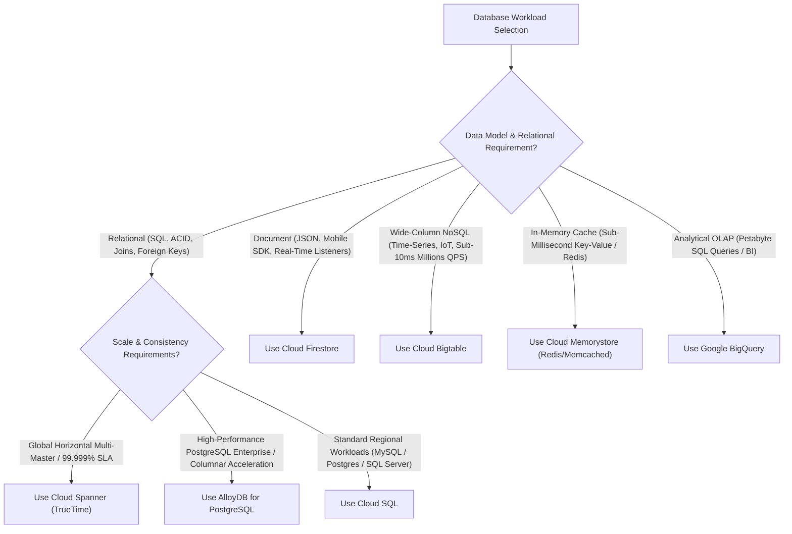

# GCP Databases & Storage Engine Hub 🗄️

Google Cloud provides an advanced, purpose-built database portfolio designed to handle every operational and analytical data access pattern—from single-instance relational databases to horizontally scalable, globally consistent multi-region databases powered by atomic TrueTime hardware clocks.

---

## Service Catalog & Architecture Map

| Service                    | Data Model                                 | Architecture & Consistency Profile                                                                     | Reference Guide                                                   |
| :------------------------- | :----------------------------------------- | :----------------------------------------------------------------------------------------------------- | :---------------------------------------------------------------- |
| **Cloud SQL**              | Relational (PostgreSQL, MySQL, SQL Server) | Managed OLTP engine, Regional synchronous HA failover (RPO = 0), and Cloud SQL Auth Proxy.             | [[GCP/databases/cloud-sql\|Cloud SQL Deep Dive]]                  |
| **Cloud Spanner**          | Globally Distributed Relational            | TrueTime atomic clock synchronization, external consistency (serializability), and 99.999% SLA.        | [[GCP/databases/spanner\|Cloud Spanner Deep Dive]]                |
| **AlloyDB for PostgreSQL** | Disaggregated Relational Engine            | Disaggregated storage engine, log processing service, and integrated vectorized columnar engine.       | [[GCP/databases/alloydb/README\|AlloyDB Deep Dive]]               |
| **Cloud Bigtable**         | NoSQL Wide-Column Store                    | Petabyte-scale sub-10ms key-value storage, SSTables on Colossus, tablet auto-splitting.                | [[GCP/databases/bigtable/README\|Cloud Bigtable Deep Dive]]       |
| **Cloud Firestore**        | Serverless Document Database               | Mobile and web sync, multi-document ACID transactions, offline persistence, Native vs Datastore mode.  | [[GCP/databases/firestore/README\|Cloud Firestore Deep Dive]]     |
| **Cloud Memorystore**      | In-Memory Cache                            | Fully managed Redis and Memcached, high-availability failover, and cluster sharding (up to 250 nodes). | [[GCP/databases/memorystore/README\|Cloud Memorystore Deep Dive]] |
| **BigQuery**               | Serverless Data Warehouse                  | Capacitor columnar format, Dremel query engine, and BigLake storage abstraction.                       | [[GCP/databases/bigquery\|BigQuery Deep Dive]]                    |

---

## Database Selection Decision Framework

---

## Related Knowledge Hubs

- [[GCP]] — Master Google Cloud Platform architectural catalog
- [[GCP/analytics/README|GCP Analytics Hub]] — Analytical query engines and data lakes
- [[GCP/migration/migration-center|Migration Center & DMS]] — Database migration and replication
- [[Architecture/solution-architecture-concepts/data-architecture/databases/README|Database Architecture]] — CAP theorem, PACELC, and transaction models
- [[AWS/databases/README|AWS Databases Comparison]] — Comparison with AWS Aurora, DynamoDB, and ElastiCache
