# GCP Developer Tools & Delivery Hub 🛠️

Google Cloud provides an integrated, serverless software delivery suite engineered to implement modern Continuous Integration, Continuous Delivery (CI/CD), software supply chain security (SLSA Level 3 compliance), and zero-trust developer environments.

---

## Service Catalog & Architecture Map

| Service                  | Category                      | Core Architecture & Primary Use Case                                                                                                                       | Reference Guide                                                        |
| :----------------------- | :---------------------------- | :--------------------------------------------------------------------------------------------------------------------------------------------------------- | :--------------------------------------------------------------------- |
| **Cloud Build**          | Serverless CI / Build Engine  | High-concurrency serverless build runner executing parallel container steps, private worker pools in VPC, and cryptographic SLSA provenance generation.    | [[GCP/developer-tools/cloud-build\|Cloud Build Deep Dive]]             |
| **Artifact Registry**    | Universal Package & OCI Store | OCI container registry and language package manager (npm, Maven, Python, Go, Apt, Yum), integrated with Container Analysis vulnerability scanning.         | [[GCP/developer-tools/artifact-registry\|Artifact Registry Deep Dive]] |
| **Cloud Deploy**         | Managed Continuous Delivery   | Fully managed release orchestration for GKE, Cloud Run, and Anthos with automated canary traffic shifting, Skaffold verification, and one-click rollbacks. | [[GCP/developer-tools/cloud-deploy\|Cloud Deploy Deep Dive]]           |
| **Binary Authorization** | Supply Chain Gatekeeper       | Cryptographic attestor verification ensuring only container images built by Cloud Build and signed by KMS keys can execute in GKE.                         | [[GCP/compute/gke/binary-authorization\|Binary Authorization]]         |

---

## The Secure Software Supply Chain (SLSA Level 3)

```mermaid
flowchart LR
    Dev["Developer Git Push"] --> GitHub["Source Repository"]
    GitHub -->|"Webhook Trigger"| CB["Cloud Build (Private Worker Pool)"]

    subgraph BuildAndAttest ["Build & Cryptographic Attestation"]
        CB -->|"Compile & Test"| Kaniko["Container Builder"]
        Kaniko -->|"Generate Attestation"| KMS["Cloud KMS (Image Signing)"]
    end

    KMS -->|"Push Image & Cosign Sig"| AR["Artifact Registry (Vulnerability Scan)"]

    AR -->|"Create Release"| CD["Cloud Deploy (Skaffold Render)"]

    subgraph DeploymentTargets ["Target Environments"]
        CD -->|"Stage 1: Canary 10%"| GKE_Staging["GKE / Cloud Run (Staging)"]
        GKE_Staging -->|"Approve Promotion"| GKE_Prod["GKE / Cloud Run (Prod Cluster)"]
    end

    BinAuth["Binary Authorization Admission Controller"] -.->|"Verify KMS Sig"| GKE_Prod
```

### 1. Build Isolation & Private Networking

By default, Cloud Build operates inside Google-owned multi-tenant worker pools. For enterprise workloads requiring access to internal databases, artifact caches, or on-premises networks via [[GCP/networking/hybrid/README\|Cloud Interconnect]], **Cloud Build Private Pools** instantiate dedicated, isolated compute instances peered into your private [[GCP/networking/vpc\|Virtual Private Cloud (VPC)]] with zero public IP exposure.

### 2. Universal Artifact Management vs Legacy GCR

Google Container Registry (`gcr.io`) is deprecated in favor of **Artifact Registry**, which introduces:

- Fine-grained IAM permissions per repository (rather than bucket-level storage permissions).
- Multi-format artifact hosting (Docker, OCI, Helm, Maven, npm, PyPI).
- Automatic asynchronous CVE scanning powered by Container Analysis and Continuous Analysis.

### 3. Declarative Delivery Pipelines

Cloud Deploy leverages open-source **Skaffold** to decouple pipeline orchestration from deployment manifests (Kustomize, Helm, raw Kubernetes YAML). Pipelines define declarative release stages (e.g. `dev` $\to$ `staging` $\to$ `prod`), automated canary rollout phases (e.g. 10% $\to$ 25% $\to$ 100%), and automatic rollback policies when container health checks fail.

---

## Related Knowledge Hubs

- [[GCP]] — Master Google Cloud Platform architectural catalog
- [[GCP/compute/gke|Google Kubernetes Engine (GKE)]] — Target runtime for containerized deployments
- [[GCP/compute/cloud-run|Cloud Run]] — Target serverless container platform
- [[GCP/security/kms/README|Cloud KMS]] — Asymmetric keys for cryptographic image signing and SLSA attestations
- [[DevOps]] — General CI/CD, GitOps, and platform engineering patterns
