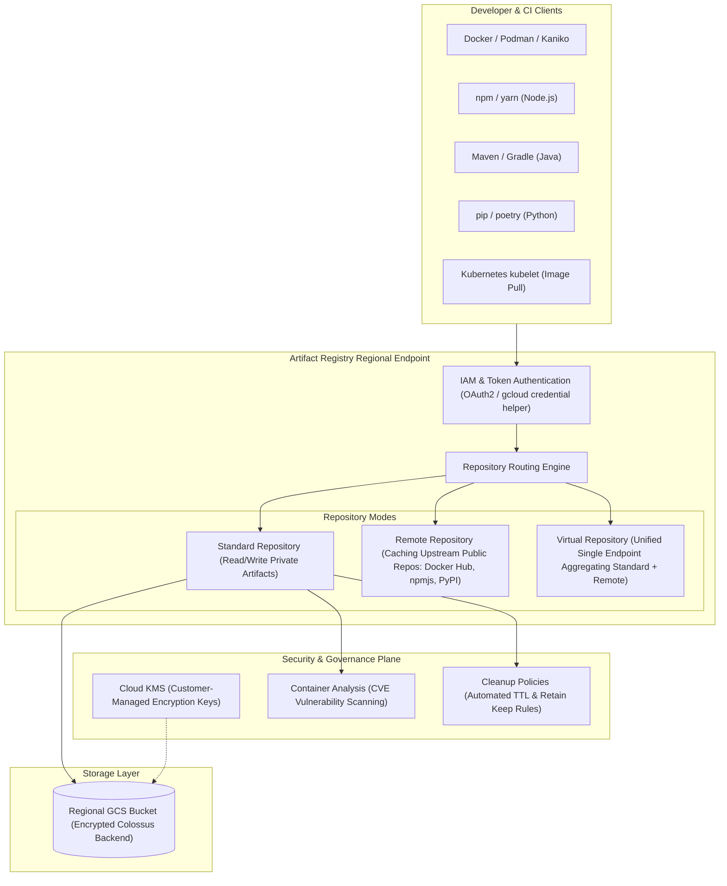

# Artifact Registry Architecture & Package Management 📦

Google Cloud Artifact Registry is the enterprise universal repository manager that supersedes legacy Container Registry (`gcr.io`). It unifies container images (Docker, OCI, Helm charts) and language packages (Maven, npm, PyPI, Go, Apt, Yum) under a single regional control plane with fine-grained IAM, automated vulnerability scanning, and VPC Service Controls.

---

## Architecture & Mental Model



### 1. Repository Modes: Standard, Remote, and Virtual

- **Standard Repositories:** Private storage for proprietary container images and internal packages. Supports fine-grained IAM per repository.
- **Remote Repositories:** Caching proxy for external public registries (e.g., Docker Hub, npmjs.org, PyPI, Maven Central). Protects against upstream outages and rate limits (e.g., Docker Hub pull limits).
- **Virtual Repositories:** A unified upstream facade combining multiple Standard and Remote repositories behind a single URL endpoint. Build tools configure one repository URL; Artifact Registry searches local repositories first and falls back to remote upstream caches.

### 2. GCR (`gcr.io`) vs Artifact Registry

| Capability                 | Container Registry (Deprecated)                                    | Artifact Registry (Modern)                                           |
| :------------------------- | :----------------------------------------------------------------- | :------------------------------------------------------------------- |
| **Storage Architecture**   | Backed by standard GCS buckets (`artifacts.<project>.appspot.com`) | Native service abstraction with independent regional storage engines |
| **IAM Granularity**        | Storage bucket-level only (all or nothing per project)             | Granular IAM per specific repository                                 |
| **Package Types**          | Docker and OCI images only                                         | Docker, OCI, Helm, Maven, npm, Python, Go, Apt, Yum                  |
| **Vulnerability Scanning** | Basic on-push scan                                                 | Continuous automated scanning with SBOM generation                   |
| **Encryption**             | Google-managed encryption only                                     | Full CMEK support via [[GCP/security/kms/README\|Cloud KMS]]         |

---

## Deep Core Concepts & Governance

### 1. Automated Lifecycle & Cleanup Policies

To prevent runaway storage costs caused by automated CI pipelines pushing hundreds of intermediate image tags per day, Artifact Registry supports declarative **Cleanup Policies**:

- **Delete Policies:** Automatically purges untagged images or tags older than a defined retention threshold (e.g., 30 days).
- **Keep Policies:** Protects production tags (e.g., matching regex `^v[0-9]+\.[0-9]+.*` or keeping the most recent 10 images) from deletion regardless of age.

### 2. Continuous Vulnerability Scanning & Container Analysis

When an image is pushed, **Container Analysis** automatically extracts the package manifest and correlates dependencies against the Common Vulnerabilities and Exposures (CVE) database. If a new zero-day vulnerability is discovered weeks after an image was built, Continuous Analysis updates the image's vulnerability record without requiring a rebuild.

---

## Production `gcloud` CLI Operations

### 1. Creating a Standard Docker Repository with CMEK Encryption

```bash
# Create a regional Docker repository encrypted with Cloud KMS
gcloud artifacts repositories create prod-docker-repo \
  --repository-format=docker \
  --location=us-central1 \
  --description="Production OCI container images" \
  --kms-key="projects/my-prod-project/locations/us-central1/keyRings/prod-ring/cryptoKeys/ar-key" \
  --project=my-prod-project

# Configure local Docker daemon authentication
gcloud auth configure-docker us-central1-docker.pkg.dev
```

### 2. Creating a Remote Caching Repository for Docker Hub

```bash
# Create a remote repository caching Docker Hub to eliminate rate limiting
gcloud artifacts repositories create docker-hub-cache \
  --repository-format=docker \
  --location=us-central1 \
  --mode=remote-repository \
  --remote-repo-config-desc="Docker Hub Upstream Cache" \
  --remote-docker-repo="DOCKER-HUB" \
  --project=my-prod-project
```

### 3. Configuring Declarative Cleanup Policies

Create a cleanup policy configuration file `cleanup-policy.json`:

```json
[
  {
    "name": "delete-untagged-images",
    "action": { "type": "Delete" },
    "condition": {
      "tagState": "UNTAGGED",
      "olderThan": "14d"
    }
  },
  {
    "name": "keep-production-semver",
    "action": { "type": "Keep" },
    "condition": {
      "tagPrefixes": ["v"],
      "tagState": "TAGGED"
    }
  },
  {
    "name": "keep-recent-ten",
    "action": { "type": "Keep" },
    "mostRecentVersions": {
      "keepCount": 10
    }
  }
]
```

Apply the policy via `gcloud`:

```bash
gcloud artifacts repositories set-cleanup-policies prod-docker-repo \
  --location=us-central1 \
  --policy=cleanup-policy.json \
  --project=my-prod-project
```

---

## Quotas, Performance, and Configuration Limits

| Resource / Metric                | Quota / Architectural Cap                       | Operational Guidance                                                                                               |
| :------------------------------- | :---------------------------------------------- | :----------------------------------------------------------------------------------------------------------------- |
| **Free Tier Storage**            | **0.5 GiB-month** per billing account           | Adequate for basic dev testing; production workloads require budget allocation.                                    |
| **Storage Capacity**             | Unlimited (backed by scalable Colossus storage) | Implement cleanup policies to prune stale CI test tags.                                                            |
| **Max Repositories per Project** | **1,000 repositories** per region               | Consolidate packages by project or domain rather than creating a repo per service.                                 |
| **Max File Upload Size**         | **100 GB** per single artifact/layer            | Ensure layer optimization and multi-stage Docker builds.                                                           |
| **Pull Rate Limits**             | **18,000 requests per minute** per region       | For massive GKE node pool rollouts (1,000+ nodes), pull images via local caching proxies or pre-warmed daemonsets. |

---

## Official References & Documentation

- [Google Cloud Artifact Registry Documentation](https://cloud.google.com/artifact-registry/docs)
- [Managing Repositories and Formats](https://cloud.google.com/artifact-registry/docs/repositories)
- [Configuring Cleanup Policies](https://cloud.google.com/artifact-registry/docs/repositories/cleanup-policy)
- [Remote and Virtual Repositories Overview](https://cloud.google.com/artifact-registry/docs/virtual-remote-overview)

---

## Realistic Pricing Scenarios

### Scenario 1: Mid-Sized Enterprise Container Storage & Scanning

- **Workload:** 100 microservices storing 5 versions each (average image size: 400 MB).
  - Total storage: $100 \times 5 \times 0.4\text{ GB} = 200\text{ GB}$.
  - Daily deployment: 50 new images pushed/scanned per day (1,500 scans/month).
- **Cost Calculation:**
  - Storage cost: $200\text{ GB} \times \$0.10 / \text{GB-month} = \mathbf{\$20.00}$
  - Vulnerability Scanning: First 1,500 scans $\times \$0.26 / \text{scan} = \mathbf{\$390.00}$
  - In-region GKE image pull egress: $\mathbf{\$0.00}$ (Egress to Google Cloud compute services in the same region is free).
  - **Total Estimated Monthly Spend:** **~$410.00 / month**

### Scenario 2: High-Volume Global Multi-Region Mirroring

- **Workload:** Multi-region Kubernetes infrastructure spanning `us-central1` and `europe-west3`.
  - 1 TB active container storage in `us-central1`.
  - Cross-region egress: 5 TB of images pulled monthly from `europe-west3` GKE clusters.
- **Cost Calculation:**
  - Storage: $1,024\text{ GB} \times \$0.10 = \mathbf{\$102.40}$
  - Cross-Region Egress ($0.08/GB): $5,000\text{ GB} \times \$0.08 = \mathbf{\$400.00}$
  - Cleanup policies pruning 3 TB of intermediate CI build artifacts: Saved ~$300/mo.
  - **Total Estimated Monthly Spend:** **~$502.40 / month**

---

## Battle-Tested Nuggets & Production Gotchas

1. **The Cross-Region Pull Egress Tax:**
   A common architectural blunder is creating an Artifact Registry repository in `us-central1` and configuring GKE clusters in `europe-west1` or `asia-east1` to pull from it. **Pulls within the same Google Cloud region incur $0.00 network egress; pulls across regions incur standard internet egress rates ($0.08–$0.12/GB)**. In large clusters pulling hundreds of gigabytes of base images daily during autoscaling, this leads to thousands of dollars in surprise network egress. Mirror repositories regionally or use multi-region repositories.
2. **Untagged Manifest Accumulation ("Orphan Blobs"):**
   When your CI pipeline repeatedly builds and pushes images with mutable tags like `:latest`, Docker unlinks the tag from the older image version. In Artifact Registry, the older image becomes **untagged**. These untagged manifests and their heavy underlying layers remain stored and billed indefinitely unless an explicit cleanup policy (`tagState: UNTAGGED`) is enabled.
3. **Repository Name vs Host URL Format:**
   In legacy Container Registry, the host URL was `gcr.io/<PROJECT_ID>/<IMAGE>`. In Artifact Registry, the location is part of the host subdomain, and the project and repository name are distinct path segments: `<LOCATION>-docker.pkg.dev/<PROJECT_ID>/<REPOSITORY_NAME>/<IMAGE>`. Forgetting the `<REPOSITORY_NAME>` segment in Kubernetes pod manifests results in `ErrImagePull` with `404 Not Found`.
4. **IAM Writer vs Administrator Permissions:**
   The `roles/artifactregistry.writer` role permits pushing and pulling artifacts, but **does not grant permission to delete tags or apply cleanup policies**. CI automation or deployment scripts that attempt to prune tags dynamically will fail with `PERMISSION_DENIED` unless granted `roles/artifactregistry.repoAdmin`.
5. **Docker Credential Helper Latency in CI:**
   Configuring `gcloud auth configure-docker` inside high-speed CI pipelines initiates a gcloud Python subshell on every Docker interaction to obtain access tokens. In high-concurrency build runners, this adds 2 to 5 seconds per push step. For automated CI runners, use static short-lived OAuth2 access tokens via `docker login -u oauth2accesstoken -p "$(gcloud auth print-access-token)"` to eliminate CLI initialization overhead.

---

## Across the wiki

- [[GCP/developer-tools/README|GCP Developer Tools Hub]] — Software delivery architecture
- [[GCP/developer-tools/cloud-build|Cloud Build Architecture]] — Serverless CI engine building images for Artifact Registry
- [[GCP/developer-tools/cloud-deploy|Cloud Deploy Architecture]] — Managed continuous delivery consuming Artifact Registry images
- [[GCP/compute/gke/binary-authorization|Binary Authorization]] — Verifying cryptographic signatures on images stored in Artifact Registry
- [[AWS/compute/ecr|AWS ECR Comparison]] — Architectural comparison with Amazon Elastic Container Registry
