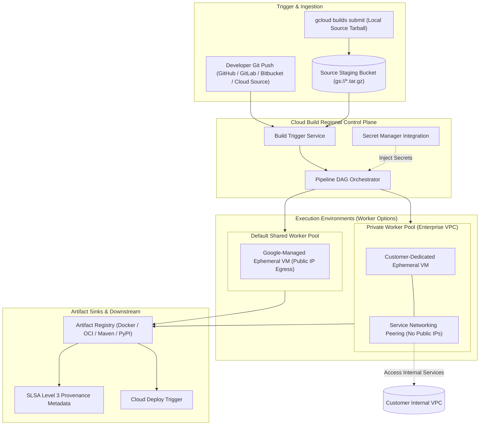

# Cloud Build Architecture & Serverless CI Deep Dive 🔨

Google Cloud Build is a fully managed, serverless continuous integration (CI) and build execution engine. It scales elastically to execute parallelized, containerized build pipelines with zero server administration, providing deep native integrations with Secret Manager, Artifact Registry, Cloud Deploy, and cryptographic software supply chain standards (SLSA Level 3).

---

## Architecture & Mental Model



Cloud Build operates on a container-first execution paradigm. Every step in a `cloudbuild.yaml` specification is an isolated container image (e.g., `gcr.io/cloud-builders/docker`, `golang:1.24`, `python:3.12`) mounted with a shared persistent workspace volume (`/workspace`). Files created or modified in step $N$ are instantly available to step $N+1$.

---

## Deep Core Concepts & Engineering Mechanics

### 1. Default Shared Pool vs Private Worker Pools

- **Default Shared Pool:** Executes inside a Google-managed multi-tenant VPC. Each build gets an isolated ephemeral container environment. However, workers use public IP egress, meaning they cannot reach internal IP addresses in your corporate VPC, databases, or on-prem networks without complex NAT proxy gateways.
- **Private Worker Pools:** Allocates dedicated single-tenant VMs peered directly into your [[GCP/networking/vpc\|Virtual Private Cloud (VPC)]] via Service Networking. Private pools feature:
  - Complete elimination of public egress IPs (egress locked strictly inside your VPC).
  - Direct low-latency access to private [[GCP/databases/cloud-sql\|Cloud SQL]] instances, private [[GCP/compute/gke\|GKE control planes]], and on-premises subnets via [[GCP/networking/hybrid/README\|Cloud Interconnect]].
  - Configurable machine sizing up to 32 vCPUs and customizable disk sizes.

### 2. Supply Chain Security & SLSA Level 3 Provenance

Cloud Build natively produces verifiable, tamper-evident **SLSA (Supply-chain Levels for Software Artifacts) Level 3** build provenance:

- When a build finishes, Cloud Build generates an in-toto attestation signed by a Google-managed cryptographic key.
- The attestation records the source commit hash, build trigger ID, builder dependencies, and the exact SHA256 digest of the generated container image.
- Downstream admission controllers like [[GCP/compute/gke/binary-authorization\|Binary Authorization]] verify this attestation before permitting deployment to GKE.

### 3. Layer Caching with Kaniko

Standard `docker build` commands inside ephemeral CI containers lose layer cache between runs. Cloud Build solves this using **Kaniko** (`gcr.io/kaniko-project/executor`), which builds images inside userspace without a Docker daemon and pushes intermediate layer snapshots directly to [[GCP/developer-tools/artifact-registry\|Artifact Registry]] cache repositories (`--cache=true`).

---

## Production `gcloud` CLI Operations

### 1. Submitting a Direct Build with Dynamic Substitutions

```bash
# Submit the current directory to Cloud Build using high-CPU workers and Kaniko caching
gcloud builds submit . \
  --config=cloudbuild.yaml \
  --substitutions=_APP_NAME="orders-service",_IMAGE_TAG="v2.4.1",_ENV="production" \
  --machine-type="e2-highcpu-8" \
  --region=us-central1 \
  --project=my-prod-project
```

### 2. Provisioning a Private Worker Pool Peered to VPC

```bash
# 1. Create a private worker pool inside the regional VPC
gcloud builds worker-pools create prod-private-pool \
  --region=us-central1 \
  --project=my-prod-project \
  --peered-network="projects/my-prod-project/global/networks/vpc-prod" \
  --worker-machine-type="e2-standard-4" \
  --worker-disk-size=100GB \
  --no-external-ip-address

# 2. Submit a build targeting the private worker pool
gcloud builds submit . \
  --config=cloudbuild.yaml \
  --worker-pool="projects/my-prod-project/locations/us-central1/workerPools/prod-private-pool" \
  --region=us-central1
```

### 3. Creating an Automated GitHub Webhook Trigger

```bash
# Create a build trigger executing on pull request merge to the main branch
gcloud builds triggers create github \
  --name="orders-service-main-ci" \
  --repo-owner="my-org" \
  --repo-name="orders-service" \
  --branch-pattern="^main$" \
  --build-config="cloudbuild.yaml" \
  --region=us-central1 \
  --service-account="projects/my-prod-project/serviceAccounts/cloudbuild-sa@my-prod-project.iam.gserviceaccount.com" \
  --project=my-prod-project
```

---

## Declarative Pipeline Specification (`cloudbuild.yaml`)

```yaml
steps:
  # Step 1: Run unit tests with cached dependencies
  - name: "golang:1.24"
    entrypoint: "go"
    args: ["test", "-v", "-race", "./..."]
    env:
      - "CGO_ENABLED=0"

  # Step 2: Build container image with Kaniko cache
  - name: "gcr.io/kaniko-project/executor:latest"
    args:
      - "--destination=us-central1-docker.pkg.dev/$PROJECT_ID/services-repo/$_APP_NAME:$COMMIT_SHA"
      - "--cache=true"
      - "--cache-ttl=24h"
      - "--cache-repo=us-central1-docker.pkg.dev/$PROJECT_ID/services-repo/cache"

  # Step 3: Trigger Cloud Deploy delivery pipeline
  - name: "gcr.io/google.com/cloudsdktool/cloud-sdk"
    entrypoint: "gcloud"
    args:
      - "deploy"
      - "releases"
      - "create"
      - "rel-$SHORT_SHA"
      - "--delivery-pipeline=orders-pipeline"
      - "--region=us-central1"
      - "--images=$_APP_NAME=us-central1-docker.pkg.dev/$PROJECT_ID/services-repo/$_APP_NAME:$COMMIT_SHA"

options:
  machineType: "E2_HIGHCPU_8"
  logging: "CLOUD_LOGGING_ONLY"
timeout: "1200s"
```

---

## Quotas, Performance, and Configuration Limits

| Resource / Parameter                 | Default Quota / Architectural Limit                           | Mitigation & Scaling Strategy                                                                          |
| :----------------------------------- | :------------------------------------------------------------ | :----------------------------------------------------------------------------------------------------- |
| **Free Tier Allowance**              | **120 build-minutes per day** per billing account             | Free tier applies to standard `e2-medium` machine types only.                                          |
| **Concurrent Builds (Default Pool)** | **10 to 30 concurrent builds** per region                     | Request quota increase via Google Cloud Console under `Cloud Build API > Concurrent builds`.           |
| **Max Build Timeout**                | **24 hours** per build run                                    | Break massive monolith compilation tasks into modular parallel triggers or microservice pipelines.     |
| **Workspace Volume Disk Limit**      | Default 100 GB (configurable up to 1,000 GB in Private Pools) | Set `worker-disk-size` on Private Worker Pools for builds generating large intermediate Docker layers. |
| **Source Archive Upload Limit**      | **2 GB** per single `.tar.gz` source upload                   | Ensure `.gcloudignore` excludes `node_modules`, `.git`, `.venv`, and temporary test artifacts.         |

---

## Official References & Documentation

- [Google Cloud Build Documentation](https://cloud.google.com/build/docs)
- [Cloud Build Private Pools & VPC Peering](https://cloud.google.com/build/docs/private-pools/private-pools-overview)
- [SLSA Level 3 Provenance in Cloud Build](https://cloud.google.com/build/docs/securing-builds/view-build-provenance)
- [Kaniko Cache Acceleration in Cloud Build](https://cloud.google.com/build/docs/optimizing-build-times/kaniko-cache)

---

## Realistic Pricing Scenarios

### Scenario 1: Startup CI Pipeline on Default Shared Workers

- **Workload:** 15 microservices running 20 builds per day. Each build runs 6 minutes on `e2-highcpu-8` ($0.016/minute).
  - Total daily build minutes: $15 \times 20 \times 6 = 1,800\text{ build-minutes / day}$.
  - Less 120 free build-minutes/day (applied at `e2-medium` baseline).
- **Cost Calculation:**
  - Net billable build minutes: $1,680\text{ min/day} \times 30\text{ days} = 50,400\text{ minutes/month}$.
  - Compute cost: $50,400 \times \$0.016 / \text{min} = \mathbf{\$806.40}$
  - Cloud Storage temporary staging bucket & Cloud Logging: $\mathbf{\$18.50}$
  - **Total Estimated Monthly Spend:** **~$824.90 / month**

### Scenario 2: Enterprise CI on Dedicated Private Worker Pool

- **Workload:** FinTech platform requiring zero public egress IPs and VPC peering.
  - 1 Private Worker Pool running 5 dedicated `e2-standard-4` instances active during business hours (250 hours/month).
- **Cost Calculation:**
  - Private pool management fee: Included with underlying compute.
  - Compute Engine worker VM cost (`e2-standard-4` @ $0.134/hr): $5 \text{ workers} \times 250\text{ hrs} \times \$0.134 = \mathbf{\$167.50}$
  - Persistent Disk (500 GB pd-standard): $\mathbf{\$20.00}$
  - Network peering and Cloud Logging: $\mathbf{\$15.00}$
  - **Total Estimated Monthly Spend:** **~$202.50 / month**

---

## Battle-Tested Nuggets & Production Gotchas

1. **The Default Service Account Privilege Gap:**
   Historically, Cloud Build ran under `<PROJECT_NUMBER>@cloudbuild.gserviceaccount.com` with broad `Cloud Build Service Account` permissions. In modern Google Cloud projects, Google enforces least privilege: the default SA has zero IAM roles attached. Builds that push to [[GCP/developer-tools/artifact-registry\|Artifact Registry]] or trigger [[GCP/developer-tools/cloud-deploy\|Cloud Deploy]] will fail immediately with `403 FORBIDDEN: Permission denied`. You must explicitly grant `roles/artifactregistry.writer` and `roles/clouddeploy.releaser` to the service account or use custom user-managed service accounts.
2. **Missing `.gcloudignore` File Performance Catastrophe:**
   When invoking `gcloud builds submit .`, the CLI automatically packages the current working directory into a `.tar.gz` archive and uploads it to a temporary GCS bucket. If your repository lacks a `.gcloudignore` file, `gcloud` will package your local `.git` history, `node_modules`, or Python `.venv` (often hundreds of megabytes or gigabytes). This causes build initialization to stall for 5 to 10 minutes before the first build step even starts.
3. **The Shared `/workspace` Ephemeral Storage Limit:**
   By default, the `/workspace` volume is backed by the root disk of the builder VM. If a multi-stage Docker build generates massive uncompressed layers or downloads large training datasets exceeding 100 GB, the build aborts abruptly with `no space left on device`. Resolve this by configuring a Private Worker Pool with `--worker-disk-size=500GB` or using Docker build caching volumes.
4. **Environment Variables Do Not Cross Steps:**
   A common anti-pattern is executing `export MY_VAR=foo` in step 1 and attempting to read `$MY_VAR` in step 2. Because each step runs inside a completely separate container namespace, environment variables set at runtime do not persist across steps. To pass dynamic values between steps, write them to a file in `/workspace/build_env.txt` and source the file in downstream steps.
5. **Private Pool Peering CIDR Collision:**
   When allocating a Service Networking IP range for Cloud Build Private Pools, the CIDR block must not overlap with existing VPC subnets, VPN tunnels, or peered VPC networks. If a `/24` or `/16` block overlaps, peering creation succeeds in the console but actual worker provisioning fails silently with `FAILED_PRECONDITION: Private pool allocation blocked by routing collision`.

---

## Across the wiki

- [[GCP/developer-tools/README|GCP Developer Tools Hub]] — Overview of Google Cloud delivery systems
- [[GCP/developer-tools/artifact-registry|Artifact Registry Deep Dive]] — Enterprise OCI container registry and package storage
- [[GCP/developer-tools/cloud-deploy|Cloud Deploy Deep Dive]] — Multi-stage release automation for GKE and Cloud Run
- [[GCP/compute/gke/binary-authorization|Binary Authorization]] — Cryptographic gatekeeping verifying Cloud Build provenance
- [[AWS/developer-tools/README|AWS CodeBuild Comparison]] — Architectural comparison with AWS CI services
