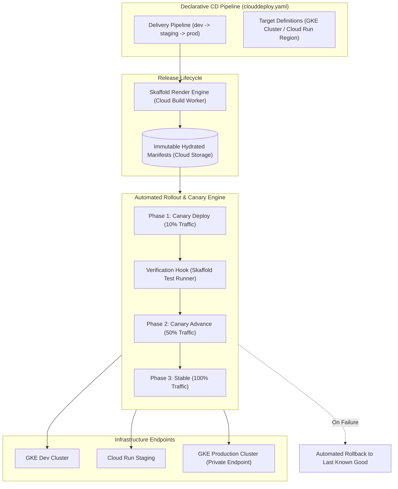

# Cloud Deploy Architecture & Continuous Delivery Deep Dive 🚀

Google Cloud Deploy is an enterprise-grade, fully managed continuous delivery (CD) platform. It orchestrates the progression of software releases across multi-stage deployment targets (GKE clusters, Cloud Run services, and GKE Enterprise / Anthos environments) with automated canary traffic shifting, post-deployment verification tests, approval gates, and instant one-click rollbacks.

---

## Architecture & Mental Model



### 1. The Separation of Render and Deploy

Cloud Deploy enforces an immutable release model. When a release is created:

1. **Render Phase:** Cloud Deploy invokes **Skaffold** in a serverless worker environment to hydrate templates (Helm charts, Kustomize overlays, or raw Kubernetes manifests) with exact image digests.
2. **Storage:** The fully rendered, raw manifests are archived immutably in a Google-managed Cloud Storage bucket.
3. **Deploy Phase:** Downstream targets (`staging`, `prod`) execute rollouts using the _exact same rendered manifests_, eliminating configuration drift between environments.

### 2. Multi-Target Progressive Delivery

A **Delivery Pipeline** defines the sequential progression order between **Targets**. For example:
$$\text{Development Cluster} \longrightarrow \text{Staging Cluster} \longrightarrow \text{Production Cluster}$$
Progressions can be configured for automatic promotion or gated behind human **Approval Gates** enforced via IAM permissions.

---

## Deep Core Concepts & Advanced Mechanics

### 1. Automated Canary Deployments & Traffic Shifting

Cloud Deploy natively supports canary rollout strategies without third-party service mesh requirements:

- **Cloud Run Targets:** Cloud Deploy leverages native Cloud Run revisions to allocate traffic percentages (e.g., 10% to new revision, 90% to active revision).
- **GKE Targets:** Cloud Deploy integrates with the **Kubernetes Gateway API** (`HTTPRoute`) or Service mesh (Istio/ASM) to split traffic dynamically at the ingress controller.
- **Phased Rollouts:** Rollouts advance through defined phases (e.g. `canary-25`, `canary-50`, `stable-100`). At each phase, Cloud Deploy can pause for manual promotion or execute automated verification.

### 2. Post-Deployment Verification Hooks

Cloud Deploy allows platform engineers to define containerized verification jobs that execute immediately after manifests are applied:

- If smoke tests, latency probes, or synthetic API checks fail during the verification phase, Cloud Deploy halts the rollout and triggers an **automated rollback** to the previous stable release.

---

## Production `gcloud` CLI Operations

### 1. Applying Pipeline & Target Configurations

```bash
# Apply declarative delivery pipeline and target definitions
gcloud deploy apply \
  --file=clouddeploy.yaml \
  --region=us-central1 \
  --project=my-prod-project
```

### 2. Creating an Immutable Release

```bash
# Create a new release referencing rendered container images from Artifact Registry
gcloud deploy releases create release-2026-10-15-01 \
  --delivery-pipeline=microservices-pipeline \
  --region=us-central1 \
  --images=orders-service=us-central1-docker.pkg.dev/my-prod-project/apps/orders-service:v3.2.0 \
  --project=my-prod-project
```

### 3. Promoting a Release to Production with Approval

```bash
# 1. Promote release from staging to production target
gcloud deploy releases promote \
  --release=release-2026-10-15-01 \
  --delivery-pipeline=microservices-pipeline \
  --region=us-central1 \
  --to-target=prod-gke-cluster

# 2. Approve the gated production rollout
gcloud deploy rollouts approve microservices-pipeline-prod-gke-cluster-0001 \
  --delivery-pipeline=microservices-pipeline \
  --release=release-2026-10-15-01 \
  --region=us-central1
```

### 4. Executing an Emergency Rollback

```bash
# Execute immediate one-click rollback on production target
gcloud deploy targets rollback prod-gke-cluster \
  --delivery-pipeline=microservices-pipeline \
  --region=us-central1 \
  --project=my-prod-project
```

---

## Declarative Configuration (`clouddeploy.yaml`)

```yaml
apiVersion: deploy.cloud.google.com/v1
kind: DeliveryPipeline
metadata:
  name: microservices-pipeline
description: Production delivery pipeline with automated canary progression
serialPipeline:
  stages:
    - targetId: staging-cluster
    - targetId: prod-cluster
      strategy:
        canary:
          runtimeConfig:
            kubernetes:
              gatewayServiceMesh:
                httpRoute: "prod-route"
                service: "orders-svc"
          canaryDeployment:
            percentages: [10, 50]
            verify: true
---
apiVersion: deploy.cloud.google.com/v1
kind: Target
metadata:
  name: prod-cluster
description: Production GKE cluster in us-central1
gke:
  cluster: projects/my-prod-project/locations/us-central1/clusters/gke-prod-cluster
requireApproval: true
```

---

## Quotas, Performance, and Configuration Limits

| Dimension                    | Quota / Architectural Cap                                                | Operational Guidance                                                                                            |
| :--------------------------- | :----------------------------------------------------------------------- | :-------------------------------------------------------------------------------------------------------------- |
| **Active Pipeline Pricing**  | Free for single-target; **$5.00/month** per active multi-target pipeline | Pipelines are only billed in months where releases/rollouts are executed.                                       |
| **API Request Rate Limit**   | **18,000 requests per minute** per region                                | Ample for high-frequency automated CI triggers across hundreds of microservices.                                |
| **Max Targets per Pipeline** | **30 targets** per delivery pipeline                                     | For multi-region architectures spanning 50+ clusters, split pipelines by geographic theatre (EMEA, AMER, APAC). |
| **Render Execution Timeout** | **10 minutes** for Skaffold manifest rendering                           | Keep Helm chart rendering modular; avoid pulling remote charts during rendering.                                |

---

## Official References & Documentation

- [Google Cloud Deploy Official Documentation](https://cloud.google.com/deploy/docs)
- [Architecture & Progressive Delivery Patterns](https://cloud.google.com/deploy/docs/progressive-deployment)
- [Integrating Cloud Deploy with GKE Gateway API](https://cloud.google.com/deploy/docs/canary-service-mesh)
- [Cloud Deploy Pricing Model](https://cloud.google.com/deploy/pricing)

---

## Realistic Pricing Scenarios

### Scenario 1: Standard Multi-Service Continuous Delivery

- **Workload:** 20 microservices deploying through 20 independent delivery pipelines (Staging $\to$ Production, 2 targets per pipeline).
  - All 20 pipelines execute releases during the billing month.
- **Cost Calculation:**
  - 20 active multi-target pipelines $\times \$5.00 / \text{pipeline-month} = \mathbf{\$100.00}$
  - Skaffold render jobs executing on default Cloud Build workers: Included in Cloud Build free tier (under 120 minutes/day).
  - Manifest storage in GCS: Negligible (<$1.00/month).
  - **Total Estimated Monthly Spend:** **~$101.00 / month**

### Scenario 2: Single-Target Edge & Branch Deployments

- **Workload:** 50 dynamic ephemeral test targets deployed directly to a single dev cluster for PR testing.
  - Each pipeline targets exactly 1 single environment (`dev-cluster`).
- **Cost Calculation:**
  - Single-target pipelines: **$0.00** (Permanently free tier).
  - Cloud Deploy platform fee: **$0.00**.
  - **Total Estimated Monthly Spend:** **$0.00 / month**

---

## Battle-Tested Nuggets & Production Gotchas

1. **Private Cluster Connect Gateway Prerequisite:**
   When targeting a private GKE cluster (master control plane with no public IP), Cloud Deploy cannot reach the Kubernetes API server directly. You must enable the **Connect Gateway** (`connectgateway.googleapis.com`) and register the cluster to a [[GCP/compute/gke/fleets-and-anthos\|GKE Fleet]]. If this is skipped, rollouts fail at execution time with `FAILED: Unable to connect to the target Kubernetes master`.
2. **The Skaffold Render Determinism Trap:**
   Cloud Deploy renders manifests once at release creation. If your `skaffold.yaml` or Helm values file relies on dynamic runtime functions (e.g., Helm's `randAlphaNum` or timestamps), those values are rendered into static text in the Cloud Storage archive. They will not re-evaluate when promoting from Staging to Production. All environment-specific variables must be parameterized using Cloud Deploy target custom configurations or Skaffold profiles.
3. **Approval Permissions Confusion:**
   Enforcing `requireApproval: true` on production targets requires distinct IAM bindings. The user or CI service account creating releases typically possesses `roles/clouddeploy.releaser`. However, approving rollouts requires `roles/clouddeploy.approver`. Ensure your automated release scripts do not attempt to approve their own gated rollouts unless explicitly granted this elevated role.
4. **Target Deletion Lockout:**
   If a delivery pipeline references a target that has been deleted or renamed, Cloud Deploy blocks all subsequent pipeline updates with `RESOURCE_IN_USE`. You must first edit the `serialPipeline` stages in `clouddeploy.yaml` to remove the target reference and re-apply before attempting to delete the target resource.
5. **Canary Phasing & Gateway Route Sync Delay:**
   When using Cloud Deploy automated canary traffic splitting with the GKE Gateway API, updating the `HTTPRoute` weight to 10% takes between 5 and 15 seconds for Envoy proxies in data-plane pods to synchronize routing tables. Configuring automated verification tests that fire within 1 second of rollout advancement will measure the pre-existing revision and produce false positives. Always inject a 15–30 second delay in verification probe manifests.

---

## Across the wiki

- [[GCP/developer-tools/README|GCP Developer Tools Hub]] — Delivery architectures on Google Cloud
- [[GCP/developer-tools/cloud-build|Cloud Build Architecture]] — Serverless CI engine triggering Cloud Deploy releases
- [[GCP/developer-tools/artifact-registry|Artifact Registry Deep Dive]] — OCI repository hosting verified image digests
- [[GCP/compute/gke/gateway-api|GKE Gateway API]] — Traffic routing layer powering Cloud Deploy canary splits
- [[AWS/developer-tools/README|AWS CodeDeploy Comparison]] — Architectural comparison with AWS deployment systems
