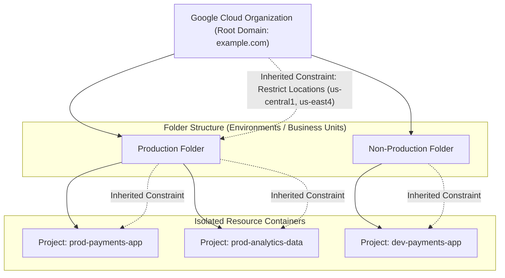

# GCP Governance & Organization Policies Hub 🏛️

Google Cloud enterprise governance establishes centralized administrative control, compliance guardrails, programmatic resource hierarchies, and automated policy enforcement across multi-tenant corporate projects.

---

## Service Catalog & Architecture Map

| Service                       | Architecture & Scope           | Primary Use Case & Guarantees                                                                                                  | Reference Guide                                                           |
| :---------------------------- | :----------------------------- | :----------------------------------------------------------------------------------------------------------------------------- | :------------------------------------------------------------------------ |
| **Organization Policies**     | Declarative Constraint Engine  | Enforcing preventive guardrails (disabling public IPs, restricting locations, CMEK enforcement) across the resource hierarchy. | [[GCP/governance/org-policies\|Organization Policies Deep Dive]]          |
| **Resource Hierarchy & Tags** | Resource Manager Control Plane | Org $\to$ Folder $\to$ Project resource hierarchy, IAM inheritance, and Resource Manager Tags for conditional IAM/policies.    | [[GCP/identity/README\|IAM & Resource Hierarchy]]                         |
| **Cost & FinOps Governance**  | Cloud Billing & Budgets        | Billing account hierarchy, programmatic budget alerts, BigQuery billing export, and automated spending caps.                   | [[GCP/cost-management/pricing-models/README\|Cost Optimization & FinOps]] |
| **Security Command Center**   | Continuous Posture Management  | Continuous compliance reporting against CIS GCP Benchmark, NIST 800-53, ISO 27001, and PCI-DSS.                                | [[GCP/security/scc\|Security Command Center (SCC)]]                       |

---

## The Resource Hierarchy & Policy Inheritance Model

### 1. The Inheritance & Override Paradigm

Policies defined at the **Organization** level flow down through **Folders** and apply to all leaf **Projects**. A lower level cannot disable an inherited boolean policy unless the organization explicitly allows inheritance overrides.

### 2. Tag-Based Conditional Policy Enforcement

Using **Resource Manager Tags**, platform teams attach strongly typed key-value pairs (e.g. `environment: production`, `confidentiality: pci-dss`) directly to projects or resources. Organization policies can evaluate these tags dynamically, enforcing strict encryption and network controls on PCI-tagged environments while keeping developer sandboxes agile.

---

## Related Knowledge Hubs

- [[GCP]] — Master Google Cloud Platform architectural catalog
- [[GCP/security/README|GCP Security Hub]] — Enterprise security and zero-trust services
- [[GCP/identity/README|IAM & Resource Hierarchy]] — Role bindings and access controls
- [[AWS/management-governance/organizations/README|AWS Organizations Comparison]] — Comparison with AWS multi-account governance
