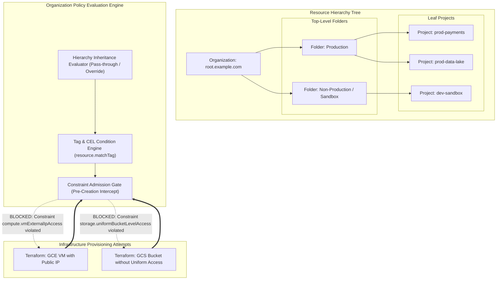

# Organization Policies & Resource Governance Architecture 🏛️

Google Cloud Organization Policy Service provides centralized, programmatic, preventive governance across an enterprise's entire resource hierarchy (Organization $\to$ Folders $\to$ Projects). Unlike reactive audit tools that detect misconfigurations after deployment, Organization Policies act as **admission-control guardrails at the Cloud Resource Manager API boundary**, intercepting and blocking non-compliant resource creation before infrastructure is provisioned.

---

## Architecture & Mental Model



Organization Policies operate synchronously inside Google's control plane. When a developer or CI pipeline attempts to create a resource via Terraform, `gcloud`, or Console:

1. The Resource Manager API checks if any constraint applies to that resource type at the target project.
2. It walks up the hierarchy tree, aggregating rules from parent folders and the organization root.
3. If the resource violates an enforced constraint, the API call is **rejected with `412 FAILED_PRECONDITION`**, ensuring infrastructure non-compliance never enters the environment.

---

## Deep Core Concepts & Governance Constraints

### 1. Boolean Constraints vs List Constraints

- **Boolean Constraints:** Binary toggles that enforce or deny a specific platform capability globally.
  - `compute.disableNestedVirtualization`: Prevents unauthorized hypervisor virtualization.
  - `compute.requireOsLogin`: Mandates Google Cloud OS Login and eliminates personal SSH keys.
  - `iam.disableServiceAccountKeyCreation`: Completely blocks developers from generating downloadable static JSON service account keys.
  - `storage.uniformBucketLevelAccess`: Disables legacy object-level ACLs across all GCS buckets.
- **List Constraints:** Enforce allowlists or denylists of specific values:
  - `gcp.resourceLocations`: Restricts data residency to authorized regions (e.g. `in:us-locations` or `in:europe-west1-locations`).
  - `compute.vmExternalIpAccess`: Restricts public IP creation; can specify an empty allowlist to block public IPs entirely.
  - `compute.trustedImageProjects`: Allows VM creation only from hardened corporate golden images (e.g. `projects/golden-os-images`).

### 2. Custom Constraints via Common Expression Language (CEL)

When pre-defined Google constraints do not cover complex organizational requirements, platform architects write **Custom Constraints** using Common Expression Language (CEL):

- Custom constraints evaluate resource attributes at admission time (e.g., mandating that all GKE clusters have Datapath V2 enabled, or that GCE instances only use specific machine families like N2 or C3).

### 3. Dry-Run Mode & Audit Rollouts

Enforcing a strict policy (such as disabling service account key creation) across an existing enterprise can inadvertently break existing CI/CD pipelines. Organization Policy supports **Dry-Run Mode**:

- Violations are logged to [[GCP/monitoring/cloud-logging/README\|Cloud Logging]] and [[GCP/security/scc\|Security Command Center (SCC)]] without blocking deployments.
- Security teams monitor audit logs to identify legacy non-compliant pipelines and remediate them before switching the policy to enforce mode.

---

## Production `gcloud` CLI Operations

### 1. Blocking Static Service Account Key Creation Organization-Wide

```bash
# Block creation of static JSON service account keys at the organization root
cat <<EOF > disable-key-creation.yaml
name: organizations/123456789012/policies/iam.disableServiceAccountKeyCreation
spec:
  rules:
    - enforce: true
EOF

gcloud org-policies set-policy disable-key-creation.yaml
```

### 2. Restricting Resource Locations to US Regions with Tag Conditions

```bash
# Enforce that resources tagged 'confidentiality=high' must only be provisioned in us-central1
cat <<EOF > restrict-locations.yaml
name: organizations/123456789012/policies/gcp.resourceLocations
spec:
  rules:
    - condition:
        expression: "resource.matchTag('123456789012/confidentiality', 'high')"
        title: "Enforce US data residency for confidential data"
      values:
        allowedValues:
          - "in:us-locations"
EOF

gcloud org-policies set-policy restrict-locations.yaml
```

### 3. Defining a Custom CEL Constraint Blocking Unshielded GKE Nodes

```bash
# Define a custom constraint requiring Shielded Nodes on all GKE clusters
cat <<EOF > custom-constraint-gke-shielded.yaml
name: organizations/123456789012/customConstraints/custom.gkeRequireShieldedNodes
resourceTypes:
  - container.googleapis.com/Cluster
methodTypes:
  - CREATE
  - UPDATE
condition: "resource.nodeConfig.shieldedInstanceConfig.enableSecureBoot == true"
actionType: ALLOW
displayName: "Require Secure Boot on GKE Node Pools"
description: "Prevents launching GKE clusters without cryptographically signed bootloaders."
EOF

gcloud org-policies set-custom-constraint custom-constraint-gke-shielded.yaml
```

---

## Top 8 Mandatory Enterprise Security Constraints

| Constraint Name                        | Type    | Recommended Production Setting       | Architectural Impact                                                                                 |
| :------------------------------------- | :------ | :----------------------------------- | :--------------------------------------------------------------------------------------------------- |
| `iam.disableServiceAccountKeyCreation` | Boolean | `enforce: true`                      | Eliminates the #1 vector for credential leakage (static JSON keys).                                  |
| `compute.vmExternalIpAccess`           | List    | `deniedValues: ["all"]`              | Blocks public IPs on VMs; forces traffic through Cloud NAT and [[GCP/security/iap-beyondcorp\|IAP]]. |
| `storage.uniformBucketLevelAccess`     | Boolean | `enforce: true`                      | Forces uniform IAM access on all GCS buckets; disables vulnerable object ACLs.                       |
| `compute.requireOsLogin`               | Boolean | `enforce: true`                      | Mandates Google Cloud OS Login; centralizes SSH auditing and revocation.                             |
| `gcp.restrictPublicIpAccess`           | Boolean | `enforce: true`                      | Blocks Cloud SQL and AlloyDB instances from binding public IPv4 addresses.                           |
| `gcp.resourceLocations`                | List    | `allowedValues: ["in:us-locations"]` | Guarantees compliance with GDPR, HIPAA, or federal data sovereignty laws.                            |
| `iam.restrictServiceAccountKeyExpiry`  | List    | Max 8 hours if keys enabled          | Enforces short-lived rotation if static keys cannot be fully disabled.                               |
| `sql.restrictAuthorizedNetworks`       | Boolean | `enforce: true`                      | Prevents exposing Cloud SQL to `0.0.0.0/0` public internet routes.                                   |

---

## Quotas, Performance, and Configuration Limits

| Dimension                          | Default Quota / Architectural Limit | Operational Guidance                                                                                |
| :--------------------------------- | :---------------------------------- | :-------------------------------------------------------------------------------------------------- |
| **Service Cost**                   | **$0.00** (Free platform service)   | Included natively in Google Cloud Resource Manager.                                                 |
| **Policy Document Size Limit**     | **128 KB** per policy resource      | Use grouped location prefixes (`in:us-locations`) rather than listing 50 individual region strings. |
| **Propagation Latency**            | **Instant to 60 seconds** globally  | Policy changes propagate across Google's control plane within seconds.                              |
| **Max Custom Constraints per Org** | **500 custom constraints**          | Consolidate related validation rules into single composite CEL expressions.                         |

---

## Official References & Documentation

- [Google Cloud Organization Policy Service Overview](https://cloud.google.com/resource-manager/docs/organization-policy/overview)
- [Predefined Organization Policy Constraints](https://cloud.google.com/resource-manager/docs/organization-policy/org-policy-constraints)
- [Creating and Managing Custom Constraints (CEL)](https://cloud.google.com/resource-manager/docs/organization-policy/creating-managing-custom-constraints)
- [Using Tags with Organization Policies](https://cloud.google.com/resource-manager/docs/organization-policy/tags-organization-policy)

---

## Realistic Pricing Scenarios

### Scenario 1: Enterprise Organization-Wide Guardrail Enforcement

- **Workload:** Enterprise spanning 1 Organization, 15 Folders, and 250 Projects enforcing 25 mandatory security constraints.
- **Cost Calculation:**
  - Organization Policy Service: **$0.00** (Free).
  - Cloud Resource Manager API operations: **$0.00** (Free Tier).
  - Security Command Center compliance findings integration: Included in SCC Standard/Premium.
  - **Total Estimated Monthly Spend:** **$0.00 / month**

### Scenario 2: Tag-Based Multi-Tenant Environment Governance

- **Workload:** 1,000 Resource Manager Tags attached to 500 GCE VMs and Cloud Storage buckets to enforce dynamic geofencing.
- **Cost Calculation:**
  - Resource Manager Tag Operations: **$0.00**.
  - Organization Policy CEL evaluation runtime: **$0.00**.
  - **Total Estimated Monthly Spend:** **$0.00 / month**

---

## Battle-Tested Nuggets & Production Gotchas

1. **The Terraform Service Account Lockout:**
   Applying `iam.disableServiceAccountKeyCreation` at the organization root will immediately break any legacy Terraform or GitHub Actions pipelines that generate or download temporary service account keys. Always deploy [[GCP/identity/workload-identity\|Workload Identity Federation]] across all CI pipelines _before_ enabling this constraint.
2. **Inheritance Override Confusion (`inheritFromParent`):**
   By default, child folders inherit parent policies. However, if an administrator defines a policy on a folder without setting `inheritFromParent: true`, the folder's policy **completely overwrites** the organization policy for that constraint rather than merging values. Ensure your policy YAML files explicitly specify whether inheritance should be merged or overridden.
3. **Existing Resources Are Not Destroyed Retroactively:**
   Organization policies are strictly **admission-control guardrails**. If you enforce `compute.vmExternalIpAccess: deny all`, **existing VMs with public IPs will continue to run and maintain their public IPs**. The constraint only blocks new VM creations or updates to existing network interfaces. To detect legacy non-compliant resources, review findings in [[GCP/security/scc\|Security Command Center]].
4. **Custom CEL Constraint Syntax Errors Fail Open:**
   When authoring Custom Constraints in CEL, test expressions thoroughly in Dry-Run mode. A malformed CEL syntax or attempting to access non-existent resource fields can cause the admission webhook to fail open (permitting creation) to avoid locking out legitimate production deployments.
5. **Dry-Run SCC Alert Volume Storms:**
   Before enforcing a constraint, enabling Dry-Run mode generates an audit log entry for every single deployment that would have been blocked. In high-velocity CI/CD environments testing non-compliant templates, this can flood Cloud Logging with thousands of alerts. Filter your alert notifications to aggregate by project rather than per individual log line.

---

## Across the wiki

- [[GCP/governance/README|GCP Governance Hub]] — Overview of Google Cloud governance models
- [[GCP/identity/README|IAM & Resource Hierarchy]] — Deep dive on Organization, Folder, and Project hierarchy
- [[GCP/security/scc|Security Command Center]] — Compliance monitoring verifying Org Policy enforcement
- [[GCP/networking/vpc|Virtual Private Cloud (VPC)]] — Restricting public egress in tandem with Org Policies
- [[AWS/management-governance/control-tower/README|AWS Service Control Policies (SCPs)]] — Architectural comparison with AWS governance
