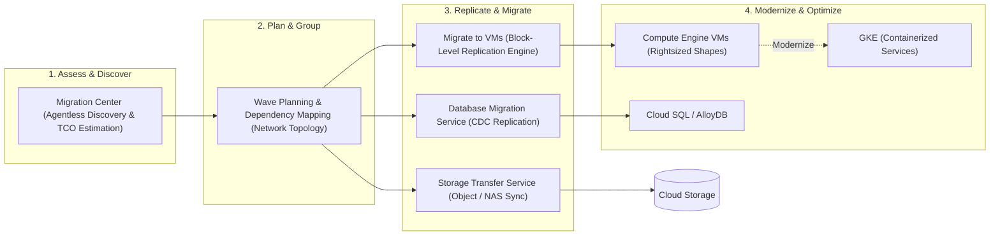

# GCP Migration & Enterprise Modernization Hub 🚀

Google Cloud provides an integrated end-to-end migration portfolio designed to assess, plan, replicate, and modernize enterprise infrastructure from on-premises datacenters (VMware vSphere, bare metal) and other public clouds (AWS, Azure) into Google Cloud compute, container, and database environments with minimal business downtime.

---

## Service Catalog & Architecture Map

| Service                              | Target Workload            | Primary Modernization Vector                                                               | Reference Guide                                                    |
| :----------------------------------- | :------------------------- | :----------------------------------------------------------------------------------------- | :----------------------------------------------------------------- |
| **Migration Center**                 | Enterprise IT Estates      | Unified discovery, inventory assessment, TCO estimation, and wave planning.                | [[GCP/migration/migration-center\|Migration Center Deep Dive]]     |
| **Migrate to Virtual Machines**      | VMware / AWS / Azure VMs   | Agentless block-level continuous data replication directly into Compute Engine.            | [[GCP/compute/gce\|Compute Engine (GCE)]]                          |
| **Migrate to Containers**            | Monolithic VM Workloads    | Deconstructing OS images into containerized workloads running on GKE.                      | [[GCP/compute/gke\|Google Kubernetes Engine (GKE)]]                |
| **Database Migration Service (DMS)** | Relational Databases       | Low-downtime Change Data Capture (CDC) into Cloud SQL and AlloyDB.                         | [[GCP/databases/cloud-sql\|Cloud SQL Deep Dive]]                   |
| **Storage Transfer Service**         | Unstructured & Object Data | High-throughput petabyte-scale data migration from S3, Azure Blob, and local NAS into GCS. | [[GCP/storage/storage-transfer-service\|Storage Transfer Service]] |

---

## The Migration Lifecycle Framework

---

## Related Knowledge Hubs

- [[GCP]] — Master Google Cloud Platform architectural catalog
- [[GCP/compute/gce|Compute Engine (GCE)]] — Target platform for virtual machine migrations
- [[GCP/storage/storage-transfer-service|Storage Transfer Service]] — Bulk data migration
- [[AWS/migration/README|AWS Migration Comparison]] — Comparison with AWS Application Migration Service (MGN) and DMS
