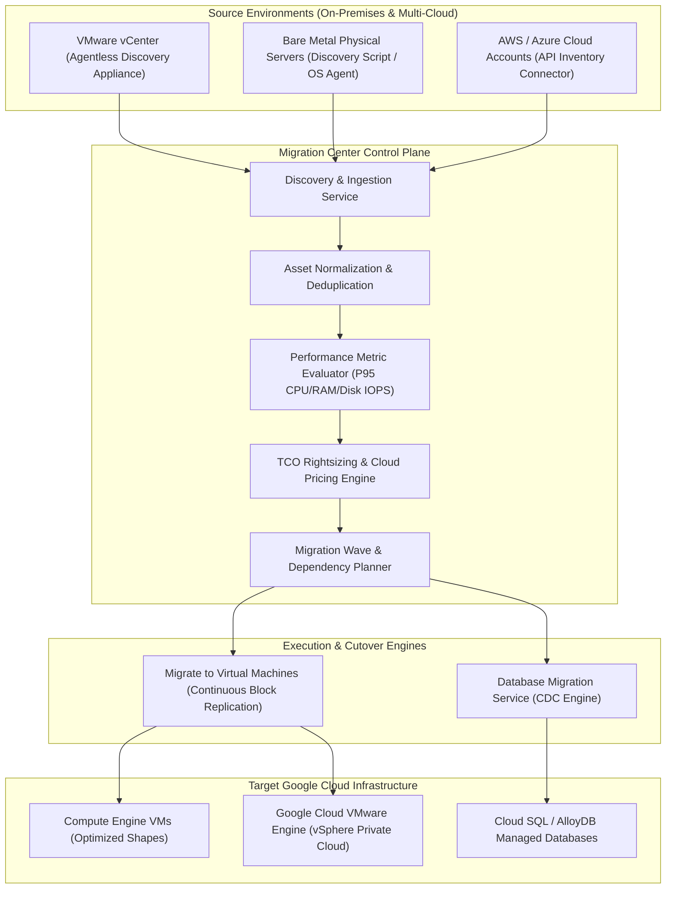

# Migration Center Architecture & Enterprise Workload Modernization 🏢

Google Cloud Migration Center is the unified platform for discovering, assessing, and planning enterprise infrastructure migrations. It ingests asset telemetry from on-premises datacenters (VMware vSphere, Hyper-V, bare metal) and public clouds (AWS, Azure), evaluates actual CPU/RAM/disk performance metrics, generates Total Cost of Ownership (TCO) rightsizing models, and coordinates cutovers with Migrate to Virtual Machines (M4VM) and Database Migration Service (DMS).

---

## Architecture & Mental Model



Migration Center eliminates the guesswork of lift-and-shift migrations. By capturing continuous 30-day performance metrics (evaluating **95th percentile CPU, RAM, and IOPS consumption** rather than allocated server specifications), it automatically rightsizes over-provisioned on-prem virtual machines into optimal Compute Engine machine shapes, preventing multi-million dollar cloud overspending.

---

## Deep Core Concepts & Migration Waves

### 1. Discovery Modalities: Agentless vs Agent-Based

- **Agentless VMware Discovery:** Deploys an OVA virtual appliance (**Migration Center Discovery Client**) directly into on-premises vCenter. Connects via standard vSphere management APIs to collect inventory, CPU utilization, allocated disk sizes, network interfaces, and guest OS versions without installing any software inside guest VMs.
- **Agent-Based / Script Discovery:** For bare-metal Linux and Windows physical servers, lightweight automated scripts query WMI (Windows) or Linux sysfs/procfs to capture configuration profiles.
- **Multi-Cloud Connectors:** Secure read-only IAM connectors query AWS EC2, EBS, RDS, and Azure VM APIs directly to import multi-cloud inventory into Migration Center.

### 2. TCO Estimation & Rightsizing Preference Sets

Platform architects create **Preference Sets** to simulate different migration scenarios:

- **As-Is Migration:** Maps allocated on-prem vCPUs and RAM to exact equivalent GCP machine types.
- **Rightsized Migration:** Sizing based on real utilization (e.g. an on-prem VM allocated 32 vCPUs but running at 10% average utilization is rightsized to an `e2-standard-4`).
- **Discount Modeling:** Simulates cost savings by applying 1-year or 3-year Committed Use Discounts (CUDs) and Sustained Use Discounts (SUDs).

### 3. Wave Planning & Network Dependency Mapping

Enterprises migrate in staged **Waves** (e.g., non-critical internal apps $\to$ staging environments $\to$ core transactional systems). Migration Center discovers inter-service network dependencies (listening ports, active TCP sockets) to ensure microservices with tight latency coupling are migrated in the same wave, preventing broken network links during cutover.

---

## Production `gcloud` CLI Operations

### 1. Creating a Rightsizing Preference Set

```bash
# Create a preference set simulating rightsized compute with 3-year Committed Use Discounts
gcloud migration-center preference-sets create prod-rightsized-cud-3yr \
  --location=us-central1 \
  --pricing-type=COMMITTED_3_YEAR \
  --compute-engine-preferences-license-type=DEFAULT \
  --compute-engine-preferences-machine-preferences-allowed-machine-series="c3,n2,e2" \
  --description="Aggressive rightsizing with 3-year commitments" \
  --project=my-prod-project
```

### 2. Querying Discovered Assets and Performance Metrics

```bash
# List all discovered virtual machine assets sorted by allocated memory
gcloud migration-center assets list \
  --location=us-central1 \
  --filter="insightList.insights:*" \
  --format="table(name,assignedGroups,machineDetails.machineName,machineDetails.coreCount,machineDetails.memoryMb)" \
  --project=my-prod-project
```

### 3. Creating a Logical Asset Group for Migration Wave 1

```bash
# Create an asset group for the first migration wave
gcloud migration-center groups create wave-01-web-tier \
  --location=us-central1 \
  --description="Wave 1: Web frontend and stateless application servers" \
  --project=my-prod-project
```

---

## Quotas, Performance, and Configuration Limits

| Resource / Parameter            | Default Quota / Architectural Limit                      | Operational Guidance                                                                          |
| :------------------------------ | :------------------------------------------------------- | :-------------------------------------------------------------------------------------------- |
| **Service Cost**                | **$0.00** (Free assessment tool)                         | Discovery, TCO estimation, and wave planning carry no licensing fee.                          |
| **Asset Limit**                 | Up to **100,000 assets** per project                     | Ample for large enterprise datacenters spanning tens of thousands of servers.                 |
| **Telemetry Collection Window** | Recommended **14 to 30 days**                            | Ensures performance profiling captures end-of-month and peak business usage cycles.           |
| **Discovered OS Support**       | Windows Server 2008+, RHEL, CentOS, Debian, Ubuntu, SLES | Identify legacy unsupported operating systems early for OS modernization or containerization. |

---

## Official References & Documentation

- [Google Cloud Migration Center Documentation](https://cloud.google.com/migration-center/docs)
- [Deploying the Discovery Client for VMware](https://cloud.google.com/migration-center/docs/deploy-discovery-client)
- [Estimating TCO and Rightsizing Preferences](https://cloud.google.com/migration-center/docs/preferences-overview)
- [Migrate to Virtual Machines Documentation](https://cloud.google.com/migrate/virtual-machines/docs)

---

## Realistic Pricing Scenarios

### Scenario 1: Enterprise Datacenter Assessment (500 VMs)

- **Workload:** 500 VMware virtual machines evaluated over 30 days using the agentless discovery appliance.
  - Initial on-premises allocation: 4,000 vCPUs, 16 TB RAM.
  - Migration Center Rightsizing Analysis: 95th percentile utilization reveals actual needs are 1,200 vCPUs, 4.8 TB RAM.
- **Cost Calculation:**
  - Migration Center Discovery & TCO Platform Fee: **$0.00** (Permanently free).
  - As-Is Cloud Projection: ~$140,000 / month.
  - Rightsized Cloud Projection with 3-year CUDs: ~$42,000 / month.
  - **Net Annual TCO Savings Identified:** **~$1,176,000 / year** saved prior to migration.

### Scenario 2: Cutover Execution via Migrate to Virtual Machines (M4VM)

- **Workload:** Replicating 50 mission-critical database and application VMs (10 TB total storage) into Compute Engine.
- **Cost Calculation:**
  - M4VM Replication Engine: **$0.00** (No replication license charges).
  - Staging Cloud Storage and snapshot storage during replication: $\mathbf{\$45.00}$.
  - Target Compute Engine VMs (billed only upon final cutover spin-up): Standard GCE rates.
  - **Total Estimated Migration Tool Spend:** **~$45.00**

---

## Battle-Tested Nuggets & Production Gotchas

1. **The Short Discovery Sampling Trap:**
   Running Migration Center discovery for only 24 to 48 hours is dangerous. Many enterprise systems experience peak batch processing only at midnight, on weekends, or during end-of-month accounting runs. Rightsizing a server based on a 48-hour quiet window can downsize a machine that subsequently crashes under peak month-end load. **Collect at least 14 to 30 continuous days of telemetry**.
2. **UEFI vs BIOS Firmware Compatibility:**
   Migrating legacy on-premises virtual machines into Compute Engine requires compatible boot firmware. GCE modern machine shapes (like C3 or T2A) require UEFI boot, whereas older on-prem VMs may use legacy MBR/BIOS bootloaders. Migration Center flags firmware mismatches; ensure bootloader conversion is planned during wave preparation.
3. **VMware Tools Version Outdated Alert:**
   The agentless discovery client queries VMware guest metrics via VMware Tools. If guest VMs run outdated or non-functioning VMware Tools, vCenter cannot report guest memory utilization (reporting only assigned memory), preventing Migration Center from accurately rightsizing memory allocations. Ensure VMware Tools is updated across the fleet prior to assessment.
4. **Database Workload Separation:**
   While Migrate to Virtual Machines can replicate database VMs (SQL Server, Oracle, MySQL), performing a block-level lift-and-shift of transactional databases often preserves inefficient storage layouts and expensive legacy OS licenses. Use Migration Center to isolate database assets and migrate them to managed [[GCP/databases/cloud-sql\|Cloud SQL]] or [[GCP/databases/alloydb/README\|AlloyDB]] using **Database Migration Service (DMS)** with continuous Change Data Capture (CDC).
5. **Static IP Re-Mapping Planning:**
   On-premises servers frequently rely on hardcoded static IP addresses. When migrating to Google Cloud VPCs, IP addresses will change unless using specialized L2 stretch networks (like Google Cloud VMware Engine - GCVE). Use Migration Center's network discovery maps to update internal DNS records and firewall rules before executing final cutover.

---

## Across the wiki

- [[GCP/migration/README|GCP Migration Hub]] — Enterprise migration and modernization architecture
- [[GCP/compute/gce|Compute Engine (GCE)]] — Target destination for virtual machine migrations
- [[GCP/storage/storage-transfer-service|Storage Transfer Service]] — Bulk storage migration pipeline
- [[GCP/databases/cloud-sql|Cloud SQL]] — Relational target for database modernization
- [[AWS/migration/application-migration-service/README|AWS Application Migration Service Comparison]] — Comparison with AWS MGN
