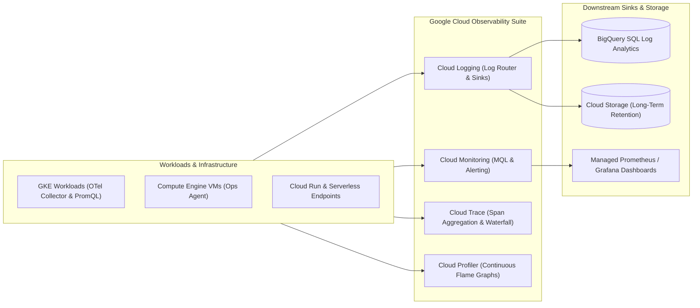

# GCP Monitoring & Observability Hub 📈

Google Cloud Observability (formerly Stackdriver) provides an integrated, enterprise-scale telemetry suite covering the four pillars of modern observability: **Metrics, Logs, Traces, and Continuous Profiles**. Engineered to run natively at hyper-scale, it provides full-stack visibility across Google Cloud infrastructure, multi-cloud platforms, and Kubernetes clusters with deep OpenTelemetry (OTel) standard integration.

---

## Service Catalog & Architecture Map

| Service                     | Telemetry Pillar      | Core Architecture & Engine                                                                                       | Reference Guide                                                        |
| :-------------------------- | :-------------------- | :--------------------------------------------------------------------------------------------------------------- | :--------------------------------------------------------------------- |
| **Cloud Monitoring**        | Metrics & Alerting    | Metric scopes, Monitoring Query Language (MQL), SRE SLO error budgets, and Managed Service for Prometheus (GMP). | [[GCP/monitoring/cloud-monitoring/README\|Cloud Monitoring Deep Dive]] |
| **Cloud Logging**           | Structured Log Stream | High-throughput Log Router, exclusion filters, BigQuery SQL log analytics, and log-based metric generation.      | [[GCP/monitoring/cloud-logging/README\|Cloud Logging Deep Dive]]       |
| **Cloud Trace**             | Distributed Tracing   | Distributed latency tracing, OTLP ingestion, span waterfall visualization, and automated bottleneck detection.   | [[GCP/monitoring/cloud-trace\|Cloud Trace Deep Dive]]                  |
| **Cloud Profiler**          | Continuous Profiling  | Zero-cost continuous production CPU, wall time, heap, and thread profiling with flame graph analysis.            | [[GCP/monitoring/cloud-profiler\|Cloud Profiler Deep Dive]]            |
| **GKE Observability & GMP** | Kubernetes Telemetry  | ContainerLogV2 logging, PodMonitoring / ClusterPodMonitoring CRDs, and native PromQL querying.                   | [[GCP/compute/gke/observability-gmp\|GKE Observability & GMP]]         |

---

## The Unified Observability Data Flow

---

## Related Knowledge Hubs

- [[GCP]] — Master Google Cloud Platform architectural catalog
- [[GCP/compute/gke/observability-gmp|GKE Managed Service for Prometheus]] — Native Kubernetes monitoring CRDs
- [[Observability]] — Core concepts of metrics, logs, traces, and OpenTelemetry
- [[AWS/monitoring/README|AWS Monitoring Comparison]] — Comparison with AWS CloudWatch and X-Ray
