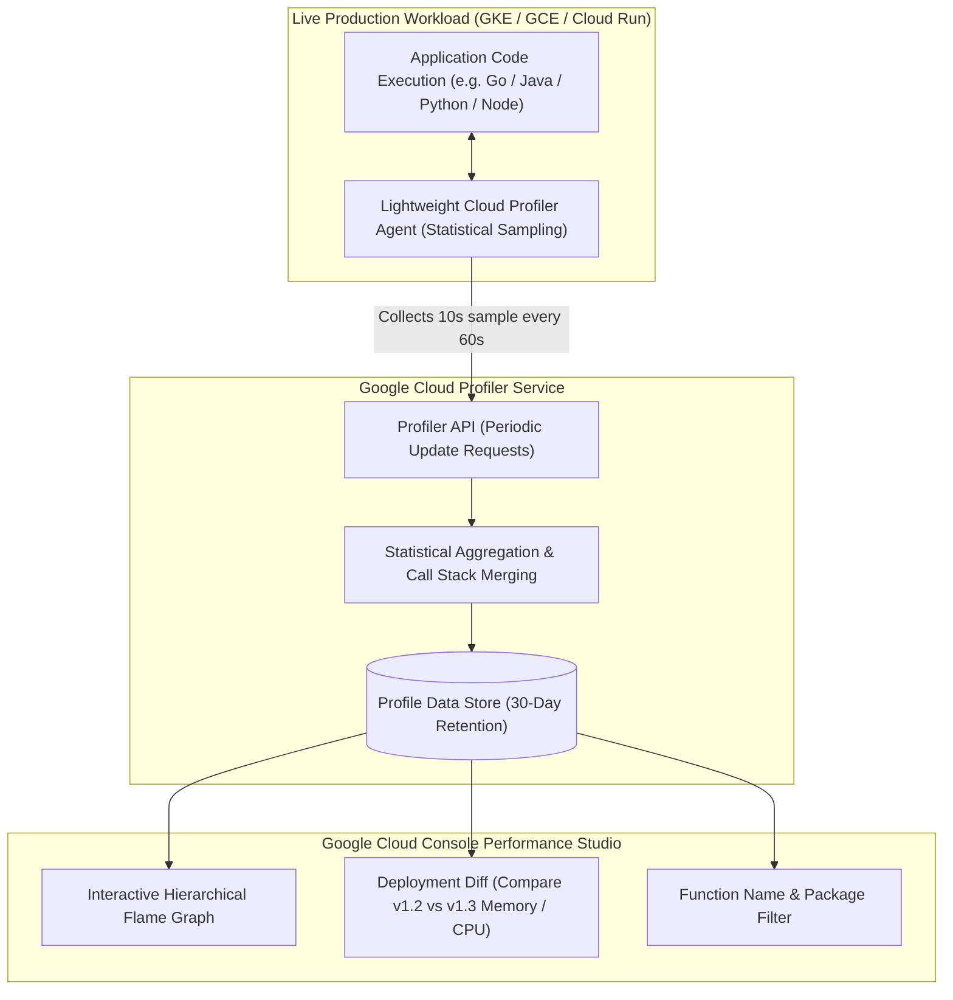

# Cloud Profiler Architecture & Continuous Code Performance 🔥

Google Cloud Profiler is a continuous, statistical production profiling service. Designed to run permanently inside live production environments with **less than 5% CPU and memory overhead**, Cloud Profiler captures detailed call stacks and resource consumption across production microservices (Go, Java, Node.js, Python), rendering interactive **Flame Graphs** that expose the exact functions and code paths consuming CPU, memory, and thread locks.

---

## Architecture & Mental Model



Traditional profilers inject heavy instrumentation that degrades application throughput, rendering them unusable in live production environments. Cloud Profiler uses **statistical sampling**:

- An in-process agent wakes up periodically (e.g. for 10 seconds every minute), collects call stack snapshots directly from kernel timers or JVM JVMTI interfaces, and transmits compressed profiles to Google Cloud.
- Because sampling is randomized and transient, production user requests experience virtually zero perceptible latency degradation.

---

## Supported Profile Types & Analysis

| Profile Type           | Supported Languages       | What It Measures                                                | Target Optimization                                             |
| :--------------------- | :------------------------ | :-------------------------------------------------------------- | :-------------------------------------------------------------- |
| **CPU Time**           | Go, Java, Node.js, Python | Actual CPU core cycles consumed executing instructions          | Inefficient algorithms, regex parsing, JSON serialization loops |
| **Wall Clock Time**    | Go, Java, Node.js, Python | Total elapsed time spent in a function (including blocking I/O) | Database query stalls, network latency, thread sleep deadlocks  |
| **Heap Memory**        | Go, Java, Node.js, Python | Memory allocated and currently retained in the heap             | Memory leaks, unbounded cache growth, retained object bloat     |
| **Allocated Memory**   | Go, Java                  | Total bytes allocated over the sample period (even if freed)    | Garbage collection thrashing, short-lived object churn          |
| **Contention (Mutex)** | Go, Java                  | Time threads spend blocked waiting to acquire shared locks      | Concurrency bottlenecks, synchronized block serialization       |

---

## Deep Core Concepts & Flame Graph Navigation

### 1. Reading Flame Graphs

- **Horizontal Bar Width ($X$-Axis):** Represents the proportion of the resource (CPU, memory) consumed by that specific function. Wider bars indicate greater consumption.
- **Vertical Hierarchy ($Y$-Axis):** Represents call stack depth. Top-level functions call child functions below them (or bottom-up inverted mode).
- **Colors:** Function blocks are color-coded by software package/namespace to differentiate application code from runtime libraries.

### 2. Deployment Performance Diffs

Cloud Profiler tags every collected profile with the application's version string (`--service-version=v2.4.0`):

- Platform engineers can select **Compare To** in the Cloud Console to visualize a differential flame graph between the current release and the prior stable release.
- Functions that increased CPU consumption are highlighted in **red**, while optimized functions appear in **blue**, immediately validating whether a software refactor improved efficiency.

---

## Production Agent Setup & CLI

### 1. Initializing Cloud Profiler in a Go Application

```go
package main

import (
    "log"
    "cloud.google.com/go/profiler"
)

func main() {
    // Initialize continuous production profiling
    cfg := profiler.Config{
        Service:        "payments-service",
        ServiceVersion: "v2.1.0",
        ProjectID:      "my-prod-project",
        MutexProfiling: true,
        AllocForceGC:   true,
    }
    if err := profiler.Start(cfg); err != nil {
        log.Fatalf("Failed to start Cloud Profiler: %v", err)
    }

    // Application business logic executes normally
}
```

### 2. Initializing Cloud Profiler in a Java Application

```bash
# Attach the Java profiler agent via JVM arguments
java -agentpath:/opt/cprof/profiler_java_agent.so=\
-cprof_service=orders-api,\
-cprof_service_version=v3.0.1,\
-cprof_enable_heap_sampling=true \
-jar /app/orders-service.jar
```

### 3. Querying Deployments via `gcloud`

```bash
# Query active profiler deployments in the regional project
gcloud alpha profiler deployments list \
  --project=my-prod-project \
  --format="table(target.service,target.serviceVersion,createTime)"
```

---

## Quotas, Performance, and Configuration Limits

| Resource / Parameter      | Default Quota / Architectural Limit         | Operational Guidance                                                                  |
| :------------------------ | :------------------------------------------ | :------------------------------------------------------------------------------------ |
| **Service Cost**          | **$0.00** (Permanently free)                | Cloud Profiler carries zero ingestion or licensing fees.                              |
| **Data Retention Window** | **30 days** of continuous profiling history | Download profile files (`.pb.gz`) for long-term historical records.                   |
| **API Update Requests**   | Governed by deployment count quotas         | Limit redundant deployment version strings (e.g. avoid unique version names per pod). |
| **Sampling Overhead**     | **< 5% CPU / memory impact**                | Safe to leave enabled 24/7 across all production nodes.                               |

---

## Official References & Documentation

- [Google Cloud Profiler Official Documentation](https://cloud.google.com/profiler/docs)
- [How Profiling Works & Sampling Concepts](https://cloud.google.com/profiler/docs/concepts-profiling)
- [Interpreting Flame Graphs](https://cloud.google.com/profiler/docs/interactive-flame-graphs)
- [Cloud Profiler Supported Languages](https://cloud.google.com/profiler/docs/profiling-go)

---

## Realistic Pricing Scenarios

### Scenario 1: Enterprise Microservices Fleet (1,000 Pods)

- **Workload:** 1,000 GKE pods running across 100 node pool instances profiling Go, Java, and Python microservices 24/7.
- **Cost Calculation:**
  - Cloud Profiler Platform Fee: **$0.00** (Permanently free).
  - Profiling data ingestion & storage: **$0.00** (Included).
  - CPU/Memory overhead on nodes (<2%): Absorbed into standard GKE capacity.
  - **Total Estimated Monthly Spend:** **$0.00 / month**

### Scenario 2: High-Performance Batch Optimization Savings

- **Workload:** Data engineering team identifies a CPU-heavy JSON unmarshaling bottleneck in an analytical microservice using Cloud Profiler flame graphs.
  - Optimizing the function drops microservice CPU consumption by 35%.
  - Enables downsizing GKE node pools from 40 `c2-standard-16` VMs to 26 VMs.
- **Financial Impact:**
  - Downsizing saves 14 VMs $\times \$0.675 / \text{hr} \times 730\text{ hrs} = \mathbf{-\$6,898.50 / \text{month}}$ in compute costs.
  - Cost of Cloud Profiler tool: **$0.00**.
  - **Net Annual Infrastructure Savings:** **~$82,782.00 / year**

---

## Battle-Tested Nuggets & Production Gotchas

1. **The Dynamic Pod Version String Quota Exhaustion:**
   Cloud Profiler groups profiling data by `Service` and `ServiceVersion`. If your deployment pipeline injects the unique Kubernetes Pod name or build timestamp into the version string (e.g. `serviceVersion: v1.0.0-pod-xyz-9876`), **every pod creates a distinct deployment entity**. This rapidly exhausts the Google Cloud Profiler API deployment quota, causing profile uploads to be dropped. Always set `ServiceVersion` to the semantic release tag (e.g. `v1.2.0`).
2. **Missing Debug Symbols in Stripped Go Binaries:**
   Building Go binaries with `go build -ldflags="-s -w"` strips all symbol tables and DWARF debugging metadata to reduce binary size. While this produces smaller container images, Cloud Profiler will only be able to display raw memory addresses (e.g. `0x4012ab`) in flame graphs instead of human-readable function names (`main.processOrder`). For production profiling, compile without `-s -w`.
3. **The `Wall Time` vs `CPU Time` Diagnostic Divergence:**
   When troubleshooting slow endpoints, engineers frequently look only at CPU flame graphs and find nothing abnormal. If a function is blocked waiting for an external database response, a network lock, or a Redis timeout, it consumes **zero CPU cycles** and will not appear on a CPU flame graph. Always switch the view to **Wall Time** to visualize functions stalled on blocking I/O.
4. **Java Native Memory Allocation Blindspot:**
   In Java applications, Cloud Profiler's Heap sampling measures memory allocated inside the JVM heap. It does **not** track off-heap allocations, native JNI C-library allocations, or memory-mapped files (Netty direct byte buffers). If an application's resident set size (RSS) grows until Kubernetes kills it with OOMKilled while the Profiler heap graph looks flat, the memory leak is occurring off-heap.
5. **Least Privilege IAM Permissions:**
   The profiler agent requires network egress to Google APIs and permission to publish profiles. The Compute Engine or GKE service account running the workload needs the `roles/cloudprofiler.agent` role. Do not grant broad administrative roles; `cloudprofiler.agent` provides write-only profile reporting access without read or modification capabilities.

---

## Across the wiki

- [[GCP/monitoring/README|GCP Monitoring Hub]] — Observability suite architecture
- [[GCP/monitoring/cloud-trace|Cloud Trace Deep Dive]] — Distributed latency tracing across microservices
- [[GCP/monitoring/cloud-monitoring/README|Cloud Monitoring Deep Dive]] — Infrastructure and metric alerting
- [[GCP/compute/gke/troubleshooting-runbook|GKE Troubleshooting Runbook]] — Diagnosing CPU saturation and OOMKills
- [[AWS/monitoring/README|AWS Observability Comparison]] — Comparison with AWS CloudWatch and CodeGuru
