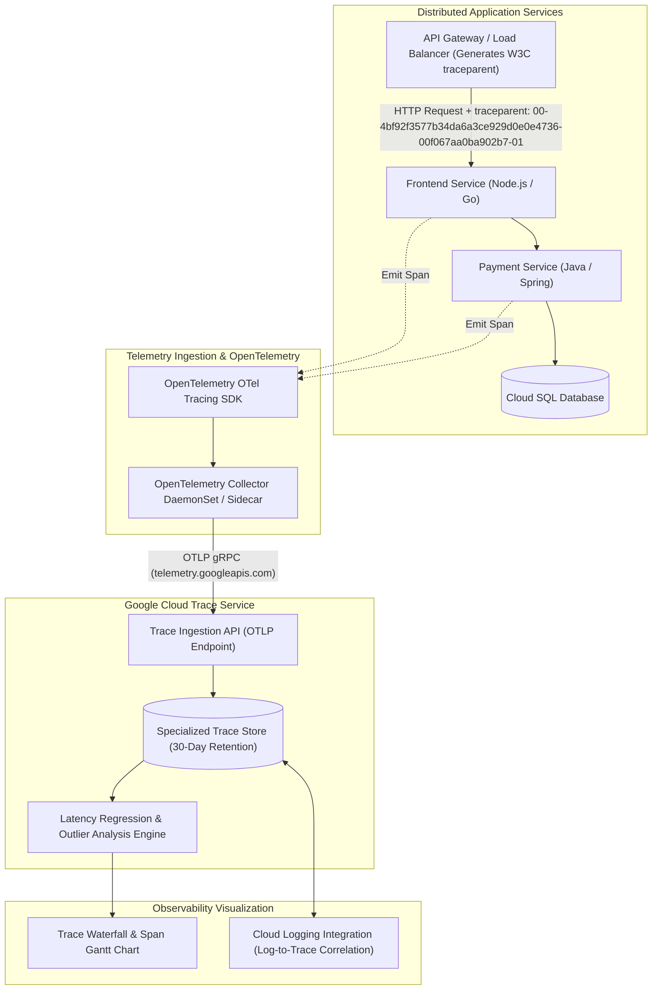

# Cloud Trace Architecture & Distributed Tracing Deep Dive 🔍

Google Cloud Trace is a fully managed, low-latency distributed tracing system. Derived from Google's internal **Dapper** tracing architecture, Cloud Trace collects latency data and execution spans across microservice networks, serverless functions, and database calls, correlating asynchronous requests into a unified timeline waterfall to isolate latency bottlenecks and performance regressions.

---

## Architecture & Mental Model



Cloud Trace tracks requests as they flow across network boundaries using the W3C **Trace Context** standard (`traceparent` header). Each atomic unit of work within a service is recorded as a **Span** containing a start time, duration, status code, and arbitrary key-value attributes. Spans sharing the same 128-bit `trace_id` are assembled into a parent-child directed acyclic graph (DAG).

---

## Deep Core Concepts & Telemetry Mechanics

### 1. Automatic Tracing vs OpenTelemetry (OTel) Instrumentation

- **Google-Managed Serverless Infrastructure:** Invocations running on Cloud Run, Cloud Functions, and App Engine automatically generate root spans at the Google Front End (GFE) layer **free of charge** without code modification.
- **Custom Application Instrumentation:** Microservices running on [[GCP/compute/gke\|GKE]] or Compute Engine use the open-source **OpenTelemetry (OTel)** SDK. Adding the OpenTelemetry Google Cloud Trace exporter (`google-cloud-opentelemetry`) automatically exports spans to Cloud Trace without vendor lock-in.

### 2. Log-to-Trace Correlation

Cloud Trace seamlessly bridges with [[GCP/monitoring/cloud-logging/README\|Cloud Logging]]. If your application logs emit JSON payloads containing the standard Google Cloud trace identifier:

```json
{
  "severity": "ERROR",
  "message": "Database query timed out",
  "logging.googleapis.com/trace": "projects/my-prod-project/traces/4bf92f3577b34da6a3ce929d0e0e4736",
  "logging.googleapis.com/spanId": "00f067aa0ba902b7"
}
```

Clicking any span in the Cloud Trace UI instantly reveals every matching log line generated during that exact execution millisecond, dramatically accelerating incident triage.

### 3. Sampling Strategies: Controlling Ingestion Volume

In high-throughput microservices processing tens of thousands of requests per second, tracing 100% of requests is cost-prohibitive and unnecessary:

- **Head-Based Probabilistic Sampling:** The ingress gateway samples a fixed percentage (e.g., 5% of requests). If sampled, downstream services inherit the decision via the tracecontext flag.
- **Tail-Based Sampling:** The OpenTelemetry Collector buffers traces in memory and evaluates completed traces: 100% of traces containing HTTP 5xx errors or durations $>2$ seconds are kept, while fast 200 OK requests are sampled at 1%.

---

## Production OpenTelemetry & CLI Configuration

### 1. OpenTelemetry Collector Configuration for Cloud Trace (`collector.yaml`)

```yaml
receivers:
  otlp:
    protocols:
      grpc:
        endpoint: 0.0.0.0:4317
      http:
        endpoint: 0.0.0.0:4318

processors:
  batch:
    send_batch_size: 512
    timeout: 5s
  memory_limiter:
    check_interval: 1s
    limit_percentage: 75

exporters:
  googlecloud:
    project: my-prod-project
    trace:
      bundle_delay: 5s

service:
  pipelines:
    traces:
      receivers: [otlp]
      processors: [memory_limiter, batch]
      exporters: [googlecloud]
```

### 2. Querying Recent Trace Latencies via `gcloud`

```bash
# List recent traces exceeding 2 seconds in duration
gcloud trace traces list \
  --filter="latency > 2s" \
  --limit=10 \
  --project=my-prod-project
```

---

## Quotas, Performance, and Configuration Limits

| Resource / Parameter            | Default Quota / Architectural Limit                 | Operational Guidance                                                                              |
| :------------------------------ | :-------------------------------------------------- | :------------------------------------------------------------------------------------------------ |
| **Free Tier Allowance**         | **2.5 million spans per month** free                | Free allocation applies per billing account.                                                      |
| **Standard Ingestion Pricing**  | **$0.20 per million spans** beyond free tier        | Implement head-based or tail-based sampling in OpenTelemetry collectors.                          |
| **Data Retention Period**       | **30 days** (Strict non-configurable retention cap) | For long-term historical analysis, export trace metadata to [[GCP/databases/bigquery\|BigQuery]]. |
| **Max Attributes per Span**     | **128 attributes** per span                         | Avoid recording massive variable objects; keep span attributes to IDs and status codes.           |
| **Max Span Description Length** | **128 bytes**                                       | Truncate long URLs or query strings in span names.                                                |

---

## Official References & Documentation

- [Google Cloud Trace Official Documentation](https://cloud.google.com/trace/docs)
- [OpenTelemetry with Google Cloud Trace](https://cloud.google.com/trace/docs/setup)
- [Log and Trace Correlation Guide](https://cloud.google.com/trace/docs/trace-log-integration)
- [Google Cloud Observability Pricing](https://cloud.google.com/stackdriver/pricing)

---

## Realistic Pricing Scenarios

### Scenario 1: Moderate Microservices Architecture

- **Workload:** 15 microservices processing 500 requests/sec.
  - Implements 5% head-based probabilistic sampling.
  - Average trace generates 4 spans.
  - Monthly spans: $500\text{ req/sec} \times 0.05 \times 4\text{ spans} \times 2,592,000\text{ sec/mo} = 259,200,000\text{ spans}$.
- **Cost Calculation:**
  - Net billable spans ($259.2\text{M} - 2.5\text{M}$): $256.7\text{ million spans}$.
  - Cloud Trace Ingestion Fee: $256.7 \times \$0.20 / \text{million} = \mathbf{\$51.34}$
  - Cloud Run auto-generated infrastructure spans: $\mathbf{\$0.00}$ (Free).
  - **Total Estimated Monthly Spend:** **~$51.34 / month**

### Scenario 2: Startup Free-Tier Tracing

- **Workload:** 3 Cloud Run services processing 2,000,000 total requests/month with custom sub-spans.
  - Generates 2,100,000 total custom spans per month.
- **Cost Calculation:**
  - Total spans fall entirely within the 2.5M free monthly allotment.
  - **Total Estimated Monthly Spend:** **$0.00 / month**

---

## Battle-Tested Nuggets & Production Gotchas

1. **Context Propagation Loss Across Asynchronous Boundaries:**
   Distributed tracing breaks if a microservice pushes a task to [[GCP/application-integration/cloud-tasks\|Cloud Tasks]] or [[GCP/analytics/pubsub/README\|Cloud Pub/Sub]] without manually injecting the `traceparent` header into message attributes. The consuming worker will initiate a brand-new trace ID, splitting what was a single end-to-end user transaction into two completely disconnected trace fragments. Always use OpenTelemetry context injectors when publishing asynchronous messages.
2. **High-Cardinality Span Name Performance Degradation:**
   A common mistake in REST controllers is formatting span names with dynamic path variables (e.g. `GET /users/12345/orders/98765`). This generates millions of unique span names, defeating Cloud Trace's automated latency analysis and outlier grouping algorithms. Format span names with route templates (e.g. `GET /users/{userId}/orders/{orderId}`) and store the raw ID inside a span attribute.
3. **Database Connection Pool Acquisition Hidden Latency:**
   When inspecting slow traces, engineers often see a span named `db.query` that takes 5 seconds, assuming the SQL execution was slow. However, if database instrumentation wraps the connection acquisition step inside the query span, a saturated connection pool waiting for an available socket will make the query appear slow. Instrument `db.connection.wait` as a distinct span to differentiate pool exhaustion from slow SQL execution.
4. **OTel Collector Memory Limiter Processor Necessity:**
   During sudden network partitions between your cluster and Google's telemetry endpoints, OpenTelemetry collectors buffer outgoing spans in memory. Without an explicit `memory_limiter` processor configured in `collector.yaml`, the collector will consume excessive RAM and be terminated by Kubernetes with `OOMKilled (Exit Code 137)`, dropping millions of in-flight traces.
5. **The Non-Chargeable Serverless Span Perk:**
   Infrastructure spans automatically recorded by Google Front Ends for Cloud Run and App Engine are **completely free and do not count against your 2.5M free monthly tier**. Take advantage of this by enabling serverless request tracing before adding heavy custom instrumentation.

---

## Across the wiki

- [[GCP/monitoring/README|GCP Monitoring Hub]] — Observability suite architecture
- [[GCP/monitoring/cloud-logging/README|Cloud Logging Deep Dive]] — Correlating logs directly with Cloud Trace spans
- [[GCP/monitoring/cloud-monitoring/README|Cloud Monitoring Deep Dive]] — Querying telemetry metrics via MQL
- [[GCP/monitoring/cloud-profiler|Cloud Profiler Deep Dive]] — Continuous CPU/heap code profiling
- [[AWS/monitoring/cloudwatch-logs/README|AWS CloudWatch Logs Comparison]] — Architectural comparison with AWS distributed tracing and logging
