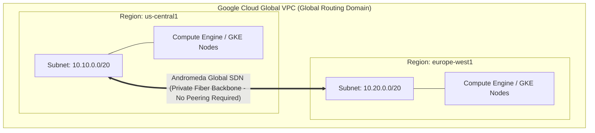

# GCP Networking & Global Connectivity Hub 🌐

Google Cloud operates one of the largest private software-defined networks in the world. Built on Google's private global fiber network (Jupiter datacenter fabric, Andromeda software-defined network, and Maglev Anycast edge routers), Google Cloud networking provides sub-millisecond inter-region latency, global Anycast load balancing, and private cross-project service consumption without public internet transit.

---

## Service Catalog & Architecture Map

| Service                           | Architecture & Scope           | Primary Use Case & Operational Model                                                                      | Reference Guide                                                                  |
| :-------------------------------- | :----------------------------- | :-------------------------------------------------------------------------------------------------------- | :------------------------------------------------------------------------------- |
| **Virtual Private Cloud (VPC)**   | Global Routing Domain          | Globally spanning VPC with regional subnets, primary/secondary IP ranges, and Andromeda SDN.              | [[GCP/networking/vpc\|Virtual Private Cloud (VPC)]]                              |
| **Shared VPC**                    | Centralized Enterprise Fabric  | Host projects sharing private subnets across multiple Service Projects without transit gateways.          | [[GCP/networking/vpc/shared-vpc\|Shared VPC Architecture]]                       |
| **Firewalls & Policies**          | Hierarchical Inspection Engine | Stateful rule priorities (0–65535), target tags, Service Accounts, and Org/Folder Hierarchical Policies.  | [[GCP/networking/vpc/firewalls\|Firewalls & Hierarchical Policies]]              |
| **Cloud NAT**                     | Distributed Software NAT       | High-availability outbound internet gateway for private workloads without public IP exposure.             | [[GCP/networking/vpc/cloud-nat\|Cloud NAT Deep Dive]]                            |
| **Cloud Load Balancing**          | Global Anycast Reverse Proxy   | Single global Anycast IPv4/IPv6 IP, Envoy-based ALBs, Maglev NLBs, and Cloud Armor WAF integration.       | [[GCP/networking/load-balancing\|Cloud Load Balancing]]                          |
| **Cloud Router & BGP**            | Dynamic Routing Control Plane  | Fully managed BGP control plane, dynamic route advertisements (MED), and multi-region routing.            | [[GCP/networking/cloud-router\|Cloud Router & BGP]]                              |
| **Network Connectivity Center**   | Hub-and-Spoke Transit Fabric   | Centralized transit hub connecting VPCs, Cloud VPNs, Cloud Interconnects, and third-party SD-WAN routers. | [[GCP/networking/network-connectivity-center\|Network Connectivity Center]]      |
| **Cloud DNS**                     | 100% Uptime Anycast DNS        | Split-horizon DNS, private peering, response policies (RPZ), and DNSSEC validation.                       | [[GCP/networking/cloud-dns/README\|Cloud DNS Architecture]]                      |
| **Cloud CDN**                     | Global Edge Content Caching    | Edge Points of Presence (PoPs), signed URLs/cookies, and sub-millisecond static content delivery.         | [[GCP/networking/cloud-cdn/README\|Cloud CDN Architecture]]                      |
| **Cloud Interconnect & HA VPN**   | Hybrid Dedicated Connectivity  | 99.99% enterprise SLA topologies, Dedicated/Partner Interconnect (10G/100G), and HA IPSec VPN.            | [[GCP/networking/hybrid/README\|Hybrid Connectivity]]                            |
| **Private Service Connect (PSC)** | Multi-Tenant Endpoint Mesh     | Consuming managed Google APIs and internal SaaS services privately via 40-byte endpoints.                 | [[GCP/networking/private-service-connect/README\|Private Service Connect (PSC)]] |

---

## The Global VPC vs Regional Cloud Comparison

In Amazon Web Services (AWS) and Microsoft Azure, VPCs/VNets are strictly regional. Connecting workloads across regions requires provisioning Transit Gateways, inter-region peering connections, and complex routing tables. In Google Cloud, **a single VPC spans every region globally**. A VM in `us-central1` can ping a VM in `europe-west1` across private IP addresses out of the box over Google's subsea fiber optic backbone without internet traversal.

---

## Related Knowledge Hubs

- [[GCP]] — Master Google Cloud Platform architectural catalog
- [[GCP/security/cloud-armor|Cloud Armor Deep Dive]] — Edge WAF protecting Cloud Load Balancers
- [[GCP/compute/gke/networking|GKE Networking Deep Dive]] — VPC-native alias IPs and Datapath V2 (Cilium eBPF)
- [[AWS/networking/README|AWS Networking Comparison]] — Comparison with AWS VPC and Transit Gateway
