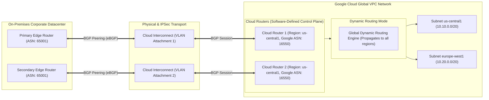

# Cloud Router & Dynamic BGP Architecture Deep Dive 📡

Google Cloud Router is a fully managed, software-defined Border Gateway Protocol (BGP) routing engine. It acts as the dynamic control plane for Google Cloud hybrid connectivity, exchanging routes dynamically between your on-premises routers and your Google Cloud Virtual Private Cloud (VPC) via [[GCP/networking/hybrid/README\|Cloud HA VPN]] and [[GCP/networking/hybrid/README\|Dedicated / Partner Cloud Interconnect]].

---

## Architecture & Mental Model



Cloud Router is **purely a control plane service**. It does _not_ carry user data-plane packets; user packets flow directly from Compute Engine VMs or GKE nodes through Google's Andromeda SDN hypervisors into the Cloud Interconnect physical circuits. Cloud Router simply runs the BGP daemon to inject learned on-premises CIDR routes into the VPC routing table and advertise VPC subnets back to on-prem.

---

## Deep Core Concepts & Dynamic Routing Topologies

### 1. Dynamic Routing Mode: Regional vs Global

A VPC's dynamic routing mode fundamentally dictates how Cloud Router routes propagate:

- **Regional Dynamic Routing:** A Cloud Router in `us-central1` only advertises subnets located in `us-central1` to on-premises routers, and routes learned from on-prem only apply to VMs in `us-central1`.
- **Global Dynamic Routing:** A Cloud Router in `us-central1` advertises **all subnets across the entire global VPC** (including `europe-west1` and `asia-east1`) to on-prem. VMs in any region can route traffic back to on-prem through the `us-central1` interconnect.

### 2. Custom Route Advertisements & Multi-Exit Discriminator (MED)

By default, Cloud Router advertises all VPC subnet IP ranges. Platform architects can override this behavior:

- **Custom Route Advertisements:** Restricts route advertisements to specific summary blocks (e.g. advertising `10.0.0.0/8` instead of fifty `/24` subnets) to prevent exhausting on-premises BGP routing tables.
- **MED (Multi-Exit Discriminator):** Assigns a numeric priority to advertised routes (lower is preferred). In an Active/Passive hybrid topology, Cloud Router 1 advertises subnets with `MED=100`, while Cloud Router 2 advertises the same subnets with `MED=200`. On-premises routers send 100% of traffic through Circuit 1, automatically failing over to Circuit 2 if Circuit 1 drops.

### 3. BGP Timers, Keepalive, and Graceful Restart

Cloud Router negotiates standard BGP parameters:

- **Keepalive Timer:** Defaults to 20 seconds; **Hold Timer:** Defaults to 60 seconds.
- **BGP Graceful Restart:** Enabled by default. If a Cloud Router undergoes software maintenance or a transient control plane failover, data-plane forwarding continues uninterrupted without packet loss while the BGP session re-establishes.

---

## Production `gcloud` CLI Operations

### 1. Provisioning a Cloud Router with Custom ASN

```bash
# Create a Cloud Router in us-central1 with a private ASN (64512)
gcloud compute routers create prod-hybrid-router-01 \
  --network=vpc-prod \
  --region=us-central1 \
  --asn=64512 \
  --project=my-prod-project
```

### 2. Adding a BGP Peer with Active/Passive MED Priorities

```bash
# Add a BGP peer over an interconnect VLAN attachment with primary MED priority 100
gcloud compute routers add-bgp-peer prod-hybrid-router-01 \
  --peer-name=onprem-primary-peer \
  --region=us-central1 \
  --interface=vlan-attachment-primary \
  --peer-ip-address=169.254.10.2 \
  --peer-asn=65001 \
  --advertised-route-priority=100 \
  --project=my-prod-project
```

### 3. Configuring Custom Prefix Summarization

```bash
# Advertise a summarized 10.0.0.0/8 block instead of automatic subnet individual CIDRs
gcloud compute routers update prod-hybrid-router-01 \
  --region=us-central1 \
  --set-advertisement-mode=CUSTOM \
  --set-advertisement-groups="" \
  --add-advertisement-ranges="10.0.0.0/8,172.16.0.0/12" \
  --project=my-prod-project
```

---

## Quotas, Performance, and Configuration Limits

| Resource / Parameter              | Default Quota / Architectural Limit                       | Mitigation & Scaling Strategy                                                               |
| :-------------------------------- | :-------------------------------------------------------- | :------------------------------------------------------------------------------------------ |
| **Cloud Router Service Cost**     | **$0.00** (Permanently free)                              | No hourly instance fee for Cloud Router; pay only for underlying VPN or Interconnect.       |
| **Max Learned Routes per Router** | **100 routes** (Soft limit) / **250 routes** (Hard limit) | On-prem network engineers must summarize on-prem routes before advertising to Cloud Router. |
| **Max BGP Peers per Router**      | **50 BGP peers** per Cloud Router                         | Create additional Cloud Routers in the same region if more peering sessions are needed.     |
| **BGP Hold Timer**                | Minimum **20 seconds** (Negotiated with on-prem)          | For sub-second failover, pair with BFD (Bidirectional Forwarding Detection).                |

---

## Official References & Documentation

- [Google Cloud Router Official Documentation](https://cloud.google.com/network-connectivity/docs/router)
- [Dynamic Routing Modes (Regional vs Global)](https://cloud.google.com/network-connectivity/docs/router/concepts/dynamic-routing-mode)
- [BGP Route Advertisements and Priorities (MED)](https://cloud.google.com/network-connectivity/docs/router/concepts/route-advertisements)
- [Cloud Router BGP Limits and Quotas](https://cloud.google.com/network-connectivity/docs/router/quotas)

---

## Realistic Pricing Scenarios

### Scenario 1: Redundant Dual-Interconnect Enterprise Hybrid Backbone

- **Workload:** High-availability 10 Gbps Cloud Interconnect spanning two Cloud Routers in `us-central1` operating in Global Dynamic Routing mode.
- **Cost Calculation:**
  - Cloud Router Platform Fee: **$0.00** (Free).
  - Dedicated Interconnect 10G ports (2 ports $\times \$1,700/mo$): $\mathbf{\$3,400.00}$.
  - Outbound data transfer across Google private backbone: Standard egress rates.
  - **Total Cloud Router Dedicated Spend:** **$0.00 / month** (Infrastructure costs tied to physical interconnect ports).

### Scenario 2: Multi-Region Active/Active Cloud HA VPN Routing

- **Workload:** 4 Cloud Routers running 8 BGP sessions across 4 Cloud HA VPN gateways connecting AWS and on-prem.
- **Cost Calculation:**
  - Cloud Routers (4 instances): **$0.00** (Free).
  - Cloud HA VPN tunnels (8 tunnels $\times \$0.05 / \text{hr} \times 730\text{ hrs}$): $\mathbf{\$292.00}$.
  - **Total Cloud Router Dedicated Spend:** **$0.00 / month**

---

## Battle-Tested Nuggets & Production Gotchas

1. **The 100 Learned Route Ceiling Trap:**
   By default, Cloud Router accepts a maximum of **100 dynamic BGP routes** from an on-premises peer. If an on-premises network engineer accidentally redistributes internal OSPF or BGP tables advertising 250+ routes, Cloud Router **immediately drops all incoming routes and shuts down the BGP session**. On-prem network engineers must configure outbound prefix filters to advertise only summarized blocks (e.g. `10.0.0.0/8`).
2. **Regional Routing Mode Asymmetric Black Hole:**
   When a VPC is configured with Regional Dynamic Routing, a Cloud Router in `us-central1` learns routes from on-prem and applies them to `us-central1` VMs only. If a VM in `europe-west1` attempts to communicate with on-prem, its traffic is dropped because the European subnet has no route to on-prem. **Always set VPC Dynamic Routing to `GLOBAL`** unless regulatory isolation strictly mandates regional boundary segmentation.
3. **MED Route Preference Inversion:**
   In BGP, **lower Multi-Exit Discriminator (MED) values win**. If Router A advertises `MED=100` and Router B advertises `MED=200`, traffic will prefer Router A. Network engineers accustomed to Cisco administrative distances or local preferences (where higher values win) frequently configure the backup circuit with `MED=50`, inadvertently turning their backup tunnel into the primary traffic sink.
4. **Bidirectional Forwarding Detection (BFD) for Sub-Second Failover:**
   Standard BGP hold timers take up to 60 seconds to detect a link failure (e.g. if an intermediate optical switch drops packets without dropping physical link state). To achieve sub-second automated failover without waiting for the 60-second BGP hold timer to expire, enable **BFD** on the Cloud Router BGP peer (`--bfd-min-receive-interval=300ms`).
5. **Private ASN Range Conflicts (RFC 6996):**
   When choosing an autonomous system number (ASN) for Cloud Router, you must use private ASNs (`64512–65534` for 16-bit or `4200000000–4294967294` for 32-bit). Never configure Google's default ASN (`16550`) on your on-premises edge router, as eBGP sessions reject peering if both sides share the identical ASN unless explicit `allowas-in` overrides are applied.

---

## Across the wiki

- [[GCP/networking/README|GCP Networking Hub]] — Overview of global software-defined networking
- [[GCP/networking/hybrid/README|Cloud Interconnect & HA VPN]] — Physical transport mechanisms paired with Cloud Router
- [[GCP/networking/network-connectivity-center|Network Connectivity Center]] — Centralized transit hub orchestrating Cloud Routers
- [[GCP/networking/vpc|Virtual Private Cloud (VPC)]] — Routing domain configured for global dynamic routing
- [[AWS/networking/hybrid/README|AWS Direct Connect & Transit Gateway BGP]] — Comparison with AWS hybrid routing
