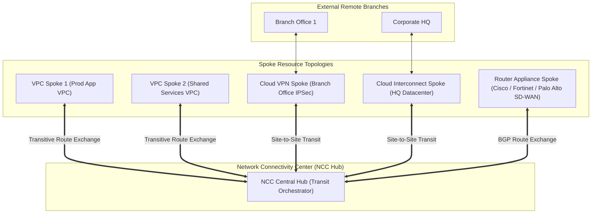

# Network Connectivity Center (NCC) & Transit Architecture 🖧

Google Cloud Network Connectivity Center (NCC) is a centralized, software-defined transit network orchestration service. It leverages Google's global private fiber backbone to establish a unified **Hub-and-Spoke** architecture, simplifying connectivity between multiple Virtual Private Clouds (VPCs), on-premises datacenters, branch offices, and third-party Software-Defined WAN (SD-WAN) virtual appliances without requiring complex mesh peering topologies.

---

## Architecture & Mental Model



NCC treats Google's global network as an enterprise WAN transport:

- **The Hub:** A global administrative container that manages connectivity and transitive route exchange.
- **The Spokes:** Attached connectivity resources representing VPC networks, [[GCP/networking/hybrid/README\|Cloud HA VPN tunnels]], [[GCP/networking/hybrid/README\|Cloud Interconnect VLAN attachments]], or third-party virtual routing appliances running inside Compute Engine VMs (**Router Appliance**).

---

## Deep Core Concepts & Transitive Routing

### 1. VPC-to-VPC Transitive Routing

Historically, Google Cloud VPC Network Peering was non-transitive: if VPC A peered with VPC B, and VPC B peered with VPC C, VPC A could not communicate with VPC C without deploying intermediate proxy VMs. **NCC VPC Spokes eliminate this constraint**:

- By attaching VPC A, VPC B, and VPC C as spokes to an NCC Hub, subnets and routes are dynamically exchanged through Google's Andromeda SDN.
- Workloads in VPC A communicate directly with VPC C across Google's private network with no bandwidth bottlenecks.

### 2. Site-to-Site Data Transfer

NCC allows enterprises to use Google's private global fiber network as their primary corporate WAN:

- Traffic originating from an on-premises branch office in Sydney can enter Google Cloud via a local Cloud VPN, traverse Google's high-speed private subsea fiber backbone, and exit via an Interconnect in London directly into European corporate headquarters, bypassing expensive, unreliable public internet transit.

### 3. Router Appliance for SD-WAN Integration

Enterprises deploying virtual network appliances (such as Cisco Catalyst 8000V, Fortinet FortiGate, or Palo Alto Networks VM-Series) can attach them as **Router Appliance Spokes**:

- The Router Appliance establishes eBGP sessions directly with [[GCP/networking/cloud-router\|Cloud Router]].
- Routes learned by the SD-WAN appliance are injected dynamically into the VPC routing table, automating multi-cloud routing without manual static route management.

---

## Production `gcloud` CLI Operations

### 1. Creating an NCC Hub

```bash
# Create a centralized Network Connectivity Center Hub
gcloud network-connectivity hubs create enterprise-global-hub \
  --description="Global transit hub for corporate VPCs and hybrid branches" \
  --project=my-prod-project
```

### 2. Attaching a VPC Network as a Spoke

```bash
# Attach a production VPC network as an NCC spoke
gcloud network-connectivity spokes linked-vpc-network create prod-vpc-spoke \
  --hub=enterprise-global-hub \
  --location=global \
  --vpc-network="projects/my-prod-project/global/networks/vpc-prod" \
  --description="Production applications VPC spoke" \
  --project=my-prod-project
```

### 3. Attaching Cloud HA VPN Tunnels as a Hybrid Spoke

```bash
# Attach Cloud VPN tunnels to the hub for site-to-site transit
gcloud network-connectivity spokes linked-vpn-tunnels create branch-sydney-spoke \
  --hub=enterprise-global-hub \
  --location=us-central1 \
  --vpn-tunnels="projects/my-prod-project/regions/us-central1/vpnTunnels/tunnel-sydney-01,projects/my-prod-project/regions/us-central1/vpnTunnels/tunnel-sydney-02" \
  --site-to-site-data-transfer \
  --project=my-prod-project
```

---

## Quotas, Performance, and Configuration Limits

| Resource / Metric              | Default Quota / Architectural Limit                   | Operational Guidance                                                  |
| :----------------------------- | :---------------------------------------------------- | :-------------------------------------------------------------------- |
| **NCC Hub Platform Fee**       | **$0.00** (Creating Hubs is permanently free)         | Hub instances carry zero hourly management charges.                   |
| **Spoke Allowances**           | First **3 VPN spokes and 3 Interconnect spokes** free | Spoke hour fees waived for standard small-scale hybrid setups.        |
| **Max Spokes per Hub**         | **250 spokes** per NCC Hub                            | Ample for large multi-VPC and multi-branch global architectures.      |
| **Max Dynamic Routes per Hub** | Bound by Cloud Router route table capacity            | Summarize advertised on-premises prefixes before peering with spokes. |

---

## Official References & Documentation

- [Google Cloud Network Connectivity Center Documentation](https://cloud.google.com/network-connectivity/docs/network-connectivity-center)
- [NCC Hub and Spoke Architecture Overview](https://cloud.google.com/network-connectivity/docs/network-connectivity-center/concepts/overview)
- [Configuring Router Appliance for SD-WAN](https://cloud.google.com/network-connectivity/docs/router-appliance)
- [Network Connectivity Center Pricing](https://cloud.google.com/network-connectivity/pricing)

---

## Realistic Pricing Scenarios

### Scenario 1: Multi-VPC Transit Hub (VPC Spokes Only)

- **Workload:** 10 production and staging VPC networks interconnected via an NCC Hub in the same region.
  - Inter-VPC traffic: 20 TB of cross-VPC data transfer per month.
- **Cost Calculation:**
  - NCC Hub Fee: **$0.00** (Free).
  - VPC Spoke Hours: Free for VPC spokes.
  - Data transfer within the same zone/region: Standard VPC egress charges (~$0.01/GB).
  - **Total Estimated Monthly Spend:** **~$200.00 / month** (Eliminates expensive third-party transit NVA licensing).

### Scenario 2: Global Site-to-Site Corporate WAN

- **Workload:** 6 corporate branches connected via Cloud VPN spokes with site-to-site data transfer enabled across Google's private backbone (5 TB/month transferred between branches).
- **Cost Calculation:**
  - First 3 VPN spokes: Free of charge.
  - Remaining 3 VPN spokes: $3 \times 730\text{ hrs} \times \$0.10 / \text{spoke-hr} = \mathbf{\$219.00}$.
  - Site-to-site data transfer over Google global backbone ($0.08–$0.12/GB): $5,000\text{ GB} \times \$0.10 = \mathbf{\$500.00}$.
  - **Total Estimated Monthly Spend:** **~$719.00 / month** (Substantially cheaper than commercial global MPLS circuits).

---

## Battle-Tested Nuggets & Production Gotchas

1. **VPC Subnet CIDR Overlap Prohibition:**
   When attaching multiple VPC networks as spokes to a single NCC Hub, **no two VPC networks can have overlapping IP subnet ranges**. If VPC A uses `10.10.0.0/16` and VPC B contains a subnet in `10.10.128.0/20`, NCC will reject the spoke creation with `ROUTING_CONFLICT`. Design non-overlapping IP address management (IPAM) blocks across all corporate VPCs.
2. **Site-to-Site Data Transfer Legal & Commercial Constraints:**
   Google Cloud allows using its backbone for site-to-site data transfer (e.g. branch-to-branch or branch-to-datacenter) only in jurisdictions where Google is authorized as a telecommunications carrier. In certain countries, regulatory constraints prohibit pure site-to-site transit without terminating inside a local cloud compute workload.
3. **Cloud Router BGP Association:**
   When attaching Router Appliance spokes, the third-party VM and the associated Cloud Router must reside in the exact same region and VPC network. Attempting to peer a Router Appliance in `us-central1` with a Cloud Router in `us-east4` will fail BGP TCP handshakes.
4. **Asymmetric Routing with Multiple Interconnects:**
   If you attach two Interconnect spokes to an NCC Hub with site-to-site data transfer enabled, ensure your on-premises edge routers honor BGP MED and AS-Path prepending. If traffic leaves on-prem via Interconnect 1 but returns via Interconnect 2, stateful firewalls on-premises will drop packets due to asymmetric routing.
5. **VPC Peering vs NCC Spoke Coexistence:**
   If two VPC networks are already peered using direct VPC Network Peering, attempting to attach both networks as spokes to the same NCC Hub will fail or produce routing conflicts. You must delete the direct VPC peering connection before attaching the networks as NCC spokes.

---

## Across the wiki

- [[GCP/networking/README|GCP Networking Hub]] — Global software-defined networking architecture
- [[GCP/networking/cloud-router|Cloud Router & BGP]] — Dynamic routing engine orchestrating NCC spokes
- [[GCP/networking/vpc/shared-vpc|Shared VPC Architecture]] — Alternative enterprise multi-tenant networking model
- [[GCP/networking/hybrid/README|Cloud Interconnect & HA VPN]] — Hybrid connectivity spokes for NCC
- [[AWS/networking/hybrid/README|AWS Transit Gateway Comparison]] — Architectural comparison with AWS Transit Gateway
