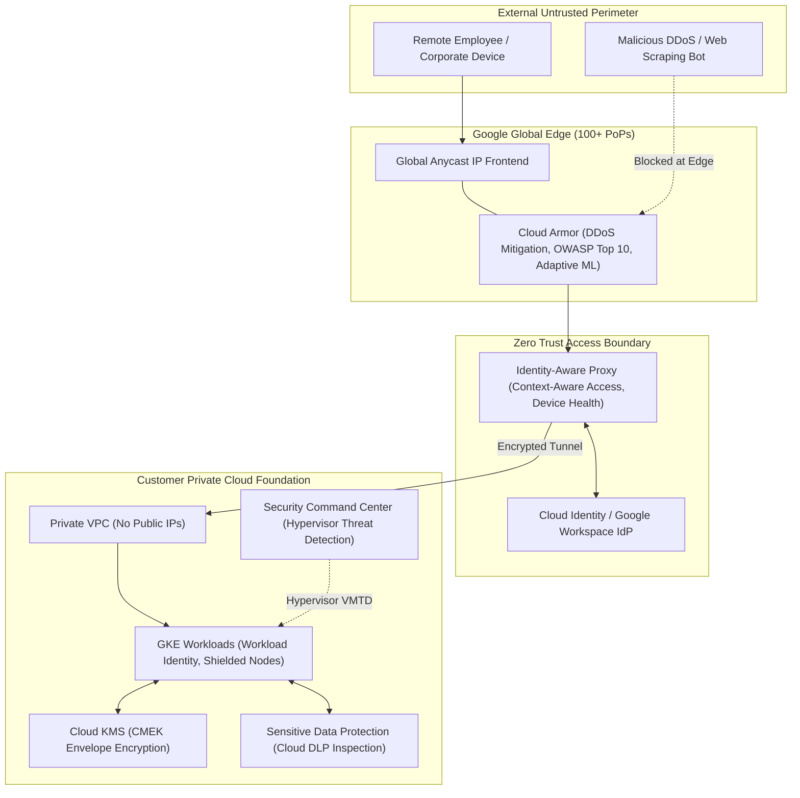

# GCP Security & Identity Hub 🔐

Google Cloud is architected around the **BeyondProd** and **BeyondCorp** zero-trust security models. Trust is never granted based on physical network perimeter; instead, every access request, container execution, RPC invocation, and storage access is cryptographically authenticated, authorized, and audited at the hypervisor, kernel, and software-defined network boundary.

---

## Service Catalog & Security Architecture Map

| Service                                   | Category                | Core Architecture & Protection Scope                                                                                  | Reference Guide                                                  |
| :---------------------------------------- | :---------------------- | :-------------------------------------------------------------------------------------------------------------------- | :--------------------------------------------------------------- |
| **IAM & Resource Hierarchy**              | Identity & Access       | Org $\to$ Folder $\to$ Project resource hierarchy, Service Accounts, Short-lived STS Tokens, CEL Conditions.          | [[GCP/identity/README\|IAM & Access Deep Dive]]                  |
| **Workload Identity Federation**          | Keyless Auth            | OIDC/SAML token exchange eliminating static JSON service account keys for GitHub Actions, AWS, and GKE.               | [[GCP/identity/workload-identity\|Workload Identity Federation]] |
| **Cloud KMS & Cloud HSM**                 | Cryptographic Keys      | FIPS 140-2 Level 3 HSM, Envelope Encryption, CMEK, automated key rotation, and External Key Manager (EKM).            | [[GCP/security/kms/README\|Cloud KMS & Envelope Encryption]]     |
| **Security Command Center (SCC)**         | CSPM & Threat Detection | Centralized CSPM/CWPP, agentless hypervisor-level VM Threat Detection (VMTD), Container Threat Detection.             | [[GCP/security/scc\|Security Command Center (SCC)]]              |
| **Cloud Armor**                           | WAF & DDoS Defense      | Global Anycast edge DDoS defense, OWASP ModSecurity CRS, ML-based Adaptive Protection, and rate-based throttling.     | [[GCP/security/cloud-armor\|Cloud Armor Deep Dive]]              |
| **Identity-Aware Proxy (IAP)**            | Zero Trust Access       | Context-aware zero-trust HTTPS/TCP proxying, eliminating VPNs for SSH/RDP and internal web apps via BeyondCorp.       | [[GCP/security/iap-beyondcorp\|IAP & BeyondCorp Deep Dive]]      |
| **Sensitive Data Protection (Cloud DLP)** | Data Privacy & Masking  | Automated discovery, classification, and cryptographic tokenization/masking of PII/PHI in BigQuery, GCS, and streams. | [[GCP/security/cloud-dlp\|Cloud DLP Deep Dive]]                  |
| **Certificate Authority Service (CAS)**   | Enterprise PKI & TLS    | Fully managed, highly scalable private CA hierarchy (Root/Subordinate CAs) and Certificate Manager automated renewal. | [[GCP/security/cas\|Certificate Authority Service]]              |
| **Binary Authorization**                  | Supply Chain Gatekeeper | Cryptographic deploy-time container image admission control enforcing SLSA provenance before execution in GKE.        | [[GCP/compute/gke/binary-authorization\|Binary Authorization]]   |

---

## The BeyondCorp & Defense-in-Depth Architecture

---

## Related Knowledge Hubs

- [[GCP]] — Master Google Cloud Platform architectural catalog
- [[GCP/governance/README|GCP Governance & Org Policies Hub]] — Resource hierarchy guardrails and organization policies
- [[GCP/networking/vpc|GCP Virtual Private Cloud (VPC)]] — Software-defined network isolation and hierarchical firewalls
- [[Security/cloud-security/gcp/README|GCP Security Hub]] — Cloud-native security operations
- [[Security]] — Global Zero Trust, container defense, and supply chain security
