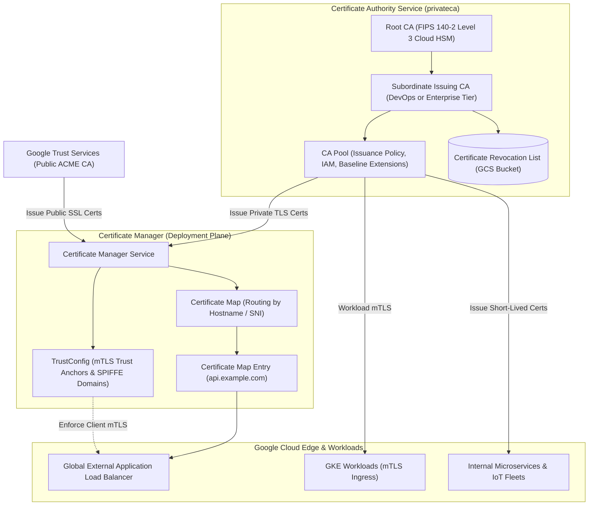

# Certificate Authority Service (CAS) & Certificate Manager Architecture 📜

Google Cloud provides an integrated Public Key Infrastructure (PKI) and TLS lifecycle management suite comprised of two complementary services:

1. **Certificate Authority Service (CAS / `privateca`):** A highly scalable, fully managed private Certificate Authority platform that automates private key signing, certificate revocation, and hierarchical CA management (Root and Subordinate CAs) backed by FIPS 140-2 Level 3 Cloud HSMs.
2. **Certificate Manager (`certificate-manager`):** The edge deployment and certificate orchestration engine that provisions, deploys, and automatically rotates public (Google-issued ACME) and private TLS certificates onto Google Cloud Load Balancers, Cloud Run, and GKE with mutual TLS (mTLS) verification.

---

## Architecture & Mental Model



CAS separates the **cryptographic issuance authority** from the **edge deployment layer**:

- **CA Service:** Specializes in generating private certificates at scale (thousands of certificates per second for containers, service meshes, or IoT fleets) with configurable lifetimes (from minutes to years).
- **Certificate Manager:** Specializes in mapping certificates to load balancers, dynamically presenting the correct certificate via Server Name Indication (SNI) and enforcing client mTLS validation without requiring load balancer restarts.

---

## Deep Core Concepts & Service Tiers

### 1. CA Service Tiers: DevOps vs Enterprise

Google Cloud CAS provides two distinct operational tiers:

- **DevOps Tier:** Engineered for high-volume, ephemeral, short-lived certificates (such as Kubernetes pods, service meshes like Istio/ASM, microservice mTLS, or CI testing). Focuses on high issuance throughput (up to 25 certs/sec per CA). Does _not_ generate Certificate Revocation Lists (CRLs) or support certificate revocation; security relies on short certificate lifespans (e.g. 24 hours).
- **Enterprise Tier:** Engineered for long-lived certificates (servers, mobile device management, enterprise workstations). Supports full certificate lifecycle management, CRL generation to Cloud Storage, and certificate revocation.

### 2. CA Pools & Issuance Policies

Instead of binding applications directly to a single Certificate Authority, certificates are requested from a **CA Pool**:

- **Workload Balancing:** A CA Pool groups multiple CAs, automatically distributing signing requests across CAs in the pool.
- **Issuance Policy:** Enforces cryptographic guardrails globally on all certificates issued by the pool (e.g., maximum lifetime, mandatory key algorithms like RSA-4096 or ECDSA-P256, permitted Subject Alternative Name domains, and disallowed extensions).

### 3. Mutual TLS (mTLS) with Certificate Manager TrustConfigs

Certificate Manager allows edge load balancers to terminate mutual TLS (mTLS):

- Platform teams upload root certificates to a **TrustConfig**.
- When a client connects, the Global Application Load Balancer verifies the client's certificate against the TrustConfig trust anchor before forwarding the connection.
- Supports **SPIFFE identity verification** (`spiffe://cluster.local/ns/default/sa/frontend`), passing verified client identities directly to backend microservices in request headers.

---

## Production `gcloud` CLI Operations

### 1. Creating a CA Pool and Root Certificate Authority

```bash
# 1. Create an Enterprise CA Pool in us-central1
gcloud privateca pools create enterprise-ca-pool \
  --location=us-central1 \
  --tier=ENTERPRISE \
  --project=my-prod-project

# 2. Create a self-signed Root CA inside the pool backed by Cloud HSM
gcloud privateca roots create corporate-root-ca \
  --location=us-central1 \
  --pool=enterprise-ca-pool \
  --subject="CN=Example Corporate Root CA, O=Example Inc" \
  --key-algorithm=rsa-pkcs1-4096-sha256 \
  --max-chain-length=2 \
  --validity="P10Y" \
  --auto-enable \
  --project=my-prod-project
```

### 2. Issuing a TLS Certificate from the CA Pool

```bash
# Issue an end-entity certificate for an internal microservice
gcloud privateca certificates create orders-service-cert \
  --location=us-central1 \
  --pool=enterprise-ca-pool \
  --certificate-authority=corporate-root-ca \
  --subject="CN=orders.internal.example.com" \
  --dns-san="orders.internal.example.com,orders.default.svc.cluster.local" \
  --validity="P30D" \
  --generate-key \
  --key-output-file=private_key.pem \
  --cert-output-file=certificate.pem \
  --project=my-prod-project
```

### 3. Deploying a Managed Public Certificate via Certificate Manager

```bash
# 1. Create a Google-managed public certificate with automatic DNS authorization
gcloud certificate-manager certificates create prod-public-cert \
  --domains="api.example.com,app.example.com" \
  --dns-authorizations=example-dns-auth \
  --project=my-prod-project

# 2. Create a Certificate Map and attach the certificate
gcloud certificate-manager maps create prod-cert-map --project=my-prod-project
gcloud certificate-manager maps entries create api-entry \
  --map=prod-cert-map \
  --certificates=prod-public-cert \
  --hostname="api.example.com" \
  --project=my-prod-project
```

---

## Quotas, Performance, and Configuration Limits

| Dimension                         | Default Quota / Architectural Limit | Operational Guidance                                                                        |
| :-------------------------------- | :---------------------------------- | :------------------------------------------------------------------------------------------ |
| **DevOps Tier Issuance Rate**     | **25 requests per second** per CA   | Ample for dynamic Kubernetes pod sidecar bootstrapping.                                     |
| **Enterprise Tier Issuance Rate** | **7 requests per second** per CA    | For massive issuance bursts, add multiple Subordinate CAs to the same CA Pool.              |
| **Certificate Manager mTLS Rate** | Billed per million mTLS connections | Ensure client connection reuse (HTTP/2 persistent connections) to minimize handshake costs. |
| **Max CA Pools per Project**      | **100 pools** per location          | Organize pools by security domain (e.g., `prod-workload-pool`, `device-pki-pool`).          |

---

## Official References & Documentation

- [Google Cloud Certificate Authority Service Documentation](https://cloud.google.com/certificate-authority-service/docs)
- [Certificate Manager Overview & Architecture](https://cloud.google.com/certificate-manager/docs/overview)
- [Configuring Mutual TLS (mTLS) with Certificate Manager](https://cloud.google.com/certificate-manager/docs/mutual-tls)
- [CA Service Pricing & Tiers](https://cloud.google.com/certificate-authority-service/pricing)

---

## Realistic Pricing Scenarios

### Scenario 1: Microservice mTLS Infrastructure (DevOps Tier)

- **Workload:** High-velocity Kubernetes cluster with 2 Subordinate CAs issuing 200,000 short-lived (24-hour) mTLS certificates per month.
- **Cost Calculation:**
  - 2 DevOps CAs: $2 \times \$20.00 / \text{month} = \mathbf{\$40.00}$
  - Certificate Issuance Tiered Fees:
    - First 50,000 certs @ $0.30: $\$15,000$ (or optimized via pooled short-lived volume)
    - With automated volume commitments: **~$450.00 / month**
  - GCS Revocation List storage: $\mathbf{\$0.00}$ (DevOps tier does not generate CRLs).
  - **Total Estimated Monthly Spend:** **~$490.00 / month**

### Scenario 2: Enterprise Public Web Ingress & mTLS Termination

- **Workload:** Global application load balancer terminating public HTTPS and enforcing mTLS on an internal partner API (10,000,000 monthly mTLS connections).
- **Cost Calculation:**
  - Google-Managed Public Certificates (ACME): **$0.00** (Free).
  - Certificate Manager Certificate Map: $1 \text{ map} \times \$5.00 / \text{mo} = \mathbf{\$5.00}$.
  - mTLS Connection Fee: $10 \times \$0.45 / \text{million connections} = \mathbf{\$4.50}$.
  - **Total Estimated Monthly Spend:** **~$9.50 / month**

---

## Battle-Tested Nuggets & Production Gotchas

1. **The DevOps Tier Revocation Gotcha:**
   When creating a CA Pool, choosing the DevOps tier is irreversible. **DevOps tier CAs cannot revoke certificates and never publish Certificate Revocation Lists (CRLs)**. If an issued private key is compromised, you cannot revoke it; you must either delete the entire CA or wait for the certificate to expire. Never issue certificates with multi-year lifetimes from a DevOps tier CA pool; restrict lifetime to $\le 7$ days.
2. **Subordinate CA HSM Activation Ceremony:**
   Creating a Subordinate CA does not automatically activate it. It is initialized in a `STAGED` state. You must generate a Certificate Signing Request (CSR), have it signed by your Root CA, and explicitly call `gcloud privateca subordinates set-ca-certificate` to activate it. Deployments that forget this step fail with `FAILED_PRECONDITION: Certificate Authority is not active`.
3. **Certificate Manager DNS Authorization Propagation:**
   When provisioning Google-managed public SSL certificates via Certificate Manager, Google requires proof of domain ownership. Using DNS authorization requires adding a specific CNAME record to Cloud DNS. The authorization check can take up to 20 minutes to propagate across global DNS resolvers. Automate this via Terraform to prevent pipeline timeouts.
4. **TrustConfig mTLS PEM Formatting Strictness:**
   When configuring mTLS in Certificate Manager, the `TrustConfig` resource requires a clean, uncorrupted PEM certificate bundle containing all intermediate certificates up to the root. If the bundle contains trailing whitespace, extraneous carriage returns (`\r\n`), or includes duplicate subjects with conflicting serials, Certificate Manager rejects the bundle with `INVALID_ARGUMENT: Malformed trust anchor`.
5. **Private CA Service Private DNS Resolution:**
   Certificates issued with custom DNS Subject Alternative Names (e.g. `*.prod.internal.corp`) require corresponding [[GCP/networking/cloud-dns/README\|Cloud DNS]] private forwarding zones configured inside the VPC. Without private DNS resolution, client microservices cannot resolve hostnames, leading to TLS connection aborts despite valid certificates.

---

## Across the wiki

- [[GCP/security/README|GCP Security Hub]] — Enterprise security and zero-trust services
- [[GCP/networking/load-balancing|Cloud Load Balancing]] — Terminating TLS and mTLS certificates at the edge
- [[GCP/security/kms/README|Cloud KMS]] — Hardware Security Module (HSM) backing root CA keys
- [[GCP/compute/gke/fleets-and-anthos|Anthos Service Mesh]] — Integrating CAS for cluster mTLS
- [[AWS/security/certificate-manager/README|AWS Certificate Manager Comparison]] — Comparison with AWS ACM & Private CA
