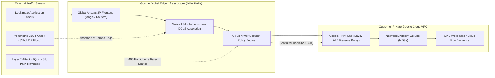

# Cloud Armor Architecture & Enterprise WAF / DDoS Deep Dive 🛡️

Google Cloud Armor is an enterprise-grade network security and Web Application Firewall (WAF) service. Deployed directly onto Google's global private Anycast edge network (at over 100 Points of Presence globally), Cloud Armor inspects and sanitizes inbound HTTP/HTTPS traffic before it reaches backend services, absorbing massive multi-terabit volumetric Layer 3/4 DDoS attacks and mitigating Layer 7 application vulnerabilities with machine-learning-driven Adaptive Protection.

---

## Architecture & Mental Model



Cloud Armor operates directly at the **Google Front End (GFE)** edge, preceding customer VPC networks. Malicious requests never consume backend CPU, bandwidth, or application memory because inspection occurs before connection state is established with customer pods or VMs.

---

## Deep Core Concepts & Protection Engines

### 1. Preconfigured WAF Rules (OWASP ModSecurity CRS 3.3)

Cloud Armor provides managed, continuously updated rule sets based on the OWASP Top 10 web vulnerabilities. Rules are evaluated using simple shorthand names:

- `sqli-v33-stable`: SQL injection detection.
- `xss-v33-stable`: Cross-site scripting protection.
- `lfi-v33-stable`: Local file inclusion and directory traversal.
- `rce-v33-stable`: Remote code execution detection (including Log4j mitigations).

### 2. Machine-Learning Adaptive Protection

For high-volume web services, manual rule authoring cannot react fast enough to zero-day Layer 7 DDoS attacks or sophisticated layer-7 scrapers. **Adaptive Protection**:

- Learns baseline traffic patterns across every URL endpoint.
- Detects subtle anomalies (e.g. sudden 5x elevation in requests bearing specific User-Agent signatures or header structures).
- Automatically generates a tailored mitigation rule (e.g., matching a distinct signature regex) and presents it to security engineers with a one-click deployment alert.

### 3. Rate-Based Banning & Throttling

Unlike basic IP firewalls, Cloud Armor rate limiting supports sophisticated multi-tier throttling:

- **Enforce on Key:** Rate counters can be tracked per IP address, per HTTP request header (e.g. `Authorization` token), or per session cookie.
- **Ban Threshold:** If a client exceeds 100 requests per minute, Cloud Armor throttles them to 10 requests/sec. If they breach the ban threshold (e.g., 500 requests/minute), Cloud Armor bans the IP completely for 10 minutes (`ban-duration-sec=600`).

---

## Production `gcloud` CLI Operations

### 1. Creating an Edge Security Policy with OWASP SQLi Protection

```bash
# 1. Create a Cloud Armor security policy
gcloud compute security-policies create prod-waf-policy \
  --description="Production enterprise edge WAF policy" \
  --project=my-prod-project

# 2. Add an OWASP SQL Injection rule at priority 1000
gcloud compute security-policies rules create 1000 \
  --security-policy=prod-waf-policy \
  --expression="evaluatePreconfiguredExpr('sqli-v33-stable')" \
  --action="deny-403" \
  --description="Block OWASP SQL injection attacks" \
  --project=my-prod-project
```

### 2. Configuring Adaptive Protection & Rate Limiting

```bash
# 1. Enable ML-driven Adaptive Protection on the policy
gcloud compute security-policies update prod-waf-policy \
  --enable-layer7-ddos-defense \
  --project=my-prod-project

# 2. Add a rate limiting rule banning IPs exceeding 200 requests / 10 seconds
gcloud compute security-policies rules create 2000 \
  --security-policy=prod-waf-policy \
  --expression="true" \
  --action="rate-based-ban" \
  --rate-limit-threshold-count=200 \
  --rate-limit-threshold-interval-sec=10 \
  --ban-threshold-count=500 \
  --ban-threshold-interval-sec=10 \
  --ban-duration-sec=600 \
  --conform-action="allow" \
  --exceed-action="deny-429" \
  --enforce-on-key="IP" \
  --project=my-prod-project
```

### 3. Attaching Security Policy to Backend Service

```bash
# Attach the security policy to the production Load Balancer backend service
gcloud compute backend-services update prod-web-backend \
  --security-policy=prod-waf-policy \
  --global \
  --project=my-prod-project
```

---

## Quotas, Performance, and Configuration Limits

| Dimension                              | Default Quota / Architectural Limit                   | Mitigation & Scaling Strategy                                                                           |
| :------------------------------------- | :---------------------------------------------------- | :------------------------------------------------------------------------------------------------------ |
| **Max Rules per Security Policy**      | **500 rules** per security policy                     | Group multiple IP CIDRs into named IP Lists (`evaluatePreconfiguredExpr`) to conserve rule slots.       |
| **Max Security Policies per Project**  | **100 policies** per project                          | Centralize policies and share across backend services where applicable.                                 |
| **Rule Evaluation Priority Range**     | `0` (highest priority) to `2147483647` (default rule) | Space out rule priorities in increments of 100 (e.g. 1000, 1100, 1200) to allow inserting future rules. |
| **Max Request Header Inspection Size** | **8 KB** inspected per request                        | Cloud Armor inspects the first 8 KB of request headers and URI queries.                                 |

---

## Official References & Documentation

- [Google Cloud Armor Official Documentation](https://cloud.google.com/armor/docs)
- [Preconfigured WAF Rules Reference](https://cloud.google.com/armor/docs/waf-rules)
- [Rate Limiting and Rate-Based Banning](https://cloud.google.com/armor/docs/rate-limiting-overview)
- [Cloud Armor Pricing & Subscription Tiers](https://cloud.google.com/armor/pricing)

---

## Realistic Pricing Scenarios

### Scenario 1: Cloud Armor Standard for High-Traffic Web Application

- **Workload:** E-commerce application receiving 50,000,000 HTTP/HTTPS requests/month protected by 1 security policy with 5 active rules.
- **Cost Calculation:**
  - Security Policy fee: $1 \text{ policy} \times \$5.00 / \text{month} = \mathbf{\$5.00}$
  - Rule fees: $5 \text{ rules} \times \$1.00 / \text{month} = \mathbf{\$5.00}$
  - Request Evaluation Fee: $50\text{M} \times \$0.75 / \text{million} = \mathbf{\$37.50}$
  - **Total Estimated Monthly Spend:** **~$47.50 / month**

### Scenario 2: Cloud Armor Enterprise (Managed Protection)

- **Workload:** Enterprise financial institution with 10 global load balancers requiring ML Adaptive Protection, DDoS bill protection, and 24/7 Google Cloud Security Response Team (SRT) escalation support.
- **Cost Calculation:**
  - Cloud Armor Enterprise Base Subscription: Fixed enterprise fee ($3,000.00 / month).
  - Protected backend services and data processing included in base tier up to tier limits.
  - DDoS Bill Protection: Insures against runaway backend compute scaling during DDoS attacks.
  - **Total Estimated Monthly Spend:** **~$3,000.00 / month**

---

## Battle-Tested Nuggets & Production Gotchas

1. **The Preview Mode Safety Net:**
   Deploying new WAF rules (especially strict OWASP CRS rules) straight into blocking mode frequently triggers false positives on legitimate customer API payloads containing code snippets or special characters. **Always deploy new rules with `--preview` enabled first**. Inspect Cloud Logging metrics (`jsonPayload.previewExecutionResult`) for 48 hours to confirm zero legitimate customer traffic is flagged before switching action to `deny-403`.
2. **Backend Service Attachment Requirement:**
   Creating a Cloud Armor security policy does _not_ protect anything until it is explicitly bound to a **Backend Service** via `gcloud compute backend-services update --security-policy=...`. Engineers frequently spend hours testing attacks against an IP only to realize the policy was never attached to the target ALB backend.
3. **The X-Forwarded-For IP Spoofing Risk:**
   When configuring rate limiting or geo-blocking, setting `--enforce-on-key="HTTP-HEADER"` using `X-Forwarded-For` allows attackers to bypass rate limits by injecting random fake IP headers. Always set `--enforce-on-key="IP"`, which instructs Google Front Ends to use the actual Layer 3/4 TCP client handshake IP address.
4. **Custom Response Codes for Webhooks:**
   Default Cloud Armor block actions return HTTP 403. However, certain third-party webhook providers (like Stripe or GitHub) treat 403 as a fatal configuration error and disable webhooks permanently, but treat HTTP 429 as a temporary backoff signal. Configure rate-limiting rules with `--exceed-action="deny-429"` to ensure webhook senders retry rather than disabling integrations.
5. **ReCAPTCHA Enterprise Session Token Decryption:**
   When pairing Cloud Armor with reCAPTCHA Enterprise for bot defense, Cloud Armor decrypts and validates reCAPTCHA tokens directly at the edge before backend invocation. Ensure the reCAPTCHA site key and secret key are properly linked in the security policy; an invalid key causes all client requests to fail with token decryption errors.

---

## Across the wiki

- [[GCP/security/README|GCP Security Hub]] — Overview of security and identity systems
- [[GCP/networking/load-balancing|Cloud Load Balancing]] — Ingress reverse proxy frontend for Cloud Armor
- [[GCP/application-integration/apigee|Apigee X Deep Dive]] — API gateway protected by Cloud Armor
- [[GCP/security/scc|Security Command Center]] — Centralized threat dashboard aggregating Armor alerts
- [[AWS/networking/protection-and-inspection|AWS Protection & Inspection Comparison]] — Comparison with AWS WAF & Shield
