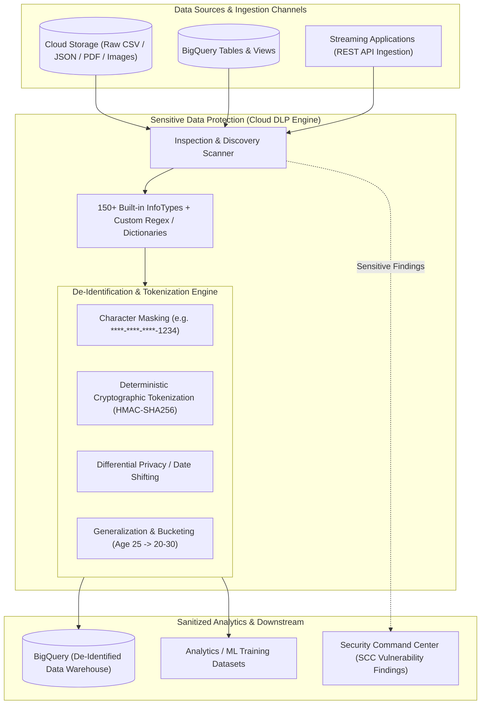

# Cloud DLP & Sensitive Data Protection Deep Dive 🔍

Google Cloud Sensitive Data Protection (formerly Cloud Data Loss Prevention / Cloud DLP) is a fully managed, high-performance data classification, inspection, and de-identification engine. It scans structured, semi-structured, and unstructured data across [[GCP/storage/gcs\|Cloud Storage]], [[GCP/databases/bigquery\|BigQuery]], and streaming payloads to detect over 150 built-in sensitive data types (InfoTypes such as credit card numbers, social security numbers, passport IDs, and medical records) and automatically sanitizes or cryptographically tokenizes sensitive attributes.

---

## Architecture & Mental Model



Cloud DLP operates along two primary operational modalities:

1. **At-Rest Storage Discovery & Profiling:** Automated background crawlers continuously scan entire BigQuery tables and GCS buckets to classify data sensitivity and generate risk profiles without altering underlying data.
2. **In-Flight Streaming Inspection & Transformation:** Integrated directly into ETL pipelines (such as [[GCP/analytics/dataflow/README\|Cloud Dataflow]] or Cloud Functions). Raw incoming user records are intercepted, sensitive PII fields are transformed or cryptographically tokenized, and only sanitized records are persisted.

---

## Deep Core Concepts & Cryptographic Tokenization

### 1. Built-in InfoTypes vs Custom Dictionary / RegEx

- **Built-in InfoTypes:** Over 150 pre-trained statistical, grammatical, and pattern-matching classifiers covering global jurisdictions (e.g., `CREDIT_CARD_NUMBER`, `US_SOCIAL_SECURITY_NUMBER`, `IBAN_CODE`, `INDIA_AADHAAR_NUMBER`, `GCP_CREDENTIALS`).
- **Custom InfoTypes:** Organizations define proprietary detectors using regular expressions (e.g., internal employee badge IDs) or dictionary wordlists with likelihood scoring thresholds.

### 2. Pseudonymization via Deterministic Cryptographic Tokenization

When sensitive identifiers (like user account IDs or patient health IDs) must be sanitized for data analysts while maintaining relational integrity across tables, Cloud DLP executes **CryptoHash or CryptoDeterministicConfig**:

- A cryptographic key stored in [[GCP/security/kms/README\|Cloud KMS]] generates a deterministic surrogate pseudonym.
- The same input value always produces the identical pseudonym token, enabling data analysts to join `users` and `orders` tables without exposing raw identity.
- Authorized compliance officers possessing the unwrap key can re-identify records under strict audit controls.

---

## Production `gcloud` CLI Operations

### 1. Creating a De-Identification Template (Masking & Deterministic Hash)

```bash
# Create an inspect template targeting US SSN and Email addresses
gcloud dlp inspect-templates create \
  --display-name="pii-inspect-template" \
  --info-types="US_SOCIAL_SECURITY_NUMBER,EMAIL_ADDRESS" \
  --min-likelihood="LIKELY" \
  --project=my-prod-project
```

### 2. Creating an Automated Recurring Discovery Scan on BigQuery

```bash
# Create a recurring DLP job trigger scanning a production BigQuery dataset every Sunday
gcloud dlp job-triggers create \
  --trigger-id="weekly-finance-bq-scan" \
  --display-name="Weekly Finance Dataset Scan" \
  --table-project-id="my-prod-project" \
  --dataset-id="curated_finance" \
  --inspect-template="projects/my-prod-project/inspectTemplates/pii-inspect-template" \
  --recurrence-period-days=7 \
  --project=my-prod-project
```

### 3. Inspecting Raw Text via the CLI

```bash
# Quickly test inspection against an inline string payload
gcloud dlp text-inspect \
  --content="Hello, my email is jane.doe@example.com and SSN is 000-12-3456" \
  --info-types="EMAIL_ADDRESS,US_SOCIAL_SECURITY_NUMBER" \
  --project=my-prod-project
```

---

## Quotas, Performance, and Configuration Limits

| Dimension                        | Default Quota / Architectural Limit          | Operational Guidance                                                                                                    |
| :------------------------------- | :------------------------------------------- | :---------------------------------------------------------------------------------------------------------------------- |
| **API Request Rate Limit**       | **10,000 requests per minute** globally      | Batch inline content inspection calls up to 0.5 MB per payload to maximize throughput.                                  |
| **Max Job Triggers per Project** | **1,000 triggers** per project               | Consolidate scanning rules into organization-level Discovery profiles rather than per-table triggers.                   |
| **Inspection Pricing**           | **$1.00 per GB** for storage data inspection | Limit scanning costs by configuring sampling limits (e.g., inspect only 1,000 rows per table).                          |
| **Transformation Pricing**       | **$2.00 per GB** for data transformation     | Execute transformations in-memory during streaming ETL using [[GCP/analytics/dataflow/README\|Dataflow]] DLP templates. |

---

## Official References & Documentation

- [Google Cloud Sensitive Data Protection Documentation](https://cloud.google.com/sensitive-data-protection/docs)
- [Predefined InfoTypes Reference Catalog](https://cloud.google.com/sensitive-data-protection/docs/infotypes-reference)
- [Pseudonymization and Cryptographic Tokenization](https://cloud.google.com/sensitive-data-protection/docs/pseudonymization)
- [Sensitive Data Protection Pricing](https://cloud.google.com/sensitive-data-protection/pricing)

---

## Realistic Pricing Scenarios

### Scenario 1: BigQuery Production Data Warehouse Discovery

- **Workload:** 50 BigQuery tables containing 500 GB of total tabular customer data inspected once monthly for compliance auditing.
  - Inspection utilizes sampling (scanning 10% of rows = 50 GB scanned).
- **Cost Calculation:**
  - Storage inspection fee: $50\text{ GB} \times \$1.00 / \text{GB} = \mathbf{\$50.00}$
  - BigQuery read scan: Included in BigQuery free allocation.
  - Security Command Center findings integration: $\mathbf{\$0.00}$
  - **Total Estimated Monthly Spend:** **~$50.00 / month**

### Scenario 2: Streaming Financial Ingestion Sanitization

- **Workload:** High-velocity streaming pipeline processing 1 TB of transactional logs monthly via Cloud Dataflow, masking credit card numbers and tokenizing user IDs.
- **Cost Calculation:**
  - Data transformation fee: $1,024\text{ GB} \times \$2.00 / \text{GB} = \mathbf{\$2,048.00}$
  - Cloud KMS key operations (1M cryptographic HMAC signs): $\mathbf{\$3.00}$
  - Cloud Dataflow worker compute: $\mathbf{\$120.00}$
  - **Total Estimated Monthly Spend:** **~$2,171.00 / month**

---

## Battle-Tested Nuggets & Production Gotchas

1. **The Full-Table Scan Billing Shock:**
   Running a DLP scan against an entire multi-terabyte BigQuery table without setting sampling rules will inspect every byte of data, incurring $1.00 per GB ($1,000 per TB) in Cloud DLP fees. **Always configure `samplingMethod` and `samplePercentage`** (e.g. `sampleMethod: RANDOM_START`, `samplePercentage: 5%`) or restrict inspection to partitions updated within the last 7 days.
2. **Contextual Likelihood Tuning:**
   DLP assigns likelihood scores (`VERY_UNLIKELY` to `VERY_LIKELY`) based on surrounding context. For example, a 9-digit string alone is evaluated as `POSSIBLE` SSN; if preceded by the word "Social Security", likelihood rises to `VERY_LIKELY`. Setting `min-likelihood: VERY_UNLIKELY` in production triggers overwhelming false positives (e.g., flagging random tracking numbers or integer IDs as credit cards). Set `min-likelihood: LIKELY` for production alerts.
3. **Deterministic Tokenization Padding Requirements:**
   When configuring AES-SIV deterministic encryption (`CryptoDeterministicConfig`), inputs with identical characters will fail or leak length metadata if not padded. Ensure your de-identification template defines surrogate InfoType configurations with fixed-width padding to prevent side-channel frequency analysis on tokenized outputs.
4. **Cloud KMS CryptoKey IAM Separation:**
   To guarantee zero-trust compliance, the service account running the de-identification ETL pipeline must only possess `roles/cloudkms.cryptoKeyEncrypter`. The `roles/cloudkms.cryptoKeyDecrypter` role must be strictly withheld and granted only to a dedicated re-identification auditor role, preventing pipeline operators from reading raw PII.
5. **Inspect Template Immutability & Versioning:**
   When a DLP Job Trigger references an Inspect Template, modifying the template does not automatically retroactively rescan past findings. If a new InfoType (e.g., IBAN numbers) is added to the template, past tables will not register the new vulnerability until a full re-scan job trigger executes.

---

## Across the wiki

- [[GCP/security/README|GCP Security Hub]] — Overview of security and identity systems
- [[GCP/databases/bigquery|Google BigQuery]] — Analytical warehouse scanned and sanitized by Cloud DLP
- [[GCP/security/kms/README|Cloud KMS]] — Key management service backing cryptographic tokenization
- [[GCP/security/scc|Security Command Center]] — Centralized dashboard for DLP sensitive data findings
- [[AWS/security/macie/README|AWS Macie Comparison]] — Architectural comparison with AWS Amazon Macie
