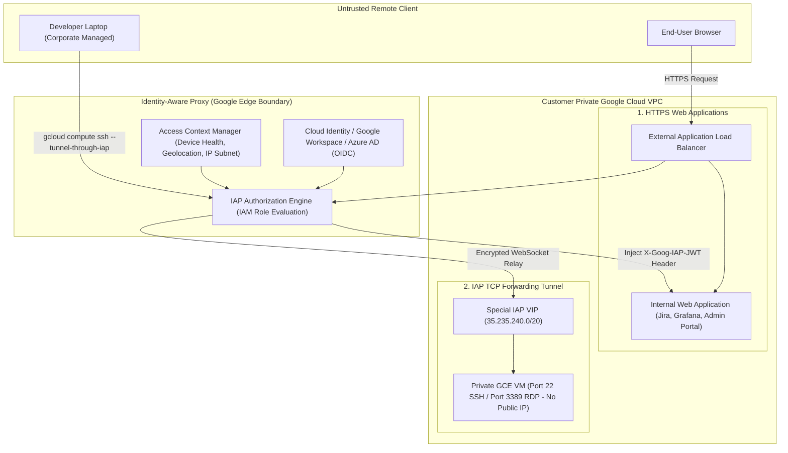

# Identity-Aware Proxy (IAP) & BeyondCorp Architecture Deep Dive 🚪

Google Cloud Identity-Aware Proxy (IAP) is the foundational implementation of Google's **BeyondCorp** zero-trust architecture. It intercepts web traffic and administrative connections heading toward cloud applications, APIs, and virtual machines, authenticating user identity and device context (location, device health, corporate ownership) before granting access—**completely eliminating the need for traditional corporate VPNs or public IP addresses**.

---

## Architecture & Mental Model



IAP operates under two distinct execution modes:

1. **HTTPS Web Applications:** Bound directly to an [[GCP/networking/load-balancing\|External Application Load Balancer]] or [[GCP/compute/cloud-run\|Cloud Run]]. Intercepts HTTP requests, initiates an OAuth2 login flow with Cloud Identity or external identity providers, verifies Context-Aware policies, and injects signed identity claims (`X-Goog-Authenticated-User-Email`, `X-Goog-IAP-JWT-Assertion`).
2. **TCP Forwarding Tunnel:** Encapsulates raw TCP traffic (SSH, RDP, MySQL) inside a secure, encrypted WebSocket tunnel terminating inside your private VPC from Google's dedicated internal CIDR range (`35.235.240.0/20`).

---

## Deep Core Concepts & Security Mechanics

### 1. Eliminating Public IPs via the IAP TCP Tunnel

In legacy architectures, bastion hosts ("jump boxes") required public IP addresses and firewall rules exposed to the internet. With IAP TCP Forwarding:

- GCE instances have **zero public IP addresses** (`natIP: none`).
- The only firewall rule required is allowing ingress on port 22/3389 from the Google IAP proxy block: `35.235.240.0/20`.
- Engineers connect via `gcloud compute ssh <VM_NAME> --tunnel-through-iap`. The CLI authenticates against IAM, establishes an encrypted TLS WebSocket with Google's proxy edge, and forwards local SSH keys seamlessly.

### 2. Context-Aware Access & BeyondCorp Enterprise

IAP pairs with **Access Context Manager (ACM)** to evaluate multi-factor context attributes before granting access:

- **Device Health & Security Posture:** Verifies whether the client OS is patched, screen lock is enabled, and disk encryption is active (via Chrome Enterprise agent).
- **IP & Geographic Geofencing:** Restricts admin console access strictly to corporate office IP ranges or designated countries.
- **Dynamic Access Levels:** If a developer travels abroad to an untrusted region, IAP automatically denies access to sensitive production applications while permitting access to dev environments.

### 3. JWT Header Verification & Preventing Identity Spoofing

When IAP authorizes an HTTP request, it forwards the traffic to backend pods or VMs. To prevent lateral movement attacks (e.g. an attacker within the VPC bypassing IAP and connecting directly to the internal pod IP), backends **must cryptographically validate the `X-Goog-IAP-JWT-Assertion` header**:

- Google signs the JWT token using public cryptographic keys hosted at `https://www.gstatic.com/iap/verify/public_key-jwk`.
- The backend verifies the signature, the audience (`aud`), and the authorized user email before fulfilling the request.

---

## Production `gcloud` CLI Operations

### 1. Configuring the Mandatory IAP Ingress Firewall Rule

```bash
# Allow IAP's dedicated TCP proxy range to reach internal VM SSH and RDP ports
gcloud compute firewall-rules create allow-ingress-from-iap \
  --network=vpc-prod \
  --direction=INGRESS \
  --action=ALLOW \
  --rules=tcp:22,tcp:3389 \
  --source-ranges=35.235.240.0/20 \
  --target-tags=allow-iap-ssh \
  --project=my-prod-project
```

### 2. Connecting to a Private VM via IAP SSH Tunnel

```bash
# SSH into a private VM without a public IP via the encrypted IAP tunnel
gcloud compute ssh prod-backend-vm-01 \
  --zone=us-central1-a \
  --tunnel-through-iap \
  --project=my-prod-project
```

### 3. Port Forwarding an Internal Database Port Locally

```bash
# Forward local port 5432 to a private Cloud SQL proxy or PostgreSQL VM in the VPC
gcloud compute start-iap-tunnel prod-postgres-vm 5432 \
  --local-host-port=localhost:5432 \
  --zone=us-central1-a \
  --project=my-prod-project
```

### 4. Granting IAP Tunnel User Permissions via IAM

```bash
# Grant an SRE engineer permission to tunnel through IAP
gcloud projects add-iam-policy-binding my-prod-project \
  --member="user:sre-engineer@example.com" \
  --role="roles/iap.tunnelResourceAccessor"
```

---

## Quotas, Performance, and Configuration Limits

| Dimension                        | Default Quota / Architectural Limit                | Operational Guidance                                                                               |
| :------------------------------- | :------------------------------------------------- | :------------------------------------------------------------------------------------------------- |
| **IAP TCP Tunnel Bandwidth**     | Up to **1 Gbps** per tunnel connection             | Ample for administrative SSH, RDP, and database triage sessions.                                   |
| **IAP TCP Ingress Source Range** | `35.235.240.0/20` (Fixed Google VIP block)         | Strictly allow this CIDR in VPC firewall rules; traffic originating outside this block is dropped. |
| **Basic IAP Pricing**            | **$0.00** (Free for Google Cloud hosted resources) | Included natively with Compute Engine and Cloud Load Balancing.                                    |
| **Context-Aware Device Health**  | Requires BeyondCorp Enterprise license             | Advanced device posture checking requires Chrome Enterprise Premium licenses.                      |

---

## Official References & Documentation

- [Google Cloud Identity-Aware Proxy Documentation](https://cloud.google.com/iap/docs)
- [BeyondCorp Zero Trust Overview](https://cloud.google.com/beyondcorp)
- [Securing SSH and RDP Connections via IAP TCP Forwarding](https://cloud.google.com/iap/docs/using-tcp-forwarding)
- [Verifying Signed JWTs on Backend Services](https://cloud.google.com/iap/docs/signed-headers-howto)

---

## Realistic Pricing Scenarios

### Scenario 1: Bastion-Free Cloud Infrastructure Access

- **Workload:** 100 software engineers and SREs accessing 500 private VMs and internal microservices via IAP TCP Forwarding and standard IAP web proxies.
- **Cost Calculation:**
  - IAP Platform Fee for GCP-hosted resources: **$0.00** (Free Tier).
  - Compute Engine savings: Eliminated 4 dedicated HA Bastion VMs ($0.134/hr $\times 4 \times 730\text{ hrs} = \mathbf{-\$391.28/mo}$).
  - External static IP savings: Eliminated 4 static public IPs ($4 \times \$3.65 = \mathbf{-\$14.60/mo}$).
  - Standard Load Balancer forwarding rules (for web apps): $\mathbf{\$18.00/mo}$.
  - **Net Result:** **Saves ~$387.88 / month** while eliminating public attack surface.

### Scenario 2: BeyondCorp Enterprise Zero-Trust Deployment

- **Workload:** 500 enterprise corporate users accessing both Google Cloud apps and on-premises internal applications with device-health posture checking.
- **Cost Calculation:**
  - Chrome Enterprise Premium User Licenses: $500 \text{ users} \times \$6.00 / \text{user-month} = \mathbf{\$3,000.00}$
  - Hybrid Interconnect data transfer: $\mathbf{\$120.00}$
  - **Total Estimated Monthly Spend:** **~$3,120.00 / month**

---

## Battle-Tested Nuggets & Production Gotchas

1. **The Missing `35.235.240.0/20` Firewall Rule:**
   By far the most common IAP troubleshooting failure: An administrator runs `gcloud compute ssh --tunnel-through-iap` and receives `ERROR: (gcloud.compute.ssh) [/usr/bin/ssh] exited with return code [255]`. **The connection times out because the VPC firewall does not permit ingress from `35.235.240.0/20` on port 22**. Always verify the firewall rule tags match the VM target tags.
2. **Backend JWT Validation Bypass:**
   Enabling IAP on a Load Balancer authenticates external requests. However, if an attacker gains access to any other compute workload within the VPC, they can connect directly to the backend VM's internal IP address (`10.x.x.x:8080`), completely bypassing IAP. **Backends must strictly validate the `X-Goog-IAP-JWT-Assertion` cryptographic header** or enforce backend mTLS.
3. **The OAuth Consent Screen Multi-Domain Lockout:**
   When setting up IAP for web applications, you must configure the OAuth consent screen. If configured as "Internal", only users within your exact Google Workspace domain can authenticate. If you need contractors or external vendors to access the app, you must configure an External consent screen or federate their identity via Workforce Identity Federation.
4. **IAP WebSocket Tunnel Timeout on Long Queries:**
   When using `gcloud compute start-iap-tunnel` to proxy local database GUI clients (e.g. pgAdmin, DBeaver) to private Cloud SQL instances, long-running batch transactions or idle connections can be severed by Google's intermediate proxy timeouts (typically after 10–15 minutes of inactivity). Configure TCP keepalive packets in your client database driver (`keepalives_idle = 60`) to keep the WebSocket tunnel alive.
5. **IAM Role Confusion (`iap.httpsResourceAccessor` vs `iap.tunnelResourceAccessor`):**
   Access permissions are bifurcated:
   - Web applications require `roles/iap.httpsResourceAccessor`.
   - SSH/TCP tunneling requires `roles/iap.tunnelResourceAccessor` AND the standard Compute OS Login permissions (`roles/compute.osLogin` or `roles/compute.osAdminLogin`). Granting only one role will result in immediate authentication rejections.

---

## Across the wiki

- [[GCP/security/README|GCP Security Hub]] — Enterprise security and zero-trust services
- [[GCP/networking/vpc|Virtual Private Cloud (VPC)]] — Firewall rules and private subnet architectures
- [[GCP/security/cloud-armor|Cloud Armor Deep Dive]] — Edge WAF protecting IAP-enabled load balancers
- [[GCP/identity/README|IAM & Access Management]] — Role bindings governing IAP resource access
- [[Security/zero-trust|Zero Trust Architecture]] — Core principles of BeyondCorp and continuous verification
