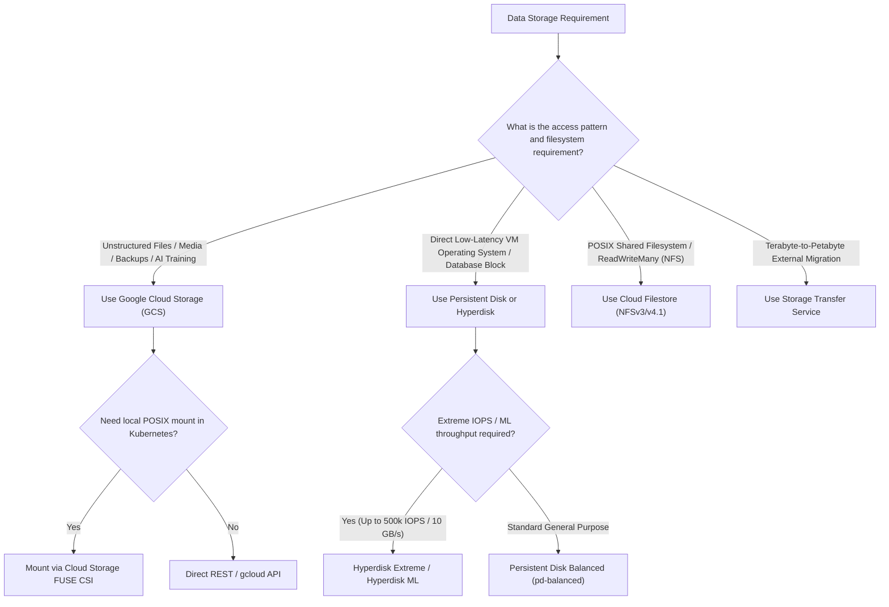

# GCP Storage Architecture & Data Systems Hub 💽

Google Cloud provides an integrated storage portfolio spanning high-throughput globally distributed object storage, ultra-low-latency block volumes, POSIX-compliant managed Network Attached Storage (NFS), and automated petabyte-scale migration pipelines.

---

## Service Catalog & Architecture Map

| Service                         | Category           | Protocol & Performance Profile                                                                                              | Reference Guide                                                    |
| :------------------------------ | :----------------- | :-------------------------------------------------------------------------------------------------------------------------- | :----------------------------------------------------------------- |
| **Google Cloud Storage (GCS)**  | Object Storage     | HTTP/REST, sub-second latency across all classes (Standard, Nearline, Coldline, Archive), Bucket Lock WORM.                 | [[GCP/storage/gcs\|Google Cloud Storage (GCS)]]                    |
| **Persistent Disk & Hyperdisk** | Block Storage      | Attached block volumes, Zonal/Regional synchronous mirroring, Hyperdisk Extreme (up to 500k IOPS) and Hyperdisk ML.         | [[GCP/storage/persistent-disk\|Persistent Disk & Hyperdisk]]       |
| **Filestore**                   | Managed File (NFS) | POSIX-compliant NFSv3 / NFSv4.1 shared storage, ReadWriteMany (RWX) multi-VM packing, and sub-millisecond file access.      | [[GCP/storage/filestore\|Filestore Deep Dive]]                     |
| **Storage Transfer Service**    | Migration & Sync   | Serverless, high-throughput data migration between AWS S3, Azure Blob, on-prem filesystems, and Cloud Storage.              | [[GCP/storage/storage-transfer-service\|Storage Transfer Service]] |
| **GKE Storage CSI & FUSE**      | Kubernetes Storage | CSI drivers dynamically provisioning Persistent Disks, Filestore shares, and streaming GCS object datasets into Pod memory. | [[GCP/compute/gke/storage-csi\|GKE Storage CSI]]                   |

---

## Architectural Storage Selection Framework

### 1. Object Storage vs Block Storage vs Shared File

- **Google Cloud Storage (GCS):** Scalable, durable ($11\times 9\text{s}$), globally accessible object storage. All classes (even Archive) deliver **millisecond first-byte latency**, unlike AWS Glacier which requires multi-hour restore jobs.
- **Persistent Disk & Hyperdisk:** Block devices attached to specific VMs or GKE nodes. Cannot be mounted across multiple VMs simultaneously (except in read-only mode).
- **Filestore:** Shared Network Attached Storage (NFS). Allows hundreds of Compute Engine VMs or GKE pods to concurrently mount the same directory with **ReadWriteMany (RWX)** semantics.

---

## Related Knowledge Hubs

- [[GCP]] — Master Google Cloud Platform architectural catalog
- [[GCP/compute/gke/storage-csi|GKE Storage CSI Driver]] — Kubernetes storage classes and volume snapshots
- [[GCP/compute/gke/cloud-storage-fuse|GKE Cloud Storage FUSE CSI]] — AI/ML dataset streaming from GCS
- [[AWS/storage/README|AWS Storage Comparison]] — Comparison with AWS S3, EBS, and EFS
