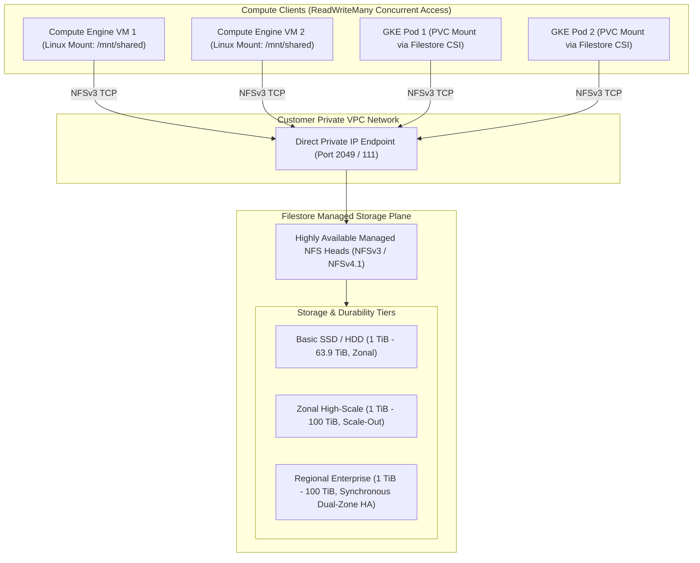

# Cloud Filestore Architecture & Managed NFS Deep Dive 📁

Google Cloud Filestore is a fully managed Network Attached Storage (NAS) service providing POSIX-compliant **NFSv3 and NFSv4.1** shared filesystems. It enables hundreds of Compute Engine VMs, Google Kubernetes Engine (GKE) pods, and on-premises clients to mount and access shared directories simultaneously with low-latency, high-throughput **ReadWriteMany (RWX)** persistence.

---

## Architecture & Mental Model



Filestore instances are provisioned directly into your [[GCP/networking/vpc\|Virtual Private Cloud (VPC)]] and assigned a private IP address. Unlike Cloud Storage (which is an object store accessed over HTTP REST APIs), Filestore presents a standard POSIX filesystem supporting atomic file locking (`fcntl`, `flock`), directory hierarchies, and POSIX permissions (`chmod`, `chown`).

---

## Deep Core Concepts & Tier Comparison

### 1. Service Tiers Matrix

| Specification           | Basic (HDD / SSD)                            | Zonal (High-Scale)                           | Regional (Enterprise)                              |
| :---------------------- | :------------------------------------------- | :------------------------------------------- | :------------------------------------------------- |
| **Target Workload**     | Dev/Test, Web content, legacy lift-and-shift | High-Performance Computing (HPC), AI/ML, EDA | Mission-critical apps, SAP HANA, Dual-Zone HA      |
| **Availability SLA**    | **99.9%** (Zonal single point of failure)    | **99.9%** (Single zone)                      | **99.99%** (Synchronously mirrored across 2 zones) |
| **Capacity Sizing**     | 1 TiB to 63.9 TiB                            | 1 TiB to 100 TiB                             | 1 TiB to 100 TiB                                   |
| **Max Throughput**      | Up to 1,200 MB/s                             | Up to **26,000 MB/s**                        | Up to 3,000 MB/s                                   |
| **Max IOPS**            | Up to 60,000 IOPS                            | Up to **700,000 IOPS**                       | Up to 120,000 IOPS                                 |
| **Protocol Support**    | NFSv3                                        | NFSv3                                        | NFSv3 and NFSv4.1                                  |
| **Multi-Share Support** | No (1 share per instance)                    | **Yes (Up to 80 shares per instance)**       | **Yes (Up to 80 shares per instance)**             |

### 2. Multi-Share Instance Packing

In Kubernetes environments, provisioning a separate 1 TiB Filestore instance for every microservice needing 10 GB of shared storage leads to severe resource waste. On Zonal and Regional tiers, Filestore supports **Multi-Share**:

- A single Filestore instance (e.g. 5 TiB) can host up to **80 individual NFS shares**.
- The [[GCP/compute/gke/filestore-csi\|GKE Filestore CSI Driver]] dynamically carves out small PersistentVolumeClaims (PVCs) from the shared instance, maximizing storage utilization and slashing costs.

### 3. Provisioned Capacity Billing Model

Filestore pricing is based on **provisioned capacity, not used capacity**. If you provision a 2 TiB instance and write only 100 GiB of data, you are billed for the full 2 TiB. Performance (IOPS and throughput bandwidth) scales linearly with provisioned capacity.

---

## Production `gcloud` CLI Operations

### 1. Creating a Basic SSD Filestore Instance

```bash
# Provision a 1 TiB Basic SSD Filestore instance in us-central1-a
gcloud filestore instances create prod-web-media \
  --zone=us-central1-a \
  --tier=BASIC_SSD \
  --file-share=name="media_share",capacity=1TiB \
  --network=name="vpc-prod" \
  --description="Shared media assets for CMS and web pods" \
  --project=my-prod-project
```

### 2. Creating a Regional Enterprise Instance with Dual-Zone HA

```bash
# Create a Regional Enterprise instance mirrored across us-central1-a and us-central1-b
gcloud filestore instances create prod-core-erp-nfs \
  --location=us-central1 \
  --tier=ENTERPRISE \
  --file-share=name="erp_data",capacity=2.5TiB \
  --network=name="vpc-prod" \
  --project=my-prod-project
```

### 3. Creating an Instant Point-in-Time Snapshot

```bash
# Capture an instantaneous point-in-time snapshot of the file share
gcloud filestore snapshots create snapshot-pre-upgrade-20261015 \
  --instance=prod-web-media \
  --zone=us-central1-a \
  --project=my-prod-project
```

### 4. Mounting Filestore on a Linux Compute Engine VM

```bash
# Install NFS client tools and mount the share
sudo apt-get update && sudo apt-get install -y nfs-common
sudo mkdir -p /mnt/shared-media
sudo mount -o defaults,hard,intr 10.128.0.45:/media_share /mnt/shared-media
```

---

## Quotas, Performance, and Configuration Limits

| Resource / Parameter         | Default Quota / Architectural Limit                        | Operational Guidance                                                                                  |
| :--------------------------- | :--------------------------------------------------------- | :---------------------------------------------------------------------------------------------------- |
| **Initial Regional Quota**   | Often **0 TiB** default on new projects                    | Request a quota increase for `Cloud Filestore API > Capacity in TiB` before running creation scripts. |
| **Minimum Provisioned Size** | **1 TiB** for Basic/Zonal; **2.5 TiB** for Enterprise      | Cannot provision arbitrary small sizes (e.g. 50 GiB); use Multi-Share on GKE to pack small volumes.   |
| **Performance Scaling**      | Throughput scales with capacity (e.g. 16–300 MB/s per TiB) | If your application requires high IOPS, increase provisioned capacity or select Zonal tier.           |
| **VPC Peering Requirements** | Reserved `/29` IP range required per instance              | Ensure your VPC subnet allocation reserves sufficient CIDRs for Filestore endpoints.                  |

---

## Official References & Documentation

- [Google Cloud Filestore Official Documentation](https://cloud.google.com/filestore/docs)
- [Filestore Service Tiers & Performance Specifications](https://cloud.google.com/filestore/docs/service-tiers)
- [Optimizing NFS Client Mount Options](https://cloud.google.com/filestore/docs/mount-instance)
- [Filestore Pricing Guide](https://cloud.google.com/filestore/pricing)

---

## Realistic Pricing Scenarios

### Scenario 1: Web Content CMS Cluster (Basic SSD)

- **Workload:** 10 web frontend VMs sharing a 1 TiB Basic SSD Filestore instance for user uploads and media files in `us-central1`.
- **Cost Calculation:**
  - 1 TiB Basic SSD provisioned capacity: $1,024\text{ GiB} \times \$0.20 / \text{GiB-month} = \mathbf{\$204.80}$
  - In-zone network bandwidth ($0.00): $\mathbf{\$0.00}$
  - Daily snapshots retained for 7 days (50 GB changed blocks): $\mathbf{\$3.50}$
  - **Total Estimated Monthly Spend:** **~$208.30 / month**

### Scenario 2: High-Availability SAP HANA / ERP Shared Storage (Regional)

- **Workload:** Mission-critical ERP platform requiring 99.99% SLA and synchronous dual-zone mirroring.
  - 2.5 TiB Enterprise Regional Filestore instance in `us-central1`.
- **Cost Calculation:**
  - 2.5 TiB Enterprise Regional capacity: $2,560\text{ GiB} \times \$0.36 / \text{GiB-month} = \mathbf{\$921.60}$
  - Cross-zone synchronous replication traffic: Included in tier fee.
  - Filestore automated backups (2.5 TB compressed in GCS): $\mathbf{\$62.50}$
  - **Total Estimated Monthly Spend:** **~$984.10 / month**

---

## Battle-Tested Nuggets & Production Gotchas

1. **The 0 TiB Quota Roadblock:**
   On newly initialized Google Cloud projects, the default quota for Filestore capacity is frequently **0 TiB** for High-Scale and Enterprise tiers. Running `gcloud filestore instances create` immediately fails with `QUOTA_EXCEEDED: Quota limit 'Capacity in TiB' has been exhausted`. Always check and submit a quota request via the Google Cloud Console 24 hours prior to planned deployments.
2. **NFS Mount Options: Use `hard,intr` Never `soft`:**
   When mounting Filestore shares on Linux clients, mounting with `soft` will return I/O errors to applications if a network blip occurs, causing database files to corrupt. Always mount with `defaults,hard,intr`. The `hard` option instructs the Linux kernel to retry requests indefinitely until the NFS server responds, protecting data integrity.
3. **Root Squashing Security Configuration:**
   By default, Filestore instances enable **Root Squashing** (`root_squash`), mapping `root` (UID 0) on client VMs to the unprivileged `nobody` user on the file share. If your container or application runs as root and attempts to write files, it will fail with `Permission Denied`. Configure `--flags=no_root_squash` during instance creation if administrative container root writes are explicitly required.
4. **The Minimum Size Barrier Workaround:**
   Because Filestore enforces a 1 TiB minimum allocation ($200+/month), spinning up a Filestore instance for a small 20 GB development share is cost-prohibitive. For small development workloads on GKE, consider using standard [[GCP/storage/persistent-disk\|Persistent Disks]] with `ReadWriteOnce` or leverage [[GCP/compute/gke/cloud-storage-fuse\|Cloud Storage FUSE]] for shared read-only assets.
5. **VPC IP Allocation Exhaustion:**
   Filestore allocates a private `/29` IP range (8 IP addresses) from your VPC for every instance. In Shared VPC architectures where multiple teams spin up Filestore instances across projects, these `/29` allocations can rapidly fragment and deplete private subnet ranges. Allocate a dedicated Service Networking IP range specifically for Filestore.

---

## Across the wiki

- [[GCP/storage/README|GCP Storage Hub]] — Overview of object, block, and file systems
- [[GCP/compute/gke/filestore-csi|GKE Filestore CSI Driver]] — Dynamically provisioning Filestore PVCs in Kubernetes
- [[GCP/storage/persistent-disk|Persistent Disk & Hyperdisk]] — Block volume alternative for single-VM workloads
- [[GCP/storage/gcs|Google Cloud Storage (GCS)]] — Object storage alternative with Cloud Storage FUSE mounts
- [[AWS/storage/efs/README|AWS EFS Comparison]] — Architectural comparison with Amazon Elastic File System
