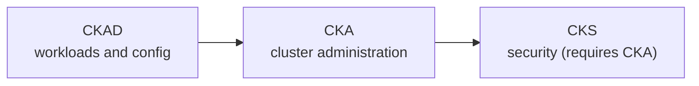

# Kubernetes Certifications

Three certification tracks sit on top of this wiki. Each track walks the official exam domains objective by objective and points at the concept note, guide and lab that covers it. The tracks do not re-explain concepts; they tell you what to read, what to practise, and where the wiki does not cover an objective yet.

The tracks are a study map with exercises. Working through one is not a prediction that you will pass; the [[Kubernetes/certifications/index#what-counts-as-ready|readiness section]] below says what evidence to look for instead.

| Track                                          | Exam                                       | Focus                                                 | Start here if you                          |
| :--------------------------------------------- | :----------------------------------------- | :---------------------------------------------------- | :----------------------------------------- |
| [[Kubernetes/certifications/ckad\|CKAD track]] | Certified Kubernetes Application Developer | Building, deploying and configuring workloads         | Ship applications onto clusters others run |
| [[Kubernetes/certifications/cka\|CKA track]]   | Certified Kubernetes Administrator         | Installing, operating and troubleshooting clusters    | Run or support the clusters themselves     |
| [[Kubernetes/certifications/cks\|CKS track]]   | Certified Kubernetes Security Specialist   | Hardening clusters, nodes, workloads and supply chain | Already hold CKA and own platform security |

---

## Which order



- **CKAD then CKA** is the gentler path. Roughly half of the CKA is CKAD material (workloads, configuration, Services, NetworkPolicy), so CKAD preparation is reused.
- **CKA first** is fine if you already operate clusters. The CKAD then takes little extra study.
- **CKS last.** You must have passed the CKA before you can sit it, and it assumes CKA-level speed with `kubectl`, static Pod manifests and node access.

### Before you start a track

The exams have no formal prerequisites apart from CKA for CKS, but the tracks assume skills they do not teach. Try this short check. If more than two items are unfamiliar, spend time on the foundation notes first; the study plans in the tracks do not include that time.

| Can you, without looking it up                                                     | If not, start with                                                                                                                  |
| :--------------------------------------------------------------------------------- | :---------------------------------------------------------------------------------------------------------------------------------- |
| Move around a Linux shell, edit a file in `vim` or `nano`, and read a process list | [[Linux\|Linux]]                                                                                                                    |
| Read and fix indentation in a YAML file                                            | [[Kubernetes/concepts/L02-objects/01-kubernetes-objects\|Kubernetes Objects]]                                                       |
| Explain what a container image and a container are, and run one with Docker        | [[Containers\|Containers]]                                                                                                          |
| Say what a Pod, a Deployment and a Service are for                                 | [[Kubernetes/concepts/L00-start-here/00-start-here\|Start Here]] and [[Kubernetes/concepts/L03-workloads/00-README\|L03 Workloads]] |
| Find a Pod's logs and events with `kubectl`                                        | [[Kubernetes/guides/tools/kubectl\|kubectl]]                                                                                        |
| Explain how a label selector decides which Pods a Service uses                     | [[Kubernetes/labs/ckad/05-services-and-dns\|Lab CKAD-05]]                                                                           |

---

## Exam format

All three exams share the same format. The facts below were checked against the Linux Foundation pages on 2026-10-13. Those pages change; confirm on them before you book.

| Item               | CKA                                             | CKAD    | CKS                          |
| :----------------- | :---------------------------------------------- | :------ | :--------------------------- |
| Format             | Performance-based, hands-on tasks in a terminal | Same    | Same                         |
| Duration           | 2 hours                                         | 2 hours | 2 hours                      |
| Tasks              | 15–20                                           | 15–20   | Not stated on the pages read |
| Kubernetes version | v1.35                                           | v1.37   | v1.35                        |
| Passing score      | 66%                                             | 66%     | 67%                          |
| Prerequisite       | None                                            | None    | Must have passed the CKA     |
| Validity           | 2 years                                         | 2 years | 2 years                      |

- **The exams do not all run the same Kubernetes version.** On the check date the CKAD was on v1.37 and the CKA and CKS on v1.35. The Linux Foundation says an exam is aligned with a new minor release "within approximately 4 to 8 weeks", so the live version is whatever the [FAQ](https://docs.linuxfoundation.org/tc-docs/certification/faq-cka-ckad-cks) says on the day, not something to infer.
- **Retake.** A standard registration includes one retake "when eligible". Registrations sold as SINGLE or SINGLE-ATTEMPT do not. See the [exam terms](https://docs.linuxfoundation.org/tc-docs/certification/exam-terms-of-service).
- **Simulator.** A standard registration includes two exam-simulator (Killer.sh) attempts, each giving 36 hours of access from activation. CKA-SINGLE, CKAD-SINGLE and CKS-SINGLE registrations do **not** include it. If you have no simulator access, use the practice sets linked from each track as your timed rehearsal.

This wiki's curriculum baseline is Kubernetes 1.37 (see [[Kubernetes/concepts/00-hub|Concepts Hub]]), and the labs are tested on v1.37.0. Where an exam runs an older version, [[Kubernetes/labs/ckad/01-cluster-setup|Lab CKAD-01]] shows how to create the lab cluster on that version, and [[Kubernetes/updates-along-the-versions|Updates Along the Versions]] and [[Kubernetes/guides/non-functional/deprecations|Deprecations]] list behaviour that changed in between. Differences that matter for the labs: Kubernetes 1.37 ships etcd 3.7 (1.35 ships 3.6), and kind v0.33 or newer is needed to run a 1.37 node.

---

## How to use a track

1. **Read the domain table.** Each objective links to the note that explains it and the lab that exercises it, and says what kind of practice the wiki has for it.
2. **Do the lab, then its "Practice Without the Answer" section.** The guided part shows the mechanism. The practice part is where you find out whether you can do it; it gives an outcome and a check, not the commands.
3. **Run the task drills.** Each domain ends with short tasks to do against a clock with only the allowed documentation open.
4. **Close the gaps.** Each track lists objectives the wiki does not exercise, with the official page to use instead.
5. **Take a timed practice set.** Each track links a mixed two-hour set with checks. If your registration includes the simulator, take its first session about two weeks out and the second a few days before the exam.

### What the coverage labels mean

The domain tables use four labels. They describe the wiki's material, not your readiness.

| Label              | Meaning                                                                                                 |
| :----------------- | :------------------------------------------------------------------------------------------------------ |
| **Lab + practice** | A lab run on Kubernetes 1.37 that includes an unguided task with a check                                |
| **Guided lab**     | A lab run on Kubernetes 1.37, worked step by step, with no unguided task yet                            |
| **Not run**        | A lab or section written from documentation and not executed end to end in this wiki's test environment |
| **Reading only**   | Concept notes and drills, no lab                                                                        |

### What counts as ready

Finishing the labs shows you have seen each mechanism once. Evidence of readiness is different:

- you complete the practice tasks **without** the guided section open, more than once, on different days;
- you complete a timed practice set at or above the pass mark with only the allowed documentation;
- you verify your own work before moving on, and can recover when a check fails;
- no objective in the track is still marked as a gap for you personally.

---

## Shared exam technique

These habits apply to all three exams. Tool depth is in [[Kubernetes/guides/tools/kubectl|kubectl]].

### One host per task

Each task is done on a **designated host**, not from one all-purpose terminal. The CKA and CKAD instructions say that an infobox at the start of each task gives the `ssh` command for its host, that you return to the base system (hostname `base`) when the task is finished, and that nested `ssh` is not supported. The CKS uses the same model.

- `kubectl` with the `k` alias and Bash completion, and the other tools, are installed **on the task hosts**. The base system has none of them.
- `sudo -i` gives root on any host.
- Anything you set up in a shell, such as the variables below, exists only in that shell on that host. Set it again after each `ssh`, or skip it.

Practise the rhythm on every lab: connect to the host, confirm the namespace, do the task, verify, `exit`. On the kind cluster the equivalent of `ssh <node>` is `docker exec -it <node> bash`.

### Shell setup

Optional, and per host:

```bash
export do="--dry-run=client -o yaml"   # k create deploy web --image=nginx $do > web.yaml
export now="--force --grace-period=0"  # k delete pod web $now
```

```vim
" ~/.vimrc
set expandtab tabstop=2 shiftwidth=2
```

### Generate manifests, do not write them

```bash
k run web --image=nginx:alpine $do > pod.yaml
k create deployment web --image=nginx:alpine --replicas=3 $do > deploy.yaml
k expose deployment web --port=80 --target-port=8080 $do > svc.yaml
k create job once --image=busybox $do -- sh -c 'echo done' > job.yaml
k create cronjob tick --image=busybox --schedule='*/5 * * * *' $do -- date > cj.yaml
k create configmap app --from-literal=MODE=prod $do > cm.yaml
k create secret generic db --from-literal=password=s3cret $do > secret.yaml
k create role reader --verb=get,list --resource=pods $do > role.yaml
k create rolebinding reader --role=reader --serviceaccount=default:app $do > rb.yaml
```

Generators do not exist for every kind or every field: there is none for a NetworkPolicy, a PersistentVolume, an HPA with `behavior`, a Gateway or an HTTPRoute, and `kubectl run` cannot set resources or probes. For those, copy an example from the allowed documentation and edit it, or generate what you can and add the rest. For individual fields, `kubectl explain` is faster than searching:

```bash
k explain pod.spec.containers.securityContext
k explain deployment.spec.strategy --recursive
```

### Working the task list

- **Connect to the task's host first.** Work done on the wrong host scores nothing. `exit` back to `base` before the next task; do not `ssh` from one task host to another.
- **Read the namespace.** Many lost points come from a correct object created in `default`.
- **Triage by weight.** Each task shows its weight. If one stalls, flag it and come back.
- **Verify before moving on.** `k get`, `k describe` or a `curl` from a temporary Pod takes seconds and catches a typo that would cost the whole task.
- **Copy and paste** in the terminal uses the Linux terminal shortcuts, not `Ctrl+C` and `Ctrl+V`.

### Documentation in the exam

Documentation is opened in the **browser inside the exam environment**. What you may open differs by exam (checked 2026-10-13 on the [allowed resources](https://docs.linuxfoundation.org/tc-docs/certification/certification-resources-allowed) page, which is the authority):

| Exam | Allowed sites                                                                                                                                                                                                                              |
| :--- | :----------------------------------------------------------------------------------------------------------------------------------------------------------------------------------------------------------------------------------------- |
| CKA  | `kubernetes.io/docs`, `kubernetes.io/blog`, `helm.sh/docs`, `gateway-api.sigs.k8s.io`                                                                                                                                                      |
| CKAD | `kubernetes.io/docs`, `kubernetes.io/blog`, `helm.sh/docs`                                                                                                                                                                                 |
| CKS  | `kubernetes.io/docs`, `kubernetes.io/blog`, `falco.org/docs`, `kubernetes-sigs.github.io/bom/cli-reference`, `etcd.io/docs`, `kubernetes.github.io/ingress-nginx/user-guide/nginx-configuration`, `docs.cilium.io`, `istio.io/latest/docs` |

- A task may also give links in its **Quick Reference** box. Those are allowed for that task; they are not a general permission to browse that site.
- The CKS list does **not** include `helm.sh`, and there is no general rule that the documentation of "whatever tool the task uses" is allowed. If a site is not listed and not in the task's Quick Reference, do not open it.
- Using a site's own search is allowed; opening external search results is not.
- Translations are allowed. The Linux Foundation recommends the English pages as the most up to date.

Practise with only these sites open, and find pages through their search, since your bookmarks are not available.

---

## Supporting material

- [[Kubernetes/labs/index|Kubernetes Hands-On Labs]]: the labs the tracks reference, with the test environment and what has and has not been run.
- Timed practice sets: [[Kubernetes/certifications/ckad-mock-exam|CKAD]], [[Kubernetes/certifications/cka-mock-exam|CKA]] and [[Kubernetes/certifications/cks-mock-exam|CKS]].
- [[Kubernetes/review/index|Revision Hub]]: five-minute refreshers per domain and the decision tables, useful in the last week.
- [[Kubernetes/review/scenarios|Scenario-Based Incident Reviews]]: written troubleshooting walk-throughs to read, not exercises to run.
- [[Kubernetes/guides/troubleshooting/index|Troubleshooting Playbooks]]: one playbook per failure mode.

## Further reading

- [CNCF curriculum repository](https://github.com/cncf/curriculum): the authoritative objective list for each exam.
- [FAQ for CKA, CKAD and CKS](https://docs.linuxfoundation.org/tc-docs/certification/faq-cka-ckad-cks): current versions, pass marks, retake and simulator terms.
- [Linux Foundation candidate handbook](https://docs.linuxfoundation.org/tc-docs/certification/lf-handbook2)
- [Exam tips for CKA and CKAD](https://docs.linuxfoundation.org/tc-docs/certification/tips-cka-and-ckad)
- [Important instructions for CKS](https://docs.linuxfoundation.org/tc-docs/certification/important-instructions-cks)
