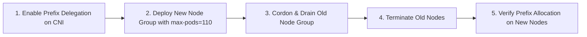

# Prefix Delegation

## Overview

By default, the Amazon VPC CNI plugin assigns individual secondary IPv4 addresses (`/32`) to Elastic Network Interfaces (ENIs) attached to worker nodes. Because each EC2 instance type supports only a limited number of ENIs and secondary IP addresses, the maximum number of pods per node is heavily constrained.

**Prefix Delegation** (introduced in VPC CNI v1.9.0) changes the unit of IP allocation from individual `/32` IPs to **IPv4 `/28` prefixes** (blocks of 16 contiguous IP addresses) or IPv6 `/80` prefixes. By assigning entire prefixes to each available ENI slot, prefix delegation dramatically scales pod density on AWS Nitro-based instances, enabling even small and medium-sized instances to run up to the standard Kubernetes ceiling of 110 or 250 pods per node.

---

## Why Prefix Delegation?

### Standard Secondary IP Mode vs Prefix Delegation Mode

In standard mode, each secondary IP slot on an ENI holds exactly 1 pod IP:

```
Standard Mode (m5.large: 3 ENIs, 10 IPs per ENI)
eth0: 1 primary IP (host) + 9 secondary IPs (pods)
eth1: 1 primary IP (ipamd) + 9 secondary IPs (pods)
eth2: 1 primary IP (ipamd) + 9 secondary IPs (pods)
Max Pods = (3 × (10 - 1)) + 2 = 29 pods
```

With prefix delegation enabled, each slot on an ENI can hold an entire `/28` prefix containing 16 contiguous IP addresses:

```
Prefix Delegation Mode (m5.large: 3 ENIs, 10 slots per ENI)
eth0: 1 primary IP (host) + 9 prefixes × 16 IPs = 144 pod IPs
eth1: 1 primary IP (ipamd) + 9 prefixes × 16 IPs = 144 pod IPs
eth2: 1 primary IP (ipamd) + 9 prefixes × 16 IPs = 144 pod IPs
Total IP Capacity = 432 IPs (Exceeds upstream 110 pod limit!)
```

### Pod Capacity Comparison Table

| Instance Type | Nitro Supported? | Standard Mode Max Pods | Prefix Delegation Theoretical IP Limit | Recommended Kubelet `max-pods` Limit |
| :------------ | :--------------- | :--------------------- | :------------------------------------- | :----------------------------------- |
| `t3.medium`   | Yes (Nitro)      | 17                     | 110                                    | 110                                  |
| `t3.large`    | Yes (Nitro)      | 27                     | 234                                    | 110                                  |
| `t4g.medium`  | Yes (Nitro)      | 17                     | 110                                    | 110                                  |
| `m5.large`    | Yes (Nitro)      | 29                     | 434                                    | 110                                  |
| `m5.xlarge`   | Yes (Nitro)      | 58                     | 722                                    | 110 (or 250 with custom tuning)      |
| `m5.2xlarge`  | Yes (Nitro)      | 118                    | 1,474                                  | 110 (or 250 with custom tuning)      |
| `c5.4xlarge`  | Yes (Nitro)      | 234                    | 2,922                                  | 110 (or 250 with custom tuning)      |

> [!NOTE]
> Even though an `m5.xlarge` can theoretically hold 722 IP addresses in prefix mode, Kubernetes limits default to **110 pods per node** for stability (kubelet overhead, container runtime limits, and CIDR allocations). You can increase this to **250 pods per node** via kubelet flags if node CPU and memory allow.

---

## How It Works Under the Hood

### IPv4 Prefix Allocation & CIDR Boundary Math

When `ENABLE_PREFIX_DELEGATION=true`, `ipamd` does not call `ec2:AssignPrivateIpAddresses`. Instead, it invokes `ec2:AssignIpv4Prefixes` to request a `/28` CIDR block.

```
Subnet: 10.0.1.0/24
├── Prefix A: 10.0.1.16/28  ──► IPs: 10.0.1.16 through 10.0.1.31 (16 IPs)
├── Prefix B: 10.0.1.32/28  ──► IPs: 10.0.1.32 through 10.0.1.47 (16 IPs)
└── Prefix C: 10.0.1.48/28  ──► IPs: 10.0.1.48 through 10.0.1.63 (16 IPs)
```

Each `/28` block consists of 16 IP addresses. Crucially, in IPv4 networking and AWS VPCs, **a `/28` block must start on a naturally aligned 16-address boundary** (where the last octet is a multiple of 16: `0, 16, 32, 48, 64, 80, 96, 112, 128, 144, 160, 176, 192, 208, 224, 240`).

### The Subnet Fragmentation Challenge

Because EC2 requires 16 **contiguous, aligned** free IPv4 addresses to allocate a `/28` prefix, **subnet fragmentation** is the primary operational issue encountered in prefix mode.

```
Subnet Address Space: [ .0  .1  .2 ... .14 .15 ] [ .16 .17 .18 ... .30 .31 ]
Allocated by RDS/ALB:              ^ (.14 busy)
Can EC2 allocate .0/28?  NO (Broken by .14)
Can EC2 allocate .16/28? YES (All 16 free)
```

If a subnet has scattered `/32` allocations (from ALB/NLB nodes, RDS instances, legacy EC2 instances, or unmigrated EKS nodes), you may encounter:

```
InsufficientFreeAddressesInSubnet / InsufficientCidrBlocks
```

Even though your VPC subnet shows 200 free IP addresses in AWS Console, if there is not a single contiguous block of 16 addresses aligned on a 16-boundary, EC2 will reject the prefix assignment request!

#### Mitigation Strategies for Fragmentation

1. **Dedicated Worker Subnets:** Run EKS worker node groups in dedicated subnets isolated from ALBs, RDS databases, or Lambda ENIs.
2. **[[Kubernetes/eks/networking/vpc-cni/custom-networking|Custom Networking]] (`ENIConfig`):** Place the node primary interfaces in a routable host subnet, and allocate pod prefixes from a dedicated secondary VPC CIDR (such as `100.64.0.0/10` from CGNAT space or `198.19.0.0/16`).
3. **Prefix Reservation:** Reserve explicit CIDR blocks in VPC subnets before allocating individual services.

---

## Prerequisites and Compatibility

| Platform / Feature                | Compatibility   | Details                                                                                    |
| :-------------------------------- | :-------------- | :----------------------------------------------------------------------------------------- |
| **Nitro Instances**               | **Supported**   | All AWS Nitro instance types (`m5`, `c5`, `r5`, `m6i`, `c6g`, `t3`, `t4g`, etc.).          |
| **Burstable Types (`t3`, `t4g`)** | **Supported**   | Fully supported for Prefix Delegation (note: burstable types do _not_ support trunk ENIs). |
| **Older Xen Instances**           | **Unsupported** | `t2`, `m4`, `c4`, and older non-Nitro instances do not support prefix delegation.          |
| **VPC CNI Version**               | **v1.9.0+**     | v1.11.0+ recommended for advanced warm target calculation.                                 |
| **Linux Nodes**                   | **Supported**   | Configured via `aws-node` DaemonSet environment variables.                                 |
| **Windows Nodes**                 | **Supported**   | Configured via `amazon-vpc-cni` ConfigMap (`enable-windows-prefix-delegation: "true"`).    |
| **Fargate**                       | **N/A**         | Fargate assigns dedicated ENIs per pod automatically.                                      |

---

## Configuration and Tuning

### 1. Enable Prefix Delegation on Linux Nodes

```bash
# Enable via AWS CLI on EKS Managed Addon
aws eks update-addon --cluster-name my-cluster --addon-name vpc-cni \
  --configuration-values '{"env":{"ENABLE_PREFIX_DELEGATION":"true","WARM_PREFIX_TARGET":"1"}}'

# Or directly on aws-node DaemonSet
kubectl set env daemonset/aws-node -n kube-system \
  ENABLE_PREFIX_DELEGATION=true \
  WARM_PREFIX_TARGET=1
```

### 2. Enable Prefix Delegation on Windows Nodes

For clusters running Windows worker nodes, prefix delegation is enabled through the `amazon-vpc-cni` ConfigMap:

```yaml
apiVersion: v1
kind: ConfigMap
metadata:
  name: amazon-vpc-cni
  namespace: kube-system
data:
  enable-windows-ipam: "true"
  enable-windows-prefix-delegation: "true"
```

Apply and restart the VPC CNI agent on Windows nodes.

---

## Warm Pool Tuning: Prefixes vs Individual IPs

When prefix delegation is enabled, how does `ipamd` decide when to allocate or release prefixes?

There are two primary allocation strategies: **Prefix-based** (`WARM_PREFIX_TARGET`) and **IP-based** (`WARM_IP_TARGET` + `MINIMUM_IP_TARGET`).

### Strategy A: `WARM_PREFIX_TARGET` (Default)

```bash
kubectl set env daemonset/aws-node -n kube-system \
  ENABLE_PREFIX_DELEGATION=true \
  WARM_PREFIX_TARGET=1
```

- `WARM_PREFIX_TARGET=1`: Keeps **1 spare `/28` prefix (16 IPs)** in reserve on each node.
- **Advantage:** Minimum number of EC2 API calls. Allocates 16 IPs at a time.
- **Trade-off:** In a 100-node cluster, `WARM_PREFIX_TARGET=1` holds $100 \times 16 = 1,600$ unused IPv4 addresses in reserve across the cluster.

### Strategy B: `WARM_IP_TARGET` + `MINIMUM_IP_TARGET` (Recommended for Constrained Subnets)

To avoid holding 16 spare IPs per node when address space is tight, use explicit IP targets. When `ENABLE_PREFIX_DELEGATION=true`, setting `WARM_IP_TARGET` will allocate prefixes only when the number of available unused IPs dips below the target:

```bash
kubectl set env daemonset/aws-node -n kube-system \
  ENABLE_PREFIX_DELEGATION=true \
  WARM_IP_TARGET=5 \
  MINIMUM_IP_TARGET=16
```

- `MINIMUM_IP_TARGET=16`: Ensures the node pre-allocates at least 1 prefix upon startup.
- `WARM_IP_TARGET=5`: As pods launch, `ipamd` uses IPs from the existing `/28` prefix. It only requests an additional `/28` prefix from EC2 when the number of unassigned IPs drops below 5.

### Comparison Matrix

| Setting Combination                        | IP Consumption                  | EC2 API Call Volume                        | Best For                                           |
| :----------------------------------------- | :------------------------------ | :----------------------------------------- | :------------------------------------------------- |
| `WARM_PREFIX_TARGET=1`                     | High (16–31 spare IPs/node)     | Very Low (infrequent `AssignIpv4Prefixes`) | Large VPC subnets, rapid autoscaling workloads     |
| `WARM_IP_TARGET=5`, `MINIMUM_IP_TARGET=16` | Optimized (5–20 spare IPs/node) | Moderate                                   | Standard enterprise production with shared subnets |
| `WARM_IP_TARGET=2` (without minimum)       | Minimal                         | High (potential EC2 rate throttling)       | Very tight `/24` subnets (risk of throttling)      |

---

## Coexistence with Trunk and Branch ENIs (Security Groups for Pods)

A frequent point of confusion is how Prefix Delegation interacts with [[Kubernetes/eks/networking/vpc-cni/trunk-and-branch-eni|Trunk and Branch ENIs]] and [[Kubernetes/eks/networking/vpc-cni/security-groups-for-pods|Security Groups for Pods]]:

```
                     EC2 Worker Node (m5.xlarge)
 ┌────────────────────────────────────────────────────────────────────────┐
 │ eth0 (Primary ENI)     ── Node base IP                                 │
 │                                                                        │
 │ eth1 (Trunk ENI)       ── Multiplexes Branch ENIs (SGP)                │
 │                           ├── Branch ENI 1: 10.0.1.50/32 (Single IP!)  │
 │                           └── Branch ENI 2: 10.0.1.51/32 (Single IP!)  │
 │                                                                        │
 │ eth2 (Secondary ENI)   ── Prefix Delegation (/28 Prefixes)             │
 │                           ├── 10.0.2.0/28  (16 Pod IPs)                │
 │                           └── 10.0.2.16/28 (16 Pod IPs)                │
 └────────────────────────────────────────────────────────────────────────┘
```

### Key Interaction Rules

1. **Branch ENIs Never Receive Prefixes:**
   Prefix delegation applies strictly to standard ENIs. When a pod matching a `SecurityGroupPolicy` launches, it receives a **Branch ENI** associated with the **Trunk ENI**. A branch ENI always consumes a single `/32` primary IP address.
2. **Trunk ENI Consumes One Physical ENI Slot:**
   Attaching the trunk ENI (`aws-k8s-trunk-eni`) uses 1 of the node's maximum physical ENI attachments. The remaining $(N - 1)$ ENIs allocate `/28` prefixes. Because each prefix-enabled ENI can host hundreds of pods, losing 1 physical ENI slot to the trunk interface does not hinder node density.
3. **Karpenter Configuration (`aws.reservedENIs`):**
   If Karpenter is used alongside Security Groups for Pods, Karpenter must be configured to account for the reserved trunk ENI slot so that it doesn't calculate max pods assuming all physical ENIs are available for prefixes:
   ```yaml
   # Older Karpenter EC2NodeClass/Provisioner
   spec:
     aws:
       reservedENIs: 1
   ```

---

## Node Max-Pods Configuration

Enabling prefix delegation on `aws-node` provides the IP capacity, but the **node Kubelet** must also be informed that it can schedule more than the historical limit of pods.

### Calculating Max Pods

AWS provides a reference script to calculate max-pods:

```bash
curl -O https://raw.githubusercontent.com/awslabs/amazon-eks-ami/master/files/max-pods-calculator.sh
chmod +x max-pods-calculator.sh
./max-pods-calculator.sh --instance-type m5.large --cni-version 1.21.1 --cni-prefix-delegation-enabled
# Output: 110
```

### Passing to Kubelet

1. **Managed Node Groups:**
   When creating a managed node group with prefix delegation enabled, the EKS AMI bootstrap script automatically detects `ENABLE_PREFIX_DELEGATION=true` (or you can pass `--use-max-pods false` with `--max-pods 110` in node group launch templates).
2. **Self-Managed Nodes:**
   Pass the calculated value to the bootstrap script in user-data:
   ```bash
   /etc/eks/bootstrap.sh my-cluster \
     --use-max-pods false \
     --kubelet-extra-args '--max-pods=110'
   ```
3. **Karpenter (v1+):**
   Karpenter automatically discovers prefix delegation when enabled in the cluster and computes `maxPods` up to 110 (or user-defined override) automatically.

---

## Step-by-Step Transitioning to Prefix Delegation

> [!CAUTION]
> **Do not perform in-place modification of running nodes.** Transitioning existing nodes from secondary IP mode to prefix delegation while pods are running can cause IP assignment conflicts and networking partition.

### Recommended Node Rollout Procedure



1. **Enable Prefix Delegation on VPC CNI:**
   ```bash
   kubectl set env daemonset/aws-node -n kube-system ENABLE_PREFIX_DELEGATION=true
   ```
2. **Provision New Node Group:**
   Launch a new node group where user-data or launch template sets `--max-pods 110`.
3. **Cordon and Drain Old Nodes:**
   ```bash
   kubectl cordon <old-node-name>
   kubectl drain <old-node-name> --ignore-daemonsets --delete-emptydir-data
   ```
4. **Delete Old Node Group:**
   Once pods are cleanly rescheduled on the new prefix-enabled nodes, safely decommission the old node group.

---

## Observability and Verification

### 1. Check Assigned Prefixes via AWS CLI

```bash
# Verify prefixes attached to instance ENIs
aws ec2 describe-network-interfaces \
  --filters "Name=attachment.instance-id,Values=i-0123456789abcdef0" \
  --query 'NetworkInterfaces[*].[NetworkInterfaceId,InterfaceType,Ipv4Prefixes[*].Ipv4Prefix]'
```

Expected output:

```json
[["eni-0123456789primary", "interface", ["10.0.1.16/28", "10.0.1.32/28"]]]
```

### 2. Inspect Local `ipamd` Introspection Port

The CNI exposes an HTTP introspection endpoint on worker nodes at port 61679:

```bash
# Query introspection endpoint from host or debug pod
curl -s http://127.0.0.1:61679/stats | jq .
```

Key fields to check:

```json
{
  "totalIPs": 32,
  "assignedIPs": 14,
  "totalPrefixes": 2,
  "prefixDelegationEnabled": true
}
```

### 3. Prometheus Metrics

The VPC CNI exports Prometheus metrics on port 61678 (`/metrics`):

| Metric                         | Type      | Meaning                                         |
| :----------------------------- | :-------- | :---------------------------------------------- |
| `awscni_assigned_ip_addresses` | Gauge     | Total IPs assigned to active pods               |
| `awscni_total_ip_addresses`    | Gauge     | Total IPs available across allocated prefixes   |
| `awscni_assigned_prefixes`     | Gauge     | Count of `/28` prefixes currently held by node  |
| `awscni_aws_api_latency_ms`    | Histogram | Latency of EC2 API calls (watch for throttling) |

---

## Troubleshooting Common Issues

| Issue                                                          | Root Cause                                                                                      | Solution                                                                                                                                    |
| :------------------------------------------------------------- | :---------------------------------------------------------------------------------------------- | :------------------------------------------------------------------------------------------------------------------------------------------ |
| `InsufficientFreeAddressesInSubnet` / `InsufficientCidrBlocks` | Subnet has free IPs, but no contiguous aligned `/28` block exists due to fragmentation.         | Move workloads to a fresh subnet, use [[Kubernetes/eks/networking/vpc-cni/custom-networking\|Custom Networking]], or free contiguous space. |
| Node capacity still shows 29 pods instead of 110               | Kubelet was started without updating `--max-pods`.                                              | Recreate node group with updated user-data `--max-pods=110` or configure Karpenter.                                                         |
| EC2 API throttling (`RequestLimitExceeded`)                    | Cluster scaling rapidly with `WARM_IP_TARGET` set too small, causing rapid single prefix churn. | Increase `WARM_PREFIX_TARGET=1` or increase `WARM_IP_TARGET` to reduce EC2 API call frequency.                                              |
| Pods unable to communicate across nodes                        | Routing table or security group blocking `/28` subnet range.                                    | Ensure VPC route tables and security groups cover the full subnet CIDR block, not just node primary IPs.                                    |

---

## Related Documentation

- [[Kubernetes/eks/networking/vpc-cni/trunk-and-branch-eni|Trunk and Branch ENIs]] — hardware trunking architecture and branch ENIs.
- [[Kubernetes/eks/networking/vpc-cni/security-groups-for-pods|Security Groups for Pods]] — assigning VPC security groups to individual pods.
- [[Kubernetes/eks/networking/vpc-cni/custom-networking|Custom Networking]] — addressing subnet exhaustion with secondary CIDRs.
- [[Kubernetes/eks/networking/vpc-cni/eni-allocation|ENI and IP Allocation]] — warm pool mechanisms and calculation formulas.
- [[Kubernetes/eks/operator-runbook/runbooks/pods-stuck-containercreating-ip-exhaustion|Runbook: IP Exhaustion]] — operational troubleshooting runbook.
- [AWS EKS Documentation: Increase IP Addresses (Prefix Delegation)](https://docs.aws.amazon.com/eks/latest/userguide/cni-increase-ip-addresses.html)
- [AWS Best Practices: Prefix Mode for Linux](https://aws.github.io/aws-eks-best-practices/networking/prefix-mode/)
