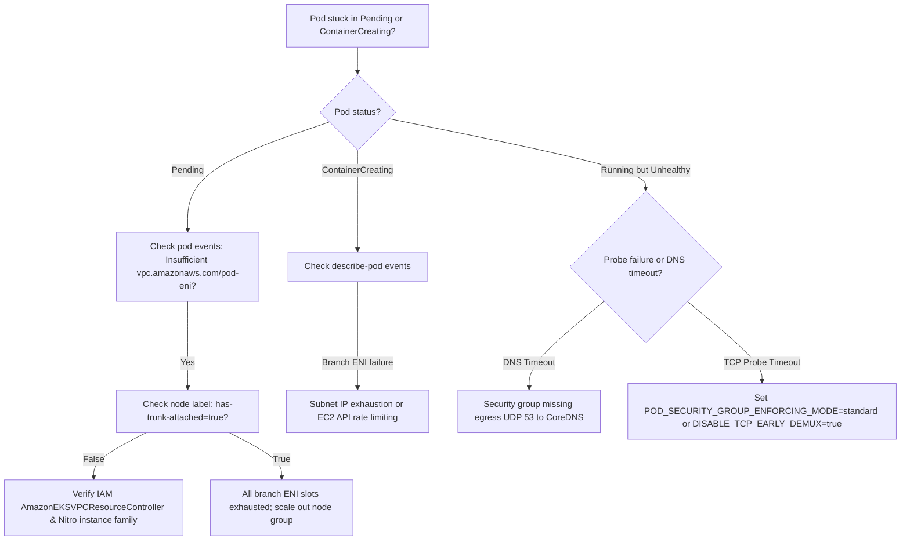

# Security Groups for Pods

By default, every pod on an EKS node shares the EC2 worker node's [[AWS/networking/vpc/security-groups|security groups]]. Anything the node is permitted to reach across the VPC, every pod running on that host can also reach.

**Security groups for pods** provides individual pods with their own isolated network interfaces and security groups. This enables native VPC firewalling at the pod boundary: for example, allowing only the `payments` microservice pods to open connections to a sensitive Amazon RDS database or Amazon ElastiCache cluster, while completely barring all other pods on that same node from reaching the database port.

The underlying infrastructure relies on [[Kubernetes/eks/networking/vpc-cni/trunk-and-branch-eni|Trunk and Branch ENIs]] multiplexed over the AWS Nitro hypervisor.

---

## How It Works: Trunk and Branch Architecture

Instead of allocating secondary IPs on a shared node interface, EKS leverages EC2 **ENI Trunking**:

```
node (Nitro instance, e.g. m5.xlarge)
├── primary ENI (eth0)         node SGs ── host daemons & standard node traffic
├── secondary ENIs (eth1)      node SGs ── ordinary pods share these (or /28 prefixes)
└── trunk ENI (eth2)           InterfaceType=trunk (aws-k8s-trunk-eni)
     ├── branch ENI (VLAN 101) ──► Pod A (payments)     SGs: [sg-payments, sg-cluster]
     └── branch ENI (VLAN 102) ──► Pod B (auth-service) SGs: [sg-auth, sg-cluster]
```

1. **The VPC Resource Controller**, running inside the managed EKS control plane, attaches a dedicated **Trunk ENI** (`InterfaceType=trunk`) to each compatible Nitro node.
2. The node advertises the extended resource `vpc.amazonaws.com/pod-eni` representing available branch interfaces.
3. When a pod matching a `SecurityGroupPolicy` custom resource is scheduled, the controller provisions a **Branch ENI** (`InterfaceType=branch`) with the requested security groups, associates it to the node's trunk ENI via `AssociateTrunkInterface`, and assigns a unique VLAN ID (between 1 and 4094).
4. The [[Kubernetes/eks/networking/vpc-cni/README|VPC CNI]] (`aws-node`) sets up a VLAN sub-interface over the trunk interface on the host, moves it directly into the pod's network namespace as `eth0`, and assigns the branch ENI's dedicated `/32` IP address.
5. Outgoing and incoming traffic for that pod is tagged with the VLAN ID and demultiplexed in hardware by the AWS Nitro Card, which enforces the pod's specific security groups.

For the full low-level datapath, VLAN multiplexing mechanics, and lifecycle flows, see [[Kubernetes/eks/networking/vpc-cni/trunk-and-branch-eni|Trunk and Branch ENIs]].

---

## Prerequisites and Enabling

### 1. IAM Permissions

The EKS control plane requires permission to manage trunk and branch network interfaces in EC2. Attach the AWS-managed policy `AmazonEKSVPCResourceController` to the **cluster IAM role** (the role passed to `eks:CreateCluster`):

```bash
aws iam attach-role-policy \
  --role-name my-eks-cluster-role \
  --policy-arn arn:aws:iam::aws:policy/AmazonEKSVPCResourceController
```

### 2. Enable in VPC CNI

Turn on pod ENI support in the `aws-node` DaemonSet:

```bash
# Via EKS Addon configuration
aws eks update-addon --cluster-name my-cluster --addon-name vpc-cni \
  --configuration-values '{"env":{"ENABLE_POD_ENI":"true"}}'

# Or via kubectl
kubectl set env daemonset/aws-node -n kube-system ENABLE_POD_ENI=true
```

### 3. Verify Trunk Interface Attachment

Check that compatible worker nodes report `vpc.amazonaws.com/has-trunk-attached=true`:

```bash
kubectl get nodes -o custom-columns=\
NAME:.metadata.name,\
TRUNK:.metadata.labels.'vpc\.amazonaws\.com/has-trunk-attached',\
BRANCH_CAPACITY:.status.capacity.'vpc\.amazonaws\.com/pod-eni'
```

> [!WARNING]
> Worker nodes that were already running before enabling `ENABLE_POD_ENI` typically do not dynamically attach a trunk ENI if their physical ENI slots are already consumed by secondary IPs. Drain and replace existing worker nodes to pick up the trunk interface.

---

## Defining a SecurityGroupPolicy

Security groups are bound to pods using the CRD `SecurityGroupPolicy` in `vpcresources.k8s.aws/v1beta1`.

### Matching by Pod Labels

```yaml
apiVersion: vpcresources.k8s.aws/v1beta1
kind: SecurityGroupPolicy
metadata:
  name: payments-db-access
  namespace: payments
spec:
  podSelector:
    matchLabels:
      app: payments-api
  securityGroups:
    groupIds:
      - sg-0aaa1111bbbb2222c # Specific workload SG: allowed in DB SG ingress
      - sg-0ddd3333eeee4444f # Cluster SG: permits DNS and intra-cluster communication
```

### Matching by ServiceAccount

Alternatively, assign security groups to any pod running under a specific Kubernetes ServiceAccount:

```yaml
apiVersion: vpcresources.k8s.aws/v1beta1
kind: SecurityGroupPolicy
metadata:
  name: batch-processor-sg
  namespace: analytics
spec:
  serviceAccountSelector:
    matchLabels:
      account-type: high-security
  securityGroups:
    groupIds:
      - sg-0ccc4444dddd5555e
```

### Critical Rules for Pod Security Groups

1. **Policies apply only at pod creation:** Existing running pods will **not** retroactively receive a branch ENI. You must delete or rollout-restart the pods after applying the `SecurityGroupPolicy`.
2. **Security Groups must allow DNS:** Pods with custom security groups no longer inherit the node's SG rules. If your pod's SG lacks an egress rule allowing UDP/TCP port 53 to CoreDNS (or to the VPC CIDR), all DNS queries inside the pod will time out.
3. **Allow Kubelet probes:** The pod SG must allow inbound traffic on the container port from the node's primary IP (or the cluster SG) so kubelet liveness and readiness probes succeed.
4. **Up to 5 Security Groups:** Under default AWS service quotas, a branch ENI can have up to 5 security groups attached (expandable up to 16 per quota request).

---

## Enforcing Mode: Strict vs Standard

The environment variable `POD_SECURITY_GROUP_ENFORCING_MODE` controls which security groups apply to pod traffic and how routing is handled on the host:

| Mode       | Rules Applied                                                   | Key Characteristics & Compatibility                                                                                                                                                                      |
| :--------- | :-------------------------------------------------------------- | :------------------------------------------------------------------------------------------------------------------------------------------------------------------------------------------------------- |
| `strict`   | **Only** the branch ENI's security groups                       | Default mode. All pod traffic exits directly via the branch ENI. Kubelet health probes require `DISABLE_TCP_EARLY_DEMUX="true"`. Incompatible with Kubernetes Network Policies.                          |
| `standard` | Pod SG for VPC/external traffic; Node SG for intra-node traffic | **Recommended for production**. Permits [[Kubernetes/eks/networking/vpc-cni/network-policies\|VPC CNI Network Policies]], NodeLocal DNSCache, and `externalTrafficPolicy: Local` to function seamlessly. |

To set standard mode:

```bash
kubectl set env daemonset/aws-node -n kube-system \
  POD_SECURITY_GROUP_ENFORCING_MODE=standard
```

---

## Hardware Support and Limits

Security groups for pods relies on hardware trunking features:

| Constraint                | Requirement / Behavior                                                                                                                                                                                                                                             |
| :------------------------ | :----------------------------------------------------------------------------------------------------------------------------------------------------------------------------------------------------------------------------------------------------------------- |
| **Instance Architecture** | **AWS Nitro only**. Older Xen instance types (`t2`, `m4`, `c4`) are completely unsupported.                                                                                                                                                                        |
| **Burstable Instances**   | **Burstable instances (`t3`, `t4g`) do NOT support ENI trunking**, even though they run on Nitro.                                                                                                                                                                  |
| **Windows Nodes**         | Unsupported. Windows nodes do not support branch ENIs or pod security groups.                                                                                                                                                                                      |
| **Fargate**               | Supported natively: every AWS Fargate pod already receives its own dedicated standard ENI, configured via `SecurityGroupPolicy`.                                                                                                                                   |
| **IPv6**                  | Security Groups for Pods is **not** supported on IPv6 clusters.                                                                                                                                                                                                    |
| **Branch ENIs per Node**  | Fixed per instance size (e.g., 9 on `m5.large`, 18 on `m5.2xlarge`, 54 on `m5.4xlarge`). See the full limit table in [[Kubernetes/eks/networking/vpc-cni/trunk-and-branch-eni#capacity-calculations--instance-type-limits\|Trunk and Branch ENI capacity limits]]. |
| **Pod Start Latency**     | Additional 3–8 seconds during pod cold start while the VPC Resource Controller creates and associates the branch ENI in EC2.                                                                                                                                       |

---

## Interaction with Prefix Delegation

Can you combine Security Groups for Pods with [[Kubernetes/eks/networking/vpc-cni/prefix-delegation|Prefix Delegation]]? **Yes.**

- **Trunk ENI slot reservation:** Attaching the trunk ENI uses 1 of the node's maximum physical ENIs.
- **Prefixes on standard ENIs:** The remaining physical ENIs on the node allocate `/28` prefixes (16 IPs per slot) for ordinary pods.
- **Branch ENIs receive single `/32` IPs:** Prefix delegation **does not apply** to branch ENIs. Each pod matching a `SecurityGroupPolicy` gets a single primary `/32` IPv4 address from the VPC subnet.
- **Karpenter Configuration:** Configure Karpenter to reserve 1 ENI for the trunk interface (`aws.reservedENIs: 1`) so it does not schedule standard pods up to the hardware ceiling before the trunk interface can be attached.

---

## Security Groups vs Network Policies

Security Groups for Pods and Kubernetes Network Policies serve distinct but complementary roles:

```
                        ┌──────────────────────────────────────────────┐
                        │              EKS Cluster                     │
                        │                                              │
                        │   ┌──────────────┐       ┌───────────────┐   │
                        │   │ Frontend Pod │ ─────►│ Payments Pod  │   │
                        │   └──────────────┘       └───────┬───────┘   │
                        │          Network Policy          │           │
                        │    (Pod-to-Pod L4 Segmentation)  │           │
                        └──────────────────────────────────┼───────────┘
                                                           │ Pod Security Group
                                                           │ (VPC Native L4 Boundary)
                                                           ▼
                                                   ┌───────────────┐
                                                   │ RDS Database  │
                                                   │ (Private VPC) │
                                                   └───────────────┘
```

| Requirement                                                                     | Preferred Mechanism                                                                 |
| :------------------------------------------------------------------------------ | :---------------------------------------------------------------------------------- |
| Enforce pod-to-pod micro-segmentation inside the Kubernetes cluster             | [[Kubernetes/eks/networking/vpc-cni/network-policies\|Kubernetes Network Policies]] |
| Restrict database access (RDS, Aurora, DynamoDB VPC endpoints) to specific pods | **Security Groups for Pods**                                                        |
| Satisfy external security compliance audits requiring AWS SG isolation          | **Security Groups for Pods**                                                        |
| Control ingress from corporate on-premises Direct Connect or Transit Gateway    | **Security Groups for Pods**                                                        |

---

## Troubleshooting

### Quick Diagnostic Flowchart



### Essential Commands

```bash
# 1. Describe pod and inspect resource allocation and events
kubectl describe pod <pod-name> -n <namespace>

# 2. Check if the SecurityGroupPolicy exists and is valid
kubectl get securitygrouppolicies -A
kubectl describe securitygrouppolicy <policy-name> -n <namespace>

# 3. Check node branch ENI allocatable capacity
kubectl describe node <node-name> | grep -i -A4 "Allocatable:" | grep "pod-eni"

# 4. Inspect VPC Resource Controller logs in control plane (if audit logs enabled)
# Stream: kube-controller-manager or CloudWatch log group /aws/eks/<cluster>/cluster

# 5. Check if branch ENIs exist in AWS EC2
aws ec2 describe-network-interfaces \
  --filters "Name=interface-type,Values=branch" \
  --query 'NetworkInterfaces[*].[NetworkInterfaceId,PrivateIpAddress,Groups[*].GroupId]'
```

### Common Failure Modes

| Symptom                                                       | Cause                                                                                             | Fix                                                                                                                     |
| :------------------------------------------------------------ | :------------------------------------------------------------------------------------------------ | :---------------------------------------------------------------------------------------------------------------------- |
| `0/N nodes available: Insufficient vpc.amazonaws.com/pod-eni` | Node group capacity exhausted or nodes lack trunk interfaces.                                     | Add more worker nodes, scale to larger instance sizes (e.g. `m5.4xlarge`), or ensure instances are Nitro non-burstable. |
| Pod stuck `ContainerCreating`                                 | Subnet ran out of available `/32` IP addresses for branch ENIs, or cluster role lacks IAM policy. | Check subnet available IPs; attach `AmazonEKSVPCResourceController` to the cluster IAM role.                            |
| Pod runs but cannot resolve internal or external hostnames    | Pod security group lacks egress rule for DNS.                                                     | Add egress rule to pod SG permitting UDP/TCP 53 to cluster CoreDNS IP or VPC CIDR.                                      |
| Readiness / Liveness probe timeouts in `strict` mode          | Linux TCP early demux drops asymmetric return traffic on host interface.                          | Set `DISABLE_TCP_EARLY_DEMUX=true` in `aws-node` DaemonSet or switch to `POD_SECURITY_GROUP_ENFORCING_MODE=standard`.   |
| `SecurityGroupPolicy` applied but pod still gets node SG      | Pod was created prior to applying the CRD.                                                        | Delete and recreate the pod (`kubectl rollout restart deployment/<name>`).                                              |

---

## Related Documentation

- [[Kubernetes/eks/networking/vpc-cni/trunk-and-branch-eni|Trunk and Branch ENIs]] — low-level EC2 trunking architecture and packet walk.
- [[Kubernetes/eks/networking/vpc-cni/prefix-delegation|Prefix Delegation]] — high-density pod networking with /28 CIDR blocks.
- [[Kubernetes/eks/networking/vpc-cni/network-policies|VPC CNI Network Policies]] — eBPF-based pod firewalling.
- [[Kubernetes/eks/networking/vpc-cni/troubleshooting|VPC CNI Troubleshooting Guide]] — cluster-wide networking diagnostics.
- [AWS EKS Documentation: Security Groups for Pods](https://docs.aws.amazon.com/eks/latest/userguide/security-groups-for-pods.html)
- [AWS Best Practices: Security Groups for Pods](https://aws.github.io/aws-eks-best-practices/networking/sg-per-pod/)
