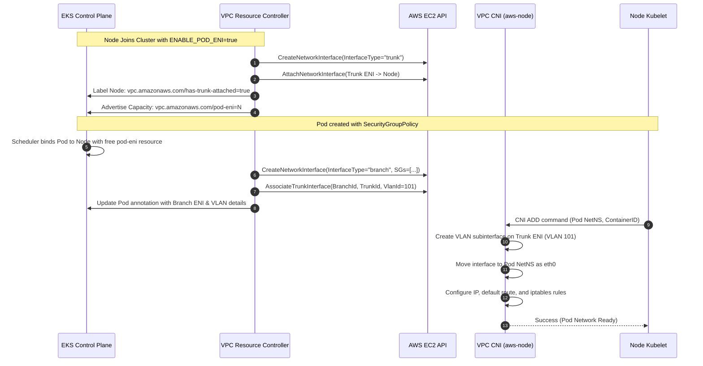

# Trunk and Branch ENIs in EKS

In AWS EC2, every virtual machine is bound by a hardware quota dictating how many Elastic Network Interfaces (ENIs) can be physically or virtually attached. For containerized environments like Amazon EKS, this limit posed a major barrier to per-workload network segmentation: if an EC2 instance only supported 4 ENIs, it could not natively run more than 3 or 4 isolated security group boundaries without an overlay.

AWS solved this by introducing **ENI Trunking** (Trunk and Branch Network Interfaces) on AWS Nitro instances. In EKS, this technology powers [[Kubernetes/eks/networking/vpc-cni/security-groups-for-pods|Security Groups for Pods]], enabling individual pods to possess dedicated VPC network identities and security groups without requiring one standard ENI per pod.

---

## 1. Architectural Concept

Instead of attaching individual standard ENIs directly to the EC2 PCIe bus for each pod, AWS uses a trunk-and-branch multiplexing topology:

```
                      EC2 Worker Node (AWS Nitro)
 ┌────────────────────────────────────────────────────────────────────────┐
 │                                                                        │
 │  eth0 (Primary ENI)                                                    │
 │  ├── Node IP: 10.0.1.10                                                │
 │  └── Host daemon / Kubelet traffic                                     │
 │                                                                        │
 │  eth1 (Secondary ENI) ── (Standard pods via veth pairs / prefixes)     │
 │  ├── 10.0.1.16/28 or individual secondary IPs                          │
 │                                                                        │
 │  eth2 (Trunk ENI: aws-k8s-trunk-eni)                                   │
 │  │   Parent interface (InterfaceType: trunk, 802.1Q multiplexer)       │
 │  │                                                                     │
 │  ├── VLAN 100 ────► veth/vlan100 ──► Pod A NetNS (Branch ENI 1, SG-A) │
 │  │                                   IP: 10.0.1.50/32                  │
 │  │                                                                     │
 │  └── VLAN 101 ────► veth/vlan101 ──► Pod B NetNS (Branch ENI 2, SG-B) │
 │                                      IP: 10.0.1.51/32                  │
 └───────────────────────────────────┬────────────────────────────────────┘
                                     │
                  IEEE 802.1Q Encapsulation / Nitro Bus
                                     ▼
                     AWS Nitro Hypervisor / VPC Fabric
          [Demultiplexes by VLAN ID, enforces Security Groups per branch]
```

### Core Components

1. **Trunk Network Interface (`aws-k8s-trunk-eni`):**
   - An Elastic Network Interface created with `InterfaceType=trunk`.
   - Attached directly to an available device index on the EC2 instance (e.g., `eth1` or `eth2`).
   - Acts as a multiplexed pipe between the instance operating system and the Nitro Card. It does not carry pod IP traffic directly on its base IP; rather, it encapsulates and forwards tagged frames for all attached branch interfaces.
   - **Crucial constraint**: The trunk ENI counts against the instance type's maximum physical network interface limit!

2. **Branch Network Interface (`aws-k8s-branch-eni`):**
   - A specialized virtual interface created with `InterfaceType=branch`.
   - Associated with the trunk ENI via the EC2 API `AssociateTrunkInterface`, which binds the branch interface to the trunk interface and assigns a unique **VLAN ID** (between 1 and 4094).
   - Possesses its own unique MAC address, private IPv4 address (and/or IPv6 address), and dedicated AWS Security Groups.
   - Plumbed into the pod's network namespace as the pod's default network interface (`eth0`).

3. **Amazon VPC Resource Controller:**
   - A Kubernetes controller embedded within the managed EKS control plane.
   - Watches for nodes labeled for trunking and manages the lifecycle of trunk and branch ENIs via EC2 API calls.
   - Advertises the extended resource `vpc.amazonaws.com/pod-eni` on worker nodes so the Kubernetes scheduler knows how many branch ENIs remain available on each host.

4. **VPC CNI (`aws-node` DaemonSet):**
   - Runs on each worker node.
   - Sets up the Linux network datapath: creates VLAN sub-interfaces or MACVLAN links linked to the trunk interface, moves the interface into the pod's network namespace, and sets up host routing table rules.

---

## 2. End-to-End Lifecycle and Provisioning Flow



### Detailed Lifecycle Steps

1. **Trunk Creation and Attachment:**
   When a Nitro node registers with the cluster and `ENABLE_POD_ENI="true"` is enabled on the VPC CNI, the VPC Resource Controller checks if the node supports trunking. If supported, it calls `ec2:CreateNetworkInterface` with `Description="aws-k8s-trunk-eni"` and attaches it via `ec2:AttachNetworkInterface`.
2. **Resource Advertisement:**
   Once attached, the VPC Resource Controller labels the node with `vpc.amazonaws.com/has-trunk-attached=true` and patches the node's `status.capacity` and `status.allocatable` with the extended resource:
   ```yaml
   status:
     capacity:
       vpc.amazonaws.com/pod-eni: "9" # Dependent on instance type
     allocatable:
       vpc.amazonaws.com/pod-eni: "9"
   ```
3. **Pod Scheduling:**
   When a pod matches a `SecurityGroupPolicy`, the mutating webhook injects a resource request for `vpc.amazonaws.com/pod-eni: 1`. The Kubernetes scheduler filters nodes based on available allocatable branch ENIs.
4. **Branch Association:**
   The VPC Resource Controller calls `ec2:CreateNetworkInterface` (`InterfaceType="branch"`) with the security groups specified in the `SecurityGroupPolicy`, and then executes:
   ```bash
   aws ec2 associate-trunk-interface \
     --trunk-interface-id eni-trunk-0123456789abcdef0 \
     --branch-interface-id eni-branch-0fedcba9876543210 \
     --vlan-id 101
   ```
5. **Pod Network Plumbing:**
   The VPC CNI daemon on the node reads the assigned VLAN ID from the pod's resource allocation, creates a Linux VLAN link associated with the trunk interface (e.g. `vlan101`), shifts it into the target pod namespace, assigns the branch ENI's private IP, and configures the default gateway route.

---

## 3. Datapath & Packet Walk

How does traffic actually travel between a pod with a branch ENI and the rest of the world?

### Egress Packet Flow (Pod to VPC Resource / RDS)

1. **Pod Namespace:** The application transmits an IP packet destined for RDS (`10.0.2.50:5432`). The kernel sends it out `eth0` inside the pod netns.
2. **VLAN Encapsulation:** As the packet traverses the virtual boundary out to the host trunk interface, the kernel tags the Ethernet frame with the IEEE 802.1Q header containing the assigned `VlanId` (e.g. `101`).
3. **Nitro Interception:** The frame reaches the EC2 Nitro controller over the trunk interface. The Nitro Card:
   - Reads the 802.1Q tag (`VlanId=101`).
   - Identifies the corresponding branch ENI.
   - **Evaluates Security Group egress rules** attached to that branch ENI. If blocked, the packet is dropped immediately in hardware.
   - Strips the 802.1Q VLAN header.
   - Forwards the bare IP packet into the AWS VPC overlay fabric.

### Ingress Packet Flow (RDS to Pod)

1. **VPC Fabric Ingress:** The reply packet arrives at the EC2 host directed to the pod's branch ENI IP address (`10.0.1.50`).
2. **Nitro Security Evaluation:** The Nitro Card matches the IP to the branch ENI, evaluates **Security Group ingress rules**, and verifies connection state (stateful firewall tracking).
3. **Hardware Tagging:** Nitro injects the 802.1Q VLAN tag (`VlanId=101`) into the Ethernet frame and hands it up through the trunk ENI to the Linux kernel.
4. **VLAN Demultiplexing:** The Linux network stack demultiplexes the tagged frame on the trunk device and delivers the untagged packet directly into the pod's `eth0` socket buffer.

---

## 4. Enforcing Modes: Strict vs Standard

The environment variable `POD_SECURITY_GROUP_ENFORCING_MODE` on the `aws-node` DaemonSet dictates how traffic to local host resources and other cluster pods is handled:

| Feature / Behavior                 | `strict` (Default)                                              | `standard` (Recommended)                                                                                           |
| :--------------------------------- | :-------------------------------------------------------------- | :----------------------------------------------------------------------------------------------------------------- |
| **Outbound Routing**               | 100% of egress traffic leaves through the branch ENI.           | Traffic destined for VPC / external egresses branch ENI; pod-to-pod / cluster traffic routes through host routing. |
| **Security Groups Applied**        | **Only** the pod's security groups.                             | Pod SGs apply to external VPC traffic; Node SGs apply to node-local communication.                                 |
| **Kubernetes Network Policies**    | **Not supported** (packets bypass host eBPF / iptables chains). | **Fully supported** alongside [[Kubernetes/eks/networking/vpc-cni/network-policies\|VPC CNI Network Policies]].    |
| **Kubelet TCP Health Probes**      | Fails unless `DISABLE_TCP_EARLY_DEMUX=true` is set.             | Works natively without requiring kernel workarounds.                                                               |
| **NodeLocal DNSCache**             | Requires explicit pod SG rules allowing traffic to node IP.     | Supported seamlessly via local routing.                                                                            |
| **`externalTrafficPolicy: Local`** | Incompatible with direct branch egress.                         | Fully functional.                                                                                                  |

> [!IMPORTANT]
> If you are running Kubernetes Network Policies, using NodeLocal DNSCache, or routing cluster traffic internally, set `POD_SECURITY_GROUP_ENFORCING_MODE="standard"`.

---

## 5. Capacity Calculations & Instance Type Limits

Branch ENI limits are determined by the EC2 Nitro hardware profile. Burstable instances (`t3`, `t4g`) and older Xen generations (`t2`, `m4`, `c4`) **do not support ENI trunking**.

### Instance Limits Table

| Instance Type                           | Max Standard ENIs | Branch ENI Limit (`pod-eni`) | Max Pods (Only SGP Branch Pods) |
| :-------------------------------------- | :---------------- | :--------------------------- | :------------------------------ |
| `m5.large` / `c5.large` / `r5.large`    | 3                 | **9**                        | 9                               |
| `m5.xlarge` / `c5.xlarge` / `r5.xlarge` | 4                 | **9**                        | 9                               |
| `m5.2xlarge` / `c5.2xlarge`             | 4                 | **18**                       | 18                              |
| `m5.4xlarge` / `c5.4xlarge`             | 8                 | **54**                       | 54                              |
| `m5.8xlarge` / `c5.9xlarge`             | 8                 | **54**                       | 54                              |
| `m5.16xlarge` / `c5.18xlarge`           | 15                | **108**                      | 108                             |
| `m6i.large` / `c6i.large`               | 3                 | **9**                        | 9                               |
| `m6i.4xlarge` / `c6i.4xlarge`           | 8                 | **54**                       | 54                              |

### Impact on Standard ENI Allocation

Attaching a trunk ENI consumes **one physical ENI slot** from the instance.

For example, on an `m5.large` (limit: 3 ENIs):

1. Device `eth0` is the **Primary ENI** (used by the EC2 host itself and host-network daemons).
2. Device `eth1` is attached as the **Trunk ENI** (`aws-k8s-trunk-eni`).
3. Only **1 remaining ENI** (`eth2`) can be attached for standard pods!

Without [[Kubernetes/eks/networking/vpc-cni/prefix-delegation|Prefix Delegation]], `eth2` provides only 10 secondary IP addresses. Consequently, turning on Security Groups for Pods on small instances without prefix delegation significantly restricts the capacity for standard non-SGP pods.

---

## 6. Trunk & Branch ENIs Combined with Prefix Delegation

Can you run both Trunk ENIs and Prefix Delegation simultaneously on the same node? **Yes**, and in production environments, this is the recommended architecture.

```
                      EC2 Instance (e.g. m5.xlarge)
 ┌────────────────────────────────────────────────────────────────────────┐
 │ eth0 (Primary ENI)     ── Node primary IP                              │
 │                                                                        │
 │ eth1 (Trunk ENI)       ── Multiplexes up to 9 Branch ENIs              │
 │                           └── Pod A: 10.0.1.50/32 (Branch ENI, SG-A)   │
 │                           └── Pod B: 10.0.1.51/32 (Branch ENI, SG-B)   │
 │                                                                        │
 │ eth2 (Secondary ENI)   ── Prefix Delegation (/28 blocks)               │
 │                           ├── Prefix 1: 10.0.2.0/28 (16 standard pods) │
 │                           ├── Prefix 2: 10.0.2.16/28 (16 standard pods)│
 │                           └── Prefix 3: 10.0.2.32/28 (16 standard pods)│
 └────────────────────────────────────────────────────────────────────────┘
```

### Key Rules of Coexistence

1. **Branch ENIs Never Use Prefixes:**
   Prefix delegation applies **only** to standard secondary ENIs. A branch ENI always receives a single primary `/32` IPv4 address from the subnet. You cannot delegate a `/28` prefix to a branch ENI.
2. **Trunk Reservation:**
   Because the trunk interface occupies 1 ENI slot, the node has $(N - 1)$ standard ENIs available for prefix allocation. Since each standard ENI in prefix mode can hold hundreds of IPs (e.g., $14 \times 16 = 224$ IPs), losing 1 ENI slot to the trunk interface has zero negative impact on standard pod density!
3. **Karpenter Configuration:**
   Karpenter calculates node capacity ahead of scheduling. When `ENABLE_POD_ENI=true`, you must configure Karpenter's node class to reserve 1 ENI slot so that it does not overcommit standard interfaces before the VPC Resource Controller can attach the trunk ENI:
   ```yaml
   apiVersion: karpenter.k8s.aws/v1
   kind: EC2NodeClass
   metadata:
     name: default
   spec:
     # ...
     # In Karpenter v1+, ensure reserved ENIs are accounted for if managing custom ENI pools
   ```
   For older Karpenter configurations:
   ```yaml
   spec:
     aws:
       reservedENIs: 1
   ```

---

## 7. Verification and Troubleshooting

### 1. Check Trunk Attachment on Nodes

```bash
# Verify trunk label on nodes
kubectl get nodes -o custom-columns=\
NAME:.metadata.name,\
TRUNK:.metadata.labels.'vpc\.amazonaws\.com/has-trunk-attached',\
BRANCH_CAPACITY:.status.capacity.'vpc\.amazonaws\.com/pod-eni',\
BRANCH_ALLOCATABLE:.status.allocatable.'vpc\.amazonaws\.com/pod-eni'
```

Expected output:

```
NAME                          TRUNK   BRANCH_CAPACITY   BRANCH_ALLOCATABLE
ip-10-0-1-45.ec2.internal     true    9                 7
ip-10-0-1-89.ec2.internal     true    9                 9
```

### 2. Inspect Trunk Associations in AWS EC2

```bash
# Find trunk ENI attached to instance
aws ec2 describe-network-interfaces \
  --filters "Name=attachment.instance-id,Values=i-0123456789abcdef0" \
            "Name=interface-type,Values=trunk" \
  --query 'NetworkInterfaces[*].[NetworkInterfaceId,InterfaceType,Status]'

# Describe all branch ENIs associated with the trunk
aws ec2 describe-trunk-interface-associations \
  --filters "Name=trunk-interface-id,Values=eni-0123456789trunk" \
  --query 'InterfaceAssociationSet[*].[BranchInterfaceId,VlanId,InterfaceProtocol]'
```

### 3. Verify Branch ENI on the Worker Node Host

Log onto the EC2 worker node via SSM Session Manager:

```bash
# Check physical network interfaces on node
ip link show

# Check for VLAN subinterfaces (e.g., vlan.eth2.100 or veth pairs)
ip -d link show type vlan

# Check routing tables for pod ENI
ip rule show
ip route show table all | grep -i eni
```

### Common Failure Scenarios

| Symptom                                                                            | Root Cause                                                                                                                            | Resolution                                                                                                                                                  |
| :--------------------------------------------------------------------------------- | :------------------------------------------------------------------------------------------------------------------------------------ | :---------------------------------------------------------------------------------------------------------------------------------------------------------- |
| Pod stuck `Pending`: `0/N nodes available: Insufficient vpc.amazonaws.com/pod-eni` | All available branch ENI slots on existing nodes are consumed, or instances lack trunk ENIs.                                          | Scale out node group, increase instance sizes (e.g. `m5.4xlarge` provides 54 branch ENIs), or verify `AmazonEKSVPCResourceController` IAM policy.           |
| Node never gets `vpc.amazonaws.com/has-trunk-attached=true`                        | Instance type does not support trunking (e.g., `t3`, `t4g`, or Xen), or cluster IAM role is missing `AmazonEKSVPCResourceController`. | Switch node group to Nitro compute (`m5`, `c5`, `r5`, `m6i`), attach the IAM policy to the EKS cluster role, and recycle worker nodes.                      |
| Pod stuck `ContainerCreating` with EC2 `AttachmentLimitExceeded`                   | Node already allocated all standard ENIs for secondary IPs before the trunk ENI could attach.                                         | Enable [[Kubernetes/eks/networking/vpc-cni/prefix-delegation\|Prefix Delegation]], configure Karpenter `aws.reservedENIs: 1`, or create a fresh node group. |
| Pod readiness probe fails with TCP timeouts in `strict` mode                       | Linux kernel TCP early demux drops incoming TCP probe frames returning over asymmetric paths.                                         | Set `DISABLE_TCP_EARLY_DEMUX="true"` in `aws-node` or switch to `POD_SECURITY_GROUP_ENFORCING_MODE="standard"`.                                             |

---

## 8. Summary Comparison

| Aspect              | Standard ENI                                 | Trunk ENI (`aws-k8s-trunk-eni`)               | Branch ENI (`aws-k8s-branch-eni`)               |
| :------------------ | :------------------------------------------- | :-------------------------------------------- | :---------------------------------------------- |
| **Interface Type**  | `interface`                                  | `trunk`                                       | `branch`                                        |
| **Attachment**      | Attached directly to EC2 PCIe device index   | Attached directly to EC2 PCIe device index    | Associated with Trunk ENI via `VlanId` (1–4094) |
| **Workload Type**   | Ordinary pods (via veth pairs)               | None (acts as network pipeline / multiplexer) | Single dedicated Pod with `SecurityGroupPolicy` |
| **IP Allocation**   | Primary IP + Secondary IPs or `/28` Prefixes | Single host IP (not used for pods)            | Single primary `/32` IP from VPC subnet         |
| **Security Groups** | Inherits Node Security Groups                | Host / Cluster SG                             | Custom Security Groups assigned via CRD         |
| **Nitro Support**   | All instance types                           | Nitro non-burstable only                      | Nitro non-burstable only                        |

---

## Related Documentation

- [[Kubernetes/eks/networking/vpc-cni/security-groups-for-pods|Security Groups for Pods]] — configuring `SecurityGroupPolicy` CRDs and policies.
- [[Kubernetes/eks/networking/vpc-cni/prefix-delegation|Prefix Delegation]] — assigning /28 CIDR blocks for massive pod density.
- [[Kubernetes/eks/networking/vpc-cni/architecture|VPC CNI Architecture]] — internal architecture of `aws-cni` and `ipamd`.
- [[Kubernetes/eks/networking/vpc-cni/eni-allocation|ENI and IP Allocation]] — warm pool management and IP target tuning.
- [AWS Documentation: Security Groups for Pods](https://docs.aws.amazon.com/eks/latest/userguide/security-groups-for-pods.html)
- [AWS Documentation: EC2 Elastic Network Interface Trunking](https://docs.aws.amazon.com/AWSEC2/latest/UserGuide/eni-trunking.html)
- [Amazon VPC Resource Controller GitHub](https://github.com/aws/amazon-vpc-resource-controller-k8s)
