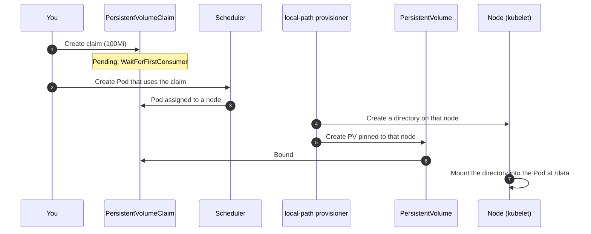

# Lab CKA-01 — Stateful Persistence & PVCs

In this lab you give a workload storage that outlives its Pods. You claim a volume through the default **StorageClass**, write a file and prove with a checksum that a replacement Pod reads the same bytes from the same **PersistentVolume**. You then create a PersistentVolume by hand, bind a claim to it, and recover it after the claim is deleted.

The lab works in its own namespace, `storage-lab`, and does not touch `default/podinfo`.

Concepts: [[Kubernetes/concepts/L05-config-storage/06-storageclass|StorageClass]], [[Kubernetes/concepts/L05-config-storage/04-persistentvolume|PersistentVolume]], [[Kubernetes/concepts/L05-config-storage/05-persistentvolumeclaim|PersistentVolumeClaim]] and [[Kubernetes/guides/troubleshooting/pvc-stuck|PVC Stuck]].

Tested 2026-10-13 on kind v0.33.0 with Kubernetes v1.37.0.



---

## 1. Prerequisites & Starting State

- Working `k8s-lab` cluster from **[[Kubernetes/labs/ckad/01-cluster-setup|Lab CKAD-01]]**. No other lab is required.
- Work in a dedicated namespace, and make it the default for this terminal:

```bash
kubectl create namespace storage-lab
kubectl config set-context --current --namespace=storage-lab
kubectl get storageclass
```

```
NAME                 PROVISIONER             RECLAIMPOLICY   VOLUMEBINDINGMODE      ALLOWVOLUMEEXPANSION   AGE
standard (default)   rancher.io/local-path   Delete          WaitForFirstConsumer   false                  23m
```

Read every column; each one matters below.

> [!note] What kind's provisioner is
> `rancher.io/local-path` is an external provisioner that creates a directory on one node and a PersistentVolume pointing at it. It is **not a CSI driver**, and the volume is not network storage: it exists on a single node. Dynamic provisioning means "a controller creates the PV for you"; CSI is one way to implement that, not a synonym for it.

---

## 2. Dynamic Provisioning

### Step 1: Create a claim and read why it is Pending

```bash
cat << 'EOF' > data-pvc.yaml
apiVersion: v1
kind: PersistentVolumeClaim
metadata:
  name: data
spec:
  accessModes:
    - ReadWriteOnce
  resources:
    requests:
      storage: 100Mi
EOF

kubectl apply -f data-pvc.yaml
kubectl get pvc data
kubectl describe pvc data | grep -A 4 "Events:"
```

```
NAME   STATUS    VOLUME   CAPACITY   ACCESS MODES   STORAGECLASS   VOLUMEATTRIBUTESCLASS   AGE
data   Pending                                      standard       <unset>                 3s

Events:
  Type    Reason                Age   From                         Message
  ----    ------                ----  ----                         -------
  Normal  WaitForFirstConsumer  3s    persistentvolume-controller  waiting for first consumer to be created before binding
```

This `Pending` is expected. The claim named no StorageClass, so it got the default one, whose `VOLUMEBINDINGMODE` is `WaitForFirstConsumer`: no volume is created until a Pod that uses the claim has been scheduled, so that the volume is created on the node the Pod will run on. A `Normal` event is the sign that nothing is wrong.

### Step 2: Use the claim from a workload

```bash
cat << 'EOF' > writer.yaml
apiVersion: apps/v1
kind: Deployment
metadata:
  name: writer
spec:
  replicas: 1
  strategy:
    type: Recreate
  selector:
    matchLabels:
      app: writer
  template:
    metadata:
      labels:
        app: writer
    spec:
      containers:
        - name: writer
          image: busybox:1.36
          command: ["sh", "-c", "sleep 3600"]
          volumeMounts:
            - name: data
              mountPath: /data
      volumes:
        - name: data
          persistentVolumeClaim:
            claimName: data
EOF

kubectl apply -f writer.yaml
kubectl rollout status deployment/writer --timeout=120s
kubectl get pvc,pv
```

```
NAME                         STATUS   VOLUME                                     CAPACITY   ACCESS MODES   STORAGECLASS   AGE
persistentvolumeclaim/data   Bound    pvc-ec9cf522-1a23-48e4-a22d-d4b7c4c11e22   100Mi      RWO            standard       8s

NAME                                                        CAPACITY   ACCESS MODES   RECLAIM POLICY   STATUS   CLAIM              STORAGECLASS   AGE
persistentvolume/pvc-ec9cf522-1a23-48e4-a22d-d4b7c4c11e22   100Mi      RWO            Delete           Bound    storage-lab/data   standard       2s
```

`strategy: Recreate` is deliberate. A `ReadWriteOnce` volume can be mounted by Pods on one node only, so a rolling update that starts the new Pod on another node before stopping the old one would hang.

See where the volume really is:

```bash
PV_NAME=$(kubectl get pvc data -o jsonpath='{.spec.volumeName}')
kubectl get pv "$PV_NAME" \
  -o jsonpath='{.spec.nodeAffinity.required.nodeSelectorTerms[0].matchExpressions[0].values[0]}{"\n"}{.spec.hostPath.path}{"\n"}'
```

```
k8s-lab-worker2
/var/local-path-provisioner/pvc-ec9cf522-1a23-48e4-a22d-d4b7c4c11e22_storage-lab_data
```

The PV has a **node affinity**. Any Pod using this claim can only ever run on that node.

### Step 3: Write data, replace the Pod, verify

Write one file to the volume and one to the container's own filesystem, and record a checksum:

```bash
kubectl exec deployment/writer -- sh -c \
  'echo "order 1001 paid" > /data/orders.log; echo scratch > /tmp/scratch.txt; sha256sum /data/orders.log'
```

```
91b25c849595dae02acc703a91dd5d0869a0c0745d4fda42dfdbab2a01744660  /data/orders.log
```

Delete the Pod and let the Deployment replace it:

```bash
kubectl delete pod -l app=writer
kubectl rollout status deployment/writer --timeout=120s

kubectl exec deployment/writer -- sh -c 'sha256sum /data/orders.log; ls /tmp/scratch.txt'
kubectl get pvc data -o jsonpath='{.spec.volumeName}{"\n"}'
```

```
91b25c849595dae02acc703a91dd5d0869a0c0745d4fda42dfdbab2a01744660  /data/orders.log
ls: /tmp/scratch.txt: No such file or directory
pvc-ec9cf522-1a23-48e4-a22d-d4b7c4c11e22
```

Three facts, each checked: the checksum is identical, the file outside the volume is gone, and the claim is still bound to the same PV. That is what "the data survived" means.

> [!warning] What this does not prove
> The Pod came back on the same node, because the volume lives there. If that node is lost, so is the data, and the replacement Pod stays `Pending` because no other node satisfies the PV's node affinity. Surviving a node failure needs storage that can be attached elsewhere (a cloud disk, a network filesystem or a replicated storage system).

### Step 4: Try to grow the claim

```bash
kubectl patch pvc data -p '{"spec":{"resources":{"requests":{"storage":"200Mi"}}}}'
```

```
Error from server (Forbidden): persistentvolumeclaims "data" is forbidden: only dynamically provisioned pvc can be resized and the storageclass that provisions the pvc must support resize
```

The StorageClass has `ALLOWVOLUMEEXPANSION false`. Setting that field to `true` is necessary but not sufficient: the driver behind the class must implement expansion, and the local-path provisioner does not. On a class that supports it, this same patch is the whole procedure, and `kubectl describe pvc` reports the resize progress. A claim can never be shrunk.

---

## 3. Static Provisioning and Reclaim Policy

Without a provisioner, an administrator creates the PersistentVolume and a claim binds to it by matching class, access mode and size.

### Step 1: Create a PV and a claim that matches it

```bash
docker exec k8s-lab-worker mkdir -p /mnt/archive

cat << 'EOF' > archive.yaml
apiVersion: v1
kind: PersistentVolume
metadata:
  name: archive-pv
spec:
  capacity:
    storage: 1Gi
  accessModes:
    - ReadWriteOnce
  persistentVolumeReclaimPolicy: Retain
  storageClassName: manual
  hostPath:
    path: /mnt/archive
  nodeAffinity:
    required:
      nodeSelectorTerms:
        - matchExpressions:
            - key: kubernetes.io/hostname
              operator: In
              values: ["k8s-lab-worker"]
---
apiVersion: v1
kind: PersistentVolumeClaim
metadata:
  name: archive
spec:
  storageClassName: manual
  accessModes:
    - ReadWriteOnce
  resources:
    requests:
      storage: 500Mi
EOF

kubectl apply -f archive.yaml
kubectl get pv archive-pv
kubectl get pvc archive
```

```
NAME         CAPACITY   ACCESS MODES   RECLAIM POLICY   STATUS   CLAIM                 STORAGECLASS   AGE
archive-pv   1Gi        RWO            Retain           Bound    storage-lab/archive   manual         3s

NAME      STATUS   VOLUME       CAPACITY   ACCESS MODES   STORAGECLASS   AGE
archive   Bound    archive-pv   1Gi        RWO            manual         3s
```

- `storageClassName: manual` names no StorageClass object. Here it is only a label that the PV and the claim must share.
- The claim asked for 500Mi and received the whole 1Gi volume. A claim binds to a PV that is **at least** as large; the capacity is not split.
- It bound at once, with no Pod, because there is no `WaitForFirstConsumer` class involved.

Write a file through a Pod:

```bash
kubectl run archiver --image=busybox:1.36 --restart=Never --overrides='{
  "spec": {
    "containers": [{"name": "archiver", "image": "busybox:1.36",
      "command": ["sh", "-c", "echo kept > /archive/file.txt; sleep 3600"],
      "volumeMounts": [{"name": "a", "mountPath": "/archive"}]}],
    "volumes": [{"name": "a", "persistentVolumeClaim": {"claimName": "archive"}}]
  }}'
kubectl wait --for=condition=Ready pod/archiver --timeout=60s
kubectl get pod archiver -o jsonpath='{.spec.nodeName}{"\n"}'
```

```
k8s-lab-worker
```

The scheduler placed the Pod on the node named in the PV's node affinity.

### Step 2: Delete the claim and find the volume Released

```bash
kubectl delete pod archiver --grace-period=1
kubectl delete pvc archive
kubectl get pv archive-pv
```

```
NAME         CAPACITY   ACCESS MODES   RECLAIM POLICY   STATUS     CLAIM                 STORAGECLASS   AGE
archive-pv   1Gi        RWO            Retain           Released   storage-lab/archive   manual         11s
```

`Retain` kept the PV and its data. With `Delete`, the policy of the dynamic class in section 2, the PV and the directory behind it would have been removed with the claim.

### Step 3: Controlled failure: a new claim will not bind to a Released volume

```bash
kubectl apply -f archive.yaml
sleep 5
kubectl get pvc archive
kubectl describe pvc archive | grep -A 4 "Events:"
```

```
NAME      STATUS    VOLUME   CAPACITY   ACCESS MODES   STORAGECLASS   AGE
archive   Pending                                      manual         6s

Events:
  Type     Reason              Age              From                         Message
  ----     ------              ----             ----                         -------
  Warning  ProvisioningFailed  4s (x2 over 6s)  persistentvolume-controller  storageclass.storage.k8s.io "manual" not found
```

The event is misleading. The class was not found the first time either, and the claim bound anyway. The real cause is on the PV: `Released` means it still carries a `claimRef` to the **old** claim (a different object with a different UID), so it is not offered to anyone else. Kubernetes does this on purpose, so that one tenant's data is not handed to the next.

Check the PV, not only the claim, whenever a claim that should match stays `Pending`.

### Step 4: Recover it

Once you have decided the data may be reused, clear the reference:

```bash
kubectl patch pv archive-pv --type json -p '[{"op":"remove","path":"/spec/claimRef"}]'

kubectl wait --for=jsonpath='{.status.phase}'=Bound pvc/archive --timeout=60s
kubectl get pv archive-pv
docker exec k8s-lab-worker cat /mnt/archive/file.txt
```

```
NAME         CAPACITY   ACCESS MODES   RECLAIM POLICY   STATUS   CLAIM                 STORAGECLASS   AGE
archive-pv   1Gi        RWO            Retain           Bound    storage-lab/archive   manual         42s
kept
```

The PV went `Released` → `Available` → `Bound`, and the file written before the claim was deleted is still there. Binding can take up to about 15 seconds after the patch.

---

## 4. Controlled Failure Scenario: A Claim for a Class That Does Not Exist

```bash
kubectl apply -f - << 'EOF'
apiVersion: v1
kind: PersistentVolumeClaim
metadata:
  name: broken
spec:
  storageClassName: fast-nvme
  accessModes: ["ReadWriteOnce"]
  resources:
    requests:
      storage: 5Gi
EOF

kubectl describe pvc broken | grep -A 4 "Events:"
```

```
Events:
  Type     Reason              Age              From                         Message
  ----     ------              ----             ----                         -------
  Warning  ProvisioningFailed  4s (x2 over 5s)  persistentvolume-controller  storageclass.storage.k8s.io "fast-nvme" not found
```

Here the same event **is** the cause: no PV carries the class `fast-nvme` and no StorageClass of that name can create one. `storageClassName` cannot be changed on an existing claim, so the fix is to delete the claim and create it again with a class from `kubectl get storageclass`.

You have now seen three reasons for a `Pending` claim. Tell them apart by the event and by the PVs that exist:

| Evidence                                                                                     | Cause                           | Action                                    |
| :------------------------------------------------------------------------------------------- | :------------------------------ | :---------------------------------------- |
| `Normal WaitForFirstConsumer`                                                                | The class waits for a Pod       | Create the Pod; nothing is wrong          |
| `ProvisioningFailed ... not found`, and no PV with that class                                | Wrong or missing StorageClass   | Recreate the claim with a real class      |
| A PV with matching class exists but is `Released`, too small, or has a different access mode | The PV cannot satisfy the claim | Clear `claimRef`, or fix the size or mode |

---

## 5. Cleanup & Exit State

```bash
kubectl config set-context --current --namespace=default
kubectl delete namespace storage-lab
kubectl delete pv archive-pv
docker exec k8s-lab-worker rm -rf /mnt/archive
```

Deleting the namespace deletes the `data` claim, and because its class has reclaim policy `Delete`, its PV goes with it. `archive-pv` has `Retain` and is cluster-scoped, so it must be deleted by hand. Confirm nothing is left with `kubectl get pv`.

---

## Practice Without the Answer

Suggested time: 8 minutes. Work in a new namespace `store`.

1. Create a 2Gi PersistentVolume `logs-pv` with class `archive`, access mode `ReadWriteOnce`, reclaim policy `Retain`, backed by `hostPath` `/mnt/logs` on `k8s-lab-worker2`.
2. Create a claim `logs` for 1Gi that binds to it.
3. Run a Pod `shipper` (image `busybox:1.36`) that mounts the claim at `/var/log/app` and writes the current date to `/var/log/app/started`.

Check yourself:

```bash
kubectl -n store get pvc logs -o jsonpath='{.status.phase} {.spec.volumeName}{"\n"}'   # Bound logs-pv
kubectl -n store get pod shipper -o jsonpath='{.spec.nodeName}{"\n"}'                  # k8s-lab-worker2
docker exec k8s-lab-worker2 cat /mnt/logs/started                                      # a date
```

If the Pod landed on another node or stays `Pending`, compare the PV's node affinity with where the directory really is. Reset with `kubectl delete namespace store; kubectl delete pv logs-pv`.

---

## Further reading

- [Persistent Volumes](https://kubernetes.io/docs/concepts/storage/persistent-volumes/), including [reclaiming](https://kubernetes.io/docs/concepts/storage/persistent-volumes/#reclaiming) and [expanding claims](https://kubernetes.io/docs/concepts/storage/persistent-volumes/#expanding-persistent-volumes-claims)
- [Storage Classes](https://kubernetes.io/docs/concepts/storage/storage-classes/)
- [Dynamic volume provisioning](https://kubernetes.io/docs/concepts/storage/dynamic-provisioning/)
- [local-path-provisioner](https://github.com/rancher/local-path-provisioner)

## Next Lab

Proceed to **[[Kubernetes/labs/cka/02-scheduling-and-autoscaling|Lab CKA-02 — Scheduling, QoS & Disruption Budgets]]** to manage resource requests, topology spread and node drains, or return to the [[Kubernetes/certifications/cka|CKA Track]].
