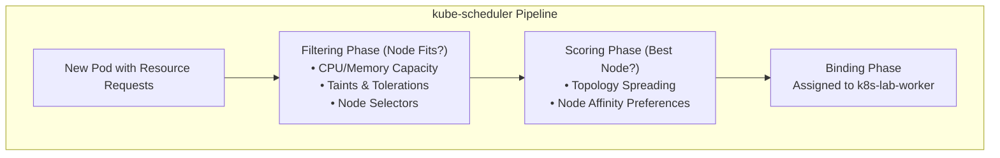

# Lab CKA-02 — Scheduling, QoS & Disruption Budgets

In this lab, you control how and where Kubernetes places your workloads. You will define compute requests and limits, inspect **Quality of Service (QoS)** classes, enforce high-availability spreading across worker nodes using **`topologySpreadConstraints`**, protect application availability during maintenance using a **PodDisruptionBudget (PDB)**, drain a node and resolve the deadlock that a strict spread constraint and a tight budget create together, and diagnose an unschedulable `Pending` Pod.

The lab works in its own namespace, `sched-lab`, and does not touch `default/podinfo`.

Concepts: [[Kubernetes/concepts/L06-scheduling-scaling/02-scheduling|Scheduling]], [[Kubernetes/concepts/L06-scheduling-scaling/01-resource-requests-limits|Resource Requests and Limits]], [[Kubernetes/concepts/L06-scheduling-scaling/04-poddisruptionbudget|PodDisruptionBudget]] and [[Kubernetes/guides/troubleshooting/pod-pending|Pod Pending]].

Tested 2026-10-13 on kind v0.33.0 with Kubernetes v1.37.0.



---

## 1. Prerequisites & Starting State

- Working `k8s-lab` cluster from **[[Kubernetes/labs/ckad/01-cluster-setup|Lab CKAD-01]]**, with its two worker nodes labelled `zone-a` and `zone-b`. No other lab is required.

```bash
kubectl create namespace sched-lab
kubectl config set-context --current --namespace=sched-lab

kubectl get nodes -L topology.kubernetes.io/zone
kubectl get nodes -o custom-columns='NAME:.metadata.name,CPU:.status.allocatable.cpu,MEM:.status.allocatable.memory,TAINTS:.spec.taints[*].key'
```

The control-plane node has the taint `node-role.kubernetes.io/control-plane` and no zone label. Both facts appear in scheduler messages later.

---

## 2. Workload, Spread Constraint and Disruption Budget

Create `web.yaml`:

```yaml
apiVersion: apps/v1
kind: Deployment
metadata:
  name: web
spec:
  replicas: 4
  selector:
    matchLabels:
      app: web
  template:
    metadata:
      labels:
        app: web
    spec:
      topologySpreadConstraints:
        - maxSkew: 1
          topologyKey: topology.kubernetes.io/zone
          whenUnsatisfiable: DoNotSchedule
          labelSelector:
            matchLabels:
              app: web
      containers:
        - name: podinfo
          image: ghcr.io/stefanprodan/podinfo:6.7.1
          resources:
            requests:
              cpu: 50m
              memory: 64Mi
            limits:
              cpu: 200m
              memory: 128Mi
---
apiVersion: policy/v1
kind: PodDisruptionBudget
metadata:
  name: web
spec:
  minAvailable: 3
  selector:
    matchLabels:
      app: web
```

```bash
kubectl apply -f web.yaml
kubectl rollout status deployment/web --timeout=120s
```

---

## 3. Step-by-Step Execution

### Step 1: Quality of Service classes

Kubernetes derives a QoS class from the requests and limits of a Pod's containers:

| Class        | Rule                                                                 |
| :----------- | :------------------------------------------------------------------- |
| `Guaranteed` | Every container has CPU and memory limits, and requests equal limits |
| `Burstable`  | At least one request or limit is set, but the Pod is not Guaranteed  |
| `BestEffort` | No requests and no limits anywhere in the Pod                        |

```bash
kubectl get pods -l app=web -o custom-columns=NAME:.metadata.name,QOS:.status.qosClass,NODE:.spec.nodeName
```

```
NAME                   QOS         NODE
web-5678bc9746-gbn6r   Burstable   k8s-lab-worker
web-5678bc9746-l72x9   Burstable   k8s-lab-worker2
web-5678bc9746-rdlnt   Burstable   k8s-lab-worker
web-5678bc9746-vtgmz   Burstable   k8s-lab-worker2
```

Create one Pod of each other class and compare:

```bash
kubectl run qos-guaranteed --image=busybox:1.36 --restart=Never --overrides='{
  "spec": {"containers": [{"name": "c", "image": "busybox:1.36", "command": ["sleep", "3600"],
    "resources": {"requests": {"cpu": "50m", "memory": "32Mi"}, "limits": {"cpu": "50m", "memory": "32Mi"}}}]}}'
kubectl run qos-besteffort --image=busybox:1.36 --restart=Never -- sleep 3600

kubectl get pods qos-guaranteed qos-besteffort -o custom-columns=NAME:.metadata.name,QOS:.status.qosClass
kubectl delete pod qos-guaranteed qos-besteffort --grace-period=1
```

```
NAME             QOS
qos-guaranteed   Guaranteed
qos-besteffort   BestEffort
```

What the class is used for: when a node runs short of memory, the kubelet ranks Pods for eviction by whether their usage exceeds their requests, then by Pod priority, then by how far over they are. A `BestEffort` Pod has no requests, so any usage puts it over; a `Guaranteed` Pod that stays within its limit is never over. The class also sets the kernel's out-of-memory score. It is a strong hint about eviction order, not a fixed sequence.

### Step 2: Topology spread

The listing above shows two Pods in each zone. `maxSkew: 1` allows the Pod counts of any two zones to differ by at most one, and `whenUnsatisfiable: DoNotSchedule` makes that a hard rule: a Pod that would break it stays `Pending`.

### Step 3: Read the budget

```bash
kubectl get pdb web
```

```
NAME   MIN AVAILABLE   MAX UNAVAILABLE   ALLOWED DISRUPTIONS   AGE
web    3               N/A               1                     1s
```

`ALLOWED DISRUPTIONS` is the number that matters: healthy Pods (4) minus `minAvailable` (3). One Pod may be evicted right now. A budget applies to **voluntary** evictions through the eviction API, which is what `kubectl drain` uses. It does not stop a `kubectl delete pod`, a node failure, or the Deployment's own rolling update.

---

## 4. Controlled Failure Scenario: A Drain That Never Finishes

Drain a worker, with a timeout so that the command returns:

```bash
kubectl drain k8s-lab-worker --ignore-daemonsets --delete-emptydir-data --timeout=60s
```

```
node/k8s-lab-worker cordoned
evicting pod sched-lab/web-5678bc9746-gbn6r
evicting pod sched-lab/web-5678bc9746-rdlnt
pod/web-5678bc9746-gbn6r evicted
error when evicting pods/"web-5678bc9746-rdlnt" -n "sched-lab" (will retry after 5s): Cannot evict pod as it would violate the pod's disruption budget.
evicting pod sched-lab/web-5678bc9746-rdlnt
error when evicting pods/"web-5678bc9746-rdlnt" -n "sched-lab" (will retry after 5s): Cannot evict pod as it would violate the pod's disruption budget.
...
error: unable to drain node "k8s-lab-worker" due to error: [error when evicting pods ... global timeout reached: 1m0s]
```

One Pod was evicted and the second never is. Without `--timeout` the command retries for ever.

### Diagnose it

The budget is refusing, so ask why it has no room:

```bash
kubectl get pdb web
kubectl get pods -l app=web -o wide
```

```
NAME   MIN AVAILABLE   MAX UNAVAILABLE   ALLOWED DISRUPTIONS   AGE
web    3               N/A               0                     68s

NAME                   READY   STATUS    RESTARTS   AGE   IP            NODE
web-5678bc9746-l72x9   1/1     Running   0          68s   10.244.1.30   k8s-lab-worker2
web-5678bc9746-lkflv   0/1     Pending   0          60s   <none>        <none>
web-5678bc9746-rdlnt   1/1     Running   0          68s   10.244.2.5    k8s-lab-worker
web-5678bc9746-vtgmz   1/1     Running   0          68s   10.244.1.29   k8s-lab-worker2
```

Only three Pods are healthy, so the allowance is zero. The replacement for the evicted Pod is `Pending`. Ask the scheduler why:

```bash
PENDING_POD=$(kubectl get pods -l app=web --field-selector=status.phase=Pending -o jsonpath='{.items[0].metadata.name}')
kubectl describe pod "$PENDING_POD" | grep -A 4 "Events:"
```

```
Warning  FailedScheduling  56s (x2 over 60s)  default-scheduler  0/3 nodes are available: 1 node(s) didn't match pod topology spread constraints, 1 node(s) had untolerated taint(s), 1 node(s) were unschedulable. preemption: 0/3 nodes are available: ...
```

Read it as one clause per node:

- `1 node(s) were unschedulable`: `k8s-lab-worker`, which the drain cordoned;
- `1 node(s) had untolerated taint(s)`: the control-plane node;
- `1 node(s) didn't match pod topology spread constraints`: `k8s-lab-worker2`. Zone `zone-b` already has two Pods and `zone-a` now has one. A third in `zone-b` would make the skew 2, and the constraint says `DoNotSchedule`.

So the two protections block each other: the spread constraint keeps the replacement from starting, and the budget will not release another Pod until it does. Nothing is broken; the configuration cannot be satisfied with one zone out of service.

### Resolve it

Three honest options exist. Which one is right depends on what the task allows you to change:

| Option                                                  | Effect                                                                |
| :------------------------------------------------------ | :-------------------------------------------------------------------- |
| Relax the spread to `whenUnsatisfiable: ScheduleAnyway` | Replacements start in the remaining zone; spread becomes a preference |
| Lower `minAvailable`, or scale the Deployment up first  | The budget has room, but the constraint still leaves Pods Pending     |
| `kubectl uncordon` and abandon the drain                | Back to the starting state                                            |

Relax the constraint, which is what makes maintenance possible on a two-zone cluster:

```bash
kubectl patch deployment web --type json \
  -p '[{"op":"replace","path":"/spec/template/spec/topologySpreadConstraints/0/whenUnsatisfiable","value":"ScheduleAnyway"}]'
kubectl rollout status deployment/web --timeout=120s

kubectl drain k8s-lab-worker --ignore-daemonsets --delete-emptydir-data --timeout=90s
kubectl get pods -l app=web -o custom-columns=NAME:.metadata.name,NODE:.spec.nodeName
```

```
node/k8s-lab-worker drained

NAME                   NODE
web-7767ddff85-2gzcx   k8s-lab-worker2
web-7767ddff85-6kfkh   k8s-lab-worker2
web-7767ddff85-9dghk   k8s-lab-worker2
web-7767ddff85-jrr79   k8s-lab-worker2
```

The patch changed the Pod template, so the Deployment rolled out new Pods, and a rollout is not limited by the budget. The drain then completed. All four Pods are in one zone, which is the price of the relaxed rule.

Return the node to service. A drained node stays cordoned until you do this, and Pods do not move back on their own:

```bash
kubectl uncordon k8s-lab-worker
kubectl get nodes
```

---

## 5. Controlled Failure Scenario: A Pod No Node Can Hold

`kubectl run` has no flag for resource requests (`--requests` was removed; the command fails with `unknown flag`). Generate a manifest and set the resources on it:

```bash
kubectl run monster --image=busybox:1.36 --restart=Never --dry-run=client -o yaml -- sleep 3600 \
  | kubectl set resources --local -f - --requests=cpu=100,memory=256Gi -o yaml \
  | kubectl apply -f -

kubectl get pod monster
kubectl describe pod monster | grep -A 4 "Events:"
```

```
NAME      READY   STATUS    RESTARTS   AGE
monster   0/1     Pending   0          4s

Warning  FailedScheduling  4s  default-scheduler  0/3 nodes are available: 1 node(s) had untolerated taint(s), 2 Insufficient cpu, 2 Insufficient memory. preemption: 0/3 nodes are available: 3 Preemption is not helpful for scheduling.
```

Confirm that the Pod **exists and is Pending** before reading events. A typing error in the command produces no Pod at all, which is a different problem with no scheduler involved.

The message again accounts for every node: one tainted, two without enough CPU and memory. `Preemption is not helpful` means evicting lower-priority Pods would not free enough. Compare the request with what a node can offer:

```bash
kubectl get node k8s-lab-worker -o jsonpath='{.status.allocatable.cpu} CPUs, {.status.allocatable.memory}{"\n"}'
kubectl describe node k8s-lab-worker | grep -A 6 "Allocated resources"
```

The scheduler compares a Pod's **requests** with the node's allocatable capacity minus the requests already placed there. Actual usage plays no part. A `FailedScheduling` event is the scheduler telling you it is running and has made a decision; a Pod that is `Pending` with **no** events at all suggests the scheduler is not running, which [[Kubernetes/labs/cka/07-control-plane-and-kubelet-repair|Lab CKA-07]] covers.

---

## 6. Cleanup & Exit State

```bash
kubectl config set-context --current --namespace=default
kubectl delete namespace sched-lab
kubectl get nodes
```

All three nodes must be `Ready` with no `SchedulingDisabled`. If one is still cordoned, run `kubectl uncordon <node>`.

---

## Practice Without the Answer

Suggested time: 8 minutes. In a new namespace `drill`:

1. Create a Deployment `api` with three replicas of `ghcr.io/stefanprodan/podinfo:6.7.1`, each requesting `100m` CPU and `64Mi` memory, with memory limited to `64Mi` and no CPU limit.
2. Add a budget that lets at most one `api` Pod be unavailable during voluntary disruption.
3. Drain `k8s-lab-worker2` and bring it back.

Check yourself:

```bash
kubectl -n drill get pods -o custom-columns=QOS:.status.qosClass | sort -u   # one class; which, and why?
kubectl -n drill get pdb                                                     # ALLOWED DISRUPTIONS 1
kubectl get nodes                                                            # no SchedulingDisabled
```

Reset with `kubectl delete namespace drill`.

podinfo` Deployment and its PodDisruptionBudget. If you are also working through the CKAD labs, re-apply the Deployment from [[Kubernetes/labs/ckad/02-deploy-workload|Lab CKAD-02]] afterwards.

---

## Further reading

- [Assigning Pods to nodes](https://kubernetes.io/docs/concepts/scheduling-eviction/assign-pod-node/)
- [Pod Quality of Service classes](https://kubernetes.io/docs/concepts/workloads/pods/pod-qos/)
- [Safely drain a node](https://kubernetes.io/docs/tasks/administer-cluster/safely-drain-node/)
- [Pod topology spread constraints](https://kubernetes.io/docs/concepts/scheduling-eviction/topology-spread-constraints/)
- [Node-pressure eviction](https://kubernetes.io/docs/concepts/scheduling-eviction/node-pressure-eviction/)

## Next Lab

Proceed to **[[Kubernetes/labs/cka/03-kubeadm-cluster-install|Lab CKA-03 — kubeadm Cluster Install]]**, which needs virtual machines, or skip ahead to **[[Kubernetes/labs/cka/05-etcd-backup-restore|Lab CKA-05 — etcd Backup & Restore]]** to stay on `kind`. The [[Kubernetes/certifications/cka|CKA Track]] puts the labs in study order.
