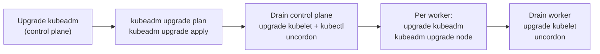

# Lab CKA-04 — kubeadm Cluster Upgrade

A cluster upgrade is one of the most predictable CKA tasks: the sequence never changes, only the version number does. This lab upgrades the cluster from [[Kubernetes/labs/cka/03-kubeadm-cluster-install|Lab CKA-03]] from v1.36 to v1.37.

> [!warning] Verified in parts, not on virtual machines
> Tested 2026-10-13, in two separate pieces:
>
> - **Package steps:** the repository switch, `apt-cache madison` and the pinned `kubeadm` install were run in an Ubuntu 24.04 container. `1.37.0-1.1` and `1.37.1-1.1` were the available versions.
> - **Upgrade sequence:** `kubeadm upgrade plan`, `kubeadm upgrade apply v1.37.0`, `kubeadm upgrade node`, the drains, the kubelet restarts and the PodDisruptionBudget scenario were run on a two-node kind cluster going from v1.36.4 to v1.37.0, with the binaries copied onto the nodes because kind nodes do not use apt.
>
> The two pieces have **not** been run together on the three virtual machines this lab describes.



Strategy, version skew rules and the reasoning are in [[Kubernetes/guides/non-functional/upgrade-strategy|Upgrade Strategy]]. This lab is the keystrokes.

---

## 1. Prerequisites & Starting State

- The three-node v1.36 cluster from Lab CKA-03.
- A workload to watch during the upgrade. Lab CKA-03 left a Deployment `web` with three replicas; this lab needs four. These commands work whether or not it already exists:

```bash
kubectl get deployment web 2>/dev/null || kubectl create deployment web --image=nginx:alpine
kubectl scale deployment web --replicas=4
kubectl rollout status deployment/web --timeout=120s
kubectl get deployment web -o jsonpath='{.status.readyReplicas}{"\n"}'   # must print 4
kubectl get nodes
```

Two rules to hold on to: upgrade **one minor version at a time**, and upgrade the **control plane before the workers**. The kubelet may be older than the API server but never newer.

---

## 2. Upgrade the Control Plane Node

On `cp1`, as root.

### Step 1: Point the package repository at the new minor version

```bash
sed -i 's/v1.36/v1.37/' /etc/apt/sources.list.d/kubernetes.list
apt-get update
apt-cache madison kubeadm | head -5
```

Pick the newest `1.37.x` patch from the list. The examples below use `1.37.0-1.1`; substitute what `madison` printed.

### Step 2: Upgrade kubeadm

```bash
apt-mark unhold kubeadm
apt-get install -y kubeadm='1.37.0-1.1'
apt-mark hold kubeadm
kubeadm version
```

### Step 3: Plan and apply

```bash
kubeadm upgrade plan
kubeadm upgrade apply v1.37.0
```

`plan` checks the cluster and prints what would change, including component versions and any manual steps. Its table also shows the bundled etcd moving from 3.6 to 3.7 and a newer CoreDNS. If a newer patch than the installed `kubeadm` exists, `plan` tells you to update `kubeadm` first; applying the version that matches your installed `kubeadm` is fine. `apply` rewrites the static Pod manifests one component at a time and renews the control plane certificates. It takes a few minutes and ends with:

```
[upgrade] SUCCESS! A control plane node of your cluster was upgraded to "v1.37.0".
[upgrade] Now please proceed with upgrading the rest of the nodes by following the right order.
```

At this point `kubectl version` reports server `v1.37.0`, while `kubectl get nodes` still shows `v1.36` for every node.

### Step 4: Drain, upgrade the kubelet, uncordon

```bash
kubectl drain cp1 --ignore-daemonsets

apt-mark unhold kubelet kubectl
apt-get install -y kubelet='1.37.0-1.1' kubectl='1.37.0-1.1'
apt-mark hold kubelet kubectl
systemctl daemon-reload
systemctl restart kubelet

kubectl uncordon cp1
kubectl get nodes
```

`cp1` now reports v1.37 while the workers still report v1.36. `kubectl get nodes` shows the **kubelet** version, which is why the node only changes after this step and not after `kubeadm upgrade apply`.

---

## 3. Upgrade Each Worker

Repeat for `worker1`, then `worker2`. Never drain both at once.

On the worker, as root:

```bash
sed -i 's/v1.36/v1.37/' /etc/apt/sources.list.d/kubernetes.list
apt-get update
apt-mark unhold kubeadm
apt-get install -y kubeadm='1.37.0-1.1'
apt-mark hold kubeadm
kubeadm upgrade node
```

On `cp1`:

```bash
kubectl drain worker1 --ignore-daemonsets
```

Back on the worker:

```bash
apt-mark unhold kubelet kubectl
apt-get install -y kubelet='1.37.0-1.1' kubectl='1.37.0-1.1'
apt-mark hold kubelet kubectl
systemctl daemon-reload
systemctl restart kubelet
```

On `cp1`:

```bash
kubectl uncordon worker1
kubectl get nodes
kubectl get pods -o wide
```

Workers use `kubeadm upgrade node`, not `apply`. It only refreshes the local kubelet configuration.

---

## 4. Controlled Failure Scenario: A Drain That Will Not Finish

Before draining `worker2`, confirm the starting point, then add two things that block a drain:

```bash
kubectl get deployment web -o jsonpath='{.status.readyReplicas}{"\n"}'   # 4

kubectl run bare --image=nginx:alpine --overrides='{"spec":{"nodeName":"worker2"}}'
kubectl create poddisruptionbudget web-pdb --selector=app=web --min-available=4
kubectl get pdb web-pdb

kubectl drain worker2 --ignore-daemonsets --timeout=30s
```

```
NAME      MIN AVAILABLE   MAX UNAVAILABLE   ALLOWED DISRUPTIONS   AGE
web-pdb   4               N/A               0                     3s

node/worker2 cordoned
error: unable to drain node "worker2" due to error: cannot delete Pods that declare no controller (use --force to override): default/bare, continuing command...
```

The first refusal is the bare Pod: nothing would recreate it, so the drain will not delete it unless you pass `--force`, which removes it for good. Add `--force` and the second problem appears:

```bash
kubectl drain worker2 --ignore-daemonsets --force --timeout=30s
```

```
error when evicting pods/"web-5d6b5c7df9-qszn9" -n "default": global timeout reached: 30s
```

Four replicas with `minAvailable: 4` leaves `ALLOWED DISRUPTIONS 0`, so every eviction of a `web` Pod is rejected. Without `--timeout` the drain retries for ever.

Fix the budget instead of bypassing it. With four healthy replicas, `minAvailable: 3` allows one eviction at a time:

```bash
kubectl patch pdb web-pdb --type=merge -p '{"spec":{"minAvailable":3}}'
kubectl get pdb web-pdb          # ALLOWED DISRUPTIONS 1
kubectl drain worker2 --ignore-daemonsets --force --timeout=180s
```

Each evicted Pod must be replaced and become Ready on `worker1` before the next eviction is allowed, so the drain takes a little longer than usual. If it still stalls, look for a `Pending` replacement: an eviction budget only recovers when the replacement can be scheduled somewhere. The arithmetic matters; with **three** replicas and `minAvailable: 3` the allowance would still be zero.

Finish the upgrade of `worker2` as in section 3, then return it to service:

```bash
kubectl uncordon worker2
kubectl get nodes        # no SchedulingDisabled anywhere
```

Other flags you will meet: `--delete-emptydir-data` when a Pod uses an `emptyDir`, and `--grace-period` to shorten termination. See [[Kubernetes/concepts/L06-scheduling-scaling/04-poddisruptionbudget|PodDisruptionBudget]] and [[Kubernetes/labs/cka/02-scheduling-and-autoscaling|Lab CKA-02]], which works through a drain blocked by a spread constraint.

---

## 5. Verification

```bash
kubectl get nodes
kubectl version
kubectl get pods -n kube-system
kubectl rollout status deployment/web --timeout=120s
kubeadm certs check-expiration
```

```
CERTIFICATE                EXPIRES                  RESIDUAL TIME   CERTIFICATE AUTHORITY   EXTERNALLY MANAGED
admin.conf                 Oct 13, 2027 10:54 UTC   364d            ca                      no
apiserver                  Oct 13, 2027 10:54 UTC   364d            ca                      no
...
```

Check the workload as well as the versions: an upgrade that leaves `web` short of replicas or a node cordoned is not finished.

All nodes on v1.37, system Pods running, and certificate expiry dates about a year out, because `kubeadm upgrade apply` renewed them.

---

## 6. Cleanup

```bash
kubectl delete deployment web
kubectl delete pdb web-pdb
```

---

## Further reading

- [Upgrading kubeadm clusters](https://kubernetes.io/docs/tasks/administer-cluster/kubeadm/kubeadm-upgrade/)
- [Version skew policy](https://kubernetes.io/releases/version-skew-policy/)
- [Safely drain a node](https://kubernetes.io/docs/tasks/administer-cluster/safely-drain-node/)

## Next Lab

Proceed to **[[Kubernetes/labs/cka/05-etcd-backup-restore|Lab CKA-05 — etcd Backup & Restore]]**, or return to the [[Kubernetes/certifications/cka|CKA Track]].
