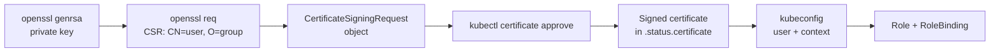

# Lab CKA-06 — Users & Certificate Requests

Kubernetes has no user objects. A "user" is whatever name appears in a client certificate the cluster CA has signed. This lab creates one end to end: key, signing request, approval, kubeconfig and RBAC.

Concepts: [[Kubernetes/concepts/L07-security/01-api-access/01-authentication-authorization|Authentication vs Authorization]], [[Kubernetes/concepts/L07-security/01-api-access/04-certificates|Certificates]] and [[Kubernetes/concepts/L07-security/01-api-access/03-rbac|RBAC]].

Tested on kind v0.31 with Kubernetes v1.35.0. Not re-run on v1.37.

Verified on `kind` v0.31 with Kubernetes v1.35.0.



---

## 1. Prerequisites & Starting State

- Working `k8s-lab` cluster from **[[Kubernetes/labs/ckad/01-cluster-setup|Lab CKAD-01]]**.
- `openssl` on the machine where you run `kubectl`.

```bash
kubectl create namespace dev
```

---

## 2. Create the Key and Signing Request

```bash
openssl genrsa -out jane.key 2048
openssl req -new -key jane.key -subj "/CN=jane/O=dev-team" -out jane.csr
```

The subject is the identity. `CN` becomes the **username** and each `O` becomes a **group**. RBAC bindings refer to exactly these strings.

---

## 3. Submit and Approve the Request

The request goes into the object base64-encoded on a single line:

```bash
cat <<EOF | kubectl apply -f -
apiVersion: certificates.k8s.io/v1
kind: CertificateSigningRequest
metadata:
  name: jane
spec:
  request: $(base64 < jane.csr | tr -d '\n')
  signerName: kubernetes.io/kube-apiserver-client
  expirationSeconds: 86400
  usages:
    - client auth
EOF
```

```bash
kubectl get csr jane
```

```text
NAME   AGE   SIGNERNAME                            REQUESTOR          REQUESTEDDURATION   CONDITION
jane   0s    kubernetes.io/kube-apiserver-client   kubernetes-admin   24h                 Pending
```

Approve it and collect the certificate:

```bash
kubectl certificate approve jane
kubectl get csr jane
kubectl get csr jane -o jsonpath='{.status.certificate}' | base64 -d > jane.crt
openssl x509 -in jane.crt -noout -subject -enddate
```

The condition becomes `Approved,Issued` and the certificate shows `subject=O=dev-team, CN=jane`.

Three fields trip people up:

- `signerName` must be `kubernetes.io/kube-apiserver-client` for a user certificate.
- `usages` must be `client auth` for that signer.
- `request` must be base64 of the CSR file with no line breaks. `base64 -w0` does that on Linux; piping through `tr -d '\n'` works on Linux and macOS alike.

`kubectl certificate deny jane` is the opposite of approve. A denied request cannot be approved later; delete it and submit a new one.

---

## 4. Build the kubeconfig Entry

```bash
kubectl config set-credentials jane \
  --client-key=jane.key --client-certificate=jane.crt --embed-certs=true
kubectl config set-context jane \
  --cluster=kind-k8s-lab --user=jane --namespace=dev
kubectl --context jane get pods
```

```text
Error from server (Forbidden): pods is forbidden: User "jane" cannot list resource "pods" ...
```

`Forbidden` is the right result. Authentication worked, because the API server knows this is `jane`. Authorization has not been granted yet.

---

## 5. Grant Access with RBAC

```bash
kubectl -n dev create role pod-reader --verb=get,list,watch --resource=pods
kubectl -n dev create rolebinding jane-pod-reader --role=pod-reader --user=jane
```

Verify from both sides:

```bash
kubectl --context jane get pods            # works, empty list
kubectl --context jane get secrets         # Forbidden
kubectl auth can-i list pods -n dev --as jane      # yes
kubectl auth can-i delete pods -n dev --as jane    # no
kubectl auth can-i --list -n dev --as jane
```

`kubectl auth can-i --as` checks permissions without needing the user's credentials, so it is the fastest way to verify an RBAC task in the exam.

---

## 6. Controlled Failure Scenario: The Binding That Matches Nobody

Bind the same Role to the group instead, with a typo:

```bash
kubectl -n dev delete rolebinding jane-pod-reader
kubectl -n dev create rolebinding dev-pod-reader --role=pod-reader --group=dev-teams
kubectl --context jane get pods
```

Access is denied again and nothing reports an error, because RBAC never validates that a subject exists. Compare what the certificate says with what the binding says:

```bash
openssl x509 -in jane.crt -noout -subject
kubectl -n dev get rolebinding dev-pod-reader -o jsonpath='{.subjects}'
kubectl auth can-i list pods -n dev --as jane --as-group dev-team
kubectl auth can-i list pods -n dev --as jane --as-group dev-teams
```

Fix it by recreating the binding with `--group=dev-team`. Group-based bindings are the better design: the next user only needs a certificate with the same `O`.

---

## 7. Cleanup

```bash
kubectl delete namespace dev
kubectl delete csr jane
kubectl config delete-context jane
kubectl config delete-user jane
rm -f jane.key jane.csr jane.crt
```

A client certificate cannot be revoked. Deleting the binding removes the access; the certificate itself stays valid until it expires, which is the reason to keep `expirationSeconds` short.

---

## Further reading

- [Certificates and Certificate Signing Requests](https://kubernetes.io/docs/reference/access-authn-authz/certificate-signing-requests/)
- [Using RBAC authorization](https://kubernetes.io/docs/reference/access-authn-authz/rbac/)

## Next Lab

Proceed to **[[Kubernetes/labs/cka/07-control-plane-and-kubelet-repair|Lab CKA-07 — Control Plane & Kubelet Repair]]**, or return to the [[Kubernetes/certifications/cka|CKA Track]].
