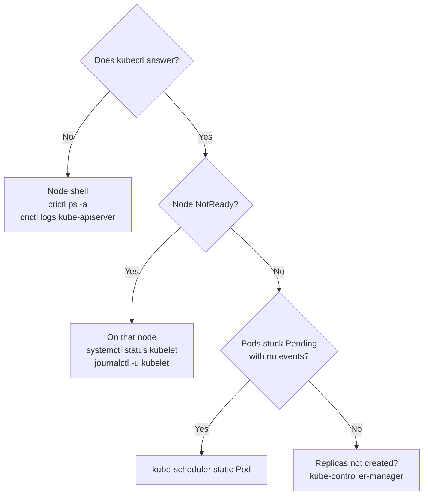

# Lab CKA-07 — Control Plane & Kubelet Repair

Troubleshooting is 30% of the CKA, and the hardest tasks are the ones where `kubectl` itself stops working. This lab breaks three components in turn and repairs each one from the node.

Concepts: [[Kubernetes/concepts/L03-workloads/11-static-pods|Static Pods]], [[Kubernetes/guides/troubleshooting/node-not-ready|Node Not Ready]] and [[Kubernetes/concepts/L08-operations/01-troubleshooting|Troubleshooting Flow]].

Tested on kind v0.31 with Kubernetes v1.35.0. Not re-run on v1.37.

Verified on `kind` v0.31 with Kubernetes v1.35.0.



---

## 1. Prerequisites & Starting State

- Working `k8s-lab` cluster from **[[Kubernetes/labs/ckad/01-cluster-setup|Lab CKAD-01]]**.
- Two node shells, standing in for `ssh`:

```bash
docker exec -it k8s-lab-control-plane bash
docker exec -it k8s-lab-worker bash
```

- An editor on the control plane node, since `kind` nodes ship without one:

```bash
# control plane node
apt-get update && apt-get install -y vim-tiny
```

- Backups of everything you are about to break:

```bash
# control plane node
mkdir -p /root/backup/cka-07 && cp /etc/kubernetes/manifests/*.yaml /root/backup/cka-07/
```

Never put backup copies **inside** `/etc/kubernetes/manifests`. The kubelet runs every file in that directory, so a `kube-apiserver.yaml.bak` there starts a second API server.

---

## 2. Scenario A: The API Server Does Not Answer

### Trigger the failure

```bash
# control plane node
sed -i 's#--etcd-servers=https://127.0.0.1:2379#--etcd-servers=https://127.0.0.1:2377#' \
  /etc/kubernetes/manifests/kube-apiserver.yaml
```

### Observe the symptom

Wait about thirty seconds, then from the host:

```bash
kubectl get nodes
```

```text
Get "https://127.0.0.1:6443/api/v1/nodes?limit=500": net/http: TLS handshake timeout
```

`kubectl` is useless from here on. Everything else happens on the node.

### Diagnose

```bash
# control plane node
crictl ps -a --name kube-apiserver
crictl logs --tail 20 $(crictl ps -a -q --name kube-apiserver | head -1)
```

The container keeps restarting and its log repeats a connection failure to `127.0.0.1:2377`. The API server cannot reach etcd, and the port is wrong. If the container had never been created at all, the next places to look would be:

```bash
# control plane node
journalctl -u kubelet --since "-5min" | grep -i apiserver
ls /var/log/pods/ | grep apiserver
```

A YAML syntax error in the manifest shows up in the kubelet journal, not in `crictl logs`, because no container ever starts.

### Repair

Fix the port in the manifest with `vi`, or restore the backup:

```bash
# control plane node
cp /root/backup/cka-07/kube-apiserver.yaml /etc/kubernetes/manifests/
watch crictl ps --name kube-apiserver
```

The kubelet notices the changed file and recreates the Pod. There is nothing to apply or restart.

---

## 3. Scenario B: Pods Stay Pending

### Trigger the failure

```bash
# control plane node
sed -i 's#- kube-scheduler$#- kube-schedulerr#' /etc/kubernetes/manifests/kube-scheduler.yaml
```

### Observe the symptom

```bash
# host
kubectl run sched-test --image=nginx:alpine
kubectl get pod sched-test -o wide
kubectl describe pod sched-test | tail -5
```

The Pod is `Pending`, has no node assigned and has **no events**. A Pod that cannot be scheduled for a real reason gets a `FailedScheduling` event. No events at all means nothing is trying to schedule it.

### Diagnose

```bash
# host
kubectl get pods -n kube-system | grep scheduler
```

```text
kube-scheduler-k8s-lab-control-plane   0/1   CrashLoopBackOff   3 (20s ago)   53s
```

```bash
# control plane node
crictl ps -a --name kube-scheduler
diff /root/backup/cka-07/kube-scheduler.yaml /etc/kubernetes/manifests/kube-scheduler.yaml
```

The container exits immediately because the command name is misspelled. In the exam there is no backup to `diff` against, so read the `command:` block line by line and compare flags and file paths with what exists on disk.

### Repair

```bash
# control plane node
cp /root/backup/cka-07/kube-scheduler.yaml /etc/kubernetes/manifests/
```

```bash
# host
kubectl get pod sched-test -o wide
```

If you need a Pod running while the scheduler is down, set `spec.nodeName` yourself. That bypasses the scheduler completely.

The same method applies to the controller manager. Its symptom is different: Deployments exist but no Pods are created, and scaling does nothing.

---

## 4. Scenario C: A Worker Goes NotReady

### Trigger the failure

```bash
# worker node
cp /var/lib/kubelet/config.yaml /root/config.yaml.bak
sed -i 's#clientCAFile: /etc/kubernetes/pki/ca.crt#clientCAFile: /etc/kubernetes/pki/wrong-ca.crt#' \
  /var/lib/kubelet/config.yaml
systemctl restart kubelet
```

### Observe the symptom

```bash
# host
kubectl get nodes -w
```

After roughly a minute the worker turns `NotReady`. `kubectl describe node k8s-lab-worker` shows conditions with the reason `NodeStatusUnknown` and the message "Kubelet stopped posting node status".

### Diagnose

That message only says the kubelet went quiet. Find out why on the node:

```bash
# worker node
systemctl status kubelet --no-pager | head -8
journalctl -u kubelet --no-pager -n 30 | grep -iE 'err|fail'
```

```text
Active: activating (auto-restart) (Result: exit-code)
...
"command failed" err="failed to construct kubelet dependencies: unable to load client CA file /etc/kubernetes/pki/wrong-ca.crt: open /etc/kubernetes/pki/wrong-ca.crt: no such file or directory"
```

The journal names the file. To find where that path is configured, follow the unit:

```bash
# worker node
systemctl cat kubelet
cat /var/lib/kubelet/kubeadm-flags.env
```

| Where                                                   | What it controls                            |
| :------------------------------------------------------ | :------------------------------------------ |
| `/var/lib/kubelet/config.yaml`                          | Kubelet configuration (the `--config` file) |
| `/var/lib/kubelet/kubeadm-flags.env`                    | Extra flags from `kubeadm`                  |
| `/etc/systemd/system/kubelet.service.d/10-kubeadm.conf` | The drop-in that assembles the command line |
| `/etc/kubernetes/kubelet.conf`                          | The kubelet's kubeconfig for the API server |

### Repair

```bash
# worker node
cp /root/config.yaml.bak /var/lib/kubelet/config.yaml
systemctl restart kubelet
systemctl is-active kubelet
```

```bash
# host
kubectl get nodes
```

After editing a unit file or drop-in, as opposed to `config.yaml`, run `systemctl daemon-reload` before the restart.

---

## 5. More Breaks to Practise

Apply each one, diagnose it without looking at this list, and repair it.

| Break                                                        | Where         | First clue                                                 |
| :----------------------------------------------------------- | :------------ | :--------------------------------------------------------- |
| `systemctl stop kubelet && systemctl disable kubelet`        | Worker        | `systemctl status kubelet` shows `inactive`                |
| `systemctl stop containerd`                                  | Worker        | Kubelet journal cannot reach the runtime socket            |
| Wrong `server:` port in `/etc/kubernetes/kubelet.conf`       | Worker        | Kubelet journal shows connection refused to the API server |
| Wrong `--kubeconfig` path in `kube-controller-manager.yaml`  | Control plane | `crictl logs` reports the missing file                     |
| Wrong `hostPath` for the PKI volume in `kube-apiserver.yaml` | Control plane | `crictl logs` cannot open a certificate                    |
| Indentation error in `kube-apiserver.yaml`                   | Control plane | No container at all; error in the kubelet journal          |
| Scale the `coredns` Deployment to zero                       | `kube-system` | Service names stop resolving in every Pod                  |

---

## 6. Cleanup

```bash
# host
kubectl delete pod sched-test
```

If the cluster is beyond repair, that is a normal outcome of this lab. Recreate it:

```bash
kind delete cluster --name k8s-lab
kind create cluster --config kind-config.yaml
```

---

## Further reading

- [Troubleshooting clusters](https://kubernetes.io/docs/tasks/debug/debug-cluster/)
- [Debugging Kubernetes nodes with crictl](https://kubernetes.io/docs/tasks/debug/debug-cluster/crictl/)
- [Troubleshooting kubeadm](https://kubernetes.io/docs/setup/production-environment/tools/kubeadm/troubleshooting-kubeadm/)

## Next Lab

This is the last CKA lab. Return to the [[Kubernetes/certifications/cka|CKA Track]] and run the domain drills against a clock, or continue with **[[Kubernetes/labs/ckad/06-observability-and-troubleshooting|Lab CKAD-06 — Observability & Troubleshooting]]** for workload-level debugging.
