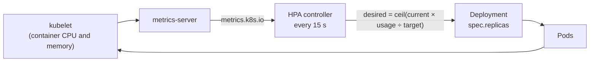

# Lab CKA-08 — Autoscaling with the HorizontalPodAutoscaler

The CKA objective "configure workload autoscaling" comes down to the HorizontalPodAutoscaler (HPA): a controller that changes a workload's replica count to keep a metric near a target. This lab creates one, breaks it in the most common way, loads the application until it scales, and watches it scale back.

Concepts: [[Kubernetes/concepts/L06-scheduling-scaling/03-horizontalpodautoscaler|HorizontalPodAutoscaler]], [[Kubernetes/concepts/L06-scheduling-scaling/05-scaling|Scaling]] and [[Kubernetes/concepts/L08-operations/04-metrics-sources|Metrics Sources]].

Tested 2026-10-13 on kind v0.33.0 with Kubernetes v1.37.0 and metrics-server v0.9.0.



---

## 1. Prerequisites & Starting State

- Working `k8s-lab` cluster from **[[Kubernetes/labs/ckad/01-cluster-setup|Lab CKAD-01]]**.
- **metrics-server**, installed as in section 2 of [[Kubernetes/labs/ckad/06-observability-and-troubleshooting|Lab CKAD-06]]. Check it before starting; an HPA without a metrics API can never work:

```bash
kubectl top nodes
```

If that prints an error, install metrics-server first.

```bash
kubectl create namespace hpa-lab
kubectl config set-context --current --namespace=hpa-lab
```

---

## 2. A Workload and an Autoscaler

```bash
kubectl create deployment web --image=ghcr.io/stefanprodan/podinfo:6.7.1 --port=9898
kubectl expose deployment web --port=80 --target-port=9898
kubectl rollout status deployment/web --timeout=90s

kubectl autoscale deployment web --min=1 --max=5 --cpu=50%
```

> [!note] The flag changed
> Recent `kubectl` takes `--cpu=50%` (and `--memory=`). Older releases use `--cpu-percent=50`, which newer ones still accept with a deprecation warning. `kubectl autoscale --help` shows which your client has.

---

## 3. Controlled Failure Scenario: `<unknown>` Metrics

```bash
sleep 45
kubectl get hpa web
kubectl describe hpa web | grep -A 4 "Conditions:"
```

```
NAME   REFERENCE        TARGETS              MINPODS   MAXPODS   REPLICAS   AGE
web    Deployment/web   cpu: <unknown>/50%   1         5         1          45s

  Type           Status  Reason                   Message
  ----           ------  ------                   -------
  AbleToScale    True    SucceededGetScale        the HPA controller was able to get the target's current scale
  ScalingActive  False   FailedGetResourceMetric  the HPA was unable to compute the replica count: failed to get cpu utilization: missing request for cpu in container podinfo of Pod web-6b8bc59d54-k4sb5
```

`<unknown>` means the HPA cannot compute the metric, and it will never scale in this state. The condition gives the reason: **`missing request for cpu`**.

A utilisation target is a percentage **of the container's CPU request**. "50%" has no meaning for a container that requests nothing. `<unknown>` has three usual causes, and the message tells them apart:

| Message contains                                | Cause                                                | Fix                                          |
| :---------------------------------------------- | :--------------------------------------------------- | :------------------------------------------- |
| `missing request for cpu`                       | The Pods have no CPU request                         | Add `resources.requests.cpu`                 |
| `no metrics returned from resource metrics API` | Metrics not collected yet, or metrics-server is down | Wait a minute; then check `kubectl top pods` |
| `unable to fetch metrics ... metrics.k8s.io`    | The metrics API is not installed                     | Install metrics-server                       |

Add a request and wait for the next samples:

```bash
kubectl set resources deployment web --requests=cpu=50m,memory=32Mi
kubectl rollout status deployment/web --timeout=90s

until kubectl get hpa web --no-headers | grep -qv unknown; do sleep 5; done
kubectl get hpa web
```

```
NAME   REFERENCE        TARGETS       MINPODS   MAXPODS   REPLICAS   AGE
web    Deployment/web   cpu: 0%/50%   1         5         1          96s
```

---

## 4. Scale Up Under Load

Generate requests from inside the cluster and watch:

```bash
kubectl run load --image=busybox:1.36 --restart=Never -- \
  sh -c 'while true; do wget -q -O- http://web/ >/dev/null; done'

kubectl get hpa web --watch
```

```
NAME   REFERENCE        TARGETS         MINPODS   MAXPODS   REPLICAS   AGE
web    Deployment/web   cpu: 0%/50%     1         5         1          116s
web    Deployment/web   cpu: 162%/50%   1         5         4          2m16s
web    Deployment/web   cpu: 88%/50%    1         5         4          2m36s
web    Deployment/web   cpu: 60%/50%    1         5         4          2m56s
web    Deployment/web   cpu: 60%/50%    1         5         5          3m17s
```

Press `Ctrl+C` when it settles. Your numbers will differ; the shape should not.

The controller computes `desired = ceil(current replicas × current usage ÷ target)`. At one replica and 162% against a 50% target, that is `ceil(1 × 162 ÷ 50) = 4`. With four replicas sharing the load, usage per Pod fell to about 60%, still over target, so `ceil(4 × 60 ÷ 50) = 5`, which is also `maxReplicas`. Usage stays at 59% because the HPA is not allowed to go higher; an HPA pinned at its maximum with the metric above target is telling you the limit is too low for the load.

```bash
kubectl top pods -l app=web
kubectl describe hpa web | grep SuccessfulRescale
```

```
NAME                   CPU(cores)   MEMORY(bytes)
web-7cb7bbd568-cttrm   28m          24Mi
web-7cb7bbd568-fz4fs   31m          25Mi
...

Normal  SuccessfulRescale  ...  horizontal-pod-autoscaler  New size: 4; reason: cpu resource utilization (percentage of request) above target
Normal  SuccessfulRescale  ...  horizontal-pod-autoscaler  New size: 5; reason: cpu resource utilization (percentage of request) above target
```

About 30m used against a 50m request is the 60% the HPA reported.

---

## 5. Scale Down, and Why It Is Slow

Stop the load:

```bash
kubectl delete pod load --grace-period=1
```

By default nothing happens for **five minutes**. The HPA scales up at once and scales down only after the metric has stayed low for the whole `stabilizationWindowSeconds` (300 by default), so that a short dip does not remove capacity that is about to be needed again. For the lab, shorten the window:

```bash
kubectl patch hpa web --type merge \
  -p '{"spec":{"behavior":{"scaleDown":{"stabilizationWindowSeconds":30}}}}'

kubectl get hpa web --watch
```

```
web    Deployment/web   cpu: 31%/50%   1         5         5          4m7s
web    Deployment/web   cpu: 13%/50%   1         5         4          4m27s
web    Deployment/web   cpu: 1%/50%    1         5         2          4m47s
web    Deployment/web   cpu: 0%/50%    1         5         1          5m7s
```

The full object, as `kubectl get hpa web -o yaml` shows it, is `autoscaling/v2`:

```yaml
spec:
  scaleTargetRef:
    apiVersion: apps/v1
    kind: Deployment
    name: web
  minReplicas: 1
  maxReplicas: 5
  metrics:
    - type: Resource
      resource:
        name: cpu
        target:
          type: Utilization
          averageUtilization: 50
  behavior:
    scaleDown:
      stabilizationWindowSeconds: 30
```

Write it by hand when a task asks for memory, several metrics or a `behavior` section, none of which `kubectl autoscale` covers fully. With several metrics the HPA computes a replica count for each and uses the largest.

> [!warning] An HPA and a manifest both want `replicas`
> While an HPA manages a Deployment, a manifest that also sets `spec.replicas` resets the count on every apply. Leave `replicas` out of the manifest. With server-side apply the two show up as a field ownership conflict, which [[Kubernetes/labs/ckad/07-kustomize-and-lifecycle|Lab CKAD-07]] works through.

---

## 6. Cleanup

```bash
kubectl config set-context --current --namespace=default
kubectl delete namespace hpa-lab
```

---

## Practice Without the Answer

Suggested time: 8 minutes. Namespace `scale`.

1. Create a Deployment `worker` (image `ghcr.io/stefanprodan/podinfo:6.7.1`, 2 replicas, CPU request `100m`).
2. Autoscale it between 2 and 6 replicas at 70% CPU.
3. Change the autoscaler so that it scales down after 60 seconds below target instead of the default.
4. Someone reports the HPA of a second Deployment, `legacy` (created with `kubectl -n scale create deployment legacy --image=nginx:alpine` and `kubectl -n scale autoscale deployment legacy --max=3 --cpu=60%`), never scales. Find the reason and fix it.

Check yourself:

```bash
kubectl -n scale get hpa worker -o jsonpath='{.spec.minReplicas} {.spec.maxReplicas} {.spec.metrics[0].resource.target.averageUtilization} {.spec.behavior.scaleDown.stabilizationWindowSeconds}{"\n"}'   # 2 6 70 60
kubectl -n scale get hpa        # neither TARGETS column shows <unknown>
```

Reset with `kubectl delete namespace scale`.

---

## Further reading

- [Horizontal Pod Autoscaling](https://kubernetes.io/docs/tasks/run-application/horizontal-pod-autoscale/)
- [HorizontalPodAutoscaler walkthrough](https://kubernetes.io/docs/tasks/run-application/horizontal-pod-autoscale-walkthrough/)
- [metrics-server](https://github.com/kubernetes-sigs/metrics-server)

## Next Lab

Proceed to **[[Kubernetes/labs/cka/09-scheduling-constraints|Lab CKA-09 — Taints, Affinity, Priority & Static Pods]]**, or return to the [[Kubernetes/certifications/cka|CKA Track]].
