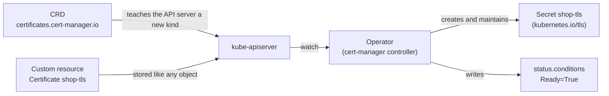

# Lab CKA-10 — CRDs, Custom Resources & Operators

The CKA asks you to "understand CRDs, install and configure operators", and the CKAD to "discover and use resources that extend Kubernetes". Both come down to the same three ideas: a **CustomResourceDefinition** adds a new kind to the API, a **custom resource** is an object of that kind, and an **operator** is a controller that acts on those objects. This lab does each in turn, with a concrete result to check.

Concepts: [[Kubernetes/concepts/L09-advanced/03-customresourcedefinitions|CustomResourceDefinitions]], [[Kubernetes/concepts/L09-advanced/01-operators|Operators]] and [[Kubernetes/concepts/L09-advanced/02-custom-controllers|Custom Controllers]].

Tested 2026-10-13 on kind v0.33.0 with Kubernetes v1.37.0 and cert-manager v1.21.2.



---

## 1. Prerequisites & Starting State

- Working `k8s-lab` cluster from **[[Kubernetes/labs/ckad/01-cluster-setup|Lab CKAD-01]]**. No other lab is required.

```bash
kubectl create namespace crd-lab
```

---

## 2. A CRD of Your Own

### Step 1: Define a new kind

```bash
cat << 'EOF' > crd.yaml
apiVersion: apiextensions.k8s.io/v1
kind: CustomResourceDefinition
metadata:
  name: backups.ops.example.com
spec:
  group: ops.example.com
  scope: Namespaced
  names:
    plural: backups
    singular: backup
    kind: Backup
    shortNames: ["bk"]
  versions:
    - name: v1
      served: true
      storage: true
      schema:
        openAPIV3Schema:
          type: object
          required: ["spec"]
          properties:
            spec:
              type: object
              required: ["schedule", "target"]
              properties:
                schedule:
                  type: string
                target:
                  type: string
                retentionDays:
                  type: integer
                  minimum: 1
                  maximum: 90
                  default: 7
      additionalPrinterColumns:
        - name: Schedule
          type: string
          jsonPath: .spec.schedule
        - name: Retention
          type: integer
          jsonPath: .spec.retentionDays
EOF

kubectl apply -f crd.yaml
kubectl wait --for=condition=Established crd/backups.ops.example.com --timeout=30s
```

The CRD's name must be `<plural>.<group>`. `scope` decides whether objects live in a namespace. Each version has a schema that the API server enforces.

### Step 2: Discover it, as you would an unfamiliar one

In an exam task the CRD is already installed and you are asked to use it. These three commands find any extension:

```bash
kubectl api-resources --api-group=ops.example.com
kubectl explain backup.spec
kubectl get crd backups.ops.example.com -o jsonpath='{.spec.versions[*].name}{"\n"}'
```

```
NAME      SHORTNAMES   APIVERSION           NAMESPACED   KIND
backups   bk           ops.example.com/v1   true         Backup

FIELDS:
  retentionDays	<integer>
  schedule	<string> -required-
  target	<string> -required-
```

`kubectl api-resources` gives the `apiVersion` and `kind` to write in a manifest. `kubectl explain` works on custom kinds exactly as on built-in ones, and shows which fields are required.

### Step 3: Create a custom resource

```bash
cat << 'EOF' | kubectl apply -f -
apiVersion: ops.example.com/v1
kind: Backup
metadata:
  name: nightly
  namespace: crd-lab
spec:
  schedule: "0 2 * * *"
  target: orders-db
EOF

kubectl -n crd-lab get bk
kubectl -n crd-lab get backup nightly -o jsonpath='{.spec}{"\n"}'
```

```
NAME      SCHEDULE    RETENTION
nightly   0 2 * * *   7

{"retentionDays":7,"schedule":"0 2 * * *","target":"orders-db"}
```

The short name works, the printer columns appear, and `retentionDays` was filled in from the schema's default.

### Step 4: Controlled failure: the schema rejects bad objects

```bash
cat << 'EOF' | kubectl apply -f -
apiVersion: ops.example.com/v1
kind: Backup
metadata:
  name: bad
  namespace: crd-lab
spec:
  schedule: "0 3 * * *"
  retentionDays: 365
  retries: 3
EOF
```

```
Error from server (BadRequest): error when creating "STDIN": Backup in version "v1" cannot be handled as a Backup: strict decoding error: unknown field "spec.retries"
```

Remove the `retries` line and apply again:

```
The Backup "bad" is invalid:
* spec.retentionDays: Invalid value: 365: spec.retentionDays in body should be less than or equal to 90
* spec.target: Required value
```

Three different rejections came from the schema: an unknown field, a value out of range and a missing required field. Each message names the path. This is the same validation built-in kinds have.

### Step 5: What a CRD does not do

```bash
kubectl -n crd-lab get all
kubectl -n crd-lab get events
```

```
No resources found in crd-lab namespace.
No resources found in crd-lab namespace.
```

The `nightly` Backup is stored and valid, and **nothing happens**. No Job, no Pod, no event. A CRD only teaches the API server to store a new kind of object. Behaviour needs a controller that watches those objects, and that is what an operator is.

```bash
kubectl delete crd backups.ops.example.com
```

Deleting a CRD deletes every object of that kind, in every namespace, without asking.

---

## 3. A Real Operator: cert-manager

cert-manager is a widely used operator that issues TLS certificates. Install a pinned release from its manifest:

```bash
kubectl apply -f https://github.com/cert-manager/cert-manager/releases/download/v1.21.2/cert-manager.yaml

kubectl -n cert-manager rollout status deployment/cert-manager --timeout=180s
kubectl -n cert-manager rollout status deployment/cert-manager-webhook --timeout=180s
kubectl -n cert-manager get deployments
```

```
NAME                      READY   UP-TO-DATE   AVAILABLE   AGE
cert-manager              1/1     1            1           15s
cert-manager-cainjector   1/1     1            1           15s
cert-manager-webhook      1/1     1            1           15s
```

An operator install always has the same parts. Find them:

```bash
kubectl get crd | grep cert-manager.io
kubectl api-resources --api-group=cert-manager.io
kubectl get clusterrole | grep -c cert-manager
```

```
certificaterequests.cert-manager.io    Namespaced   v1(storage)
certificates.cert-manager.io           Namespaced   v1(storage)
clusterissuers.cert-manager.io         Cluster      v1(storage)
issuers.cert-manager.io                Namespaced   v1(storage)
...

NAME                  SHORTNAMES   APIVERSION           NAMESPACED   KIND
certificaterequests   cr,crs       cert-manager.io/v1   true         CertificateRequest
certificates          cert,certs   cert-manager.io/v1   true         Certificate
clusterissuers        ciss         cert-manager.io/v1   false        ClusterIssuer
issuers               iss          cert-manager.io/v1   true         Issuer
```

| Part              | Here                                                                    |
| :---------------- | :---------------------------------------------------------------------- |
| CRDs              | `certificates`, `issuers`, `clusterissuers` and others                  |
| Controller        | Deployment `cert-manager` in namespace `cert-manager`                   |
| RBAC              | ClusterRoles and bindings that let the controller manage Secrets        |
| Admission webhook | Deployment `cert-manager-webhook`, which validates the custom resources |

Operators are also commonly installed with Helm or through the Operator Lifecycle Manager. The parts are the same whichever way they arrive.

### Step 1: Ask the operator for something

Use `kubectl explain` to find the fields, as in section 2:

```bash
kubectl explain certificate.spec | grep -E "^  (secretName|issuerRef|dnsNames)"
```

```
  dnsNames	<[]string>
  issuerRef	<Object> -required-
  secretName	<string> -required-
```

```bash
cat << 'EOF' > cert.yaml
apiVersion: cert-manager.io/v1
kind: Issuer
metadata:
  name: selfsigned
  namespace: crd-lab
spec:
  selfSigned: {}
---
apiVersion: cert-manager.io/v1
kind: Certificate
metadata:
  name: shop-tls
  namespace: crd-lab
spec:
  secretName: shop-tls
  dnsNames:
    - shop.example.test
  issuerRef:
    name: selfsigned
    kind: Issuer
EOF

kubectl apply -f cert.yaml
kubectl -n crd-lab wait --for=condition=Ready certificate/shop-tls --timeout=60s
kubectl -n crd-lab get issuer,certificate
kubectl -n crd-lab get secret shop-tls
```

```
NAME                                READY   AGE
issuer.cert-manager.io/selfsigned   True    1s

NAME                                   READY   SECRET     AGE
certificate.cert-manager.io/shop-tls   True    shop-tls   1s

NAME       TYPE                DATA   AGE
shop-tls   kubernetes.io/tls   3      0s
```

If the first `kubectl apply` fails with a webhook connection error, the webhook Pod is not ready yet; wait a few seconds and repeat.

You wrote a `Certificate`. The operator generated a private key, issued the certificate and wrote a `kubernetes.io/tls` Secret that an Ingress can use. Confirm the contents match the request:

```bash
kubectl -n crd-lab get secret shop-tls -o jsonpath='{.data.tls\.crt}' | base64 -d \
  | openssl x509 -noout -ext subjectAltName -enddate
```

```
X509v3 Subject Alternative Name: critical
    DNS:shop.example.test
notAfter=Jan 11 11:28:31 2027 GMT
```

### Step 2: Reconciliation

Delete what the operator made:

```bash
kubectl -n crd-lab delete secret shop-tls
sleep 6
kubectl -n crd-lab get secret shop-tls
kubectl -n crd-lab describe certificate shop-tls | grep -A 4 "Events:"
```

```
NAME       TYPE                DATA   AGE
shop-tls   kubernetes.io/tls   3      6s

Normal  Issuing    7s  cert-manager-certificates-trigger          Issuing certificate as Secret does not exist
Normal  Requested  7s  cert-manager-certificates-request-manager  Created new CertificateRequest resource "shop-tls-2"
Normal  Issuing    6s  cert-manager-certificates-issuing          The certificate has been successfully issued
```

The Secret is back, six seconds old. The custom resource states what should exist, and the operator keeps making it true. This is the same loop a Deployment runs for Pods.

### Step 3: Controlled failure: the operator is down

```bash
kubectl -n cert-manager scale deployment cert-manager --replicas=0

sed 's/shop-tls/api-tls/g; s/shop.example.test/api.example.test/' cert.yaml | kubectl apply -f -
sleep 12
kubectl -n crd-lab get certificate
kubectl -n crd-lab get secret api-tls
kubectl -n crd-lab describe certificate api-tls | grep "Events:"
```

```
NAME       READY   SECRET     AGE
api-tls            api-tls    12s
shop-tls   True    shop-tls   23s

Error from server (NotFound): secrets "api-tls" not found
Events:         <none>
```

The new `Certificate` was **accepted** and nothing came of it: `READY` is empty, there is no Secret and no event. The existing `shop-tls` still says `True`, because nobody is updating it either.

This is the standard symptom of a broken operator: custom resources that are stored but have an empty status and no events. The API server and the webhook are fine; the controller is not running. Check in this order:

1. `kubectl get <kind>`: is the status empty or stale?
2. `kubectl -n <operator namespace> get pods`: is the controller running?
3. `kubectl -n <operator namespace> logs deployment/<controller>`: is it failing, for example on missing RBAC?

Bring it back:

```bash
kubectl -n cert-manager scale deployment cert-manager --replicas=1
kubectl -n crd-lab wait --for=condition=Ready certificate/api-tls --timeout=90s
kubectl -n crd-lab get certificate
```

```
NAME       READY   SECRET     AGE
api-tls    True    api-tls    14s
shop-tls   True    shop-tls   25s
```

The controller found the waiting object when it started and acted on it. Nothing had to be re-applied.

---

## 4. Cleanup

Order matters. Delete the custom resources while the operator and CRDs still exist, then the operator:

```bash
kubectl delete namespace crd-lab
kubectl delete -f https://github.com/cert-manager/cert-manager/releases/download/v1.21.2/cert-manager.yaml
rm -f crd.yaml cert.yaml
```

Removing an operator first can leave custom resources stuck in `Terminating` if they carry finalizers that only the operator can clear. [[Kubernetes/concepts/L09-advanced/05-finalizers|Finalizers]] explains why.

---

## Practice Without the Answer

Suggested time: 12 minutes. Install cert-manager again first (section 3), then in namespace `certs`:

1. List every kind cert-manager added and write the names to `/tmp/cm-kinds.txt`.
2. Create a `ClusterIssuer` called `lab-ca` of type `selfSigned`.
3. Create a `Certificate` `web` that uses `lab-ca`, is valid for `web.certs.svc`, lasts 48 hours, and stores its result in a Secret `web-cert`.
4. A colleague's `Certificate` named `broken` (apply the manifest below) never becomes Ready. Find out why from the object alone and fix it.

```bash
kubectl create namespace certs
cat << 'EOF' | kubectl apply -f -
apiVersion: cert-manager.io/v1
kind: Certificate
metadata:
  name: broken
  namespace: certs
spec:
  secretName: broken-cert
  dnsNames: ["broken.certs.svc"]
  issuerRef:
    name: lab-ca
    kind: Issuer
EOF
```

Check yourself:

```bash
grep -c . /tmp/cm-kinds.txt                                                   # 6
kubectl get clusterissuer lab-ca -o jsonpath='{.status.conditions[0].status}{"\n"}'   # True
kubectl -n certs get certificate                                              # web and broken both READY True
kubectl -n certs get secret web-cert -o jsonpath='{.type}{"\n"}'              # kubernetes.io/tls
kubectl -n certs get certificate web -o jsonpath='{.spec.duration}{"\n"}'     # 48h0m0s or 48h
```

For task 4, `kubectl describe certificate broken` and the `CertificateRequest` it created say what is being looked for and where.

---

## Further reading

- [Custom resources](https://kubernetes.io/docs/concepts/extend-kubernetes/api-extension/custom-resources/)
- [Extend the Kubernetes API with CustomResourceDefinitions](https://kubernetes.io/docs/tasks/extend-kubernetes/custom-resources/custom-resource-definitions/)
- [Operator pattern](https://kubernetes.io/docs/concepts/extend-kubernetes/operator/)
- [cert-manager installation](https://cert-manager.io/docs/installation/kubectl/)

## Next Lab

Proceed to **[[Kubernetes/labs/cka/11-service-and-dns-troubleshooting|Lab CKA-11 — Service & DNS Troubleshooting]]**, or return to the [[Kubernetes/certifications/cka|CKA Track]].
