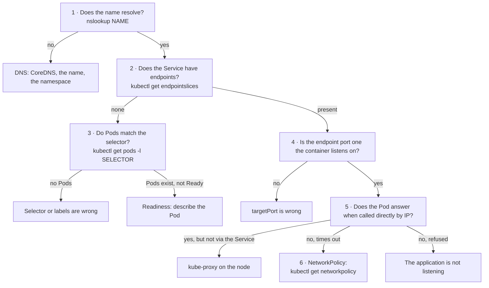

# Lab CKA-11 — Service & DNS Troubleshooting

Troubleshooting is 30% of the CKA, and "troubleshoot services and networking" is one of its named objectives. This lab is built differently from the guided ones: a script creates four applications that are all broken, plus one cluster-wide fault later, and **you are not told what is wrong**. Work through them with the method below. The answers are in collapsed blocks; open one only after you have a diagnosis you would defend.

Concepts: [[Kubernetes/guides/troubleshooting/service-unreachable|Service Unreachable]], [[Kubernetes/guides/troubleshooting/dns-resolution|DNS Resolution]], [[Kubernetes/concepts/L04-services-networking/05-network-policy|NetworkPolicy]] and [[Kubernetes/concepts/L04-services-networking/08-endpoint-slices|EndpointSlices]].

Tested 2026-10-13 on kind v0.33.0 with Kubernetes v1.37.0.

---

## 1. Prerequisites & Starting State

- Working `k8s-lab` cluster from **[[Kubernetes/labs/ckad/01-cluster-setup|Lab CKAD-01]]**. No other lab is required. [[Kubernetes/labs/ckad/05-services-and-dns|Lab CKAD-05]] introduces the mechanics this lab tests.

Save and run the setup. Do not study it; the point is to find the faults from the cluster.

```bash
cat << 'SETUP' > net-faults.sh
kubectl create namespace net-lab
for A in alpha bravo delta; do
  kubectl -n net-lab create deployment $A --image=ghcr.io/stefanprodan/podinfo:6.7.1 --port=9898
  kubectl -n net-lab expose deployment $A --port=80 --target-port=9898
done
kubectl -n net-lab create deployment charlie --image=ghcr.io/stefanprodan/podinfo:6.7.1 --port=9898 --dry-run=client -o yaml \
  | kubectl patch --local -f - --type json -o yaml -p '[{"op":"add","path":"/spec/template/spec/containers/0/readinessProbe","value":{"httpGet":{"path":"/ready","port":9898},"periodSeconds":3}}]' \
  | kubectl apply -f -
kubectl -n net-lab expose deployment charlie --port=80 --target-port=9898
kubectl -n net-lab patch service alpha -p '{"spec":{"selector":{"app":"alhpa"}}}'
kubectl -n net-lab patch service bravo --type json -p '[{"op":"replace","path":"/spec/ports/0/targetPort","value":8080}]'
kubectl -n net-lab apply -f - << 'POL'
apiVersion: networking.k8s.io/v1
kind: NetworkPolicy
metadata:
  name: delta-lockdown
spec:
  podSelector:
    matchLabels:
      app: delta
  policyTypes: ["Ingress"]
  ingress:
    - from:
        - podSelector:
            matchLabels:
              role: gateway
POL
kubectl -n net-lab run client --image=curlimages/curl:8.10.1 --restart=Never --command -- sleep 3600
kubectl -n net-lab wait --for=condition=Ready pod/client --timeout=90s
SETUP

sh net-faults.sh
sleep 15
```

---

## 2. The Symptom

From the `client` Pod, none of the four Services answers:

```bash
for A in alpha bravo charlie delta; do
  printf '%-8s' $A
  kubectl -n net-lab exec client -- curl -s -m 4 -o /dev/null -w '%{http_code} (curl exit %{exitcode})\n' "http://$A/"
done
```

```
alpha   000 (curl exit 7)
bravo   000 (curl exit 7)
charlie 000 (curl exit 7)
delta   000 (curl exit 28)
```

The `curl` exit code is the first piece of evidence, before any `kubectl` command:

| Exit                | Meaning                    | Points towards                                                |
| :------------------ | :------------------------- | :------------------------------------------------------------ |
| `6`                 | Could not resolve the name | DNS, or a wrong name or namespace                             |
| `7`                 | Connection refused         | No endpoints, or nothing listening on the target port         |
| `28`                | Timed out                  | Packets dropped: a NetworkPolicy, or a host that is not there |
| `0` with a 5xx code | The application answered   | The application itself                                        |

**Your task:** make all four return `200` from `client`, changing as little as possible. Do not delete and recreate the applications. Suggested time: 20 minutes for the four.

---

## 3. The Method

Work from the client towards the Pod. Each step either clears a layer or names the fault.



The commands, with `SVC` standing for the Service:

```bash
kubectl -n net-lab exec client -- nslookup SVC.net-lab.svc.cluster.local
kubectl -n net-lab get service SVC -o wide
kubectl -n net-lab get endpointslices -l kubernetes.io/service-name=SVC
kubectl -n net-lab get pods -l <the Service's selector> -o wide --show-labels
kubectl -n net-lab get pod <pod> -o jsonpath='{.spec.containers[*].ports}'
kubectl -n net-lab exec client -- curl -s -m 4 -o /dev/null -w '%{http_code}\n' http://<pod IP>:<container port>/
kubectl -n net-lab get networkpolicy
```

Two overview commands show most of the picture at once. Run them and try to place each application on the flowchart before going further:

```bash
kubectl -n net-lab get pods
kubectl -n net-lab get endpointslices
```

---

## 4. Answers

> [!hint]- alpha: evidence and fix
>
> ```
> NAME          ADDRESSTYPE   PORTS     ENDPOINTS
> alpha-7srw6   IPv4          <unset>   <unset>
>
> NAME    TYPE        CLUSTER-IP     PORT(S)   SELECTOR
> alpha   ClusterIP   10.96.64.154   80/TCP    app=alhpa
> ```
>
> No endpoints, and `kubectl get pods -l app=alhpa` returns nothing while a healthy `alpha` Pod exists with `app=alpha`. The **selector is misspelt**. A Service with no endpoints refuses connections, which is the `curl` exit 7.
>
> ```bash
> kubectl -n net-lab patch service alpha -p '{"spec":{"selector":{"app":"alpha"}}}'
> ```

> [!hint]- bravo: evidence and fix
>
> ```
> NAME          ADDRESSTYPE   PORTS   ENDPOINTS
> bravo-9bml4   IPv4          8080    10.244.2.65
> ```
>
> There **is** an endpoint, so the selector is right. But the endpoint's port is `8080`, and the container's port (`kubectl get pod ... -o jsonpath='{.spec.containers[*].ports}'`) is `9898`. The Service's **`targetPort` is wrong**, so connections are forwarded to a port where nothing listens: refused, exit 7, the same client symptom as `alpha` with different evidence.
>
> ```bash
> kubectl -n net-lab patch service bravo --type json \
>   -p '[{"op":"replace","path":"/spec/ports/0/targetPort","value":9898}]'
> ```

> [!hint]- charlie: evidence and fix
>
> ```
> NAME                       READY   STATUS    RESTARTS   AGE
> charlie-559d8dd4f4-b4kh8   0/1     Running   0          15s
>
> 10.244.2.68 ready=false
>
> Warning  Unhealthy  kubelet  Readiness probe failed: HTTP probe failed with statuscode: 404
> ```
>
> The Pod is `Running` and `0/1`, with no restarts. Its endpoint exists and is marked not ready, so the Service does not use it. `kubectl describe pod` shows why: the **readiness probe asks for `/ready`**, which returns 404. Calling the Pod directly by IP returns 200, so the application is healthy and only the probe is wrong. `podinfo`'s readiness path is `/readyz`.
>
> ```bash
> kubectl -n net-lab patch deployment charlie --type json \
>   -p '[{"op":"replace","path":"/spec/template/spec/containers/0/readinessProbe/httpGet/path","value":"/readyz"}]'
> kubectl -n net-lab rollout status deployment/charlie --timeout=60s
> ```
>
> A liveness probe with the same mistake would show restarts instead.

> [!hint]- delta: evidence and fix
> Everything about the Service is correct: one ready endpoint on port 9898. The difference was visible from the start: `curl` **timed out** (exit 28) where the others were refused. Calling the Pod directly by IP also times out. Packets are being dropped, which is what a NetworkPolicy does.
>
> ```bash
> kubectl -n net-lab get networkpolicy
> kubectl -n net-lab describe networkpolicy delta-lockdown
> ```
>
> ```
> PodSelector:     app=delta
> Allowing ingress traffic:
>   To Port: <any> (traffic allowed to all ports)
>   From:
>     PodSelector: role=gateway
> ```
>
> Only Pods labelled `role=gateway` may connect, and `client` has no such label. The policy may be exactly what its author intended, so the smallest correct fix is to give the client the identity the policy expects, not to delete the policy:
>
> ```bash
> kubectl -n net-lab label pod client role=gateway
> ```
>
> In a task, read what you are allowed to change. "Allow the client" and "the policy is wrong, fix it" are different instructions.

Verify all four before continuing:

```bash
for A in alpha bravo charlie delta; do
  printf '%-8s' $A
  kubectl -n net-lab exec client -- curl -s -m 4 -o /dev/null -w '%{http_code}\n' "http://$A/"
done
```

---

## 5. A Fifth Fault, Cluster-Wide

With all four working, break something else. Run this, then diagnose before reading on:

```bash
kubectl -n kube-system scale deployment coredns --replicas=0
sleep 8
kubectl -n net-lab exec client -- curl -s -m 6 -o /dev/null -w '%{http_code} (curl exit %{exitcode})\n' http://delta/
```

```
000 (curl exit 6)
```

Exit 6: the name did not resolve. Every application in every namespace is affected at once, which itself is a clue that the fault is in something shared.

> [!hint]- Evidence and fix
> Separate "DNS is broken" from "the network is broken" by bypassing DNS:
>
> ```bash
> SVC_IP=$(kubectl -n net-lab get service delta -o jsonpath='{.spec.clusterIP}')
> kubectl -n net-lab exec client -- curl -s -m 4 -o /dev/null -w 'by ClusterIP: %{http_code}\n' "http://$SVC_IP/"
> kubectl -n net-lab exec client -- nslookup -timeout=2 delta
> ```
>
> ```
> by ClusterIP: 200
> nslookup: write to '10.96.0.10': Connection refused
> ```
>
> The Service works by IP, so routing is fine. The resolver address `10.96.0.10` is the `kube-dns` Service, and it refuses connections, which means **it** has no endpoints. Apply the same method to it:
>
> ```bash
> kubectl -n kube-system get endpointslices -l k8s-app=kube-dns
> kubectl -n kube-system get deployment coredns
> ```
>
> ```
> NAME             ADDRESSTYPE   PORTS     ENDPOINTS
> kube-dns-t2xnk   IPv4          <unset>   <unset>
>
> NAME      READY   UP-TO-DATE   AVAILABLE
> coredns   0/0     0            0
> ```
>
> CoreDNS has been scaled to zero.
>
> ```bash
> kubectl -n kube-system scale deployment coredns --replicas=2
> kubectl -n kube-system rollout status deployment/coredns --timeout=90s
> ```
>
> Other DNS faults sit in the same place and are found the same way: CoreDNS Pods in `CrashLoopBackOff` after a bad edit to the `coredns` ConfigMap (read `kubectl -n kube-system logs -l k8s-app=kube-dns`), or a NetworkPolicy that blocks egress to port 53. A name that resolves from one namespace and not from another is usually not a fault at all: a short name such as `delta` only resolves inside its own namespace, and from elsewhere it must be `delta.net-lab`.

---

## 6. Cleanup & Exit State

```bash
kubectl delete namespace net-lab
kubectl -n kube-system get deployment coredns     # READY 2/2
rm -f net-faults.sh
```

Do not leave CoreDNS at zero replicas; every later lab depends on it.

---

## What to Take Away

| Client sees              | Endpoints                 | Most likely cause         |
| :----------------------- | :------------------------ | :------------------------ |
| Cannot resolve           | Not relevant              | DNS, or the name is wrong |
| Refused                  | None                      | Selector or labels        |
| Refused                  | Present, port looks wrong | `targetPort`              |
| Refused                  | Present, `ready=false`    | Readiness probe           |
| Timeout                  | Present and ready         | NetworkPolicy             |
| Works by IP, not by name | Present and ready         | DNS                       |

Refused-versus-timeout is how this cluster's `kube-proxy` and CNI behave. Other dataplanes can turn a refusal into a timeout, so use the client error as a first hint and the EndpointSlice as the evidence.

To repeat the lab as real practice, run the setup again after a few days and time yourself without opening the answers.

---

## Further reading

- [Debug Services](https://kubernetes.io/docs/tasks/debug/debug-application/debug-service/)
- [Debugging DNS resolution](https://kubernetes.io/docs/tasks/administer-cluster/dns-debugging-resolution/)
- [Network Policies](https://kubernetes.io/docs/concepts/services-networking/network-policies/)

## Next Lab

Proceed to **[[Kubernetes/labs/cka/12-gateway-api|Lab CKA-12 — Gateway API]]**, or return to the [[Kubernetes/certifications/cka|CKA Track]].
