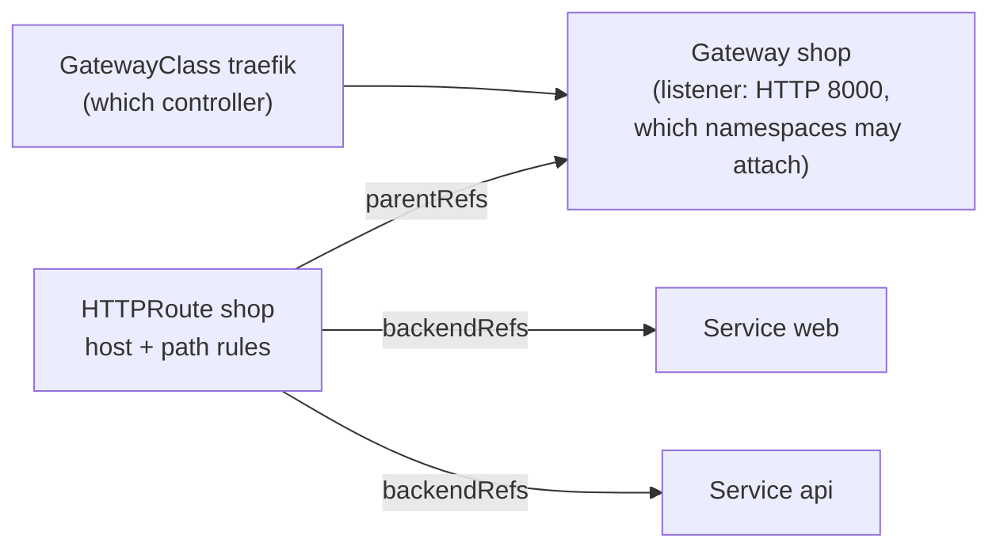

# Lab CKA-12 — Gateway API

The CKA objective "use the Gateway API to manage Ingress traffic" covers three resources and the way they refer to each other. This lab is a short path through them: one controller, one Gateway, two routes, and the status conditions that tell you why a route is not working. The [[Kubernetes/concepts/L04-services-networking/gateway-api-lab/RUNBOOK|Gateway API runbook]] in the concepts section goes much further with Envoy Gateway; that material has not been run in this wiki's test environment.

Concepts: [[Kubernetes/concepts/L04-services-networking/09-gateway-api|Gateway API]] and [[Kubernetes/concepts/L04-services-networking/04-ingress|Ingress]].

Tested 2026-10-13 on kind v0.33.0 with Kubernetes v1.37.0, Gateway API v1.6.3 and Traefik chart 41.7.1.



| Resource       | Scope      | Usually owned by                | Ingress equivalent        |
| :------------- | :--------- | :------------------------------ | :------------------------ |
| `GatewayClass` | Cluster    | Whoever installs the controller | `IngressClass`            |
| `Gateway`      | Namespaced | Platform team                   | The controller's listener |
| `HTTPRoute`    | Namespaced | Application team                | The rules of an `Ingress` |

Splitting what Ingress keeps in one object is the point of the design: an application team can change its routes without being able to change the listener.

---

## 1. Prerequisites & Starting State

- Working `k8s-lab` cluster from **[[Kubernetes/labs/ckad/01-cluster-setup|Lab CKAD-01]]**, Helm, and NodePort `30080` free (`kubectl get service -A | grep 30080` prints nothing). No other lab is required.

### Install the CRDs and a controller

Gateway API is not built into Kubernetes. Its kinds are CRDs in the group `gateway.networking.k8s.io`, and they do nothing until a controller implements them. In the exam both are already installed.

```bash
kubectl apply --server-side -f https://github.com/kubernetes-sigs/gateway-api/releases/download/v1.6.3/standard-install.yaml

helm repo add traefik https://traefik.github.io/charts
helm repo update traefik
helm install traefik traefik/traefik --version 41.7.1 -n traefik --create-namespace \
  --set service.type=NodePort \
  --set ports.web.nodePort=30080 \
  --set ports.websecure.nodePort=30443 \
  --set providers.kubernetesGateway.enabled=true \
  --set gateway.enabled=false
kubectl -n traefik rollout status deployment/traefik --timeout=180s

kubectl api-resources --api-group=gateway.networking.k8s.io
kubectl get gatewayclass
```

```
NAME             SHORTNAMES   APIVERSION                     NAMESPACED   KIND
gatewayclasses   gc           gateway.networking.k8s.io/v1   false        GatewayClass
gateways         gtw          gateway.networking.k8s.io/v1   true         Gateway
httproutes                    gateway.networking.k8s.io/v1   true         HTTPRoute
referencegrants  refgrant     gateway.networking.k8s.io/v1   true         ReferenceGrant
...

NAME      CONTROLLER                      ACCEPTED   AGE
traefik   traefik.io/gateway-controller   True       22s
```

`ACCEPTED True` means a running controller has claimed the class. Start every Gateway task with `kubectl get gatewayclass`: the name is what goes in `gatewayClassName`.

### Two backends

```bash
kubectl create namespace gw-lab
for A in web api; do
  kubectl -n gw-lab create deployment $A --image=ghcr.io/stefanprodan/podinfo:6.7.1 --port=9898
  kubectl -n gw-lab set env deployment/$A PODINFO_UI_MESSAGE="$A backend"
  kubectl -n gw-lab expose deployment $A --port=80 --target-port=9898
done
kubectl -n gw-lab rollout status deployment/web --timeout=90s
kubectl -n gw-lab rollout status deployment/api --timeout=90s
```

---

## 2. A Gateway and a Route

```bash
cat << 'EOF' > gw.yaml
apiVersion: gateway.networking.k8s.io/v1
kind: Gateway
metadata:
  name: shop
  namespace: gw-lab
spec:
  gatewayClassName: traefik
  listeners:
    - name: http
      protocol: HTTP
      port: 8000
      allowedRoutes:
        namespaces:
          from: Same
---
apiVersion: gateway.networking.k8s.io/v1
kind: HTTPRoute
metadata:
  name: shop
  namespace: gw-lab
spec:
  parentRefs:
    - name: shop
  hostnames:
    - shop.example.com
  rules:
    - matches:
        - path:
            type: PathPrefix
            value: /api
      backendRefs:
        - name: api
          port: 80
    - matches:
        - path:
            type: PathPrefix
            value: /
      backendRefs:
        - name: web
          port: 80
EOF

kubectl apply -f gw.yaml
kubectl -n gw-lab get gateway,httproute
```

```
NAME                                     CLASS     ADDRESS   PROGRAMMED   AGE
gateway.gateway.networking.k8s.io/shop   traefik             True         7s

NAME                                       HOSTNAMES              AGE
httproute.gateway.networking.k8s.io/shop   ["shop.example.com"]   6s
```

> [!note] Why port 8000
> With Traefik, a listener's `port` must be the port of one of Traefik's own entry points, and its `web` entry point listens on `8000` inside the Pod. The Service in front maps NodePort `30080` to it. Other controllers create a Service per Gateway and let you write `80`. In an exam task, use the port the task gives.

There is no `kubectl create` generator for these kinds. Copy an example from the Gateway API documentation, which the CKA lets you open, and edit it.

### Read the status, not only the existence

```bash
kubectl -n gw-lab get gateway shop \
  -o jsonpath='{range .status.conditions[*]}{.type}={.status} {.reason}{"\n"}{end}{range .status.listeners[*]}{.name} attachedRoutes={.attachedRoutes}{"\n"}{end}'

kubectl -n gw-lab get httproute shop \
  -o jsonpath='{range .status.parents[*].conditions[*]}{.type}={.status} {.reason}{"\n"}{end}'
```

```
Accepted=True Accepted
Programmed=True Programmed
http attachedRoutes=1

Accepted=True Accepted
ResolvedRefs=True ResolvedRefs
```

These four lines are the health check, and each failure in section 4 changes exactly one of them:

| Condition        | On        | True means                                        |
| :--------------- | :-------- | :------------------------------------------------ |
| `Accepted`       | Gateway   | The controller took the Gateway                   |
| `Programmed`     | Gateway   | The listener is configured in the data plane      |
| `attachedRoutes` | Listener  | How many routes bound to it                       |
| `Accepted`       | HTTPRoute | The Gateway allowed this route to attach          |
| `ResolvedRefs`   | HTTPRoute | Every `backendRefs` target exists and may be used |

### Test

```bash
curl -s -H 'Host: shop.example.com' http://127.0.0.1:30080/ | grep message
curl -s -H 'Host: shop.example.com' http://127.0.0.1:30080/api/info | grep message
curl -s -o /dev/null -w '%{http_code}\n' -H 'Host: other.example.com' http://127.0.0.1:30080/
```

```
  "message": "web backend",
  "message": "api backend",
404
```

The more specific match (`/api`) wins over `/` whatever the order in the file. A host with no route gets `404`.

---

## 3. Traffic Splitting by Weight

Something Ingress cannot express: send a share of one route's traffic to a second backend.

```bash
kubectl -n gw-lab patch httproute shop --type json -p '[
  {"op": "replace", "path": "/spec/rules/1/backendRefs",
   "value": [{"name": "web", "port": 80, "weight": 80}, {"name": "api", "port": 80, "weight": 20}]}]'

for i in $(seq 1 50); do
  curl -s -H 'Host: shop.example.com' http://127.0.0.1:30080/ | grep -o '"message": "[a-z ]*"'
done | sort | uniq -c
```

```
     10 "message": "api backend"
     40 "message": "web backend"
```

An 80/20 split with one Pod behind each Service. Compare [[Kubernetes/labs/ckad/12-blue-green-and-canary|Lab CKAD-12]], where the same split needed Pod counts in that ratio. Put the route back:

```bash
kubectl -n gw-lab patch httproute shop --type json \
  -p '[{"op":"replace","path":"/spec/rules/1/backendRefs","value":[{"name":"web","port":80}]}]'
```

---

## 4. Controlled Failure Scenarios: Four Routes That Do Not Work

Define a helper for the route's status:

```bash
rs() { kubectl -n "$1" get httproute "$2" -o jsonpath='{range .status.parents[*].conditions[*]}{.type}={.status} {.reason}: {.message}{"\n"}{end}'; }
```

### 4a. A backend that does not exist

```bash
kubectl -n gw-lab patch httproute shop --type json \
  -p '[{"op":"replace","path":"/spec/rules/1/backendRefs","value":[{"name":"wbe","port":80}]}]'
rs gw-lab shop
curl -s -o /dev/null -w '%{http_code}\n' -H 'Host: shop.example.com' http://127.0.0.1:30080/
```

```
Accepted=True Accepted:
ResolvedRefs=False BackendNotFound: Cannot load HTTPBackendRef gw-lab/wbe: getting service: service "wbe" not found
500
```

The route attached, so `Accepted` is true, but `ResolvedRefs` is false with the reason and the name. The client gets a `500`, not a `404`: the route matched and had nowhere to send the request. Fix the name:

```bash
kubectl -n gw-lab patch httproute shop --type json \
  -p '[{"op":"replace","path":"/spec/rules/1/backendRefs","value":[{"name":"web","port":80}]}]'
```

### 4b. A route in a namespace the Gateway does not allow

Another team tries to attach its own route to the shared Gateway:

```bash
kubectl create namespace team-b
kubectl -n team-b create deployment docs --image=ghcr.io/stefanprodan/podinfo:6.7.1 --port=9898
kubectl -n team-b expose deployment docs --port=80 --target-port=9898

cat << 'EOF' | kubectl apply -f -
apiVersion: gateway.networking.k8s.io/v1
kind: HTTPRoute
metadata:
  name: docs
  namespace: team-b
spec:
  parentRefs:
    - name: shop
      namespace: gw-lab
  hostnames:
    - docs.example.com
  rules:
    - backendRefs:
        - name: docs
          port: 80
EOF

rs team-b docs
curl -s -o /dev/null -w '%{http_code}\n' -H 'Host: docs.example.com' http://127.0.0.1:30080/
```

```
Accepted=False NotAllowedByListeners:
ResolvedRefs=True ResolvedRefs:
404
```

The opposite pattern: the backend is fine and the route was **refused by the Gateway**. The listener says `allowedRoutes.namespaces.from: Same`. The Gateway's owner decides who may attach, and can allow namespaces by label:

```bash
kubectl label namespace team-b gateway-access=shop
kubectl -n gw-lab patch gateway shop --type json -p '[
  {"op": "replace", "path": "/spec/listeners/0/allowedRoutes/namespaces",
   "value": {"from": "Selector", "selector": {"matchLabels": {"gateway-access": "shop"}}}}]'

rs team-b docs
curl -s -o /dev/null -w 'docs: %{http_code}\n' -H 'Host: docs.example.com' http://127.0.0.1:30080/
```

```
Accepted=True Accepted:
ResolvedRefs=True ResolvedRefs:
docs: 200
```

### 4c. The fix that broke the first route

```bash
rs gw-lab shop
curl -s -o /dev/null -w 'shop: %{http_code}\n' -H 'Host: shop.example.com' http://127.0.0.1:30080/
```

```
Accepted=False NotAllowedByListeners:
ResolvedRefs=True ResolvedRefs:
shop: 404
```

The original route is now refused. `from: Selector` admits **only** namespaces that match the selector, and the Gateway's own namespace does not carry the label. A change that fixes one route can detach another, so re-check every route on a Gateway after changing its listener.

```bash
kubectl label namespace gw-lab gateway-access=shop
rs gw-lab shop      # Accepted=True
```

The three values of `from` are `Same` (the default), `All` and `Selector`.

### 4d. A listener port the controller cannot serve

```bash
cat << 'EOF' | kubectl apply -f -
apiVersion: gateway.networking.k8s.io/v1
kind: Gateway
metadata:
  name: wrongport
  namespace: gw-lab
spec:
  gatewayClassName: traefik
  listeners:
    - name: http
      protocol: HTTP
      port: 80
EOF

kubectl -n gw-lab get gateway
kubectl -n gw-lab get gateway wrongport \
  -o jsonpath='{range .status.listeners[*].conditions[*]}{.type}={.status} {.reason}: {.message}{"\n"}{end}'
```

```
NAME        CLASS     ADDRESS   PROGRAMMED   AGE
shop        traefik             True         47s
wrongport   traefik             False        4s

Accepted=False PortUnavailable: Cannot find entryPoint for Gateway: no matching entryPoint for port 80 and protocol "HTTP"
```

`PROGRAMMED False` on the Gateway, and the listener's own conditions say why. This one is specific to how Traefik maps listeners to entry points; the method is general: when a Gateway is not programmed, read `.status.listeners[].conditions`.

A fifth case to know about: a `gatewayClassName` that no controller owns. Nothing reports an error, and the Gateway simply has no status, or keeps a stale one from before the change. Compare the name with `kubectl get gatewayclass`.

### Crossing namespaces to a backend

A route may send traffic to a Service in **another** namespace only if that namespace permits it with a `ReferenceGrant`. Without one, the route shows `ResolvedRefs=False` with reason `RefNotPermitted`. The grant lives in the namespace of the Service being referred to:

```yaml
apiVersion: gateway.networking.k8s.io/v1
kind: ReferenceGrant
metadata:
  name: allow-gw-lab-routes
  namespace: team-b
spec:
  from:
    - group: gateway.networking.k8s.io
      kind: HTTPRoute
      namespace: gw-lab
  to:
    - group: ""
      kind: Service
```

---

## 5. Cleanup

```bash
kubectl delete namespace gw-lab team-b
helm uninstall traefik -n traefik && kubectl delete namespace traefik
kubectl delete -f https://github.com/kubernetes-sigs/gateway-api/releases/download/v1.6.3/standard-install.yaml
rm -f gw.yaml
```

---

## Practice Without the Answer

Suggested time: 12 minutes. Install the CRDs and the controller again (section 1), then in namespace `edge`:

1. Create Services `blog` and `shop`, each in front of a `podinfo` Deployment with a different `PODINFO_UI_MESSAGE`.
2. Create a Gateway `public` using the installed class, listening for HTTP on port 8000, that accepts routes from its own namespace only.
3. Route `www.example.test/blog` (and anything below it) to `blog`, and everything else on that host to `shop`.
4. Send 10% of the `shop` traffic to `blog`.

Check yourself:

```bash
kubectl -n edge get gateway public -o jsonpath='{.status.listeners[0].attachedRoutes}{"\n"}'     # 1 or more
kubectl -n edge get httproute -o jsonpath='{range .items[*].status.parents[*].conditions[*]}{.type}={.status} {end}{"\n"}'   # all True
curl -s -H 'Host: www.example.test' http://127.0.0.1:30080/blog/ | grep message    # blog's message
for i in $(seq 1 40); do curl -s -H 'Host: www.example.test' http://127.0.0.1:30080/ | grep -o '"message": "[^"]*"'; done | sort | uniq -c   # roughly 36 to 4
```

---

## Further reading

- [Gateway API](https://gateway-api.sigs.k8s.io/) and its [HTTP routing guide](https://gateway-api.sigs.k8s.io/guides/http-routing/)
- [Kubernetes: Gateway API](https://kubernetes.io/docs/concepts/services-networking/gateway/)
- [Cross-namespace routing and ReferenceGrant](https://gateway-api.sigs.k8s.io/api-types/referencegrant/)

## Next Lab

This is the last CKA lab. Return to the [[Kubernetes/certifications/cka|CKA Track]], or test yourself with the [[Kubernetes/certifications/cka-mock-exam|CKA practice set]].
