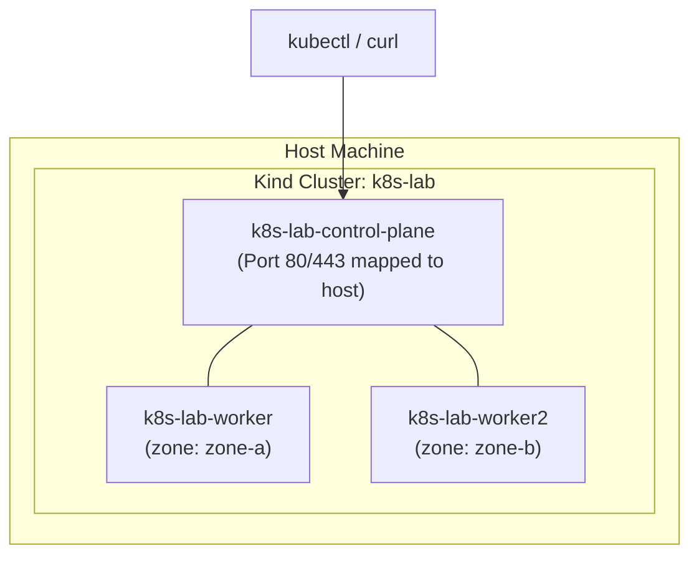

# Lab CKAD-01 — Cluster Setup & Orientation

The goal of this lab is to establish our local laboratory environment: a multi-node Kubernetes cluster running inside Docker via `kind` (Kubernetes in Docker). You will verify the separation between the **control plane** and **worker nodes**, inspect system namespaces, and practice failure diagnosis on node health.

Every other lab in the [[Kubernetes/labs/ckad/index|CKAD]], [[Kubernetes/labs/cka/index|CKA]] and [[Kubernetes/labs/cks/index|CKS]] folders starts from the cluster built here, unless it says it creates its own.

Concepts: [[Kubernetes/concepts/L01-architecture/00-README|L01 Architecture]], [[Kubernetes/concepts/L01-architecture/01-setting-up-cluster|Setting up a Cluster]] and [[Kubernetes/guides/tools/kubectl|kubectl]].

Tested 2026-10-13 on kind v0.33.0 with Kubernetes v1.37.0.



---

## 1. Prerequisites & Starting State

### Reference environment

The labs are written and tested on one environment. Other hosts usually work, with the differences noted below, but only this one is verified.

| Item           | Reference profile                                                                                                             |
| :------------- | :---------------------------------------------------------------------------------------------------------------------------- |
| Host           | Linux x86-64 with Docker Engine 24 or newer (tested on Docker 29)                                                             |
| Free resources | 4 CPUs, 8 GB RAM and 20 GB disk for the three-node cluster; the CKS labs with Cilium or Falco are more comfortable with 12 GB |
| kind           | **v0.33.0**                                                                                                                   |
| Node image     | `kindest/node:v1.37.0` (digest below)                                                                                         |
| kubectl        | v1.36, v1.37 or v1.38                                                                                                         |
| Other tools    | `curl`, `jq`, `openssl`; `helm` (3 or 4) from Lab CKAD-09 onwards                                                             |

- **kind must be v0.33 or newer for Kubernetes 1.37.** kind v0.31 and older generate a kubeadm configuration that v1.37 rejects, and cluster creation fails at "Starting control-plane".
- **kubectl is supported within one minor version of the API server**, so v1.35 or older is outside the supported range for a v1.37 cluster.
- **macOS and Windows (Docker Desktop):** give Docker at least 8 GB of memory. Node IPs are not reachable from the host there, so use the `localhost` ports or `kubectl port-forward` as each lab describes. Labs that load kernel modules or inspect the host (several CKS labs) say so in their prerequisites and need Linux.
- **arm64** works for the cluster and for `podinfo`. A few CKS tools publish x86-64 binaries only; those labs name the download.
- **Ports 80, 443, 30080 and 30443** must be free on your machine. With rootless Docker, ports below 1024 need extra configuration; remove the `80` and `443` mappings if you cannot bind them.

### Preflight

Run this before creating the cluster. Fix anything that does not match before you start a lesson:

```bash
docker info --format 'docker {{.ServerVersion}}, {{.NCPU}} CPUs, {{.MemTotal}} bytes RAM'
kind version
kubectl version --client
for p in 80 443 30080 30443; do
  (ss -ltn 2>/dev/null || netstat -an) | grep -qE "[:.]$p\s" && echo "port $p is in use" || echo "port $p free"
done
```

```
docker 29.7.2, 6 CPUs, 16527872000 bytes RAM
kind v0.33.0 go1.26.7 linux/amd64
Client Version: v1.36.0
Kustomize Version: v5.8.1
port 80 free
port 443 free
port 30080 free
port 30443 free
```

---

## 2. Cluster Configuration

Save the following as `kind-config.yaml`. The same file is in the repository as [`labs/kind-config.yaml`](../kind-config.yaml).

```yaml
kind: Cluster
apiVersion: kind.x-k8s.io/v1alpha4
name: k8s-lab
nodes:
  - role: control-plane
    labels:
      ingress-ready: "true"
    extraPortMappings:
      - containerPort: 80
        hostPort: 80
        protocol: TCP
      - containerPort: 443
        hostPort: 443
        protocol: TCP
      - containerPort: 30080
        hostPort: 30080
        protocol: TCP
      - containerPort: 30443
        hostPort: 30443
        protocol: TCP
  - role: worker
    labels:
      topology.kubernetes.io/zone: "zone-a"
  - role: worker
    labels:
      topology.kubernetes.io/zone: "zone-b"
```

### Why this configuration matters:

1. **Multi-node topology:** With 1 control-plane and 2 worker nodes, you can test realistic pod scheduling, anti-affinity, and node drain scenarios.
2. **Zone labels:** Simulates a multi-zone cloud environment (`zone-a` and `zone-b`) to explore `topologySpreadConstraints`.
3. **Host port mappings:** Docker publishes ports 80, 443, 30080 and 30443 of the control-plane node on your machine. A Service with NodePort 30080 or 30443 is then reachable on `localhost`; without a mapping, a kind node's ports are not reachable from outside Docker on macOS and Windows.

---

## 3. Step-by-Step Execution

### Step 1: Bootstrap the cluster

The node image decides the Kubernetes version, so name it explicitly and by digest. Without `--image`, kind uses whatever version its own release defaults to.

```bash
kind create cluster --config kind-config.yaml \
  --image kindest/node:v1.37.0@sha256:a1ed56cfb0e7b93589bdf97c8cd566405a265939e3620fc4f5de89adff580ae5
```

**Expected output:**

```
Creating cluster "k8s-lab" ...
 • Ensuring node image (kindest/node:v1.37.0) 🖼
 • Preparing nodes 📦 📦 📦
 • Writing configuration 📜
 • Starting control-plane 🕹️
 • Installing CNI 🔌
 • Installing StorageClass 💾
 • Joining worker nodes 🚜
Set kubectl context to "kind-k8s-lab"
```

> [!note] Practising for the version an exam runs
> The exams do not all run the same release (see the [[Kubernetes/certifications/index|certification hub]] for the current versions). To rehearse on v1.35, create the cluster with `--image kindest/node:v1.35.8@sha256:07b2536e30b803ed61d1677a79df6115f798ce64c80f9e22f6ed45afd09323c0` and use kubectl v1.34 to v1.36. The digests are the ones published with kind v0.33.0. Output in the labs was captured on v1.37 and differs in small ways on older releases.

### Step 2: Verify current context and API connectivity

```bash
kubectl cluster-info
kubectl config current-context
```

**Expected output:**

```
Kubernetes control plane is running at https://127.0.0.1:<PORT>
CoreDNS is running at https://127.0.0.1:<PORT>/api/v1/namespaces/kube-system/services/kube-dns:dns/proxy
kind-k8s-lab
```

### Step 3: Inspect node topology and labels

```bash
kubectl wait --for=condition=Ready nodes --all --timeout=120s
kubectl get nodes -L topology.kubernetes.io/zone,ingress-ready
```

**Expected output:**

```
NAME                    STATUS   ROLES           AGE   VERSION   ZONE     INGRESS-READY
k8s-lab-control-plane   Ready    control-plane   2m    v1.37.0            true
k8s-lab-worker          Ready    <none>          90s   v1.37.0   zone-a
k8s-lab-worker2         Ready    <none>          90s   v1.37.0   zone-b
```

### Step 4: Inspect core control plane and system pods

```bash
kubectl get pods -n kube-system -o wide
```

Notice the static pods running the control plane (`etcd`, `kube-apiserver`, `kube-controller-manager`, `kube-scheduler`), along with the cluster daemonset (`kube-proxy`) and DNS pods (`coredns`).

---

## 4. Controlled Failure Scenario: Node Failure & Kubelet Disconnect

What happens to a cluster when a worker node stops communicating with the control plane?

### Trigger the failure:

Simulate a catastrophic hardware loss by stopping the worker container:

```bash
docker stop k8s-lab-worker
```

### Observe the symptom:

Watch the node status:

```bash
kubectl get nodes
```

The node stays `Ready` at first, because the node controller waits about 50 seconds without a heartbeat before changing its mind. Wait for the change instead of guessing the delay:

```bash
kubectl wait --for=condition=Ready=Unknown node/k8s-lab-worker --timeout=120s
kubectl get nodes
kubectl describe node k8s-lab-worker | grep -A 6 "Conditions:"
```

```
NAME                    STATUS     ROLES           AGE   VERSION
k8s-lab-control-plane   Ready      control-plane   22m   v1.37.0
k8s-lab-worker          NotReady   <none>          22m   v1.37.0
k8s-lab-worker2         Ready      <none>          22m   v1.37.0

Conditions:
  Type             Status    ...   Reason              Message
  ----             ------          ------              -------
  MemoryPressure   Unknown   ...   NodeStatusUnknown   Kubelet stopped posting node status.
  DiskPressure     Unknown   ...   NodeStatusUnknown   Kubelet stopped posting node status.
  PIDPressure      Unknown   ...   NodeStatusUnknown   Kubelet stopped posting node status.
  Ready            Unknown   ...   NodeStatusUnknown   Kubelet stopped posting node status.
```

`kubectl get nodes` prints `NotReady`, while the condition itself is `Unknown`: the control plane has not been told the node is unhealthy, it has simply stopped hearing from it. A kubelet that is running but unhealthy reports `Ready=False` with a specific reason instead.

The node controller also taints the node `node.kubernetes.io/unreachable`. Pods on it are evicted after their toleration for that taint expires, 300 seconds by default.

### Recovery:

Restart the worker container:

```bash
docker start k8s-lab-worker
kubectl wait --for=condition=Ready node/k8s-lab-worker --timeout=120s
```

Verify that all three nodes return to `Ready`.

---

## 5. Teardown & Verification

Keep this cluster running for the following labs.

**Exit state:** context `kind-k8s-lab`, three `Ready` nodes on v1.37.0, nothing deployed in `default`.

**Reset.** Every lab states the state it expects and leaves. If a lab goes wrong and you cannot get back to its starting state, deleting and recreating the cluster takes about a minute and is always a valid reset:

```bash
kind delete cluster --name k8s-lab
kind create cluster --config kind-config.yaml \
  --image kindest/node:v1.37.0@sha256:a1ed56cfb0e7b93589bdf97c8cd566405a265939e3620fc4f5de89adff580ae5
```

Labs that create their own cluster switch your kubectl context. Return to this one with `kubectl config use-context kind-k8s-lab`.

---

## Further reading

- [kind quick start](https://kind.sigs.k8s.io/docs/user/quick-start/)
- [Kubernetes components](https://kubernetes.io/docs/concepts/overview/components/)

## Next Lab

Now that your cluster is operational, proceed to **[[Kubernetes/labs/ckad/02-deploy-workload|Lab CKAD-02 — Deploying the Application]]** to deploy the application the CKAD labs share, `podinfo`, or return to the [[Kubernetes/certifications/ckad|CKAD Track]].
