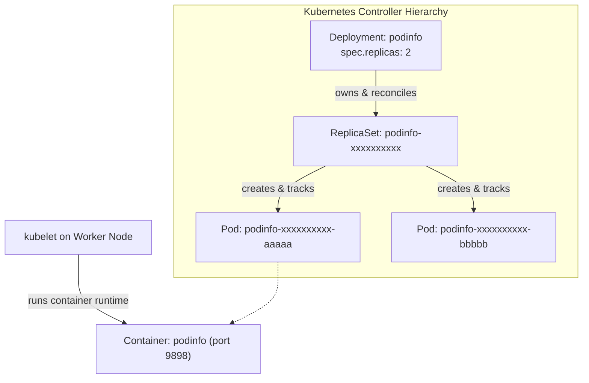

# Lab CKAD-02 — Deploying the Application

In this lab, you deploy the canonical application used throughout this curriculum: **`podinfo`** (`ghcr.io/stefanprodan/podinfo:6.7.1`). You will trace the controller hierarchy from Deployment to ReplicaSet to Pod, and watch a ReplicaSet ignore, adopt and release Pods as their labels change.

Concepts: [[Kubernetes/concepts/L03-workloads/03-deployments|Deployments]], [[Kubernetes/concepts/L03-workloads/02-replicaset|ReplicaSet]] and [[Kubernetes/concepts/L03-workloads/01-pods|Pods]].

Tested 2026-10-13 on kind v0.33.0 with Kubernetes v1.37.0.



---

## 1. Prerequisites & Starting State

- Working `k8s-lab` cluster from **[[Kubernetes/labs/ckad/01-cluster-setup|Lab CKAD-01]]**.
- Current context verified: `kubectl config current-context` (`kind-k8s-lab`).

---

## 2. The Application Manifest

Save the following YAML as `podinfo-deployment.yaml`:

```yaml
apiVersion: apps/v1
kind: Deployment
metadata:
  name: podinfo
  namespace: default
  labels:
    app.kubernetes.io/name: podinfo
    app.kubernetes.io/part-of: k8s-curriculum
spec:
  replicas: 2
  revisionHistoryLimit: 5
  selector:
    matchLabels:
      app.kubernetes.io/name: podinfo
  template:
    metadata:
      labels:
        app.kubernetes.io/name: podinfo
    spec:
      containers:
        - name: podinfo
          image: ghcr.io/stefanprodan/podinfo:6.7.1
          imagePullPolicy: IfNotPresent
          ports:
            - name: http
              containerPort: 9898
              protocol: TCP
            - name: grpc
              containerPort: 9999
              protocol: TCP
          command:
            - ./podinfo
            - --port=9898
            - --level=info
          livenessProbe:
            httpGet:
              path: /healthz
              port: http
            initialDelaySeconds: 2
            periodSeconds: 10
          readinessProbe:
            httpGet:
              path: /readyz
              port: http
            initialDelaySeconds: 2
            periodSeconds: 5
          resources:
            requests:
              cpu: 50m
              memory: 32Mi
            limits:
              cpu: 250m
              memory: 128Mi
```

---

## 3. Step-by-Step Execution

### Step 1: Apply the manifest

```bash
kubectl apply -f podinfo-deployment.yaml
```

**Expected output:**

```
deployment.apps/podinfo created
```

### Step 2: Track the rollout until complete

```bash
kubectl rollout status deployment/podinfo
```

**Expected output:**

```
Waiting for deployment "podinfo" rollout to finish: 0 of 2 updated replicas are available...
Waiting for deployment "podinfo" rollout to finish: 1 of 2 updated replicas are available...
deployment "podinfo" successfully rolled out
```

### Step 3: Inspect the controller ownership chain

Verify the Deployment, the generated ReplicaSet, and the Pods:

```bash
kubectl get deployment,rs,pods -l app.kubernetes.io/name=podinfo -o wide
```

Notice the naming pattern:

1. `deployment.apps/podinfo`
2. `replicaset.apps/podinfo-<pod-template-hash>`
3. `pod/podinfo-<pod-template-hash>-<random-5-chars>`

Now inspect the `ownerReferences` on one of the created Pods:

```bash
POD_NAME=$(kubectl get pods -l app.kubernetes.io/name=podinfo -o jsonpath='{.items[0].metadata.name}')
kubectl get pod "$POD_NAME" -o jsonpath='{.metadata.ownerReferences}' | jq .
```

**Observed JSON:**

```json
[
  {
    "apiVersion": "apps/v1",
    "blockOwnerDeletion": true,
    "controller": true,
    "kind": "ReplicaSet",
    "name": "podinfo-76575fc4c",
    "uid": "..."
  }
]
```

The Pod is owned by the ReplicaSet, not directly by the Deployment. The Deployment manages the ReplicaSet, and the ReplicaSet manages the individual Pods.

### Step 4: Stream logs and verify HTTP response

Stream logs from all Pods matching the selector:

```bash
kubectl logs -l app.kubernetes.io/name=podinfo --tail=10
```

Forward local port 9898 to the Deployment:

```bash
kubectl port-forward deployment/podinfo 9898:9898 >/dev/null &
PORT_FORWARD_PID=$!

curl -s --retry 5 --retry-connrefused http://127.0.0.1:9898/api/info | jq .
```

**Expected output:**

```json
{
  "hostname": "podinfo-...",
  "version": "6.7.1",
  "revision": "...",
  "color": "#34577c",
  "message": "greetings from podinfo",
  "goos": "linux",
  "goarch": "amd64"
}
```

Stop the port-forward process:

```bash
kill $PORT_FORWARD_PID
```

---

## 4. Controlled Scenario: What a ReplicaSet Counts as Its Own

A ReplicaSet owns the Pods that match **its whole selector**. The next three steps show a Pod being ignored, adopted and released, using nothing but labels.

### Step 1: Read the real selector

The Deployment's selector has one label. The ReplicaSet it generates has two:

```bash
RS_NAME=$(kubectl get rs -l app.kubernetes.io/name=podinfo -o jsonpath='{.items[0].metadata.name}')
kubectl get rs "$RS_NAME" -o jsonpath='{.spec.selector.matchLabels}{"\n"}'
```

```
{"app.kubernetes.io/name":"podinfo","pod-template-hash":"78f976d784"}
```

The Deployment controller adds `pod-template-hash` to every ReplicaSet it creates, so that the ReplicaSets of two revisions never claim each other's Pods. Your hash will differ.

### Step 2: A Pod with only one of the labels is ignored

```bash
kubectl run rogue-pod --image=busybox:1.36 \
  --labels="app.kubernetes.io/name=podinfo" -- sleep 3600

kubectl get pods -l app.kubernetes.io/name=podinfo \
  -o custom-columns='NAME:.metadata.name,STATUS:.status.phase,OWNER:.metadata.ownerReferences[0].name'
```

```
NAME                       STATUS    OWNER
podinfo-78f976d784-2k5gn   Running   podinfo-78f976d784
podinfo-78f976d784-lvnff   Running   podinfo-78f976d784
rogue-pod                  Running   <none>
```

`rogue-pod` keeps running with no owner. It matches the Deployment's selector but not the ReplicaSet's, and the ReplicaSet is the controller that counts Pods.

> [!warning] A loose selector still catches it
> Anything else that selects on `app.kubernetes.io/name=podinfo` alone, such as a Service or `kubectl logs -l`, now includes this BusyBox Pod. That is why the cleanup in step 5 matters before the next lab.

### Step 3: Give it the second label and it is adopted, then deleted

```bash
HASH=$(kubectl get rs "$RS_NAME" -o jsonpath='{.metadata.labels.pod-template-hash}')
kubectl label pod rogue-pod pod-template-hash="$HASH"

kubectl get pod rogue-pod -o jsonpath='{.metadata.ownerReferences[0].name}{"\n"}'
kubectl describe rs "$RS_NAME" | grep -A 6 "Events:"
```

```
podinfo-78f976d784
Events:
  Type    Reason            Age   From                   Message
  ----    ------            ----  ----                   -------
  Normal  SuccessfulCreate  34s   replicaset-controller  Created pod: podinfo-78f976d784-lvnff
  Normal  SuccessfulCreate  34s   replicaset-controller  Created pod: podinfo-78f976d784-2k5gn
  Normal  SuccessfulDelete  6s    replicaset-controller  Deleted pod: rogue-pod
```

The Pod now matches the full selector and has no controller, so the ReplicaSet adopts it (the owner reference appears). That makes three Pods against `replicas: 2`, so the controller deletes one. Here it chose `rogue-pod`; which Pod goes is decided by the controller's ordering rules (not-ready and newer Pods first), so do not rely on it always being the newcomer. BusyBox ignores SIGTERM, so the Pod takes about 30 seconds to disappear.

### Step 4: Remove a label and a managed Pod is released

The reverse also holds. Take the label away from a Pod the ReplicaSet owns:

```bash
POD_NAME=$(kubectl get pods -l app.kubernetes.io/name=podinfo -o jsonpath='{.items[0].metadata.name}')
kubectl label pod "$POD_NAME" app.kubernetes.io/name-

kubectl get pods \
  -o custom-columns='NAME:.metadata.name,STATUS:.status.phase,OWNER:.metadata.ownerReferences[0].name'
```

```
NAME                       STATUS    OWNER
podinfo-78f976d784-2k5gn   Running   <none>
podinfo-78f976d784-6t8xc   Running   podinfo-78f976d784
podinfo-78f976d784-lvnff   Running   podinfo-78f976d784
```

The relabelled Pod loses its owner and keeps running, and the ReplicaSet creates a replacement to get back to two. This is how you take a misbehaving Pod out of service to inspect it without the controller killing it.

### Step 5: Clean up and assert the exit state

```bash
kubectl delete pod "$POD_NAME" --wait=false
kubectl delete pod rogue-pod --ignore-not-found --wait=false

kubectl get pods -l app.kubernetes.io/name=podinfo \
  -o custom-columns='NAME:.metadata.name,OWNER:.metadata.ownerReferences[0].name'
kubectl get deployment podinfo -o jsonpath='{.status.readyReplicas}{"\n"}'
```

You are done when every listed Pod has the ReplicaSet as its owner and the last command prints `2`.

---

## 5. Exit State

Keep the `podinfo` Deployment running. The next four labs build on it and expect:

- Deployment `default/podinfo` with two ready replicas of `ghcr.io/stefanprodan/podinfo:6.7.1`;
- no other Pod carrying the label `app.kubernetes.io/name=podinfo`.

---

## Further reading

- [Deployments](https://kubernetes.io/docs/concepts/workloads/controllers/deployment/) and its [pod-template-hash label](https://kubernetes.io/docs/concepts/workloads/controllers/deployment/#pod-template-hash-label)
- [Labels and selectors](https://kubernetes.io/docs/concepts/overview/working-with-objects/labels/)

## Next Lab

Proceed to **[[Kubernetes/labs/ckad/03-updates-and-rollbacks|Lab CKAD-03 — Updates & Rollbacks]]** to perform rolling updates and rollbacks, or return to the [[Kubernetes/certifications/ckad|CKAD Track]].
