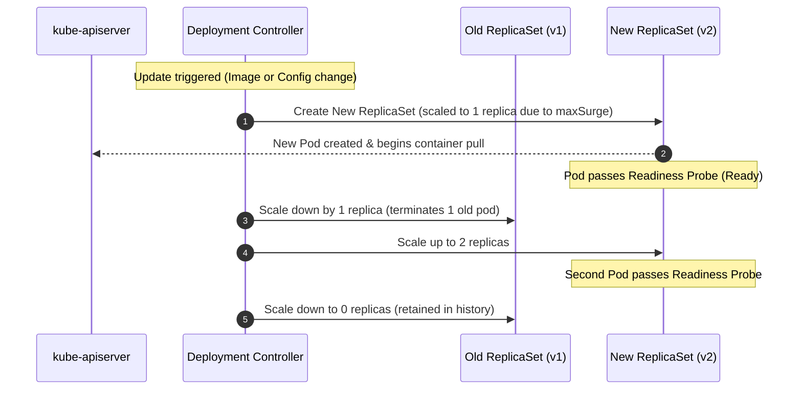

# Lab CKAD-03 — Updates & Rollbacks

In this lab, you manage the live update lifecycle of `podinfo`. You will configure the `RollingUpdate` strategy parameters (`maxSurge` and `maxUnavailable`), observe how Kubernetes hands over between two ReplicaSets without removing a ready Pod first, diagnose a stuck rollout caused by `ImagePullBackOff`, and safely restore service using `kubectl rollout undo`.

Concepts: [[Kubernetes/concepts/L03-workloads/03-deployments|Deployments]], [[Kubernetes/guides/delivery/progressive-delivery/strategies|Progressive Delivery Strategies]] and [[Kubernetes/guides/troubleshooting/image-pull|ImagePullBackOff]].

Tested 2026-10-13 on kind v0.33.0 with Kubernetes v1.37.0.



---

## 1. Prerequisites & Starting State

- Working `k8s-lab` cluster.
- `podinfo` deployment running from **[[Kubernetes/labs/ckad/02-deploy-workload|Lab CKAD-02]]**.
- Check current state:
  ```bash
  kubectl get deployment podinfo
  ```

---

## 2. Configuring the RollingUpdate Strategy

To prevent downtime during updates, configure explicit surge parameters in `podinfo`:

- `maxSurge: 1`: Kubernetes may create 1 additional Pod above desired replicas during the rollout.
- `maxUnavailable: 0`: No existing healthy Pods may be terminated until a new Pod is fully `Ready`.

Patch the deployment strategy:

```bash
kubectl patch deployment podinfo -p '{"spec":{"strategy":{"type":"RollingUpdate","rollingUpdate":{"maxSurge":1,"maxUnavailable":0}}}}'
```

---

## 3. Step-by-Step Execution: Rolling Update

### Step 1: Trigger an application configuration update

Change the UI colour and greeting by adding two environment variables to the Pod template. Any change to the template starts a rollout:

```bash
kubectl set env deployment/podinfo \
  PODINFO_UI_COLOR="#16a085" \
  PODINFO_UI_MESSAGE="v2 rollout successful!"
```

### Step 2: Observe the dual-ReplicaSet handoff

In a separate terminal (or run immediately):

```bash
kubectl get rs -l app.kubernetes.io/name=podinfo
```

**Expected output:**

```
NAME                 DESIRED   CURRENT   READY   AGE
podinfo-5f87f786f9   1         1         0       0s
podinfo-78f976d784   2         2         2       2m3s
```

Watch the rollout complete:

```bash
kubectl rollout status deployment/podinfo --timeout=120s
```

Notice that the old ReplicaSet is **not deleted**; its replica count is reduced to `0`. Kubernetes preserves inactive ReplicaSets so you can instantly roll back if needed.

### Step 3: Check rollout history

```bash
kubectl rollout history deployment/podinfo
```

**Expected output:**

```
deployment.apps/podinfo
REVISION  CHANGE-CAUSE
1         <none>
2         <none>
```

---

## 4. Controlled Failure Scenario: Diagnosing a Stuck Rollout

What happens when an engineer deploys an image tag that does not exist in the container registry?

### Trigger the failure:

Set an invalid image tag:

```bash
kubectl set image deployment/podinfo podinfo=ghcr.io/stefanprodan/podinfo:v9.9.99-nonexistent
```

### Observe the symptom:

Check the rollout status:

```bash
kubectl rollout status deployment/podinfo --timeout=30s
```

```
Waiting for deployment "podinfo" rollout to finish: 1 out of 2 new replicas have been updated...
error: timed out waiting for the condition
```

Without `--timeout` this command waits until you press `Ctrl+C`. It exits non-zero on timeout, which is what a script should check.

Inspect the Pods in the cluster:

```bash
kubectl get pods -l app.kubernetes.io/name=podinfo
```

**Observed output:**

```
NAME                       READY   STATUS         RESTARTS   AGE
podinfo-5f87f786f9-8p2fm   1/1     Running        0          42s
podinfo-5f87f786f9-jczw5   1/1     Running        0          36s
podinfo-7fc48cd45-zdtjq    0/1     ErrImagePull   0          30s
```

The status alternates between `ErrImagePull` (a pull just failed) and `ImagePullBackOff` (the kubelet is waiting before the next attempt).

### Key Diagnostic Takeaway:

Notice that the two Pods of the previous revision are **still Running and Ready**.
Because we configured `maxUnavailable: 0`, the Deployment controller refused to terminate any old Pods until the new Pod became `Ready`. Because the new container cannot pull its image, the rollout cannot progress, and the old Pods keep serving. The rollout is stuck, not paused: `kubectl rollout pause` is a different, deliberate state.

### Root Cause Inspection:

Inspect the failed Pod's event log:

```bash
FAILED_POD=$(kubectl get pods -l app.kubernetes.io/name=podinfo --field-selector=status.phase=Pending -o jsonpath='{.items[0].metadata.name}')
kubectl describe pod "$FAILED_POD" | grep -A 8 "Events:"
```

**Events (Kubernetes 1.37; messages are shortened here):**

```
Events:
  Type     Reason     Age                From               Message
  ----     ------     ----               ----               -------
  Normal   Scheduled  30s                default-scheduler  Successfully assigned default/podinfo-7fc48cd45-zdtjq to k8s-lab-worker2
  Normal   Pulling    17s (x2 over 29s)  kubelet            spec.containers{podinfo}: Pulling image "ghcr.io/stefanprodan/podinfo:v9.9.99-nonexistent"
  Warning  Failed     16s (x2 over 29s)  kubelet            spec.containers{podinfo}: Failed to pull image "...": rpc error: code = NotFound ...
  Warning  Failed     16s (x2 over 29s)  kubelet            spec.containers{podinfo}: Error: ErrImagePull
  Normal   BackOff    2s (x2 over 28s)   kubelet            spec.containers{podinfo}: Back-off pulling image "..."
  Warning  Failed     2s (x2 over 28s)   kubelet            spec.containers{podinfo}: Error: ImagePullBackOff
```

`NotFound` means the registry answered and has no such tag. An authentication failure or an unreachable registry produces a different message in the same place, so read it rather than assuming.

---

## 5. Recovery: Executing a Rollback

To restore cluster health, cancel the failed update and roll back to the previous known-good revision:

```bash
kubectl rollout undo deployment/podinfo
```

```
Warning: resource deployments/podinfo was previously managed with 'kubectl apply'. Rolling back will not update the kubectl.kubernetes.io/last-applied-configuration annotation, which may cause unexpected behavior on future 'kubectl apply' operations. Consider using 'kubectl apply' with your previous configuration file instead.
deployment.apps/podinfo rolled back
```

The warning is worth reading: `rollout undo` changes the live object but not the record of what you last applied. [[Kubernetes/labs/ckad/04-configuration|Lab CKAD-04]] runs into exactly that.

Verify that the Deployment is healthy again:

```bash
kubectl rollout status deployment/podinfo --timeout=60s
kubectl rollout history deployment/podinfo
kubectl get pods -l app.kubernetes.io/name=podinfo
```

```
deployment.apps/podinfo
REVISION  CHANGE-CAUSE
1         <none>
3         <none>
4         <none>
```

Revision 2 has gone: undoing re-uses its ReplicaSet and renumbers it as the newest revision (4). To return to a specific revision instead of the previous one, use `kubectl rollout undo deployment/podinfo --to-revision=1`, and inspect one first with `kubectl rollout history deployment/podinfo --revision=1`.

---

## 6. Exit State

The next lab expects:

- Deployment `default/podinfo`, two ready replicas, image `ghcr.io/stefanprodan/podinfo:6.7.1`;
- the two environment variables from step 1 still set on the container (`PODINFO_UI_COLOR=#16a085`, `PODINFO_UI_MESSAGE=v2 rollout successful!`).

```bash
kubectl get deployment podinfo -o jsonpath='{.spec.template.spec.containers[0].image}{"\n"}{.spec.template.spec.containers[0].env[*].name}{"\n"}'
```

```
ghcr.io/stefanprodan/podinfo:6.7.1
PODINFO_UI_COLOR PODINFO_UI_MESSAGE
```

---

## Further reading

- [Rolling back a Deployment](https://kubernetes.io/docs/concepts/workloads/controllers/deployment/#rolling-back-a-deployment)
- [kubectl rollout](https://kubernetes.io/docs/reference/kubectl/generated/kubectl_rollout/)

## Next Lab

Proceed to **[[Kubernetes/labs/ckad/04-configuration|Lab CKAD-04 — Workload Configuration & Secrets]]** to decouple configuration and credentials from container images, or return to the [[Kubernetes/certifications/ckad|CKAD Track]].
